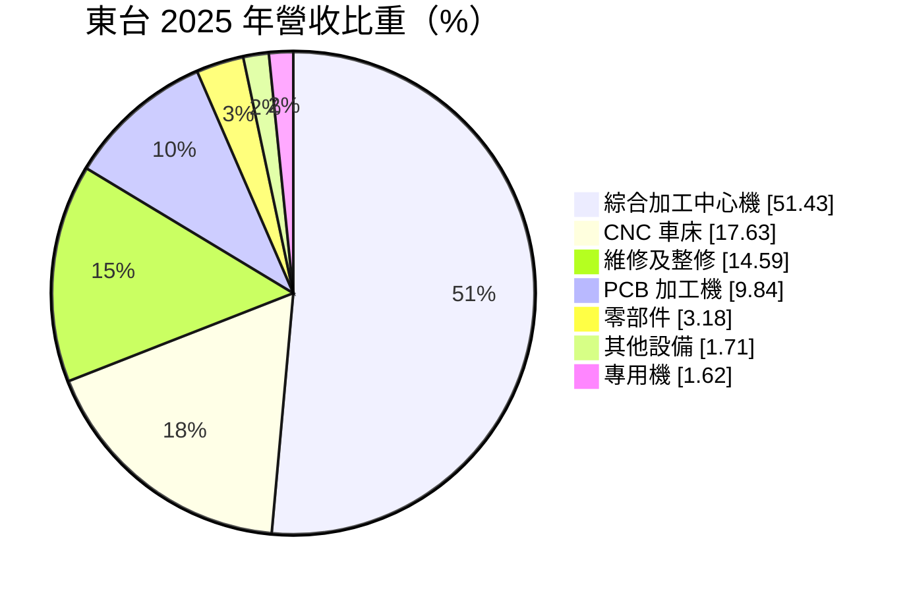
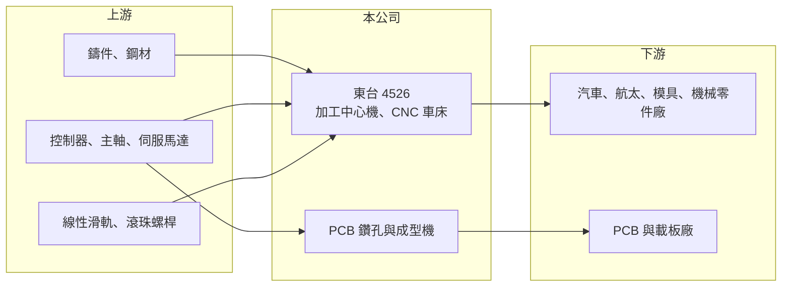

# 4526 東台

> 上市｜[[產業索引-電機機械|電機機械]]｜上市（櫃）日期 2003/09/15

# 第一章：企業模式與商業藍圖

> [!info] 撰寫說明
> 精簡版，由 Claude 依公開資料整理，架構比照 [[2330台積電]] 的四章研究，資料截至 2026-10-08。來源：證交所開放資料（基本資料、2026 年第二季資產負債與損益、營益分析、股利、每月營收）、MoneyDJ／富邦 e 點通 年度財務比率與基本資料（營收比重、歷年股利）、經濟日報與優分析新聞標題。集團轉投資與同業描述為整理性內容，標示待校對。#待校對

東台精機（以下簡稱東台）是台灣南部歷史最悠久的[[工具機]]廠之一，同時也是 PCB 鑽孔機的供應商，本章說明它的雙主軸業務與長期定位。

- **核心業務：** 東台成立於 1969 年，總部位於高雄路竹科學園區，2003 年於證交所上市。主力產品是[[加工中心機]]與 [[CNC]] 車床，2025 年兩者合計約占營收 69%，用於汽車、航太、模具與一般機械零件的金屬切削加工。另一條產品線是印刷電路板（PCB）鑽孔與成型機，2025 年占營收約 9.84%。
- **營收結構：** 設備銷售屬於一次性的資本財訂單，受客戶擴產意願影響很大。維修及整修收入占 14.59%，來自已售出機台的保養、零件與翻修，是相對穩定的收入來源。
- **營運據點：** 生產基地在高雄路竹，並透過子公司與經銷網路銷售到中國、東南亞、美國與歐洲。集團旗下另有其他工具機與自動化相關子公司（待校對），形成多品牌的工具機集團。
- **長期方向：** 長期方向是從單機銷售走向整線自動化與智慧製造方案，並提高 PCB 設備的比重。AI 伺服器帶動高層數 PCB 與載板需求，鑽孔設備的精度與速度要求持續提高，這條產品線的景氣與傳統工具機不同，可分散週期風險。

# 第二章：護城河深度與競爭優勢

台灣工具機產業以中小型廠為主、競爭激烈，本章說明東台的優勢與它面對的強大對手。

- **競爭優勢：** 東台擁有超過五十年的機械設計與製造經驗，產品線完整，從加工中心機、車床到專用機與 PCB 設備都能自製。龐大的機台裝機量也帶來維修、零件與翻新收入，並讓業務人員可以持續接觸既有客戶的汰換需求。
- **主要對手：** 在一般工具機領域，國內同業包括 [[1583程泰]]、[[4510高鋒]]、[[4513福裕]]、[[6609瀧澤科]]、[[1530亞崴]] 等，國際上則面對日本山崎馬扎克（Mazak）、大隈、德國 DMG 森精機等高階品牌，以及價格更低的中國廠商。PCB 鑽孔機的主要競爭者是日本與中國的專業設備商（待校對）。
- **觀察重點：** 由於台灣工具機與日本品牌在高階市場仍有差距、在中低階又面臨中國價格競爭，東台能否透過自動化整線、PCB 設備與售後服務提高附加價值，是長期能否走出虧損的關鍵。近年本業連續虧損，也代表過去的競爭優勢不足以抵禦產業逆風。

# 第三章：財務體質與盈利規模

資料日期：2026-10-08，表格是撰寫當時的快照；最新月營收、毛利率、累計 EPS 由自動排程寫在本筆記的屬性欄位（月營收、毛利率、累計EPS 等）。#待校對

工具機是典型的高營運槓桿產業，本章用多年度數據說明東台獲利的波動性與資本報酬。

| 年度 | 營收年增率 | [[毛利率]] | [[營業利益率]] | EPS（元） | [[ROE]] |
|---|---|---|---|---|---|
| 2021 | 23.75% | 19.51% | 1.75% | 0.68 | 2.81% |
| 2022 | -14.10% | 22.06% | 1.97% | 0.36 | 2.53% |
| 2023 | -7.84% | 20.40% | -2.05% | 0.20 | 2.26% |
| 2024 | -24.69% | 8.76% | -18.69% | -3.56 | -19.12% |
| 2025 | -6.62% | 15.78% | -13.27% | 1.81 | 9.64% |
| 2026 上半年 | 營收 26.26 億元 | 15.49% | -9.76% | -1.02 | 未查得 |

註：2021 至 2025 年取自 MoneyDJ 年度財務比率（合併），年度營收金額未查得；2026 上半年取自證交所營益分析與損益表。

- **營收規模：** 2026 年上半年營收 26.26 億元，1 至 8 月累計 37.15 億元，較前一年同期成長約 3.4%。2022 至 2025 年營收連續四年衰退，其中 2024 年衰退近 25%，反映全球工具機景氣低迷與中國競爭。
- **獲利：** 毛利率在 2023 年以前約 20% 至 22%，2024 年掉到 8.76%，營業利益率由小幅獲利轉為 -18.69%，顯示營收下滑時固定成本無法分攤的[[營運槓桿]]效果。2025 年本業仍虧損 13.27%，但 EPS 為 1.81 元，代表當年有大額業外收益（性質未查得，推估為資產處分或投資收益），不能視為本業轉好。近 5 年平均 ROE 約 -0.4%。
- **財務特色：** 2026 年第二季負債比率約 63%，股東權益 50.8 億元，負債總額 87.0 億元，財務槓桿偏高。2025 年度發放每股 1 元現金，其中 0.95 元來自資本公積、僅 0.05 元來自盈餘，代表配息能力主要不是靠本業獲利支撐；2019 至 2023 年度每年配息多在 0 至 0.2 元。
- **[[ROIC]] 與 [[WACC]]：** 以 2026 年上半年營業損失 2.56 億元年化、扣 20% 稅，稅後營業利益約 -4.1 億元；投入資本以股東權益 50.8 億元至加計全部負債的 137.8 億元計，ROIC 約 -8% 至 -3%（推算）。WACC 以無風險利率 1.75%、市場風險溢酬 6%、β 取 1.2（工具機同業常見值，假設）得股權成本約 9%，假設有息負債占投入資本 45%、稅後負債成本 2%，WACC 約 5.8%（推算）。ROIC 為負且遠低於 WACC，代表目前本業在侵蝕股東價值，需要等到工具機景氣回升與 PCB 設備放量才有機會扭轉。

# 第四章：總體風險與地緣政治

東台面對的是週期性強、競爭激烈的資本設備產業，本章說明主要風險。

- **產業週期：** 工具機是製造業的「母機」，客戶只在擴產或汰換時下單，景氣下行時訂單會急遽減少，加上機台交期長，營收常落後於景氣好轉。PCB 設備則跟著電子業與 AI 伺服器的擴產週期走，兩條產品線的週期不一定同步。
- **營運風險：** 本業連續虧損會消耗股東權益，若虧損延續，可能需要處分資產、增資或調整產線。高負債比率也讓公司在利率上升或銀行緊縮時承受較大壓力。
- **其他風險：** 新台幣相對日圓升值時，台灣工具機對日本品牌的價格優勢會縮小；中國工具機廠在政策支持下快速擴張，持續壓低中低階機種報價。美國關稅與出口管制規定（例如高階工具機不得銷往特定國家）也會影響接單。

# 專有名詞解析

## 金融

- **[[營運槓桿]]**：固定成本占比高的企業，營收變動時獲利會以更大的幅度變動，景氣好時放大獲利、景氣差時放大虧損。

## 產業

- **[[工具機]]**：用來切削、成形金屬零件的機器，被稱為「機器之母」，客戶涵蓋汽車、航太、模具與電子業。
- **[[加工中心機]]**：具備自動換刀功能的 CNC 銑削設備，可在一次裝夾中完成多道加工工序。
- **[[CNC]]**：電腦數值控制，用程式控制機台刀具移動路徑，讓加工精度與重複性大幅提高。

# 核心供應鏈

- 上游：鑄件與鋼材（例如 [[2002中鋼]]）、數控系統與主軸（例如日本發那科等）、傳動元件（例如 [[2049上銀]]）。
- 下游／客戶：汽車、航太、模具等金屬加工廠；PCB 鑽孔機客戶為 PCB 與載板廠，例如 [[3037欣興]]、[[2313華通]]、[[3044健鼎]]（是否為客戶待校對）。
- 同業：[[1583程泰]]、[[4510高鋒]]、[[4513福裕]]、[[6609瀧澤科]]、[[1530亞崴]]、日本山崎馬扎克、大隈。

## 最新新聞
<!-- news:start（自動產生，請勿手動編輯此範圍） -->
- 2026-10-12 📰 媒體 18:51｜營收速報 - 東台(4526)9月營收7.07億元年增率高達81.03％｜[鉅亨網](https://news.cnyes.com/news/id/6628390)

完整紀錄：[[4526東台 新聞]]
<!-- news:end -->

## 相關連結
- [公開資訊觀測站](https://mopsov.twse.com.tw/mops/web/t05st03?step=1&firstin=1&co_id=4526)
- [Goodinfo](https://goodinfo.tw/tw/StockDetail.asp?STOCK_ID=4526)
- [Yahoo 股市](https://tw.stock.yahoo.com/quote/4526)
- [鉅亨網新聞](https://www.cnyes.com/twstock/4526/news)
