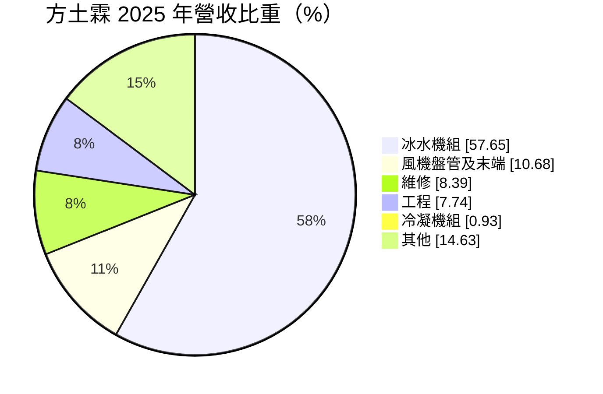
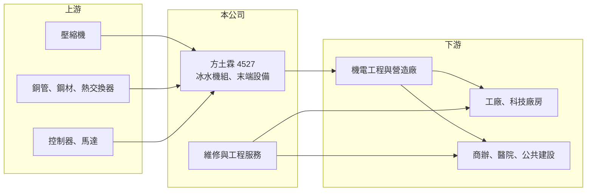

# 4527 方土霖

> 上櫃｜[[產業索引-電機機械|電機機械]]｜上市（櫃）日期 2000/09/28

# 第一章：企業模式與商業藍圖

> [!info] 撰寫說明
> 精簡版，由 Claude 依公開資料整理，架構比照 [[2330台積電]] 的四章研究，資料截至 2026-10-08。來源：櫃買中心開放資料（基本資料、2026 年第二季資產負債與損益、每月營收）、MoneyDJ／富邦 e 點通 年度財務比率與基本資料（營收比重、歷年股利）。公開資料有限，客戶與應用場域描述為推估，標示待校對。#待校對

方土霖（英文 Kuenling）是台灣本土的中央空調設備廠，本章說明它從冰水主機製造延伸到工程與維修的商業模式。

- **核心業務：** 方土霖成立於 1988 年，總部與工廠位於高雄梓官，2000 年掛牌上櫃。主力產品是中央空調的[[冰水機]]組，2025 年占營收 57.65%，另有風機盤管等末端設備、冷凝機組，以及維修與工程服務。冰水機是大樓、工廠與醫院中央空調的核心設備，負責產生冷水再送到各樓層的末端設備降溫。
- **營收結構：** 設備銷售約占七成，維修與工程合計約 16%，其餘為其他產品。設備訂單來自新建廠房、商辦與公共建設，以及既有建物的節能汰換；維修收入則跟著過去累積的裝機量成長。
- **營運據點：** 生產集中在高雄，業務以台灣為主，合併報表中有非控制權益，代表有持股未達百分之百的子公司（具體為何未查得）。2026 年第二季資產負債表的股本 7.62 億元，高於基本資料中的實收資本額 6.85 億元，推估 2026 年有辦理減資（待校對）。
- **長期方向：** 台灣半導體、電子廠與資料中心的擴建都需要大型空調與製程冷卻，加上淨零政策推動高效率空調汰換，是長期需求來源（推估）。若能提高維修與工程占比，公司的收入會更穩定。

# 第二章：護城河深度與競爭優勢

中央空調設備兼具製造與工程服務的特性，本章說明方土霖的護城河與競爭環境。

- **競爭優勢：** 本土廠商在交期、客製化與售後服務反應速度上，相對國際品牌有優勢，特別是中小型工廠與地方建案，更重視即時維修與報價彈性。累積多年的裝機量也帶來穩定的維修與汰換需求，這部分不容易被新進廠商搶走。
- **主要對手：** 國內同業包括 [[1504東元]] 的空調事業，國際品牌則有開利（Carrier）、特靈（Trane）、約克（York）、大金、日立、三菱重工等（待校對）。大型科技廠房與超高層商辦多由國際品牌主導，方土霖的強項推估在中型商用與工業市場。
- **觀察重點：** 長期要觀察公司能否打進半導體與資料中心等高規格冷卻市場、毛利率能否維持在 24% 以上，以及維修收入占比是否持續提高。2025 年營收衰退約 16%，也要觀察是否只是單一年度的工程認列落差。

# 第三章：財務體質與盈利規模

資料日期：2026-10-08，表格是撰寫當時的快照；最新月營收、毛利率、累計 EPS 由自動排程寫在本筆記的屬性欄位（月營收、毛利率、累計EPS 等）。#待校對

方土霖是本組中少數長期穩定獲利、配息穩定的公司，本章用多年度數據說明它的獲利能力。

| 年度 | 營收年增率 | [[毛利率]] | [[營業利益率]] | EPS（元） | [[ROE]] |
|---|---|---|---|---|---|
| 2021 | -2.80% | 23.70% | 6.93% | 1.98 | 9.84% |
| 2022 | 19.70% | 23.24% | 7.40% | 2.68 | 13.03% |
| 2023 | 14.63% | 24.18% | 9.06% | 3.39 | 16.44% |
| 2024 | 4.97% | 24.88% | 9.92% | 4.20 | 17.43% |
| 2025 | -15.95% | 26.33% | 9.22% | 3.40 | 13.06% |
| 2026 上半年 | 營收 13.22 億元 | 25.93% | 11.70% | 1.65 | 未查得 |

註：2021 至 2025 年取自 MoneyDJ 年度財務比率（合併），年度營收金額未查得；2026 上半年取自櫃買中心開放資料。

- **營收規模：** 2026 年上半年營收 13.22 億元，1 至 8 月累計 18.33 億元，較前一年同期成長約 11%，年營收規模推估在 25 億元上下（推估）。
- **獲利：** 毛利率長期穩定在 23% 至 26%，營業利益率由 2021 年的 6.93% 提升到 2026 年上半年的 11.70%，顯示產品組合與規模效益逐步改善。EPS 在 2024 年達 4.20 元的高點，2025 年回落到 3.40 元。近 5 年平均 ROE 約 14%。
- **財務特色：** 2026 年第二季負債比率約 42%，非流動負債僅 1.89 億元，流動負債推估以應付帳款與工程預收款為主（推估）。現金股利由 2019 年度的 1.6 元提高到 2024 年度的 3.2 元、2025 年度 3.0 元，2025 年度配息率約 88%，配息穩定。
- **[[ROIC]] 與 [[WACC]]：** 以 2026 年上半年營業利益 1.55 億元年化、扣 20% 稅，稅後營業利益約 2.47 億元；以股東權益 18.1 億元計算 ROIC 約 13.7%，若把全部負債 12.9 億元都算進去，下限約 8%（推算）。WACC 以無風險利率 1.75%、市場風險溢酬 6%、β 取 0.9（空調設備同業常見值，假設）得股權成本約 7.2%，假設有息負債占投入資本 20%、稅後負債成本 1.6%，WACC 約 6%（推算）。ROIC 高於 WACC，代表方土霖長期在創造價值，只是規模小、波動受工程認列影響。

# 第四章：總體風險與地緣政治

方土霖的風險來自營建與資本支出週期，以及原物料成本，本章逐項說明。

- **產業週期：** 中央空調需求跟著廠房、商辦與公共建設的興建週期走，大型專案延後或取消時，設備與工程收入會明顯波動。2025 年營收衰退約 16% 即反映專案認列的不穩定。
- **營運風險：** 工程收入涉及工期與成本控管，若材料或人工成本在工程期間上漲，固定總價合約的毛利可能被侵蝕。公司規模小，若單一大型客戶或專案出問題，對年度獲利影響相對大。
- **其他風險：** 壓縮機、銅管與鋼材是主要成本，價格上漲時需要時間轉嫁。冷媒法規趨嚴（逐步淘汰高溫室效應冷媒）會要求產品改版，帶來研發與認證成本，但也可能帶動汰換需求。

# 專有名詞解析

## 金融

- **[[配息率]]**：現金股利占當年度每股盈餘的比例，反映公司把獲利分給股東的程度。

## 產業

- **[[冰水機]]**：中央空調的核心設備，把水冷卻後送到大樓各處的末端設備，用於商辦、工廠與醫院。
- **[[風機盤管]]**：中央空調末端設備，用風扇把冰水管路的冷量吹進室內。
- **[[維保服務]]**：設備售出後提供的定期保養、檢修與零件更換服務，通常以長期合約收費，收入穩定、毛利較高。

# 核心供應鏈

- 上游：冰水機用的螺旋式或渦卷式壓縮機（多為國外品牌，待校對）、銅管與鋼材、控制器與馬達。
- 下游／客戶：工廠與科技廠房、商辦、醫院與公共建設業主，以及承攬機電工程的營造與工程公司。
- 同業：[[1504東元]]、開利、特靈、約克、大金、日立、三菱重工。

## 最新新聞
<!-- news:start -->
<!-- news:end -->

## 相關連結
- [公開資訊觀測站](https://mopsov.twse.com.tw/mops/web/t05st03?step=1&firstin=1&co_id=4527)
- [Goodinfo](https://goodinfo.tw/tw/StockDetail.asp?STOCK_ID=4527)
- [Yahoo 股市](https://tw.stock.yahoo.com/quote/4527)
- [鉅亨網新聞](https://www.cnyes.com/twstock/4527/news)
