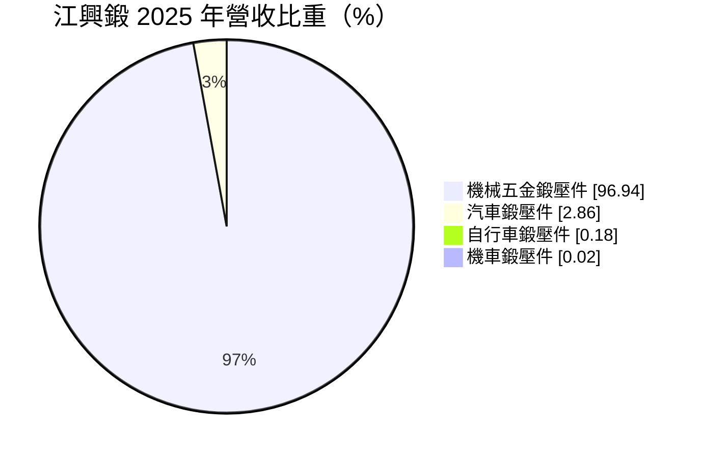
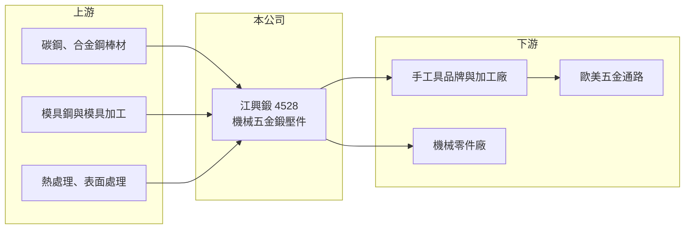

# 4528 江興鍛

> 上櫃｜[[產業索引-電機機械|電機機械]]｜上市（櫃）日期 2001/02/12

# 第一章：企業模式與商業藍圖

> [!info] 撰寫說明
> 精簡版，由 Claude 依公開資料整理，架構比照 [[2330台積電]] 的四章研究，資料截至 2026-10-08。來源：櫃買中心開放資料（基本資料、2026 年第二季資產負債與損益、每月營收、本益比殖利率）、MoneyDJ／富邦 e 點通 年度財務比率與基本資料（營收比重、歷年股利）。公開資料有限，產品應用與客戶為推估，標示待校對。#待校對

江興鍛壓（以下簡稱江興鍛）是台中的金屬[[鍛造]]廠，本章說明它在機械與五金產業鏈中的位置。

- **核心業務：** 江興鍛成立於 1980 年，工廠在台中西屯，2001 年掛牌上櫃，由江氏家族經營。公司以熱鍛、冷鍛等製程生產金屬鍛壓件，2025 年機械五金鍛壓件占營收 96.94%，汽車、自行車與機車鍛壓件比重已很小。
- **營收結構：** 機械五金鍛壓件推估以手工具（扳手、套筒等）與機械零件的鍛造毛胚為主，客戶是台灣與海外的手工具品牌與加工廠（推估，待校對）。鍛造件屬於「依圖代工」，客戶提供設計，江興鍛負責模具與量產。
- **營運據點：** 主要生產在台中，台中是台灣手工具與機械產業的聚落中心，上下游廠商距離近、協作方便。產品經由客戶加工、組裝後，大量外銷歐美。
- **長期方向：** 長期需要從單純毛胚供應，往精密鍛造、近淨形（減少後續加工）與高附加價值零件升級，才能對抗中國與東南亞的低價競爭。汽車鍛壓件比重已降到 3% 以下，代表公司目前的成長仍高度依賴手工具與五金市場。

# 第二章：護城河深度與競爭優勢

鍛造業屬於傳統製造，本章說明江興鍛的優勢與它面對的結構性壓力。

- **競爭優勢：** 鍛造需要大型鍛壓設備、模具開發能力與熱處理經驗，新進者要投入大量資本，而客戶更換供應商也需要重新開模與驗證。江興鍛四十多年的經驗與台中產業聚落的地緣，讓它能快速配合客戶的小量多樣需求。
- **主要對手：** 國內有眾多中小型鍛造廠，上市櫃同業包括 [[1586和勤]] 等金屬零件廠（待校對）；國際上主要壓力來自中國與印度的低成本鍛造廠（待校對）。手工具品牌在成本壓力下，可能把一般規格的毛胚轉向更便宜的產地。
- **觀察重點：** 營收從 2022 年起連續四年下滑，營業利益率由 2020 年的 12.31% 降到 2025 年的 0.21%，顯示議價力明顯減弱。長期要觀察公司能否找到新的產品或客戶，以及是否調整產能與成本結構。

# 第三章：財務體質與盈利規模

資料日期：2026-10-08，表格是撰寫當時的快照；最新月營收、毛利率、累計 EPS 由自動排程寫在本筆記的屬性欄位（月營收、毛利率、累計EPS 等）。#待校對

江興鍛過去是穩定獲利、配息的公司，近年獲利大幅衰退，本章用多年度數據說明這個轉變。

| 年度 | 營收年增率 | [[毛利率]] | [[營業利益率]] | EPS（元） | [[ROE]] |
|---|---|---|---|---|---|
| 2021 | 11.97% | 21.97% | 8.74% | 2.37 | 8.55% |
| 2022 | -4.12% | 18.59% | 4.81% | 2.14 | 8.08% |
| 2023 | -19.82% | 18.25% | 4.36% | 0.91 | 3.35% |
| 2024 | -12.09% | 14.63% | 0.23% | 0.01 | 0.04% |
| 2025 | -7.73% | 15.03% | 0.21% | -0.31 | -1.14% |
| 2026 上半年 | 營收 7.14 億元 | 11.63% | -4.76% | -0.61 | 未查得 |

註：2021 至 2025 年取自 MoneyDJ 年度財務比率（合併），年度營收金額未查得；2026 上半年取自櫃買中心開放資料。

- **營收規模：** 2026 年上半年營收 7.14 億元，1 至 8 月累計 9.53 億元，較前一年同期減少約 6%，年營收規模推估約 14 億元（推估）。2018 至 2021 年的高點之後，營收已連續多年縮小。
- **獲利：** 毛利率從 2020 年的 26.47% 一路降到 2026 年上半年的 11.63%，營業利益率由兩位數轉為負值，EPS 由 2018 年的 3.63 元降到 2025 年的 -0.31 元。這種毛利率與營收同步下滑的走勢，代表產能利用率降低與售價壓力同時發生。近 5 年平均 ROE 約 3.8%。
- **財務特色：** 2026 年第二季負債比率約 37%，股東權益 22.7 億元，保留盈餘 14.0 億元，過去累積的盈餘仍厚，財務安全性尚可。現金股利由 2019、2020 年度的每股 1.8 元降到 2024、2025 年度的 0.2 元，配息隨獲利下滑而縮減。每股淨值 26.96 元，股價淨值比約 0.55 倍，反映市場對獲利前景的保守看法。
- **[[ROIC]] 與 [[WACC]]：** 以 2026 年上半年營業損失 0.34 億元年化、扣 20% 稅，稅後營業利益約 -0.54 億元；以股東權益 22.7 億元至加計全部負債的 35.9 億元計，ROIC 約 -2.4% 至 -1.5%（推算）。WACC 以無風險利率 1.75%、市場風險溢酬 6%、β 取 0.9（金屬加工同業常見值，假設）得股權成本約 7.2%，假設有息負債占投入資本 25%、稅後負債成本 1.6%，WACC 約 5.8%（推算）。2018 至 2021 年 ROIC 推估接近或高於 WACC，2023 年後明顯低於 WACC，代表公司已從創造價值轉為侵蝕價值。

# 第四章：總體風險與地緣政治

江興鍛的風險主要來自終端手工具市場與成本結構，本章逐項說明。

- **產業週期：** 手工具與五金的終端需求來自歐美的修繕、DIY 與工業維修市場，受房市與消費景氣影響，通路商在景氣轉弱時會大幅去庫存。上游鍛造廠位於長鞭的末端，訂單波動會被放大。
- **營運風險：** 鍛造設備與廠房屬於重資產，營收下滑時折舊與人事成本無法同步減少，毛利率會快速惡化。若虧損持續，可能需要處分資產或縮減產線。
- **其他風險：** 鋼材是主要原料，價格波動直接影響成本；新台幣升值不利以外銷為主的下游客戶，間接壓縮訂單。美國對進口鋼鐵製品與手工具的關稅政策，可能改變客戶的採購地點。

# 專有名詞解析

## 金融

- **[[長鞭效應]]**：終端需求的小幅變動，沿供應鏈往上游傳遞時被逐級放大，造成上游庫存與訂單劇烈波動。
- **[[股價淨值比]]**：股價除以每股淨值，低於 1 倍代表市場價格低於帳面淨值，常反映對獲利能力的疑慮。

## 產業

- **[[鍛造]]**：用壓力讓金屬在固態下變形成形的加工方式，可細化金屬組織、提高強度。
- **[[近淨形]]**：讓零件在成形階段就接近最終尺寸，減少後續切削加工與材料浪費的製程概念。

# 核心供應鏈

- 上游：碳鋼與合金鋼棒材（例如 [[2002中鋼]]）、模具鋼與熱處理廠。
- 下游／客戶：台灣與海外手工具品牌、機械零件加工廠，產品最終銷往歐美五金通路（推估）。
- 同業：[[1586和勤]] 等國內金屬零件廠，以及中國、印度的鍛造廠。

## 最新新聞
<!-- news:start -->
<!-- news:end -->

## 相關連結
- [公開資訊觀測站](https://mopsov.twse.com.tw/mops/web/t05st03?step=1&firstin=1&co_id=4528)
- [Goodinfo](https://goodinfo.tw/tw/StockDetail.asp?STOCK_ID=4528)
- [Yahoo 股市](https://tw.stock.yahoo.com/quote/4528)
- [鉅亨網新聞](https://www.cnyes.com/twstock/4528/news)
