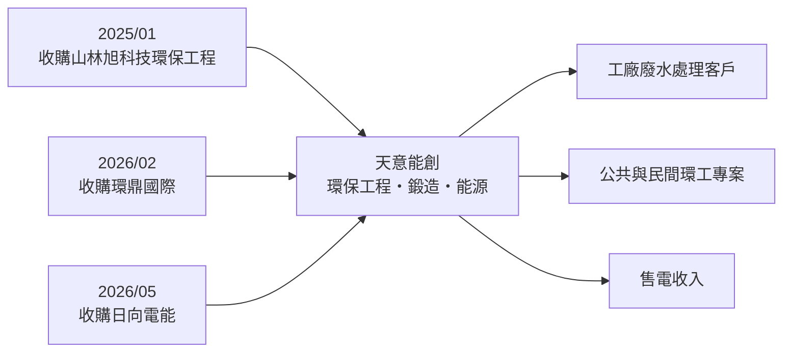
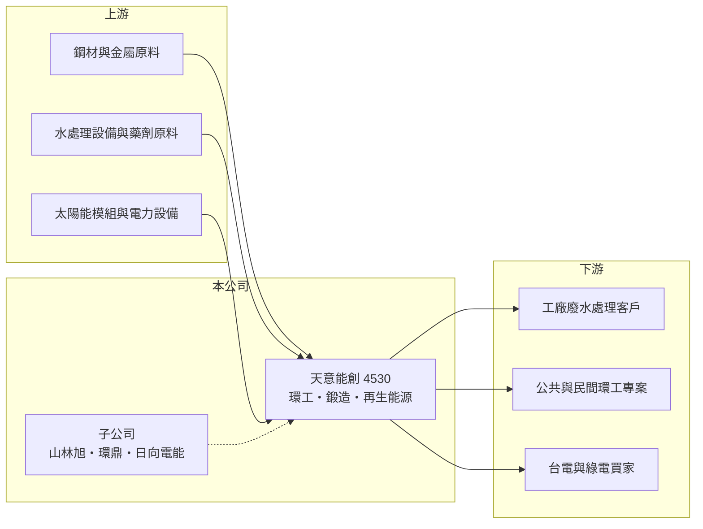

# 4530 宏易

> 上櫃｜[[產業索引-觀光餐旅|觀光餐旅]]｜上市（櫃）日期 2001/04/30

# 第一章：企業模式與商業藍圖

> [!info] 撰寫說明
> 本文由 Claude 依公開資料整理，架構比照 [[2330台積電]] 的四章研究，資料截至 2026-10-08。公司已於 2026 年 7 月由「宏易」更名為「天意能創」，本筆記檔名沿用舊簡稱。財務數字來源：櫃買中心開放資料（基本資料、2026 年第二季資產負債表與綜合損益表）、Goodinfo 年度經營績效頁、nStock 公司簡介；公開資料有限，查不到各事業的營收比重，產業描述為整理性內容，尚未逐條比對原始文件。#待校對

在評估單一個股的長期投資價值時，首要步驟是拆解企業的底層獲利邏輯。本章說明天意能創（股票代號：4530，原名宏易，以下簡稱天意能創）如何在四十年間從鋼模、精密加工、餐飲，轉向環保工程與再生能源。

## 一、核心定位：一家多次[[轉型]]的公司

天意能創於 1984 年 9 月設立，原名宏易鋼模，2001 年 4 月在櫃買中心上櫃，同年 8 月更名為宏易精密工業。2018 年 7 月更名為宏易創新國際，產業別歸入觀光餐旅，當時公司設有餐飲事業處。2025 年 6 月股東會通過處分持續虧損的餐飲事業處，2026 年 7 月再更名為天意能創，名稱中的「能」字反映新的能源與環保方向。

依 nStock 整理，公司目前的營業項目包括金屬鍛造加工及買賣、廢水與污水處理及工業助劑批發、環境保護工程專案營造，以及再生能源發電。雖然櫃買中心的產業別仍是觀光餐旅（代碼 16），但實際業務已與餐旅無關，閱讀這檔股票時應以營業項目為準。

## 二、以併購建立新事業

天意能創的新事業主要透過[[併購]]建立：2025 年 1 月收購山林旭科技環保工程，切入環境工程；2026 年 2 月收購環鼎國際；2026 年 5 月收購日向電能，取得再生能源發電業務。這種「買進現成公司」的方式可以快速取得執照、客戶與工程實績，但也意味著公司的價值高度取決於收購價格是否合理，以及被收購團隊能否留任。2026 年第二季底非控制權益達 1.63 億元，占權益總計約 27%，說明多家子公司並非 100% 持股。

## 三、長期方向

環保工程與[[再生能源]]都是受政策支持的長期產業：工業廢水排放標準逐步趨嚴，企業對廢水處理與回收的需求穩定成長；台灣也持續推動綠電占比。天意能創若能把工程、藥劑與發電串成一條龍服務，有機會建立比過去餐飲事業更穩定的收入基礎，但目前仍處於整合初期。

# 第二章：護城河深度與競爭優勢

「護城河」指企業抵禦競爭、維持超額利潤的保護機制。天意能創剛完成轉型，本章說明新事業可能的相對優勢與限制。

## 一、相對優勢

環保工程與廢水處理屬於需要專業技術、執照與工程實績的行業，客戶通常是工廠或公共工程，一旦系統建置完成，後續的藥劑供應與維護具有延續性，這是天意能創新事業最主要的潛在優勢。再生能源發電則有長期售電收入，可以平衡工程業務按專案認列的波動。不過這些優勢都來自剛收購的子公司，尚未在合併財報上展現穩定獲利。

## 二、主要競爭對手

| 對手 | 定位 | 對天意能創的威脅 |
|---|---|---|
| [[8422可寧衛]] | 廢棄物處理與環保服務 | 規模與處理設施遠大於天意能創 |
| [[8341日友]] | 廢棄物清運與處理 | 爭奪工業客戶的環保服務預算 |
| [[6806森崴能源]]、[[6869雲豹能源]] | 再生能源開發與售電 | 在綠電案場與資金取得上具規模優勢 |
| 區域型環工公司 | 承攬地方廢水工程 | 以價格競爭標案 |

## 三、守得住／守不住／觀察重點

守得住的是已取得的環工執照與既有客戶；守不住的是工程毛利，2026 年第二季毛利率一度為負（約 -3%），顯示工程成本控制與專案認列仍不穩定。長期觀察重點是收購的子公司能否穩定獲利、再生能源案場規模是否擴大，以及公司是否持續以增資或借款進行併購。

# 第三章：財務體質與盈利規模

資料日期：2026-10-08，表格是撰寫當時的快照；最新月營收、毛利率、累計 EPS 由自動排程寫在本筆記的屬性欄位（月營收、毛利率、累計EPS 等）。#待校對

財務報表是檢驗護城河是否真實存在的最終標準。由於公司經歷多次轉型，本章的多年度數字分別反映不同的事業組合，比較時要特別留意。

## 一、多年度經營績效

| 年度 | 營收（新台幣） | [[毛利率]] | [[營業利益率]] | EPS（元） | [[ROE]] |
|---|---|---|---|---|---|
| 2020 | 0.37 億 | 43.6% | -38.1% | -0.49 | -7.63% |
| 2021 | 1.60 億 | 33.1% | -18.0% | -0.47 | -7.12% |
| 2022 | 1.97 億 | 37.0% | -6.15% | -0.27 | -3.28% |
| 2023 | 1.62 億 | 26.9% | -25.5% | -1.26 | -26.9% |
| 2024 | 0.63 億 | 43.9% | 30.6% | -1.28 | 未查得 |
| 2025 | 3.49 億 | 39.4% | 17.8% | 0.34 | 5.36% |
| 2026 上半年 | 1.74 億 | 8.1% | -13.3% | -0.58 | 未查得 |

資料來源：2020 至 2025 年為 Goodinfo，2026 上半年為櫃買中心開放資料。2024 年 Goodinfo 顯示的 ROE 與 2023 年相同，疑為資料錯誤，故寫未查得；2024 年營業利益率為正但 EPS 為負，可能與停業單位損失有關（推估）。nStock 列 2025 年營收為 3.88 億元，與 Goodinfo 的 3.49 億元不同，可能是停業單位重編所致，需以年報核對。

2020 至 2024 年公司營收都在 2 億元以下且多為虧損，2025 年因收購環保工程子公司，營收放大到 3 億多元並轉為獲利，EPS 0.34 元。不過 2026 年上半年毛利率掉到約 8%，營業虧損 0.23 億元，顯示新事業的獲利仍不穩定。2021 至 2025 年平均 ROE 約 -8%（以有數字的四年推算），近五年沒有配發現金股利。

## 二、財務結構

2026 年第二季底，天意能創總資產 11.9 億元、負債 5.8 億元，負債比約 49%；流動資產 7.2 億元高於流動負債 4.6 億元，流動比率約 154%，短期償債能力尚可。保留盈餘 -0.11 億元，累積虧損不大，每股淨值 12.44 元。

## 三、[[ROIC]] 與 [[WACC]]：價值創造利差

**ROIC 推算：** 以 2025 年營業利益約 0.62 億元（3.49 億 × 17.8%）計，稅後約 0.50 億元。2026 年第二季底權益總計約 6.08 億元，負債 5.8 億元中假設三成為有息負債約 1.75 億元（推估），投入資本約 7.8 億元，2025 年 ROIC 約 6%（推算）。若改用 2026 年上半年的營業虧損年化，ROIC 會轉為負值（約 -6%，推算）。

**WACC 推算：** 台灣 10 年期公債取 1.75%、市場風險溢酬 6%、β 取小型環工股常見值 1.0，股東權益成本約 7.75%；負債成本 3%、稅後 2.4%；權益占約 78%、負債約 22%，WACC 約 6.6%（推算）。

**結論：** 2025 年 ROIC 與 WACC 大致相當，2026 年上半年則低於 WACC。新事業要創造價值，需要讓工程毛利穩定在兩成以上，並讓再生能源的長期售電收入成為獲利基礎。

# 第四章：總體風險與地緣政治

任何企業都無法脫離宏觀環境獨立存在。本章分析天意能創長期必須面對的風險。

## 一、轉型與併購風險

公司在一年多內完成三筆收購，業務組合變化極快。若收購價格偏高、被收購公司獲利不如預期，未來可能需要認列商譽或投資減損。頻繁轉型也讓投資人難以用歷史數字評估公司。

## 二、工程與專案風險

環保工程以專案認列營收，標案得標與否、工程進度與成本超支都會造成營收與毛利大幅波動。原物料與人力成本上升時，固定價格的工程合約可能虧損。

## 三、政策與能源風險

廢水處理需求受環保法規影響，再生能源收入受電價政策與躉購費率影響。政策方向改變或電網併網受限，都可能影響能源事業的投資報酬。

# 專有名詞解析

## 金融

- **[[併購]]**：透過收購其他公司股權或資產快速取得業務與客戶，價值取決於收購價格與整合成效。
- **[[ROIC]]**：投入資本報酬率，稅後營業利益除以股東權益加有息負債，衡量本業運用資本的效率。
- **[[WACC]]**：加權平均資金成本，股東與債權人要求報酬率的加權平均，是 ROIC 要超越的門檻。

## 產業

- **[[轉型]]**：企業把主要業務從原產業移往新產業，過程中營收與獲利常出現斷層。
- **[[再生能源]]**：太陽能、風力等可自然補充的能源，發電業者通常透過長期購電合約或躉購費率出售電力。

# 核心供應鏈

## 1. 上游：原料與設備
- 金屬原料、水處理設備與藥劑原料、太陽能模組與電力設備

## 2. 中游：天意能創與子公司
- 山林旭科技環保工程（2025 年收購）、環鼎國際（2026 年收購）、日向電能（2026 年收購）

## 3. 下游與同業
- 客戶：工業廢水處理客戶、環工標案業主、售電對象
- 同業：[[8422可寧衛]]、[[8341日友]]、[[6806森崴能源]]、[[6869雲豹能源]]

## 最新新聞
<!-- news:start -->
<!-- news:end -->

## 相關連結
- [公開資訊觀測站](https://mopsov.twse.com.tw/mops/web/t05st03?step=1&firstin=1&co_id=4530)
- [Goodinfo](https://goodinfo.tw/tw/StockDetail.asp?STOCK_ID=4530)
- [Yahoo 股市](https://tw.stock.yahoo.com/quote/4530)
- [鉅亨網新聞](https://www.cnyes.com/twstock/4530/news)
