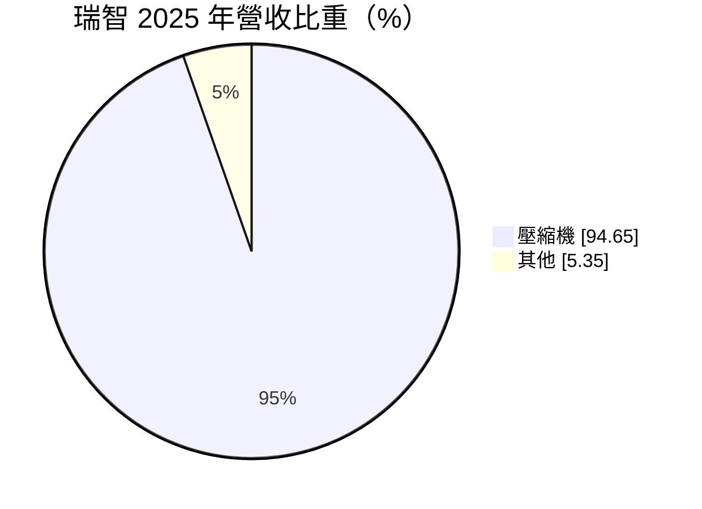
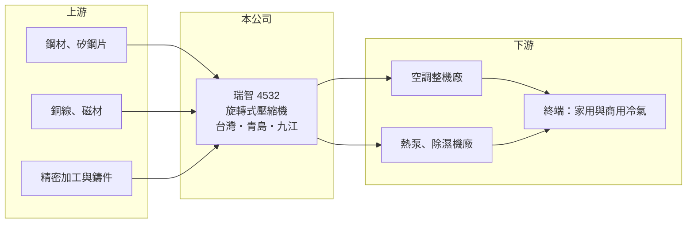

# 4532 瑞智

> 上市｜[[產業索引-電機機械|電機機械]]｜上市（櫃）日期 2003/08/04

# 第一章：企業模式與商業藍圖

> [!info] 撰寫說明
> 精簡版，由 Claude 依公開資料整理，架構比照 [[2330台積電]] 的四章研究，資料截至 2026-10-08。來源：證交所開放資料（基本資料、2026 年第二季資產負債與損益、營益分析、股利、每月營收）、MoneyDJ／富邦 e 點通 年度財務比率與基本資料（營收比重、歷年股利）、工商時報與優分析新聞標題。客戶與競爭者描述為整理性內容，標示待校對。#待校對

瑞智精密（以下簡稱瑞智）是台灣最大的空調用[[壓縮機]]製造商，本章說明它在冷氣產業鏈中的位置，以及這門生意的規模經濟特性。

- **核心業務：** 瑞智成立於 1989 年，2003 年上市，主要產品是家用與輕型商用空調所用的旋轉式壓縮機，2025 年壓縮機占營收 94.65%。壓縮機是冷氣機的「心臟」，負責壓縮冷媒、決定整台機器的效率與耗電，因此冷氣品牌對壓縮機的品質與能效要求很高。
- **營收結構：** 公司把壓縮機賣給空調整機廠，再由整機廠組裝成冷氣、除濕機或[[熱泵]]產品。由於產品高度集中在單一品項，營收主要跟著全球冷氣出貨量、各國能效法規與冷媒規範變化而波動。
- **營運據點：** 總部與台灣工廠在桃園觀音，主要生產基地在中國，包括青島與九江子公司（依 2026 年 10 月公司重大訊息中的子公司名稱）。生產重心在中國，貼近全球最大的空調組裝聚落，但也讓公司營運受中國市場與兩岸關係影響。
- **長期方向：** 長期成長來源包括新興市場冷氣普及率提升、各國提高空調能效標準帶動變頻壓縮機替換，以及歐洲以熱泵取代燃氣鍋爐的趨勢。這些需求都需要更高效率的壓縮機，對有技術累積的專業廠是長期利多。

# 第二章：護城河深度與競爭優勢

壓縮機是規模經濟非常明顯的產業，本章說明瑞智作為獨立專業廠的優勢與處境。

- **競爭優勢：** 壓縮機的製程包括精密加工、馬達與組裝，需要大量資本投入與長期品質紀錄，空調品牌換供應商前要做長時間的可靠度驗證，因此客戶關係一旦建立就相對穩固。瑞智作為不做自有冷氣品牌的獨立專業廠，可以同時供貨給彼此競爭的冷氣品牌，這是它和垂直整合對手最大的差異。
- **主要對手：** 全球壓縮機市場由中國廠商主導，包括美的旗下的美芝（GMCC）、格力旗下的凌達、上海海立，以及日系的松下、大金、三菱電機等（待校對）。前兩者背後有自家冷氣品牌的大量內部訂單，規模遠大於瑞智，在價格上具備優勢。
- **觀察重點：** 長期要看瑞智在變頻、熱泵與新冷媒壓縮機的技術進展，以及能否擴大中國以外的客戶與產能，以降低對單一市場的依賴。毛利率能否維持在 15% 以上，是判斷它能否擺脫純價格競爭的關鍵指標。

# 第三章：財務體質與盈利規模

資料日期：2026-10-08，表格是撰寫當時的快照；最新月營收、毛利率、累計 EPS 由自動排程寫在本筆記的屬性欄位（月營收、毛利率、累計EPS 等）。#待校對

瑞智營收規模大但毛利率低，本章用多年度數據說明它的獲利結構與資本效率。

| 年度 | 營收年增率 | [[毛利率]] | [[營業利益率]] | EPS（元） | [[ROE]] |
|---|---|---|---|---|---|
| 2021 | 16.99% | 10.41% | 2.60% | 1.08 | 5.01% |
| 2022 | -18.72% | 12.22% | 3.17% | 1.38 | 6.60% |
| 2023 | -8.23% | 14.86% | 5.52% | 1.50 | 7.39% |
| 2024 | 27.62% | 15.74% | 5.94% | 2.02 | 9.58% |
| 2025 | -5.76% | 16.66% | 6.75% | 2.05 | 9.60% |
| 2026 上半年 | 營收 123.56 億元 | 14.05% | 5.71% | 1.01 | 未查得 |

註：2021 至 2025 年取自 MoneyDJ 年度財務比率（合併），年度營收金額未查得；2026 上半年取自證交所營益分析與損益表。

- **營收規模：** 2026 年上半年營收 123.56 億元，1 至 8 月累計 155.29 億元，較前一年同期成長約 4.7%，年營收規模推估在 200 億元以上（推估）。營收年增率在 -19% 到 +28% 之間大幅擺盪，反映空調產業的庫存週期。
- **獲利：** 毛利率由 2021 年的 10.41% 逐年改善到 2025 年的 16.66%，營業利益率也從 2.60% 提升到 6.75%，EPS 由 1.08 元增加到 2.05 元，代表產品組合與成本控制有實質進步。2026 年上半年毛利率回落到 14.05%，顯示價格壓力仍在。近 5 年平均 ROE 約 7.6%。
- **財務特色：** 2026 年第二季負債比率約 63%，流動負債 189 億元占大宗，推估主要是應付帳款與應付票據等營運性負債，以及部分短期借款（推估）。現金股利由 2019 年的 0.5 元逐步提高到 2024、2025 年度的 1.5 元，2025 年度配息率約 73%。
- **[[ROIC]] 與 [[WACC]]：** 以 2026 年上半年營業利益 7.06 億元年化、扣 20% 稅，稅後營業利益約 11.3 億元；以股東權益 117.1 億元計算 ROIC 上限約 9.6%，若把全部負債 202.5 億元都視為投入資本，下限約 3.5%，合理區間推估在 5% 至 7%（推算）。WACC 以無風險利率 1.75%、市場風險溢酬 6%、β 取 1.0（家電零組件同業常見值，假設）得股權成本 7.75%，假設有息負債占投入資本 35%、稅後負債成本 2%，WACC 約 5.7%（推算）。ROIC 與 WACC 大致打平，代表瑞智近年已從「侵蝕價值」改善到「勉強創造價值」，但幅度不大。

# 第四章：總體風險與地緣政治

瑞智的風險集中在產業週期、中國生產集中與原物料成本，本章逐項說明。

- **產業週期：** 冷氣出貨受天氣、房市與通路庫存影響，品牌廠在旺季前備貨、淡季去化，上游壓縮機的訂單波動因此被放大，也就是[[長鞭效應]]。2022 至 2023 年營收連續衰退即是庫存調整的結果。
- **營運風險：** 營收九成以上來自單一產品，且主要產能在中國，若中國空調市場價格戰加劇或客戶轉向垂直整合廠採購，瑞智的議價力有限。新冷媒與能效法規更新時，研發與產線轉換也需要資本支出。
- **其他風險：** 壓縮機大量使用鋼材、銅與矽鋼片，原物料價格上漲時毛利率會受壓；人民幣與美元匯率變動也會影響換算後的獲利。美中貿易摩擦與關稅措施可能改變客戶的採購地點，這對以中國為生產重心的公司是長期變數。

# 專有名詞解析

## 應用

- **[[熱泵]]**：用少量電力把熱從低溫處搬到高溫處的設備，可用於暖氣與熱水，被視為取代燃氣鍋爐的節能方案。

## 產業

- **[[壓縮機]]**：壓縮冷媒、讓冷媒在系統中循環的核心零件，是冷氣、冰箱與熱泵的「心臟」。
- **[[變頻]]**：依需求調整馬達轉速的技術，比定頻機種省電，是各國提高空調能效標準後的主流規格。
- **[[長鞭效應]]**：終端需求的小幅變動，沿供應鏈往上游傳遞時被逐級放大，造成上游庫存與訂單劇烈波動。

# 核心供應鏈

- 上游：鋼材與矽鋼片（例如 [[2002中鋼]]）、銅線與馬達材料、鑄件與精密加工件。
- 下游／客戶：國內外空調整機廠與熱泵廠，台灣品牌例如 [[1604聲寶]]、[[1504東元]]（是否為客戶待校對）。
- 同業：美芝（美的集團）、凌達（格力集團）、上海海立、松下、大金、三菱電機。

## 最新新聞
<!-- news:start（自動產生，請勿手動編輯此範圍） -->
- 2026-10-13 🏛️ 重訊 16:01｜代重要子公司瑞智(九江)精密機電有限公司 公告總經理異動｜[觀測站](https://mops.twse.com.tw/mops/#/web/t05st01)
- 2026-10-07 🏛️ 重訊 16:12｜代重要子公司瑞智(青島)精密機電有限公司 公告董事會決議2025年度盈餘分配案｜[觀測站](https://mops.twse.com.tw/mops/#/web/t05st01)
- 2026-10-07 🏛️ 重訊 16:10｜本公司115年09月自結合併營收情形｜[觀測站](https://mops.twse.com.tw/mops/#/web/t05st01)

完整紀錄：[[4532瑞智 新聞]]
<!-- news:end -->

## 相關連結
- [公開資訊觀測站](https://mopsov.twse.com.tw/mops/web/t05st03?step=1&firstin=1&co_id=4532)
- [Goodinfo](https://goodinfo.tw/tw/StockDetail.asp?STOCK_ID=4532)
- [Yahoo 股市](https://tw.stock.yahoo.com/quote/4532)
- [鉅亨網新聞](https://www.cnyes.com/twstock/4532/news)
