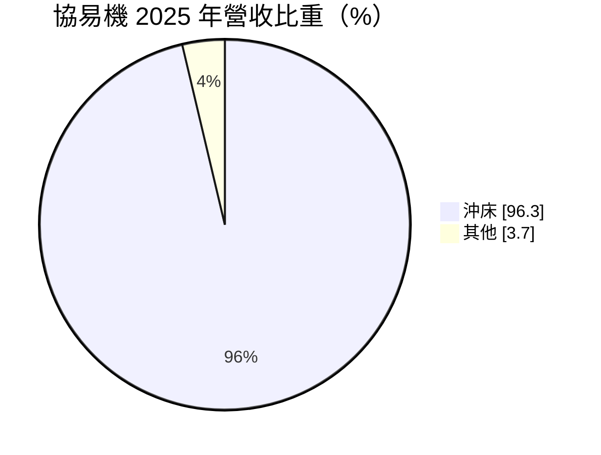
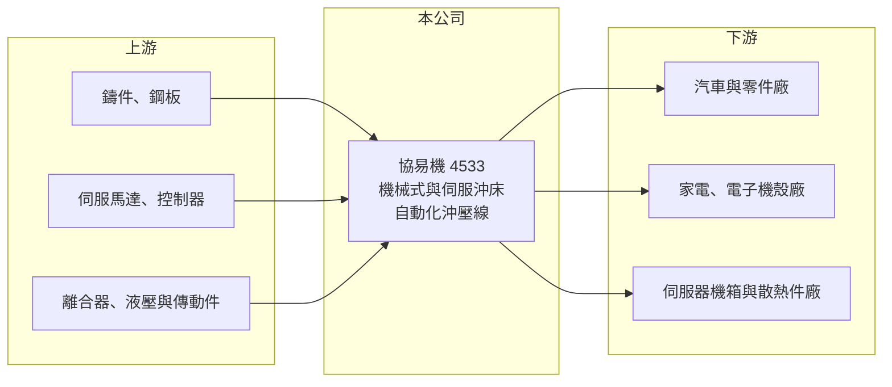

# 4533 協易機

> 上櫃｜[[產業索引-電機機械|電機機械]]｜上市（櫃）日期 2002/04/26

# 第一章：企業模式與商業藍圖

> [!info] 撰寫說明
> 精簡版，由 Claude 依公開資料整理，架構比照 [[2330台積電]] 的四章研究，資料截至 2026-10-08。來源：櫃買中心開放資料（基本資料、2026 年第二季資產負債與損益、每月營收、本益比殖利率）、MoneyDJ／富邦 e 點通 年度財務比率與基本資料（營收比重）、經濟日報與自由時報新聞標題。應用市場與同業描述為整理性內容，標示待校對。#待校對

協易機械（英文 SEYI，以下簡稱協易機）是台灣主要的[[沖床]]製造商，本章說明沖壓設備在製造業中的角色，以及協易機的產品定位。

- **核心業務：** 協易機成立於 1982 年，總部與工廠在桃園龜山，2002 年掛牌上櫃。2025 年沖床占營收 96.30%，產品包括機械式沖床、[[伺服沖床]]與搭配的自動化送料系統。沖床是用模具把金屬板材沖壓成形的設備，汽車車身與零件、家電外殼、電子機殼、伺服器機箱等都要用到。
- **營收結構：** 營收幾乎全部來自沖壓設備銷售，屬於一次性的資本財訂單。客戶在新車型、新產品量產或擴產時採購，大型沖壓線單價高、交期長，因此單一年度的營收容易受少數大單影響。
- **營運據點：** 主要生產在台灣，並透過海外子公司與代理商銷售到中國、東南亞、美洲等市場（待校對）。2026 年第二季資產負債表股本為 15.84 億元，基本資料的實收資本額為 17.84 億元，推估 2026 年下半年完成約 2 億元的增資（待校對）。
- **長期方向：** 電動車車身輕量化需要更大噸數、更精準的伺服沖壓設備，AI 伺服器機殼與散熱件也帶來新的沖壓需求，這是協易機近年對外強調的成長方向。從機械式沖床升級到伺服沖床，可以提高單台價值與附加價值。

# 第二章：護城河深度與競爭優勢

沖壓設備市場由日本大廠主導高階，本章說明協易機的優勢與它在全球競爭中的位置。

- **競爭優勢：** 協易機是台灣少數能做大型沖壓線與伺服沖床的廠商，產品線涵蓋小噸數到大噸數，可為客戶提供整線規劃與自動化整合。相較日本品牌，台灣設備在價格與交期上具彈性，對新興市場與中型零件廠有吸引力。
- **主要對手：** 國際主要競爭者為日本的天田（Amada）、會田（Aida）、小松產機（Komatsu）以及德國舒勒（Schuler），中國也有多家快速成長的沖床廠（待校對）。高階汽車大型沖壓線多由日德品牌掌握，協易機需要靠伺服技術與服務切入。
- **觀察重點：** 長期要觀察伺服沖床與大型沖壓線的營收比重、電動車與伺服器機殼客戶能否帶來穩定訂單，以及毛利率能否維持在 25% 以上。本業營業利益率長年接近零，代表規模與費用結構還沒有轉化成穩定獲利。

# 第三章：財務體質與盈利規模

資料日期：2026-10-08，表格是撰寫當時的快照；最新月營收、毛利率、累計 EPS 由自動排程寫在本筆記的屬性欄位（月營收、毛利率、累計EPS 等）。#待校對

協易機的毛利率不低，但營業費用吃掉大部分毛利，本章用多年度數據說明這個結構。

| 年度 | 營收年增率 | [[毛利率]] | [[營業利益率]] | EPS（元） | [[ROE]] |
|---|---|---|---|---|---|
| 2021 | 43.66% | 21.42% | 0.14% | 0.36 | 2.38% |
| 2022 | -6.51% | 23.76% | -0.84% | 0.18 | 1.19% |
| 2023 | -1.43% | 30.36% | 4.35% | 1.34 | 8.50% |
| 2024 | 2.75% | 27.97% | 2.15% | 1.55 | 9.33% |
| 2025 | 12.02% | 25.99% | 1.33% | 0.20 | 1.20% |
| 2026 上半年 | 營收 19.06 億元 | 21.60% | -2.56% | 0.13 | 未查得 |

註：2021 至 2025 年取自 MoneyDJ 年度財務比率（合併），年度營收金額未查得；2026 上半年取自櫃買中心開放資料。

- **營收規模：** 2026 年上半年營收 19.06 億元，1 至 8 月累計 26.54 億元，較前一年同期減少約 2.7%，年營收規模推估在 40 億元上下（推估）。
- **獲利：** 毛利率在 21% 至 30% 之間，但營業利益率多在 -1% 至 4% 之間，代表研發、銷售與管理費用占營收比例高。2023、2024 年 EPS 超過 1 元，有一部分來自業外收益（2024 年淨利率 6.84% 高於營業利益率 2.15%）。2026 年上半年本業虧損，靠業外收入 0.77 億元才轉為小幅獲利。近 5 年平均 ROE 約 4.5%。
- **財務特色：** 2026 年第二季負債比率約 59%，非流動負債 8.65 億元，財務槓桿中等偏高。現金股利不穩定，2025 年度每股僅約 0.18 元。2026 年 10 月公司公告買回庫藏股期間屆滿，顯示經營層有在低檔回購股份的作法。
- **[[ROIC]] 與 [[WACC]]：** 以 2026 年上半年營業損失 0.49 億元年化、扣 20% 稅，稅後營業利益約 -0.78 億元；以股東權益 25.7 億元至加計全部負債的 63.0 億元計，ROIC 約 -3% 至 -1%（推算）；以 2023、2024 年較好的年度估算，ROIC 也只有約 2% 至 4%（推算）。WACC 以無風險利率 1.75%、市場風險溢酬 6%、β 取 1.2（工具機與設備同業常見值，假設）得股權成本約 9%，假設有息負債占投入資本 40%、稅後負債成本 2%，WACC 約 6.2%（推算）。ROIC 長期低於 WACC，代表協易機尚未創造經濟價值，必須提高營業利益率才能改善。

# 第四章：總體風險與地緣政治

協易機屬於資本設備業，風險集中在景氣週期與費用結構，本章逐項說明。

- **產業週期：** 沖床需求跟著汽車、家電、電子等製造業的擴產與換線週期走，景氣下行時客戶會延後設備採購。汽車產業轉向電動車的速度與車廠投資節奏，也會直接影響大型沖壓線訂單。
- **營運風險：** 營業費用占比高，營收稍有下滑就會轉為本業虧損。大型專案交期長，若出現驗收延遲或成本超支，會影響當年度獲利。
- **其他風險：** 鋼材與鑄件是主要原料，價格上漲會壓縮毛利；新台幣升值不利出口報價。中國沖床廠的價格競爭與美國關稅政策，也會影響海外接單。

# 專有名詞解析

## 金融

- **[[營運槓桿]]**：固定成本占比高的企業，營收變動時獲利會以更大的幅度變動，景氣好時放大獲利、景氣差時放大虧損。

## 產業

- **[[沖床]]**：以模具與壓力把金屬板材沖壓成形的設備，廣泛用於汽車、家電與電子機殼製造。
- **[[伺服沖床]]**：以伺服馬達驅動滑塊的沖床，可精準控制速度與行程，適合高強度鋼板與精密成形。
- **[[工具機]]**：用來切削、成形金屬零件的機器，被稱為「機器之母」，客戶涵蓋汽車、航太、模具與電子業。

# 核心供應鏈

- 上游：鑄件與鋼板（例如 [[2002中鋼]]）、伺服馬達與控制系統、傳動元件（例如 [[2049上銀]]，是否為供應商待校對）。
- 下游／客戶：汽車與車用零件廠、家電與電子機殼廠、伺服器機箱廠（例如 [[8210勤誠]]、[[2059川湖]] 這類金屬件廠，是否為客戶待校對）。
- 同業：天田、會田、小松產機、舒勒，以及國內工具機同業 [[4526東台]]。

## 最新新聞
<!-- news:start（自動產生，請勿手動編輯此範圍） -->
- 2026-10-12 🏛️ 重訊 17:55｜公告本公司買回庫藏股期間屆滿執行情形｜[觀測站](https://mops.twse.com.tw/mops/#/web/t05st01)

完整紀錄：[[4533協易機 新聞]]
<!-- news:end -->

## 相關連結
- [公開資訊觀測站](https://mopsov.twse.com.tw/mops/web/t05st03?step=1&firstin=1&co_id=4533)
- [Goodinfo](https://goodinfo.tw/tw/StockDetail.asp?STOCK_ID=4533)
- [Yahoo 股市](https://tw.stock.yahoo.com/quote/4533)
- [鉅亨網新聞](https://www.cnyes.com/twstock/4533/news)
