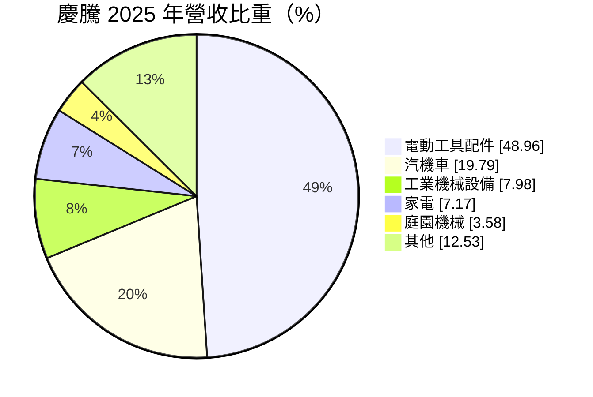
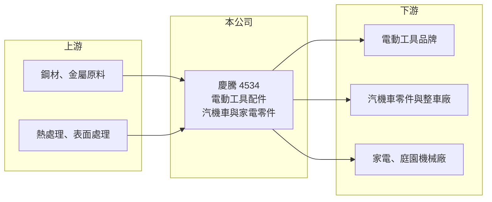

# 4534 慶騰

> 上櫃｜[[產業索引-電機機械|電機機械]]｜上市（櫃）日期 2003/03/31

# 第一章：企業模式與商業藍圖

> [!info] 撰寫說明
> 精簡版，由 Claude 依公開資料整理，架構比照 [[2330台積電]] 的四章研究，資料截至 2026-10-08。來源：櫃買中心開放資料（基本資料、2026 年第二季資產負債與損益、每月營收、本益比殖利率）、MoneyDJ／富邦 e 點通 年度財務比率與基本資料（營收比重、歷年股利）、本筆記自動新聞紀錄（2026 年 10 月減資公告）。公開資料有限，產品細節、客戶與同業為推估，標示待校對。#待校對

慶騰精密（以下簡稱慶騰）是苗栗頭份的精密零組件製造商，產品以電動工具配件為主，本章說明它的產品組合與在產業鏈中的位置。

- **核心業務：** 慶騰成立於 1993 年，總部在苗栗頭份，2003 年掛牌上櫃。依 MoneyDJ 的 2025 年營收比重，電動工具配件占 48.96%，汽機車零件占 19.79%，其餘分布在工業機械、家電與庭園機械。產品推估為電動工具與機械用的精密金屬或傳動零組件（推估，待校對）。
- **營收結構：** 公司屬於零組件供應商，依客戶規格生產後交給電動工具、汽機車與家電品牌組裝。電動工具配件需求跟著歐美居家修繕與營建景氣變動，汽機車零件則提供部分分散效果。
- **營運據點：** 主要生產據點在苗栗頭份，產品多經由品牌客戶外銷到全球市場（推估）。2026 年 10 月公司公告減資已完成資本額變更登記，2026 年第二季保留盈餘為 -1.89 億元，推估是以減資彌補累積虧損（推估，待校對）。
- **長期方向：** 電動工具朝無線化、無刷馬達與鋰電池發展，帶動配件與零組件規格升級。慶騰若能提高高精度零件與新應用的比重，才有機會走出過去幾年的虧損。

# 第二章：護城河深度與競爭優勢

慶騰規模小、過去獲利波動大，本章說明它的競爭位置與限制。

- **競爭優勢：** 多元的應用分布（電動工具、汽機車、家電、庭園機械）讓公司不完全依賴單一產業，而長期配合品牌客戶開發，也累積了精密加工與品質管理經驗。零組件一旦通過客戶驗證，通常能跟著產品週期持續供貨數年。
- **主要對手：** 電動工具零組件的競爭者包括台灣與中國眾多金屬加工與粉末冶金廠，上市櫃同業可參考 [[1515力山]]（電動工具整機）等相關公司（待校對）。全球電動工具品牌高度集中在少數大廠，零組件供應商的議價力相對有限。
- **觀察重點：** 2022、2023 年毛利率一度降到 0.5% 至 3.6%，顯示在需求急凍時缺乏定價能力。長期要觀察毛利率能否穩定回到 15% 以上、減資後能否恢復配息，以及新客戶與新應用的開發成果。

# 第三章：財務體質與盈利規模

資料日期：2026-10-08，表格是撰寫當時的快照；最新月營收、毛利率、累計 EPS 由自動排程寫在本筆記的屬性欄位（月營收、毛利率、累計EPS 等）。#待校對

慶騰的財務數字反映了一家小型零件廠在景氣循環中的脆弱性，本章用多年度數據說明。

| 年度 | 營收年增率 | [[毛利率]] | [[營業利益率]] | EPS（元） | [[ROE]] |
|---|---|---|---|---|---|
| 2021 | 9.65% | 19.21% | 5.10% | 0.59 | 5.61% |
| 2022 | -27.59% | 3.60% | -18.27% | -1.71 | -17.01% |
| 2023 | -20.23% | 0.50% | -19.37% | -1.53 | -18.08% |
| 2024 | 20.85% | 17.20% | -1.67% | 0.23 | 2.94% |
| 2025 | -2.40% | 13.32% | -6.13% | 0.01 | 0.19% |
| 2026 上半年 | 營收 4.90 億元 | 15.99% | -0.50% | -0.07 | 未查得 |

註：2021 至 2025 年取自 MoneyDJ 年度財務比率（合併），年度營收金額未查得；2026 上半年取自櫃買中心開放資料。

- **營收規模：** 2026 年上半年營收 4.90 億元，1 至 8 月累計 7.01 億元，較前一年同期成長約 34%，年營收規模推估約 10 億元（推估）。2022、2023 年營收連續大減兩至三成，反映疫情後電動工具通路去庫存的衝擊。
- **獲利：** 毛利率在景氣好時約 17% 至 19%，景氣差時幾乎歸零，營業利益率在 2021 年以後多為負值。2024、2025 年雖然 EPS 為正，但本業仍虧損，靠業外收益才勉強打平。近 5 年平均 ROE 約 -5.3%。
- **財務特色：** 2026 年第二季負債比率約 52%，股東權益 7.15 億元，每股淨值 8.24 元低於面額，保留盈餘為負，這也是 2026 年辦理減資的背景（推估）。2019 至 2025 年度都沒有發放現金股利。
- **[[ROIC]] 與 [[WACC]]：** 以 2026 年上半年營業損失 0.02 億元年化、扣 20% 稅，稅後營業利益約 -0.04 億元；以股東權益 7.1 億元至加計全部負債的 14.8 億元計，ROIC 約 -0.6% 至 -0.3%，接近零（推算）。WACC 以無風險利率 1.75%、市場風險溢酬 6%、β 取 1.1（小型零組件同業常見值，假設）得股權成本約 8.4%，假設有息負債占投入資本 30%、稅後負債成本 2%，WACC 約 6.4%（推算）。ROIC 長期低於 WACC，代表公司尚未創造經濟價值，改善關鍵在提高毛利率與營收規模。

# 第四章：總體風險與地緣政治

慶騰的風險集中在終端需求波動與財務體質，本章逐項說明。

- **產業週期：** 電動工具需求受歐美房市、營建與 DIY 消費影響，品牌與通路在景氣轉弱時大幅去庫存，2022 至 2023 年的營收衰退就是典型的[[長鞭效應]]。景氣回升時訂單也會快速回補，因此營收波動大。
- **營運風險：** 營收規模約 10 億元，固定成本分攤能力有限，營收下滑時容易轉為虧損。客戶集中於少數電動工具品牌（推估），若主要客戶轉單或要求降價，對獲利影響很大。
- **其他風險：** 鋼材與金屬原料價格、新台幣匯率都會影響毛利；美國對進口工具與零件的關稅政策，也可能改變品牌客戶的供應鏈布局。

# 專有名詞解析

## 應用

- **[[電動工具]]**：以電力驅動的手持工具，例如電鑽、起子機、砂輪機，無線鋰電化是近年主流趨勢。

## 金融

- **[[減資]]**：公司減少股本，常見目的為彌補累積虧損或退還現金給股東，彌補虧損型減資不影響股東權益總額。
- **[[長鞭效應]]**：終端需求的小幅變動，沿供應鏈往上游傳遞時被逐級放大，造成上游庫存與訂單劇烈波動。
- **[[營運槓桿]]**：固定成本占比高的企業，營收變動時獲利會以更大的幅度變動，景氣好時放大獲利、景氣差時放大虧損。

# 核心供應鏈

- 上游：鋼材與金屬原料（例如 [[2002中鋼]]）、熱處理與表面處理廠。
- 下游／客戶：歐美與日本電動工具品牌、汽機車零件廠、家電與庭園機械廠（具體客戶未查得）。
- 同業：國內外電動工具零組件廠；相關整機廠如 [[1515力山]]（待校對）。

## 最新新聞
<!-- news:start（自動產生，請勿手動編輯此範圍） -->
- 2026-10-15 🏛️ 重訊 14:57｜公告本公司減資已完成資本額變更登記事宜｜[觀測站](https://mops.twse.com.tw/mops/#/web/t05st01)

完整紀錄：[[4534慶騰 新聞]]
<!-- news:end -->

## 相關連結
- [公開資訊觀測站](https://mopsov.twse.com.tw/mops/web/t05st03?step=1&firstin=1&co_id=4534)
- [Goodinfo](https://goodinfo.tw/tw/StockDetail.asp?STOCK_ID=4534)
- [Yahoo 股市](https://tw.stock.yahoo.com/quote/4534)
- [鉅亨網新聞](https://www.cnyes.com/twstock/4534/news)
