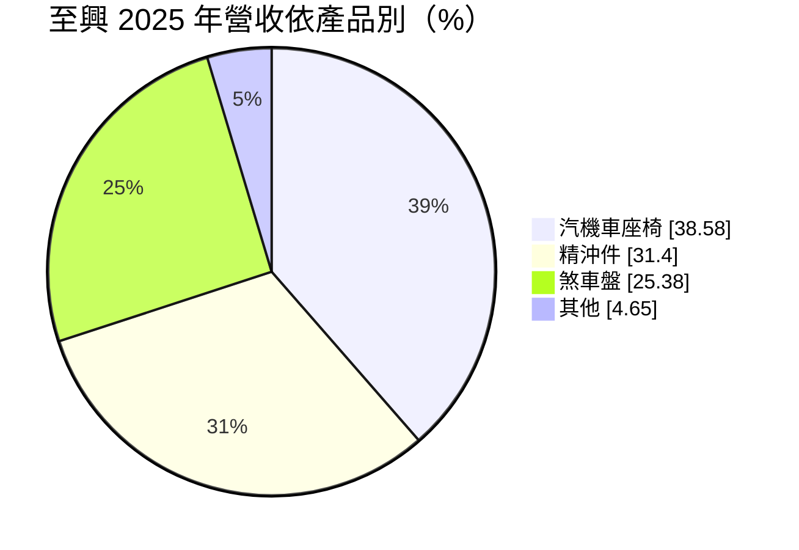
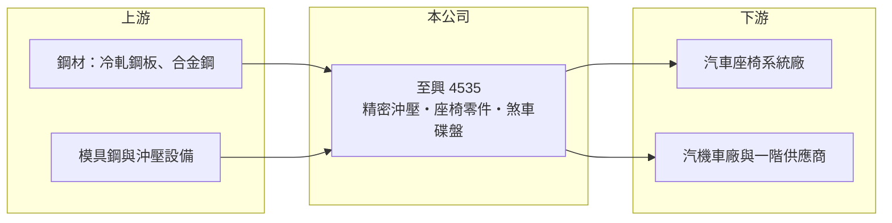

# 4535 至興

> 上櫃｜[[產業索引-電機機械|電機機械]]｜上市（櫃）日期 2003/04/16

# 第一章：企業模式與商業藍圖

> [!info] 撰寫說明
> 精簡版，由 Claude 依公開資料整理，架構比照 [[2330台積電]]，資料截至 2026-10-08。來源：櫃買中心開放資料快照（基本資料、2026 年第二季資產負債與損益、本益比殖利率）、Goodinfo 經營績效頁、MoneyDJ 基本資料頁（2025 年營收比重與歷年股利）。產品用途與客戶型態為依產品類別整理的描述，公開資料有限。#待校對

至興精機（以下簡稱至興）是一家以[[精密沖壓]]起家的汽機車零件廠，理解它的關鍵在於：公司把同一套模具與沖壓技術，延伸到座椅調整機構、精沖件與煞車碟盤三條產品線，獲利能力穩定但成長性平緩。

- **核心業務：** 至興成立於 1988 年，2003 年在櫃買中心掛牌，總部位於彰化線西的彰濱工業區，公司網址即以精密沖壓（fine blanking）命名。精密沖壓與一般沖壓的差別在於，成品的剪切面平整、尺寸精度高，很多零件沖完就能直接組裝，不需要再切削加工，適合座椅調角器齒盤、變速與煞車系統等要求強度與精度的零件。這種製程需要專用的高噸位沖床與模具設計能力，是至興的技術根本。
- **營收結構：** 依 MoneyDJ 整理的 2025 年營收比重，汽機車座椅相關產品約占 38.6%、精沖件約占 31.4%、煞車盤約占 25.4%、其他約 4.7%。三條產品線比重相對平均，代表公司不依賴單一產品，但三者都與汽機車產量連動，本質上仍是單一終端產業的供應商。座椅產品推估以座椅調整機構與骨架零件為主（#待校對）。
- **營運據點：** 公司登記地址在彰化彰濱工業區，總經理為吳宗明、董事長為吳崇儀。依 2026 年上半年損益，合併淨利約 0.89 億元中約 0.45 億元歸屬[[非控制權益]]，表示集團內有母公司未全資持有、而且獲利占比不小的子公司，海外據點的具體分布公開資料未查得（#待校對）。
- **長期方向：** 汽機車零件的長期成長來自兩個方向：一是跟著既有客戶的新車種與新平台持續接單，二是把精密沖壓能力延伸到電動車、電動機車的新零件。電動化會改變煞車與傳動系統的設計（例如動能回收減少碟盤磨耗），但座椅與車身結構件的需求不受動力形式影響，這是至興產品組合相對穩健的原因。

# 第二章：護城河深度與競爭優勢

至興的護城河屬於「窄護城河」，來自製程門檻與車用認證，而不是品牌或規模。

- **競爭優勢：** 精密沖壓需要高噸位專用設備、模具設計與材料熱處理的長期經驗，新進者要做到穩定良率並不容易。車用零件一旦通過客戶驗證並導入車型，通常會跟著該車型供貨數年，換供應商要重新驗證，這構成一定的轉換成本。三條產品線共用模具與沖壓能力，也讓公司在單一產品景氣轉差時有其他產品支撐。
- **主要對手：** 座椅機構件與精沖件面對的是國際座椅系統廠的自製部門、日系與歐系精沖專業廠，以及中國大陸大量擴產的沖壓廠；煞車碟盤則面對中國大陸低價鑄造與加工廠的競爭。具體的對手名單公開資料未查得。在這個市場上，報價權大多掌握在車廠與一階系統廠手中。
- **觀察重點：** 長期最值得追蹤的是毛利率能否維持在 19% 至 20% 的區間。2021 至 2025 年毛利率始終落在 19.4% 至 19.8%，即使 2025 年營收下滑約 13%，毛利率也沒有明顯惡化，顯示產品定價與成本控制相當穩定。若未來毛利率跌破這個區間，可能代表價格競爭或產品組合出現結構性變化。

# 第三章：財務體質與盈利規模

資料日期：2026-10-08，表格是撰寫當時的快照；最新月營收、毛利率、累計 EPS 由自動排程寫在本筆記的屬性欄位（月營收、毛利率、累計EPS 等）。#待校對

至興的財務呈現穩定型零件廠的樣貌：營收在 21 億至 31 億元之間波動、毛利率約兩成、負債極低，但成長性有限。

| 年度 | 營收（億元） | [[毛利率]] | [[營業利益率]] | EPS（元） | [[ROE]] |
|---|---|---|---|---|---|
| 2021 | 27.7 | 19.5% | 12.1% | 2.40 | 10.1% |
| 2022 | 31.4 | 19.4% | 12.0% | 2.82 | 11.4% |
| 2023 | 28.6 | 19.8% | 11.7% | 2.40 | 9.84% |
| 2024 | 29.1 | 19.5% | 11.5% | 2.44 | 10.2% |
| 2025 | 25.2 | 19.8% | 11.2% | 1.30 | 7.14% |

（來源：Goodinfo 經營績效頁；2020 年營收 21.1 億元、EPS 1.36 元。Goodinfo 頁面欄位以位置對應，ROE 與 EPS 之間略有不一致，#待校對。）

- **營收規模：** 2020 至 2025 年營收由 21.1 億元增至 25.2 億元，年複合成長率約 3.6%（推算），但期間高點是 2022 年的 31.4 億元，之後逐年回落。這個走勢反映汽機車零件跟著全球車市與客戶車型週期起伏。2026 年上半年營收約 12.6 億元，與 2025 年水準相當。
- **獲利：** 近五年（2021 至 2025）平均 ROE 約 9.7%（推算），營業利益率長期維持在 11% 至 12%，對零件代工廠而言屬於中上水準。2025 年 EPS 降至 1.30 元，但營業利益率仍有 11.2%，EPS 降幅大於營業利益降幅，與歸屬非控制權益的獲利比重有關。2026 年上半年歸屬母公司 EPS 為 0.58 元。
- **財務特色：** 依 2026 年第二季資料，總資產約 32.0 億元、權益總計約 27.5 億元（其中非控制權益約 2.8 億元），負債僅約 4.4 億元，負債比約 14%，財務結構非常保守。現金股利方面，依 MoneyDJ 資料，2019 至 2025 年度分別配發 1.00、0.70、1.60、2.00、1.60、1.60、0.80 元，大致隨獲利調整，2020 年度以後的配發率多落在五至七成（推算）。
- **[[ROIC]] 與 [[WACC]]：** 以 2025 年營業利益約 2.82 億元（25.2 億元 × 11.2%）、稅率 20% 計算，稅後營業利益約 2.26 億元。有息負債未查得，投入資本以權益 27.5 億元到「權益加全部負債」32.0 億元為區間，ROIC 約 7.1% 至 8.2%（推算）。WACC 以 [[CAPM]] 推估：無風險利率 1.75%、市場風險溢酬 6%、β 假設 0.9（汽車零件股常見值），權益成本約 7.2%；負債比重低，WACC 約 6.8% 至 7.0%（推算）。ROIC 略高於 WACC，代表至興長期大致能賺回資金成本並創造少量經濟價值，但幅度不大，屬於穩健而非高報酬的類型。

# 第四章：總體風險與地緣政治

至興的風險主要來自汽機車產業週期、價格競爭與子公司結構。

- **產業週期：** 三條產品線都與汽機車產量連動，車市下滑或客戶車型停產時，營收會同步下降，2023 至 2025 年營收由 31.4 億元降到 25.2 億元即是例子。汽車零件的訂單以車型為單位，新車型接單的成敗會決定未來數年的營收。電動化與車型平台整合，也可能改變特定零件的需求量。
- **營運風險：** 車廠與一階系統廠每年常要求零件供應商降價，若生產效率提升跟不上降價幅度，毛利率就會被壓縮。精密沖壓需要高價設備，產能利用率下降時固定成本攤提會拉低獲利。子公司由外部股東持有相當比例，母公司股東能分到的獲利比例需留意。
- **其他風險：** 主要原料為鋼材，鋼價波動會影響成本，轉嫁給客戶通常有時間落差。出口與海外營運涉及匯率變動。中國大陸沖壓與碟盤廠商的低價競爭，以及各國關稅政策，都可能改變客戶的採購地點。

# 專有名詞解析

## 金融

- **[[非控制權益]]**：合併報表中屬於子公司其他股東的權益與淨利，不歸母公司股東所有。
- **[[CAPM]]**：資本資產定價模型，以無風險利率加上 β 乘以市場風險溢酬，估算股東要求的報酬率。

## 產業

- **[[精密沖壓]]**：以模具與沖床把金屬薄板快速衝壓成高精度零件，剪切面平整、可免後續切削，是座椅機構與傳動零件的主要製程。
- **[[煞車碟盤]]**：安裝在車輪上、與煞車卡鉗摩擦產生制動力的金屬圓盤，屬於耗損件，有原廠與售後兩個市場。

# 核心供應鏈

- 上游：鋼板與合金鋼供應商（例如 [[2002中鋼]] 等鋼廠），以及模具鋼材、精密沖床設備廠。
- 下游／客戶：汽車座椅系統廠、汽機車廠與其一階供應商；具體客戶名單公開資料未點名（#待校對）。
- 同業：國內外精密沖壓與車用金屬零件廠，例如同屬汽車零件產業的 [[2233宇隆]]（產品不同，僅供產業對照）。

## 最新新聞
<!-- news:start -->
<!-- news:end -->

## 相關連結
- [公開資訊觀測站](https://mopsov.twse.com.tw/mops/web/t05st03?step=1&firstin=1&co_id=4535)
- [Goodinfo](https://goodinfo.tw/tw/StockDetail.asp?STOCK_ID=4535)
- [Yahoo 股市](https://tw.stock.yahoo.com/quote/4535)
- [鉅亨網新聞](https://www.cnyes.com/twstock/4535/news)
