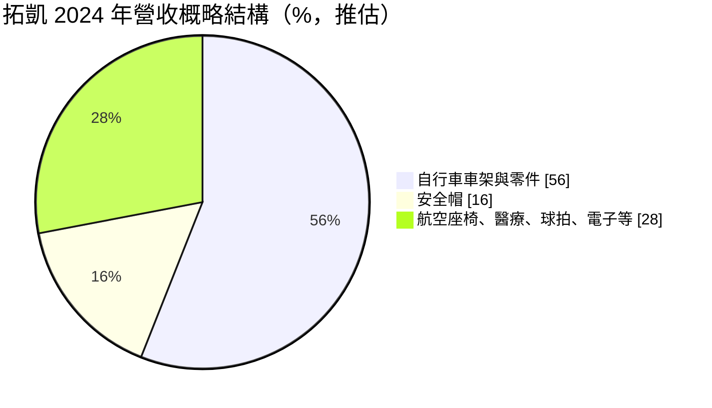
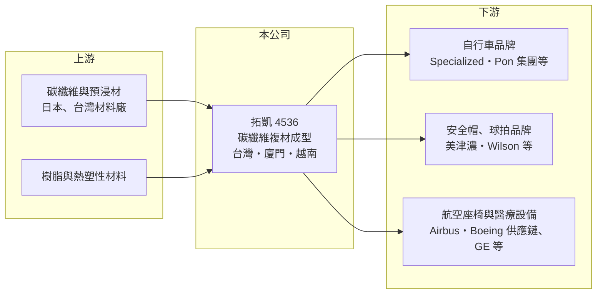

# 4536 拓凱

> 上市｜[[產業索引-運動休閒|運動休閒]]｜上市（櫃）日期 2013/10/09

# 第一章：企業模式與商業藍圖

> [!info] 撰寫說明
> 精簡版，由 Claude 依公開資料整理，架構比照 [[2330台積電]]，資料截至 2026-10-08。來源：MoneyDJ 理財網財務比率年表（2018 至 2025 年）；富果研究 2025 年 3 月法說會備忘錄（產品、客戶、產地、資本支出、2024 年財務數字）；證交所開放資料快照（基本資料、2026 年上半年資產負債與損益、股利）。營收比重為 2024 年概略數字，部分營收以每股營業額乘以約 9,082 萬股推算。#待校對

拓凱實業成立於 1980 年 7 月、2013 年 10 月上市，總部在台中后里，董事長沈文振、總經理沈貝倪，實收資本額約 9.08 億元。拓凱從網球拍、羽球拍起家，把[[碳纖維複合材料]]的成型技術一路延伸到自行車、安全帽、飛機座椅與醫療器材，是一家「以材料工藝跨產業接單」的代工廠。

- **核心業務：** 拓凱替國際品牌代工碳纖維與熱塑性複材產品，最大宗是高階自行車與 [[E-bike]] 的碳纖維車架、前叉、輪圈與輪組，其次是賽車、越野與工業用安全帽。其他產品包括飛機座椅椅背、核磁共振床板、輪椅斜板、網球與羽球拍、Padel 球拍，以及手機與智慧手錶的複材元件。
- **營收結構：** 依富果整理的 2025 年 3 月法說會，自行車約占營收 56%（2024 年），安全帽約 16%（過去曾達 20% 至 25%），其餘由航空座椅、醫療、球拍與電子元件組成。自行車主要客戶為紀錄中的 SBC（推估為 Specialized）與 Pang 集團（推估為荷蘭 Pon 集團），安全帽客戶以日本美津濃為主，球拍客戶包括 Wilson、Babolat、Head（待校對）。
- **營運據點：** 生產基地分布在台灣、中國廈門與越南。廈門兩個廠區是最大生產基地，超過七成產線位於此；台中后里的中科新廠投資約 1 億美元，增加自行車與航空內裝產能；越南一期投資 3,500 萬美元生產車架與前叉，二期再增資 2,000 萬美元，並加入球拍與航空座椅產線。
- **長期方向：** 拓凱的策略是「三地生產＋分散產業」。三地產能讓客戶可依關稅選擇出貨地；產品面則持續降低對自行車的依賴，擴大航空座椅、醫療與電子元件，並評估人形機器人、農業與國土保安用無人機等新應用。經營層長期維持低負債、高現金，並以半年配息的方式發放約五至六成獲利。

# 第二章：護城河深度與競爭優勢

拓凱的護城河是「碳纖維成型的製程經驗＋跨產業認證」，客戶一旦導入，不容易輕易更換。

- **競爭優勢：** 碳纖維車架與安全帽的品質取決於鋪層設計、模具與熱壓製程，良率與一致性需要長年累積，高階品牌客戶不輕易換廠。飛機座椅與醫療床板更需要航空與醫療相關認證，驗證週期長，一旦通過就是長期訂單。核磁共振床板在法說紀錄中市占超過六成，客戶包括 GE、Toshiba、Philips、Siemens（待校對），顯示拓凱在小眾利基市場能建立很高的占有率。
- **主要對手：** 碳纖維自行車車架的對手包括台灣其他複材代工廠（例如 [[8928鉅明]] 也有碳纖維製品業務，重疊程度待校對），以及中國大陸眾多碳纖維車架廠；球拍與高爾夫領域則與 [[6670復盛應用]]、[[8938明安]] 等複材代工廠部分重疊。中國廠商價格低，但在高階品牌、航空與醫療認證上仍不及拓凱。
- **觀察重點：** 自行車產業在 2021 至 2022 年疫情熱潮後經歷長達兩年的去庫存，拓凱因為產品分散，2023 年營收跌幅遠小於純自行車廠。長期要看非自行車業務占比能否持續提高、越南與中科新廠的產能利用率能否拉升，以及最大客戶以外的新品牌能否開發成功。

# 第三章：財務體質與盈利規模

資料日期：2026-10-08，表格是撰寫當時的快照；最新月營收、毛利率、累計 EPS 由自動排程寫在本筆記的屬性欄位（月營收、毛利率、累計EPS 等）。#待校對

拓凱的毛利率長期穩定在 30% 至 35%、營業利益率約 17% 至 23%，在代工廠中屬於高獲利水準，且負債低、現金多。

| 年度 | 營收（億元） | [[毛利率]] | [[營業利益率]] | EPS（元） | [[ROE]] |
|---|---|---|---|---|---|
| 2021 | 約 86.9（推算） | 30.54% | 16.55% | 9.16 | 16.07% |
| 2022 | 約 110 | 35.40% | 23.18% | 24.89 | 34.32% |
| 2023 | 約 92.7（推算） | 32.71% | 18.38% | 15.58 | 17.91% |
| 2024 | 94.78 | 34.89% | 19.80% | 18.86 | 19.85% |
| 2025 | 約 92.0（推算） | 35.31% | 18.71% | 14.92 | 15.14% |

- **長期指標：** 2021 至 2025 年營收年複合成長率約 1.4%（推算），規模大致持平，但 2022 年自行車熱潮時明顯跳升。近 5 年平均 ROE 約 20.7%（推算）。每股現金流量 2018 至 2025 年皆為正，2024 年度現金股利 11 元、約為 EPS 的 58%；2025 年下半年度配發現金股利 8 元（證交所資料），股利政策穩定。
- **[[ROIC]] 與 [[WACC]]：** 2025 年營業利益約 17.2 億元（營收約 92 億元 × 18.71%），稅後約 13.8 億元（稅率 20%）。投入資本以 2026 年第二季權益總計 99.3 億元，加有息負債推估約 15 億元計算（負債總計 51.7 億元，官方快照未拆分），ROIC 約 12%（推算）；若扣除約 70 億元的現金部位，營運資本報酬率更高達三成左右（推算）。WACC 約 7%（推算：無風險利率 1.75%、市場風險溢酬 6%、β 取 0.9，股東權益成本 7.15%；負債比重低，稅率 20%）。ROIC 長期高於 WACC，代表拓凱持續創造價值，但帳上大量現金拉低了整體資本報酬。
- **財務特色：** 2026 年第二季總資產 151.0 億元、負債 51.7 億元，負債比率約 34%，每股淨值 103.91 元。2026 年上半年營收 48.7 億元、毛利率 32.7%、營業利益率 16.2%、EPS 6.55 元。2024 年業外有利息收入 2.79 億元與匯兌收益 2.66 億元，現金多以美元持有，匯率對業外損益影響明顯。

# 第四章：總體風險與地緣政治

拓凱的風險主要來自自行車產業週期、客戶集中與中國廠區比重。

- **產業週期：** 高階自行車與 E-bike 屬於可選消費，2020 至 2022 年疫情帶來需求暴增，之後品牌與通路庫存過高，2023 至 2024 年全產業去庫存。自行車占拓凱營收過半，這個週期會直接反映在營收與產能利用率上。
- **營運風險：** 自行車業務集中在少數大品牌，最大客戶的訂單變化影響很大。新建的中科廠與越南廠需要時間爬坡，產能利用率不足時折舊會壓低毛利率。安全帽占比從二成多降到一成多，顯示個別產品線的需求波動也大。
- **其他風險：** 超過七成產線在中國廈門，美中關稅與地緣政治會影響輸美產品，公司正以越南與台灣產能分散。營收以美元計價、現金多為美元，新台幣升值會同時壓縮營業與業外獲利。碳纖維原料價格與供應也影響成本。

# 專有名詞解析

## 金融

- **[[ROIC]]**：投入資本報酬率，稅後營業利益除以股東權益加有息負債，衡量本業運用資本的效率。
- **[[WACC]]**：加權平均資金成本，股東與債權人要求報酬率的加權平均，是 ROIC 要超越的門檻。

## 產業

- **[[碳纖維複合材料]]**：以碳纖維搭配樹脂成型的材料，重量輕、強度高，用於球拍、球桿、自行車與飛機結構件。
- **[[E-bike]]**：電動輔助自行車，騎乘者踩踏時由電機提供輔助動力，在歐洲是成長最快的自行車品類。

# 核心供應鏈

- 上游：碳纖維與預浸材供應商（如日本東麗等，未於本次來源查證）、樹脂與熱塑性複材原料。
- 下游／客戶：自行車品牌 Specialized、Pon 集團（推估）；安全帽客戶美津濃；球拍客戶 Wilson、Babolat、Head；航空座椅客戶屬 Airbus、Boeing 供應鏈與漢翔；醫療設備 GE、Toshiba、Philips、Siemens；煞車把手客戶 SRAM。
- 同業：[[8928鉅明]]、[[6670復盛應用]]、[[8938明安]]；國內自行車整車與零件廠 [[9921巨大]]、[[9914美利達]] 屬下游相關族群。

## 最新新聞
<!-- news:start -->
<!-- news:end -->

## 相關連結
- [公開資訊觀測站](https://mopsov.twse.com.tw/mops/web/t05st03?step=1&firstin=1&co_id=4536)
- [Goodinfo](https://goodinfo.tw/tw/StockDetail.asp?STOCK_ID=4536)
- [Yahoo 股市](https://tw.stock.yahoo.com/quote/4536)
- [鉅亨網新聞](https://www.cnyes.com/twstock/4536/news)
