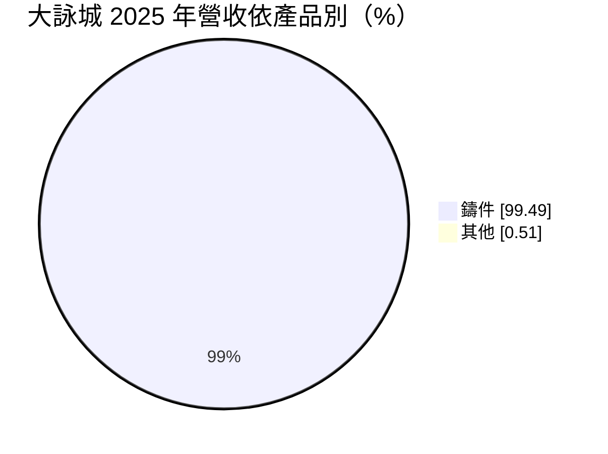
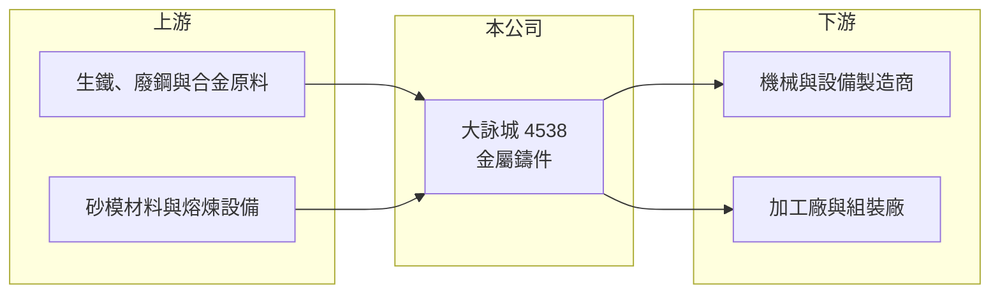

# 4538 大詠城

> 上櫃｜[[產業索引-電機機械|電機機械]]｜上市（櫃）日期 2019/01/15

# 第一章：企業模式與商業藍圖

> [!info] 撰寫說明
> 精簡版，由 Claude 依公開資料整理，架構比照 [[2330台積電]]，資料截至 2026-10-08。來源：櫃買中心開放資料快照（基本資料、2026 年第二季資產負債與損益、本益比殖利率）、Goodinfo 經營績效頁、MoneyDJ 基本資料頁（2025 年營收比重與歷年股利）。公開資料有限，鑄件的材質與終端應用未能從本次來源確認。#待校對

大詠城是一家位於彰化鹿港的金屬鑄件廠，營收幾乎全部來自[[鑄造]]業務。理解它的關鍵在於：這是一個規模小、接單型的零件製造商，營收與獲利跟著下游機械與設備產業的景氣明顯起伏。

- **核心業務：** 大詠城成立於 1980 年，2019 年在櫃買中心掛牌，總部與工廠位於彰化鹿港，董事長為謝順民。依 MoneyDJ 整理的營收比重，2025 年鑄件約占 99.5%，可說是單一產品公司。鑄造是把熔融金屬倒入模具冷卻成形的製程，適合生產形狀複雜、需要一定強度的金屬零件，是機械、閥門、泵浦、汽車與工具機等產業的基礎加工環節。公司鑄件的材質（鑄鐵、鑄鋼或不鏽鋼）與主要應用，本次來源未能確認（#待校對）。
- **營收結構：** 2025 年營收約 3.8 億元，規模在上櫃公司中偏小。鑄件通常按客戶圖面接單生產，每張訂單的品項、重量與材質都不同，營收受少數大客戶的拉貨節奏影響很大。2022 年營收曾達 6.08 億元，2024 年降到 3.15 億元，波動幅度接近一半，顯示客戶集中度可能偏高（推估）。
- **營運據點：** 公司登記在彰化鹿港，位於台灣中部機械產業聚落附近。中部聚集了大量工具機、機械與五金廠商，鑄件廠可以就近服務客戶、縮短交期，這是在地鑄造廠能與海外低價供應商競爭的重要條件。
- **長期方向：** 鑄造業屬於傳統產業，長期課題是在環保法規趨嚴、人力老化的環境下維持產能，並往附加價值較高的精密鑄件或加工後的半成品發展。公司未來能否擴大客戶群、降低對單一產業的依賴，是決定營收能否走出低檔的關鍵，相關具體規劃公開資料未查得。

# 第二章：護城河深度與競爭優勢

大詠城的護城河很窄，主要來自客戶關係與在地供應能力，而非技術獨占。

- **競爭優勢：** 鑄件需要依客戶圖面開模、調整澆鑄與熱處理參數，通過客戶驗證後通常會長期供貨，換供應商要重新打樣與驗證，形成一定的轉換成本。公司負債極低、財務穩健，景氣低迷時不會有償債壓力，可以撐過產業週期。不過這些優勢在同業之間相當普遍，並不構成明顯的差異化。
- **主要對手：** 台灣中南部有大量中小型鑄造廠，中國大陸與印度、越南等地的鑄造廠也以低價搶單，價格競爭激烈。具體的主要對手名單公開資料未查得。鑄件市場分散，單一廠商很難取得定價權。
- **觀察重點：** 長期最值得觀察的是毛利率能否回到 2022 至 2023 年約 23% 至 24% 的水準。2024 至 2025 年毛利率降到 15.8% 至 18.2%，營業利益率只剩 3% 至 5%，代表在營收縮小後固定成本攤提壓力很大。若營收回升，獲利會因[[營業槓桿]]放大反彈，反之亦然。

# 第三章：財務體質與盈利規模

資料日期：2026-10-08，表格是撰寫當時的快照；最新月營收、毛利率、累計 EPS 由自動排程寫在本筆記的屬性欄位（月營收、毛利率、累計EPS 等）。#待校對

大詠城的財務特色是規模小、負債低、獲利波動大，近兩年獲利能力明顯偏弱。

| 年度 | 營收（億元） | [[毛利率]] | [[營業利益率]] | EPS（元） | [[ROE]] |
|---|---|---|---|---|---|
| 2021 | 4.63 | 19.0% | 10.2% | 0.76 | 5.59% |
| 2022 | 6.08 | 23.2% | 15.7% | 1.59 | 11.1% |
| 2023 | 4.35 | 24.2% | 14.1% | 1.12 | 7.51% |
| 2024 | 3.15 | 18.2% | 2.89% | 0.19 | 1.28% |
| 2025 | 3.80 | 15.8% | 4.57% | 0.29 | 1.99% |

（來源：Goodinfo 經營績效頁；2019 年營收 4.33 億元、EPS 0.97 元，2020 年營收 3.03 億元、EPS 0.49 元。）

- **營收規模：** 2020 至 2025 年營收由 3.03 億元增至 3.80 億元，年複合成長率約 4.6%（推算），但若從 2019 年的 4.33 億元算起則是衰退，可見期間只是在 3 億至 6 億元之間來回波動。2026 年上半年營收約 1.91 億元，接近 2025 年的平均水準。這種走勢反映接單型鑄件廠缺乏長期穩定的成長動能。
- **獲利：** 近五年（2021 至 2025）平均 ROE 約 5.5%（推算），只有 2022 年超過一成。2024 至 2025 年 EPS 僅 0.19 與 0.29 元，2026 年上半年 EPS 為 0.22 元，其中業外收入約 0.07 億元占稅前淨利比重不低。本業獲利偏薄時，業外收入的波動會明顯影響 EPS。
- **財務特色：** 依 2026 年第二季資料，總資產約 9.38 億元、權益約 8.27 億元，負債僅約 1.12 億元，負債比約 12%，財務非常保守。依 MoneyDJ 資料，2019 至 2025 年度現金股利分別為 0.20、0.80、0.50、0.55、0.80、0.40、1.00 元，其中 2024 與 2025 年度的股利高於當年 EPS（推算），表示公司動用過去累積的盈餘或資本公積維持配息，這種配息水準能否持續取決於本業獲利是否回升（#待校對）。
- **[[ROIC]] 與 [[WACC]]：** 以 2025 年營業利益約 0.17 億元（3.80 億元 × 4.57%）、稅率 20% 計算，稅後營業利益約 0.14 億元。投入資本以權益 8.27 億元到「權益加全部負債」9.38 億元為區間，ROIC 約 1.5% 至 1.7%（推算）；2022 年景氣高點時同法推估約 8% 至 9%（推算，以當期資本約略估計）。WACC 以 [[CAPM]] 推估：無風險利率 1.75%、市場風險溢酬 6%、β 假設 0.9（傳產零件股常見值），權益成本約 7.2%；負債比重低，WACC 約 6.9%（推算）。近兩年 ROIC 遠低於 WACC，代表公司目前沒有賺回資金成本，只有在 2022 年這類景氣高點才短暫創造經濟價值。

# 第四章：總體風險與地緣政治

大詠城的風險集中在下游景氣、客戶集中與傳產製造的經營環境。

- **產業週期：** 鑄件需求跟著機械設備、工具機與相關產業的資本支出循環走，景氣轉差時客戶會先砍零件訂單，營收可能在一兩年內大幅下降。2022 至 2024 年營收從 6.08 億元降到 3.15 億元就是一次完整的下行。這種週期性是鑄造業的本質，很難靠單一公司的努力消除。
- **營運風險：** 公司營收規模小，少數客戶的訂單變化就會造成營收大幅波動。鑄造廠的熔爐、模具與人力屬於固定成本，產能利用率下降時獲利會迅速萎縮。產業普遍面臨技術人力老化與招工困難，長期可能限制產能擴充。
- **其他風險：** 生鐵、廢鋼與合金等原料價格波動會影響成本，電價上漲對耗能的熔煉製程影響明顯。鑄造業屬高耗能、高排放產業，環保法規與碳費制度趨嚴會增加營運成本。若客戶以出口為主，匯率與關稅也會間接影響訂單。

# 專有名詞解析

## 金融

- **[[營業槓桿]]**：固定成本占比高時，營收小幅變動會讓營業利益大幅變動的現象。
- **[[CAPM]]**：資本資產定價模型，以無風險利率加上 β 乘以市場風險溢酬，估算股東要求的報酬率。

## 產業

- **[[鑄造]]**：把熔融金屬倒入模具冷卻成形的製程，可大量生產形狀複雜的零件，例如煞車碟盤與機械底座。

# 核心供應鏈

- 上游：生鐵、廢鋼與合金原料供應商（例如 [[2002中鋼]] 等鋼鐵業者），以及砂模材料、熔煉爐等設備供應商。
- 下游／客戶：機械、設備與零件製造商；具體客戶與應用產業公開資料未點名（#待校對）。
- 同業：台灣中部與海外的中小型鑄造廠，以及同樣生產金屬鑄件的業者；具體名單公開資料未查得。

## 最新新聞
<!-- news:start -->
<!-- news:end -->

## 相關連結
- [公開資訊觀測站](https://mopsov.twse.com.tw/mops/web/t05st03?step=1&firstin=1&co_id=4538)
- [Goodinfo](https://goodinfo.tw/tw/StockDetail.asp?STOCK_ID=4538)
- [Yahoo 股市](https://tw.stock.yahoo.com/quote/4538)
- [鉅亨網新聞](https://www.cnyes.com/twstock/4538/news)
