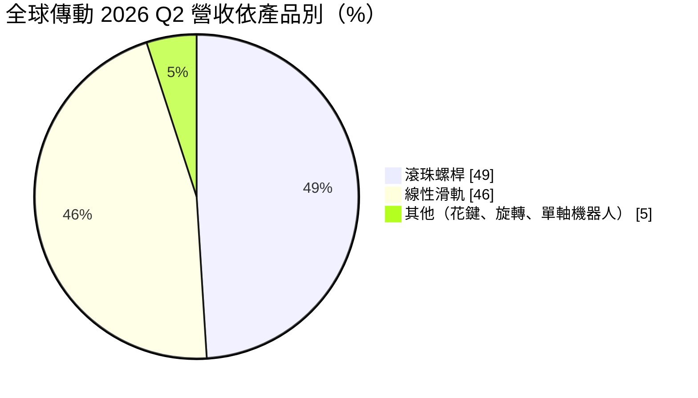
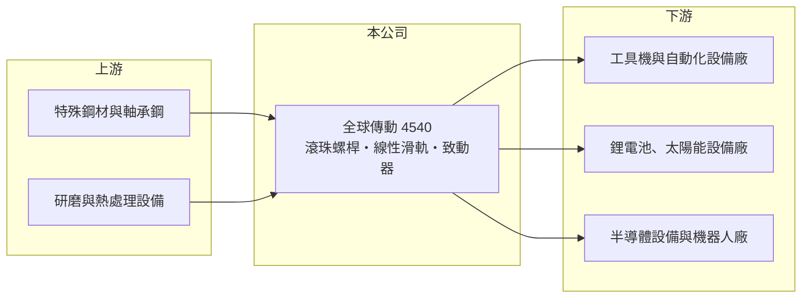

# 4540 全球傳動

> 上市｜[[產業索引-電機機械|電機機械]]｜上市（櫃）日期 2018/08/15

# 第一章：企業模式與商業藍圖

> [!info] 撰寫說明
> 精簡版，由 Claude 依公開資料整理，架構比照 [[2330台積電]] 的四章研究，資料截至 2026-10-08。來源：證交所開放資料快照（基本資料、2026 年第二季資產負債與綜合損益、營益分析、股利）、富果研究 2026 年 8 月法說會摘要、財經媒體標題。公開資料有限，多年度財務數字多數未查得。#待校對

全球傳動（股票代號 4540，英文品牌 TBI MOTION）製造讓機器「精準走直線」的傳動元件，是工具機、自動化設備、半導體設備與機器人的上游零件供應商。理解這家公司，重點在於它高度依賴中國市場的營收結構，以及它正在嘗試從單一元件走向模組化產品的轉型。

## 一、核心定位：線性傳動元件製造商

- **核心業務：** 全球傳動的五大產品線是[[線性滑軌]]、[[滾珠螺桿]]、滾珠花鍵、旋轉系列與單軸機器人。滾珠螺桿把馬達的旋轉轉成直線運動，線性滑軌則讓機構沿直線精準移動，兩者幾乎出現在每一台需要精密定位的機器裡，因此需求和製造業的設備投資高度連動。
- **營收結構：** 依富果整理的法說會內容，2026 年第二季滾珠螺桿約占營收 49%、線性滑軌約 46%，兩大產品合計超過九成。應用產業涵蓋自動化、機器人、半導體、工具機與醫療綠能，近年鋰電池與太陽能等新能源設備帶動研磨級滾珠螺桿需求。
- **地區結構：** 2026 年上半年中國大陸約占營收 84%。這代表公司的景氣幾乎等同於中國製造業的設備投資週期，也代表中國本土傳動元件廠的價格競爭會直接衝擊獲利。

## 二、營運據點與長期方向

- **營運據點：** 總部與主要工廠在新北市樹林，中國大陸設有子公司全傳科技（蘇州）。法說會指出台灣廠受招工困難限制產能利用率，公司正把產能移往中國，預計 2026 年底中國產能占集團比重由約 15% 提高到 38% 至 40%，另洽談處分大溪廠。這是一次重要的產能結構調整，目的是讓生產靠近主要客戶並降低人力成本。
- **長期方向：** 公司的目標是從機構元件供應商，轉型為提供機電整合與電控整合的模組化方案商，重點放在[[人形機器人]]、智慧倉儲與精密組裝檢測。新產品以[[電動致動器]]為主，法說會表示 2026 年是驗證送樣年，2027 年下半年才有較明確的市場回饋。人形機器人產品規劃台灣產能至少占七成，研發核心留在台灣。

# 第二章：護城河深度與競爭優勢

線性傳動元件是一個由日本與台灣大廠主導、中國廠快速追趕的市場。本章說明全球傳動的競爭位置，以及它和龍頭廠之間的差距。

## 一、護城河組成

- **精密加工與研磨技術：** 研磨級滾珠螺桿與高精度滑軌需要長期累積的熱處理、研磨與檢測技術，良率與精度決定能否打進半導體與高階設備。依法說會內容，研磨級滾珠螺桿訂單已排至 2027 年第二季，顯示在高階規格上仍有一定的技術門檻。
- **中國市場的在地供應：** 長期耕耘中國市場、加上當地生產據點，讓公司能就近服務中國設備廠。不過這項優勢同時也是集中風險，屬於較窄的護城河。
- **整體判斷：** 和全球龍頭相比，全球傳動的品牌、規模與產品完整度都較小，護城河屬於窄或尚未成形。轉型模組化方案若成功，才有機會建立更高的轉換成本。

## 二、主要對手

| 對手 | 定位 | 與全球傳動的關係 |
|---|---|---|
| THK、NSK、Bosch Rexroth | 日本與歐洲傳動元件龍頭 | 掌握最高階市場與品牌，定價能力最強 |
| [[2049上銀]] | 台灣最大線性傳動廠 | 產品線完整、規模大，直接競爭兩大主力產品 |
| [[1597直得]] | 台灣線性滑軌廠 | 在中小型滑軌重疊 |
| 中國本土傳動廠 | 政策扶植、價格低 | 在中國中低階市場壓縮報價 |

## 三、觀察重點

- **產能移轉後的成本結構：** 中國產能比重提升後，毛利率能否穩定在兩成以上。
- **新產品的實際營收：** 電動致動器與人形機器人相關產品，從送樣到量產通常需要數年，應觀察 2027 年後是否真正貢獻營收。

# 第三章：財務體質與盈利規模

資料日期：2026-10-08，表格是撰寫當時的快照；最新月營收、毛利率、累計 EPS 由自動排程寫在本筆記的屬性欄位（月營收、毛利率、累計EPS 等）。#待校對

財務表現反映了傳動元件產業的高度週期性：景氣好時產能滿載，景氣差時固定成本吞掉毛利。全球傳動近年處於虧損與復甦的交界，數字需要放在週期中解讀。

## 一、多年度財務

| 年度 | 營收（億元） | [[毛利率]] | [[營業利益率]] | EPS（元） | [[ROE]] |
|---|---|---|---|---|---|
| 2022 | 未查得 | 未查得 | 未查得 | 未查得 | 未查得 |
| 2023 | 未查得 | 未查得 | 未查得 | 未查得 | 未查得 |
| 2024 | 未查得 | 未查得 | 未查得 | 未查得 | 未查得 |
| 2025 | 未查得（1 至 8 月 15.58） | 未查得（Q2 約 8%） | 未查得 | 約 -0.64（推算） | 約 -2%（推算） |
| 2026 上半年 | 16.18 | 17.46% | 0.45% | 0.25 | 約 1.6%（年化推算） |

- **營收規模：** 2026 年上半年營收 16.18 億元，年增約 45%；1 至 8 月累計 22.40 億元，年增約 44%，反映中國新能源與自動化設備需求回溫。
- **獲利：** 2025 年稅後淨損約 7,407 萬元（證交所股利資料），以約 1.15 億股計算 EPS 約負 0.64 元（推算），該年度未配發股利。2026 年上半年營業利益率僅 0.45%，稅後 EPS 0.25 元中有相當部分來自約 8,700 萬元匯兌利益，本業獲利仍薄。
- **財務特色：** 2026 年第二季底股東權益約 34.9 億元、負債總計約 44.9 億元，負債高於權益，財務槓桿偏高。保留盈餘僅約 2,900 萬元，股利政策受限於累積虧損的彌補，短期內配息能力有限。法說會也提到應收帳款的備抵呆帳曾高達 9,400 萬元，顯示中國客戶的信用風險是長期需要注意的項目。

## 二、[[ROIC]] 與 [[WACC]]

- **ROIC（推算）：** 2026 年上半年營業利益 734 萬元，年化約 1,470 萬元，稅後約 1,170 萬元。投入資本以股東權益 34.9 億元加推估有息負債約 27 億元（有息負債未查得，以非流動負債 20.6 億元加部分流動借款估計）約 62 億元計算，ROIC 約 0.2%（推算）；2025 年全年虧損，ROIC 為負。
- **WACC（推算）：** 無風險利率取 1.75%，市場風險溢酬 6%，β 取機械同業常見值 1.2，股權成本約 9%；負債成本假設 2.5%、稅後 2%，以權益 56%、負債 44% 的資本結構計算，WACC 約 5.9%（推算）。
- **判讀：** ROIC 明顯低於 WACC，代表近年公司沒有為股東創造價值，資本報酬甚至不足以彌補資金成本。轉型與產能移轉是否能讓營業利益率回到中高個位數以上，是 ROIC 能否超過 WACC 的關鍵。

# 第四章：總體風險與地緣政治

全球傳動的主要風險集中在中國市場依賴、產業週期與轉型執行。本章挑出長期最相關的幾項。

## 一、產業週期

- **設備投資週期：** 滾珠螺桿與滑軌需求跟著工具機、半導體、鋰電池與太陽能設備的投資起伏，景氣反轉時訂單可能在數季內快速下滑，而工廠固定成本不變，獲利波動大。
- **新能源產業的波動：** 近年需求回溫有相當部分來自鋰電池與太陽能，這兩個產業在中國都有產能過剩的歷史，需求延續性需要觀察。

## 二、營運風險

- **中國集中度：** 中國約占營收八成以上，中國經濟、產業政策與本土廠的價格戰都會直接影響營收與毛利。
- **產能移轉執行：** 把產能從台灣移往中國，涉及設備搬遷、良率爬坡與人員訓練，過渡期可能壓縮毛利。
- **應收帳款與信用風險：** 中國設備客戶付款週期較長，景氣轉差時呆帳風險上升。

## 三、其他風險

- **地緣政治：** 兩岸關係與美中貿易限制可能影響中國子公司營運與資金調度。
- **智慧財產與商標：** 2026 年 10 月子公司全傳科技（蘇州）公告收到侵害商標權糾紛的民事起訴狀，顯示在中國市場的品牌與商標保護是長期需要管理的議題。
- **匯率：** 跨台幣、人民幣與美元營運，匯兌損益對單季獲利影響大。

# 專有名詞解析

## 應用

- **[[人形機器人]]**：外型與動作模仿人類的機器人，需要大量精密致動器、減速機與感測器。

## 產業

- **[[滾珠螺桿]]**：把馬達的旋轉運動轉換為直線運動的傳動元件，透過滾珠降低摩擦，提高定位精度與效率。
- **[[線性滑軌]]**：讓機構沿直線精準移動的導軌與滑塊，用於機床、半導體設備與自動化設備。
- **[[電動致動器]]**：以馬達驅動的直線或旋轉運動元件，例如電動缸與電動夾爪，定位精度高，可部分取代氣動元件。

# 核心供應鏈

- 上游：特殊鋼材、軸承鋼與滾珠，以及研磨機與熱處理設備；具體供應商未查得。
- 下游／客戶：以中國大陸的自動化、新能源、工具機與半導體設備廠為主，具體客戶名單未查得。
- 同業：[[2049上銀]]、[[1597直得]]、[[4576大銀微系統]]、THK、NSK、Bosch Rexroth。

## 最新新聞
<!-- news:start（自動產生，請勿手動編輯此範圍） -->
- 2026-10-19 🏛️ 重訊 19:04｜代子公司全傳科技（蘇州）有限公司公告收到 侵害商標權糾紛之民事起訴狀。｜[觀測站](https://mops.twse.com.tw/mops/#/web/t05st01)
- 2026-10-08 📰 媒體 18:21｜營收速報 - 全球傳動(4540)9月營收3.24億元年增率高達40.23％｜[鉅亨網](https://news.cnyes.com/news/id/6625177)

完整紀錄：[[4540全球傳動 新聞]]
<!-- news:end -->

## 相關連結
- [公開資訊觀測站](https://mopsov.twse.com.tw/mops/web/t05st03?step=1&firstin=1&co_id=4540)
- [Goodinfo](https://goodinfo.tw/tw/StockDetail.asp?STOCK_ID=4540)
- [Yahoo 股市](https://tw.stock.yahoo.com/quote/4540)
- [鉅亨網新聞](https://www.cnyes.com/twstock/4540/news)
