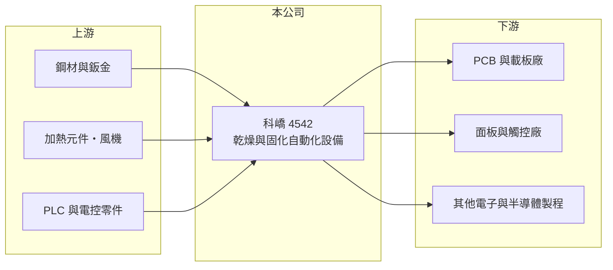

# 4542 科嶠

> 上櫃｜[[產業索引-電子零組件業|電子零組件業]]｜上市（櫃）日期 2014/08/25

# 第一章：企業模式與商業藍圖

> [!info] 撰寫說明
> 精簡版，由 Claude 依公開資料整理，架構比照 [[2330台積電]]，資料截至 2026-10-08。來源：櫃買中心開放資料（基本資料、2026 年第二季資產負債與綜合損益、股利）、Goodinfo 經營績效頁、nStock 公司頁、CMoney 個股快訊標題。公開資料有限，產品比重、客戶與生產據點未查得，產品描述多憑記憶整理。#待校對

科嶠是一家規模很小的設備廠，賣的是電子產品製程中用來烘乾、固化的自動化設備；理解它的關鍵，是電子業擴產週期如何決定設備訂單。

- **核心業務：** 依 nStock 公司資料，科嶠的主要營業項目是機械設備製造與批發，財經媒體多以「電子 3C 產業 [[自動化設備]]中的乾燥裝置廠」描述它。這類設備用在 [[PCB]]、面板、觸控與半導體等製程中，負責塗佈後的烘烤、油墨與膠材固化，屬於生產線上不可缺少、但不太起眼的環節（具體機種與應用比重待校對）。
- **商業模式：** 設備業以專案接單為主，客戶擴產或換新製程時才會下單，因此營收的波動大於一般零組件廠。好處是每台設備依製程客製，技術與售後服務能建立黏著度，毛利率可以明顯高於代工型公司，科嶠近年毛利率多落在 35% 至 40%。
- **營運規模：** 科嶠實收資本額約 3.5 億元，2025 年營收約 7.4 億元，屬於台灣上櫃公司中規模偏小的一群。它於 2000 年設立、2014 年上櫃，生產據點與海外子公司的配置未查得（推估以台灣與中國華南、華東電子聚落為主，待校對）。
- **長期方向：** 對這類設備廠而言，長期成長取決於兩件事：一是下游電子業擴產的地點與規模，例如 PCB 與載板往東南亞移動帶來的新廠需求；二是能否從單機設備往整線自動化與更高階製程（例如半導體與先進封裝相關的烘烤設備）延伸，以提高單價與毛利。公司在這些方向的具體進度未查得。

# 第二章：護城河深度與競爭優勢

科嶠的競爭力來自製程經驗與客製化能力，但規模小、客戶需求集中於景氣循環產業，護城河屬於窄而淺的一類。

- **競爭優勢：** 乾燥與固化設備的關鍵在於溫度均勻度、潔淨度與產能，客戶在製程驗證通過後，通常會在同一條產線上沿用同一家廠商的設備與備品，形成一定的轉換成本。科嶠近年 35% 以上的毛利率，顯示它在利基應用中仍有議價能力。
- **主要對手：** 台灣同類的電子製程設備廠包括 [[2467志聖]]、[[6664群翊]]、[[6438迅得]] 等，也會遇到日本與中國的熱處理設備商。其中志聖、群翊在 PCB 與載板烘烤設備的規模較大，科嶠需要在特定製程或客群上找到差異化（對手比較為推估，待校對）。
- **觀察重點：** 第一是毛利率能否穩定維持在 35% 以上，這反映產品是否往高階製程移動。第二是營業利益率能否在營收成長時明顯放大，2026 年第二季單季營益率約 14%，高於過去多數年度。第三是新接訂單的產業來源是否更分散，降低單一產業擴產週期的影響。

# 第三章：財務體質與盈利規模

資料日期：2026-10-08，表格是撰寫當時的快照；最新月營收、毛利率、累計 EPS 由自動排程寫在本筆記的屬性欄位（月營收、毛利率、累計EPS 等）。#待校對

科嶠的財務特色是毛利率高、營收規模小、獲利隨接單起伏很大。

| 年度 | 營收（億元） | [[毛利率]] | [[營業利益率]] | EPS（元） | [[ROE]] |
|---|---|---|---|---|---|
| 2020 | 5.45 | 28.7% | 4.80% | 0.67 | 3.37% |
| 2021 | 6.76 | 26.2% | 5.15% | 1.11 | 5.37% |
| 2022 | 7.74 | 25.0% | -4.15% | 0.04 | 0% |
| 2023 | 8.22 | 36.8% | 8.57% | 1.68 | 7.78% |
| 2024 | 5.34 | 39.7% | 2.17% | 0.08 | 0.43% |
| 2025 | 7.36 | 35.2% | 11.0% | 1.28 | 6.14% |
| 2026 上半年 | 5.55 | 39.0% | 11.8% | 1.49 | 半年，不年化 |

（2020 至 2025 年取自 Goodinfo；2026 上半年依櫃買中心第二季綜合損益計算。nStock 所載 2025 年營收為 7.28 億元，與 Goodinfo 略有差異。）

- **營收規模：** 2020 至 2025 年營收由 5.45 億元增至 7.36 億元，年複合成長率約 6.2%，但中間 2024 年曾掉到 5.34 億元，顯示設備接單的週期性。2026 年上半年營收已達 5.55 億元，接近 2024 年全年。
- **獲利：** 毛利率由 2020 至 2022 年的 25% 至 29%，提升到 2023 年以後的 35% 至 40%，代表產品組合明顯改善。但營業利益率波動很大，從 -4% 到 11% 不等，這是 [[營運槓桿]] 的作用：研發與人事等固定費用在營收少的年度會吃掉大部分毛利。近五年（2021 至 2025）平均 ROE 僅約 3.9%。
- **股利與財務：** 2024 年 EPS 僅 0.08 元仍發放 1 元現金股利，2025 年配發約 0.93 元，相對 EPS 1.28 元配息率約 73%（推算），顯示公司傾向維持股利穩定。2026 年第二季底股東權益 9.7 億元、負債 11.1 億元，負債多為流動負債，設備業常見的預收款與應付帳款可能占相當比重（未查得明細）。
- **[[ROIC]] 與 [[WACC]]：** 有息負債未查得，以股東權益近似投入資本。2025 年稅後營業利益約 7.36 億 × 11% × (1 − 20%) ≈ 0.65 億元，除以權益 9.7 億元，ROIC 約 6.7%（推算）；以 2026 上半年營業利益 0.66 億元年化，約 11%（推算）。WACC 以 CAPM 推估：無風險利率 1.75%、市場風險溢酬 6%、β 取設備股常見值 1.2，股權成本約 9%；負債成本假設 2.5%，WACC 約 8% 至 9%（推算）。過去多數年度 ROIC 低於 WACC，只有接單高峰年接近或超過，代表長期價值創造尚不穩定，2026 年的改善能否延續是關鍵。

# 第四章：總體風險與地緣政治

科嶠的風險集中在設備業固有的週期性，以及小公司對少數客戶與產業的依賴。

- **產業週期：** 電子製程設備的需求取決於客戶擴產，PCB、面板與消費性電子的資本支出常在兩三年內由高峰轉為急凍。2024 年營收年減約 35%，就是這種週期的典型表現，投資人應以多年度平均而非單一年度評估它的獲利能力。
- **營運風險：** 營收規模小，一兩張大單的認列時點就能讓季度獲利大起大落。設備交貨後還有驗收、保固與售後服務，若客戶延後驗收或發生品質爭議，會影響收入認列與現金回收。
- **競爭與技術風險：** 中國設備廠在價格上具競爭力，且近年積極進入電子製程設備市場。若下游製程改變（例如改用不同固化方式），既有機種可能被淘汰，需要持續投入研發。
- **其他風險：** 客戶擴產往東南亞移動時，需要在當地建立安裝與服務團隊，增加營運成本。匯率與鋼材、電控零件價格也會影響設備成本與報價。

# 專有名詞解析

## 金融

- **[[ROIC]]**：投入資本報酬率，衡量公司運用股東與債權人資金創造營業利潤的效率。
- **[[WACC]]**：加權平均資金成本，是股權與債權資金成本依資本結構加權後的平均值。
- **[[營運槓桿]]**：固定成本占比較高時，營收增加會讓利潤以更快的速度成長，反之亦然。

## 產業

- **[[自動化設備]]**：用來取代人工、自動完成搬運、加工、檢測或熱處理等工序的生產設備。
- **[[PCB]]**：印刷電路板，用銅箔線路連接電子零件的基板，是幾乎所有電子產品的骨架。

# 核心供應鏈

- 上游：鋼材與鈑金、加熱器與風機、PLC 與電控零件供應商（未查得具名廠商）。
- 下游／客戶：PCB、面板、觸控與其他電子製程廠（具名客戶未查得）。
- 同業：[[2467志聖]]、[[6664群翊]]、[[6438迅得]]（待校對）。

## 最新新聞
<!-- news:start -->
<!-- news:end -->

## 相關連結
- [公開資訊觀測站](https://mopsov.twse.com.tw/mops/web/t05st03?step=1&firstin=1&co_id=4542)
- [Goodinfo](https://goodinfo.tw/tw/StockDetail.asp?STOCK_ID=4542)
- [Yahoo 股市](https://tw.stock.yahoo.com/quote/4542)
- [鉅亨網新聞](https://www.cnyes.com/twstock/4542/news)
