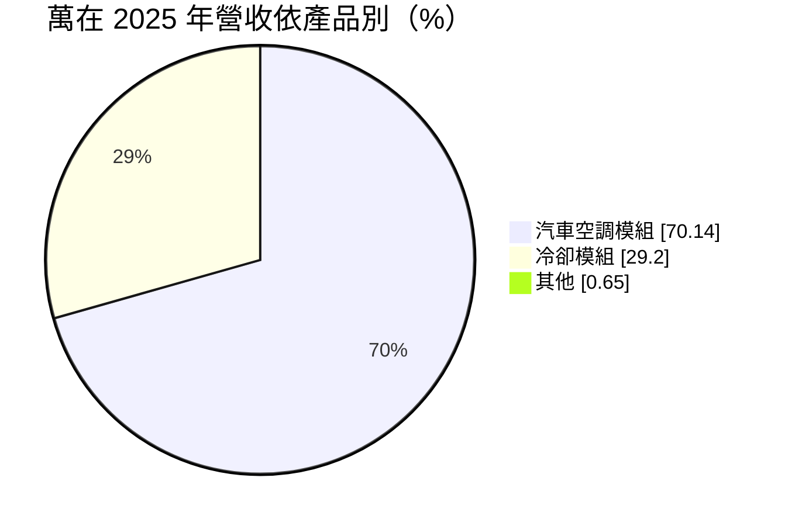
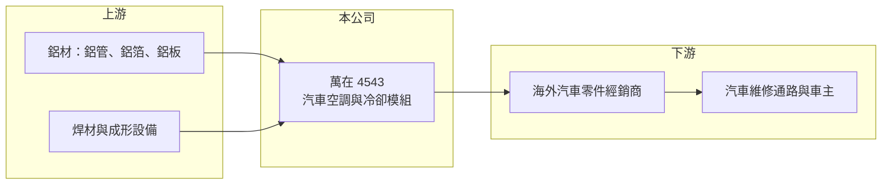

# 4543 萬在

> 上櫃｜[[產業索引-電機機械|電機機械]]｜上市（櫃）日期 2016/03/15

# 第一章：企業模式與商業藍圖

> [!info] 撰寫說明
> 精簡版，由 Claude 依公開資料整理，架構比照 [[2330台積電]]，資料截至 2026-10-08。來源：櫃買中心開放資料快照（基本資料、2026 年第二季資產負債與損益、本益比殖利率）、Goodinfo 經營績效頁、MoneyDJ 基本資料頁（2025 年營收比重與歷年股利）。銷售市場以售後維修市場為主一說係依產業常識整理，尚未從本次來源確認。公開資料有限。#待校對

萬在工業（以下簡稱萬在）是台南關廟的汽車熱交換零件製造商，產品分為汽車空調模組與冷卻模組兩大類。理解它的關鍵在於：這是一個以汽車熱管理零件為核心的利基型製造商，營收規模不大，但產品的單價與毛利會隨產品組合與原料價格明顯變動。

- **核心業務：** 萬在成立於 1984 年，2016 年在櫃買中心掛牌，董事長萬正乾兼任總經理，屬於家族經營的製造業公司。依 MoneyDJ 整理的 2025 年營收比重，汽車空調模組約占 70.1%、冷卻模組約占 29.2%。汽車空調模組包括冷凝器、蒸發器等熱交換器，冷卻模組則以引擎散熱用的水箱（散熱器）為主（推估，#待校對）。這類產品以鋁材為主要原料，經過管件成形、焊接與測漏等工序製成。
- **營收結構：** 台灣汽車熱交換器業者多數以出口[[售後維修市場]]為主，萬在的銷售市場推估也以海外汽車維修零件通路為主（#待校對）。售後市場的特性是車型品項多、單一品項量小，需求來自車輛老化後的更換，而不是新車銷售，因此與新車景氣的連動較低。若此推估正確，公司營收的穩定度主要取決於車隊規模與車齡。
- **營運據點：** 公司登記地址位於台南關廟，依 2026 年第二季資料非流動資產約 13.9 億元，占總資產一半以上，顯示公司擁有相當規模的廠房與設備。海外據點分布公開資料未查得。
- **長期方向：** 汽車電動化會改變熱管理系統的需求：電動車不需要傳統引擎水箱，但需要電池與電機的冷卻模組，空調系統也改用電動壓縮機與熱泵。萬在若能把熱交換器的製程能力延伸到電動車的熱管理零件，就能延長產品生命週期；若停留在燃油車零件，長期需求會隨燃油車比重下降而萎縮。

# 第二章：護城河深度與競爭優勢

萬在的護城河來自售後市場的品項廣度與製程經驗，屬於窄護城河。

- **競爭優勢：** 熱交換器需要鋁材成形、硬焊（爐焊）與測漏等專業製程，良率與耐用度決定客戶回購意願。售後市場講求「有沒有這個車型的料號」，長期累積的模具與料號數量本身就是進入門檻，新進者要追上需要多年時間。公司財務結構穩健，負債比約三成，有能力持續投入新料號開發。
- **主要對手：** 汽車熱交換器的售後市場競爭者包括台灣與中國大陸的同業，以及國際大廠旗下的售後品牌，中國大陸廠商在價格上具有明顯優勢。具體的主要對手名單公開資料未查得。原廠市場則由國際熱管理大廠主導，中小廠不容易打入。
- **觀察重點：** 長期最值得追蹤的是毛利率的穩定度。2022 至 2024 年毛利率在 26% 至 31% 之間，2025 年降到 21.9%，2026 年上半年又回升到約 31.9%（推算）。毛利率大幅擺動代表產品組合、鋁價與匯率對獲利影響很大，若能維持在三成附近，代表公司已站穩較高附加價值的產品。

# 第三章：財務體質與盈利規模

資料日期：2026-10-08，表格是撰寫當時的快照；最新月營收、毛利率、累計 EPS 由自動排程寫在本筆記的屬性欄位（月營收、毛利率、累計EPS 等）。#待校對

萬在的財務特色是營收長期持平在 8 億元上下，但毛利率與獲利起伏很大，資產規模相對營收偏大，使 ROE 長期不高。

| 年度 | 營收（億元） | [[毛利率]] | [[營業利益率]] | EPS（元） | [[ROE]] |
|---|---|---|---|---|---|
| 2021 | 9.27 | 19.2% | 5.30% | 0.53 | 2.01% |
| 2022 | 9.64 | 26.4% | 14.2% | 2.49 | 8.89% |
| 2023 | 8.36 | 30.8% | 16.5% | 2.41 | 8.06% |
| 2024 | 7.92 | 30.1% | 9.14% | 2.09 | 7.00% |
| 2025 | 8.03 | 21.9% | 5.76% | 0.53 | 1.75% |

（來源：Goodinfo 經營績效頁；2019 年營收 9.18 億元、EPS 0.32 元，2020 年營收 8.11 億元、EPS 0.19 元。）

- **營收規模：** 2020 至 2025 年營收由 8.11 億元到 8.03 億元，年複合成長率約 -0.2%（推算），基本持平。2026 年上半年營收約 4.86 億元，若下半年維持相近水準，全年可望高於近年平均（推估）。營收缺乏成長，代表公司的價值主要取決於獲利率而非規模擴張。
- **獲利：** 近五年（2021 至 2025）平均 ROE 約 5.5%（推算），即使在 2022 至 2023 年營業利益率達 14% 至 16% 的高點，ROE 也只有 8% 至 9%，原因是淨值相對營收偏大。2026 年上半年營業利益約 0.77 億元、營業利益率約 15.9%（推算），EPS 1.37 元，已高於 2025 年全年的 0.53 元，顯示獲利有明顯回升。
- **財務特色：** 依 2026 年第二季資料，總資產約 26.8 億元、權益約 18.7 億元、負債約 8.1 億元，負債比約 30%。依 MoneyDJ 資料，2019 至 2025 年度現金股利分別為 0.71、0、0、1.20、1.00、1.00、0.20 元，2025 年度另配股票股利 0.5 元；獲利低的年度會停發或少發現金股利，配息穩定度不高。
- **[[ROIC]] 與 [[WACC]]：** 以 2025 年營業利益約 0.46 億元（8.03 億元 × 5.76%）、稅率 20% 計算，稅後營業利益約 0.37 億元。有息負債未查得，投入資本以權益 18.7 億元到「權益加全部負債」26.8 億元為區間，ROIC 約 1.4% 至 2.0%（推算）；2023 年營業利益約 1.38 億元，同法推估 ROIC 約 4% 至 6%（推算）。WACC 以 [[CAPM]] 推估：無風險利率 1.75%、市場風險溢酬 6%、β 假設 0.9（汽車零件股常見值），權益成本約 7.2%；稅後負債成本假設 2%、負債占兩成，WACC 約 6.2%（推算）。即使在獲利較好的年度，ROIC 也低於 WACC，代表萬在長期沒有充分賺回資金成本，資產使用效率是公司最需要改善的地方。

# 第四章：總體風險與地緣政治

萬在的風險來自汽車動力轉型、原料與匯率，以及售後市場的價格競爭。

- **產業週期：** 售後維修市場的需求相對穩定，但會受到海外經銷商庫存調整影響，經銷商去化庫存時訂單可能突然縮減。長期來看，電動車普及會減少引擎水箱與傳統空調零件的需求，這是燃油車零件廠必須面對的結構性挑戰。轉型需要新的製程與客戶認證，時間往往以年計。
- **營運風險：** 熱交換器以鋁為主要原料，鋁價上漲時若無法即時轉嫁，毛利率就會被壓縮，2025 年毛利率大幅下滑可能與原料或產品組合有關（推估）。公司資產規模大，產能利用率不足時折舊負擔會拉低獲利。家族經營的公司，接班與治理安排也值得長期留意。
- **其他風險：** 產品以外銷為主（推估），新台幣升值會壓縮以台幣計算的營收與毛利。美國等主要市場的關稅政策變化，可能影響台灣出口零件的價格競爭力。中國大陸同業的低價競爭是長期壓力來源。

# 專有名詞解析

## 金融

- **[[CAPM]]**：資本資產定價模型，以無風險利率加上 β 乘以市場風險溢酬，估算股東要求的報酬率。

## 產業

- **[[售後維修市場]]**：汽車出廠後，用於維修與更換的零件市場（AM 市場），需求隨車輛老化而來，品項多、批量小。
- **[[熱交換器]]**：讓兩種流體交換熱量的裝置，汽車的冷凝器、蒸發器與水箱都屬於此類，多以鋁材製成。
- **[[熱管理]]**：控制電池、馬達、引擎與車艙溫度的系統，電動車需要比燃油車更複雜的冷卻與熱泵設計。

# 核心供應鏈

- 上游：鋁管、鋁箔與鋁板等鋁材供應商，以及焊材、成形與測漏設備供應商。
- 下游／客戶：海外汽車零件經銷商與維修通路（推估，具體客戶公開資料未點名，#待校對）。
- 同業：台灣與中國大陸的汽車熱交換器業者；同屬台灣汽車售後零件出口產業的還有 [[1522堤維西]]（車燈，產品不同，僅供產業對照）。

## 最新新聞
<!-- news:start -->
<!-- news:end -->

## 相關連結
- [公開資訊觀測站](https://mopsov.twse.com.tw/mops/web/t05st03?step=1&firstin=1&co_id=4543)
- [Goodinfo](https://goodinfo.tw/tw/StockDetail.asp?STOCK_ID=4543)
- [Yahoo 股市](https://tw.stock.yahoo.com/quote/4543)
- [鉅亨網新聞](https://www.cnyes.com/twstock/4543/news)
