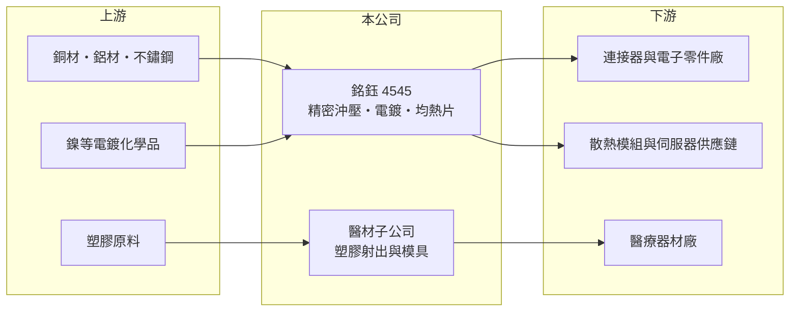

# 4545 銘鈺

> 上市｜[[產業索引-電子零組件業|電子零組件業]]｜上市（櫃）日期 2016/01/06

# 第一章：企業模式與商業藍圖

> [!info] 撰寫說明
> 精簡版，由 Claude 依公開資料整理，架構比照 [[2330台積電]]，資料截至 2026-10-08。來源：證交所開放資料（基本資料、2026 年第二季資產負債與綜合損益、股利）、Goodinfo 經營績效頁、nStock 公司頁、自由時報新聞標題。公開資料有限，產品比重與客戶未查得，客戶與應用描述部分憑記憶整理。#待校對

銘鈺是一家做精密金屬零件的小型加工廠，它的價值來自「沖壓、電鍍、表面處理一條龍」的製程整合，以及能否把這套能力移到散熱等新應用。

- **核心業務：** 依 nStock 所載營業項目，銘鈺經營鋁、銅製品的電鍍加工、[[精密沖壓]]金屬零件與無電解鎳表面處理。這類零件最常見的用途是 [[連接器]] 端子、電子產品的金屬遮罩與結構件，業界多將銘鈺歸類為連接器與電子零件的上游供應商（主要客戶未查得，待校對）。
- **新應用：散熱均熱片：** 財經媒體報導銘鈺布局 AI 伺服器散熱商機的 [[均熱片]]，這是覆蓋在處理器上、把熱快速攤平再導向散熱器的金屬片，需要高平整度的沖壓與電鍍處理，與銘鈺的既有製程高度相關（擴產時點與規模未查得年份，故不列入）。若能打入 AI 伺服器供應鏈，產品單價與技術門檻都會高於一般端子。
- **其他事業：** 依 nStock 資料，子公司從事醫療用塑膠射出器材，以及其模具與自動化機台的研發、製造與售後服務。這讓銘鈺在金屬加工之外多了一條醫材零件的收入來源，但比重與獲利貢獻未查得。
- **營運據點與長期方向：** 公司設於桃園觀音工業區，2016 年上市，實收資本額 7.7 億元。長期來看，銘鈺的方向是把沖壓與電鍍的製程能力，從消費性連接器延伸到散熱、車用與醫材等毛利較高、認證較嚴格的領域（海外生產據點未查得）。

# 第二章：護城河深度與競爭優勢

銘鈺的護城河來自製程整合與模具開發能力，但沖壓加工本身同質性高，議價能力有限。

- **競爭優勢：** 精密沖壓的難度在於模具設計與公差控制，再加上電鍍與表面處理若能在同一家公司完成，可以縮短交期、降低品質責任分散的問題。客戶一旦以某家廠商的模具量產，換廠要重新開模與驗證，形成一定的轉換成本。
- **主要對手：** 在連接器端子與金屬沖壓件方面，台灣與中國有大量同業，也有部分連接器大廠自行垂直整合沖壓。散熱均熱片方面則會遇到 [[3653健策]]、[[3017奇鋐]]、[[3324雙鴻]] 等散熱大廠，其中健策是均熱片的主要供應商，規模與客戶關係都遠勝銘鈺。
- **觀察重點：** 第一是毛利率能否從 2025 年的 15% 回到 20% 以上，這反映產品組合與稼動率。第二是均熱片等新產品能否取得穩定訂單並放大營收比重。第三是醫材子公司的營運是否成為穩定的獲利來源。

# 第三章：財務體質與盈利規模

資料日期：2026-10-08，表格是撰寫當時的快照；最新月營收、毛利率、累計 EPS 由自動排程寫在本筆記的屬性欄位（月營收、毛利率、累計EPS 等）。#待校對

銘鈺的財務呈現「營收穩定、利潤率偏低且波動」的加工廠特徵，2025 年獲利明顯下滑。

| 年度 | 營收（億元） | [[毛利率]] | [[營業利益率]] | EPS（元） | [[ROE]] |
|---|---|---|---|---|---|
| 2020 | 19.2 | 22.7% | 5.94% | 0.39 | 1.76% |
| 2021 | 21.7 | 21.2% | 6.00% | 1.16 | 5.23% |
| 2022 | 22.8 | 21.3% | 7.33% | 2.10 | 8.96% |
| 2023 | 20.8 | 18.4% | 4.22% | 1.08 | 4.42% |
| 2024 | 24.0 | 22.7% | 7.57% | 2.37 | 9.44% |
| 2025 | 23.9 | 15.3% | 1.46% | 0.17 | 0.67% |
| 2026 上半年 | 11.3 | 16.5% | 2.0% | 0.47 | 半年，不年化 |

（2020 至 2025 年取自 Goodinfo；2026 上半年依證交所第二季綜合損益計算。）

- **營收規模：** 2020 至 2025 年營收由 19.2 億元增至 23.9 億元，年複合成長率約 4.5%，波動不大，顯示既有客戶的訂單相對穩定。
- **獲利：** 毛利率多數年度在 18% 至 23% 之間，2025 年降到 15.3%，營業利益率只剩 1.5%，EPS 由 2.37 元降到 0.17 元。2026 年上半年毛利率 16.5%、營益率 2.0%，仍未回到過去水準。對加工廠來說，毛利率幾個百分點的變化就足以讓獲利大幅波動，這是低利潤率行業的 [[營運槓桿]]。
- **股利與財務：** 近五年（2021 至 2025）平均 ROE 約 5.7%。2025 年度配發現金股利 0.13 元，配息率約 76%（推算）。2026 年第二季底總資產 33.5 億元、負債 14.0 億元、權益 19.4 億元，負債比約 42%，財務結構尚屬穩健。
- **[[ROIC]] 與 [[WACC]]：** 有息負債未查得，以股東權益近似投入資本。2025 年稅後營業利益約 23.9 億 × 1.46% × (1 − 20%) ≈ 0.28 億元，除以權益 19.4 億元，ROIC 約 1.4%（推算）；較好的 2024 年約為 1.82 億 × 0.8 ÷ 19.4 億 ≈ 7.5%（推算）。WACC 以 CAPM 推估：無風險利率 1.75%、市場風險溢酬 6%、β 取電子零組件常見值 1.0，股權成本約 7.8%；負債成本假設 2.5%、負債約占三成，WACC 約 6% 至 7%（推算）。銘鈺只有在景氣好的年度 ROIC 才接近 WACC，多數年度低於資金成本，代表既有業務的價值創造能力有限，轉型到高毛利產品是改善的關鍵。

# 第四章：總體風險與地緣政治

銘鈺的風險在於加工業的低毛利結構、下游電子產品的週期，以及新產品能否成功放量。

- **產業週期：** 沖壓零件的需求跟著連接器與終端電子產品的出貨起伏，當 PC、手機或網通進入庫存調整期，加工廠的稼動率與毛利率會同步下滑。2025 年獲利驟降，顯示銘鈺對產能利用率相當敏感。
- **營運風險：** 加工廠的議價能力有限，原料上漲或客戶要求降價時，很難完全轉嫁。新開發的均熱片若良率不佳或未取得主要客戶認證，前期投入的設備與人力會成為折舊與費用負擔。
- **原物料與環保：** 銅、鎳等金屬價格波動直接影響成本。電鍍與表面處理屬於環保管制較嚴的製程，廢水處理與法規要求提高，會增加營運成本，但也提高新進者的門檻。
- **其他風險：** 醫材子公司需符合醫療器材的品質法規，認證與稽核成本較高。新台幣匯率與客戶產地轉移，也會影響接單與報價。

# 專有名詞解析

## 金融

- **[[營運槓桿]]**：固定成本占比較高時，營收增加會讓利潤以更快的速度成長，反之亦然。
- **[[ROIC]]**：投入資本報酬率，衡量公司運用股東與債權人資金創造營業利潤的效率。
- **[[WACC]]**：加權平均資金成本，是股權與債權資金成本依資本結構加權後的平均值。

## 產業

- **[[精密沖壓]]**：以模具與沖床把金屬薄板快速衝壓成高精度零件，是連接器端子與金屬結構件的主要製程。
- **[[連接器]]**：讓電子零件或設備之間可插拔連接、傳輸電力與訊號的元件。
- **[[均熱片]]**：覆蓋在晶片上方的金屬片，把局部熱點的熱量攤平後再傳給散熱器。

# 核心供應鏈

- 上游：銅、鋁、不鏽鋼板材，電鍍化學品與塑膠原料供應商（未查得具名廠商）。
- 下游／客戶：連接器與電子零件廠、散熱模組與伺服器供應鏈、醫療器材廠（具名客戶未查得）。
- 同業：[[3653健策]]、[[3017奇鋐]]、[[3324雙鴻]]（散熱均熱片），以及台灣與中國的精密沖壓加工廠。

## 最新新聞
<!-- news:start -->
<!-- news:end -->

## 相關連結
- [公開資訊觀測站](https://mopsov.twse.com.tw/mops/web/t05st03?step=1&firstin=1&co_id=4545)
- [Goodinfo](https://goodinfo.tw/tw/StockDetail.asp?STOCK_ID=4545)
- [Yahoo 股市](https://tw.stock.yahoo.com/quote/4545)
- [鉅亨網新聞](https://www.cnyes.com/twstock/4545/news)
