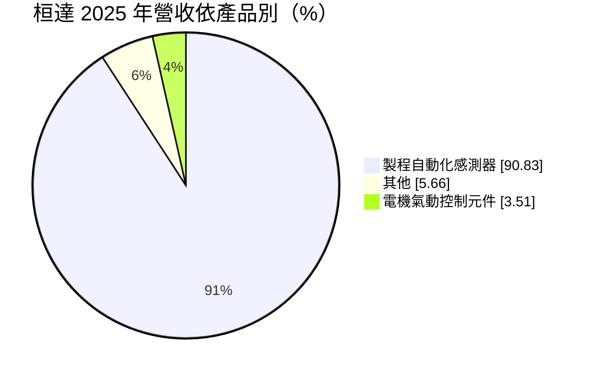
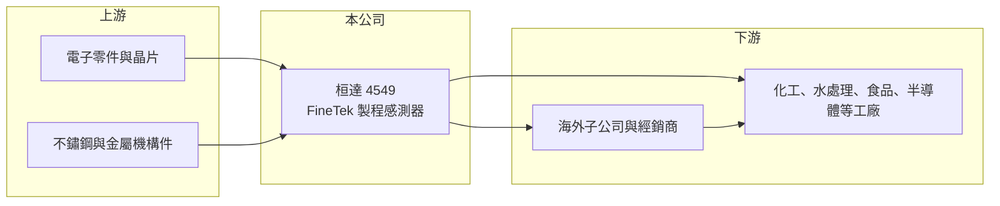

# 4549 桓達

> 上櫃｜[[產業索引-電機機械|電機機械]]｜上市（櫃）日期 2014/11/27

# 第一章：企業模式與商業藍圖

> [!info] 撰寫說明
> 精簡版，由 Claude 依公開資料整理，架構比照 [[2330台積電]]，資料截至 2026-10-08。來源：櫃買中心開放資料快照（基本資料、2026 年第二季資產負債與損益、本益比殖利率）、Goodinfo 經營績效頁、MoneyDJ 基本資料頁（2025 年營收比重與歷年股利）、CMoney 新股掛牌文章標題（中國客戶比重高）。產品細項與海外據點係依公司品牌 FineTek 的公開形象整理，尚未逐條比對原始文件。#待校對

桓達科技（以下簡稱桓達，品牌 FineTek）是台灣少數以自有品牌銷售工業[[製程感測器]]的公司，產品用來量測工廠儲槽與管線中的液位、料位與流量。理解它的關鍵在於：這是一門「小量多樣、高毛利」的工業儀表生意，毛利率長期超過五成，但成長跟著客戶的工廠資本支出循環走。

- **核心業務：** 桓達成立於 2003 年，2014 年在櫃買中心掛牌，總部位於新北市土城工業區，董事長吳定國兼任總經理。依 MoneyDJ 整理的 2025 年營收比重，製程自動化感測器約占 90.8%、電機氣動控制元件約占 3.5%、其他約 5.7%。感測器產品包括[[液位計]]、料位開關、流量計與壓力、溫度量測儀表（#待校對），安裝在化工、水處理、食品、塑膠、電力與半導體等產業的儲槽與管線上，讓工廠知道物料存量與流動狀態。
- **營收結構：** 依公司掛牌時的媒體報導標題，桓達的中國大陸客戶比重高，因此營收明顯受中國大陸製造業投資與利率政策影響。工業儀表屬於工廠的「必要小零件」，單價不高但品項多，客戶看重的是量測可靠度與交期，而不是最低價格，這是毛利率可以維持在五成以上的原因。
- **營運據點：** 公司以台灣為研發與生產中心，透過海外子公司與經銷商銷售到全球市場，海外據點的具體分布本次來源未能確認（#待校對）。以自有品牌經營海外通路，代表公司要自行負擔行銷與技術服務費用，營業費用率較高，但也能保留品牌溢價。
- **長期方向：** 工業自動化與智慧製造的長期趨勢，會讓工廠需要更多感測器把現場數據上傳到控制系統，這是製程儀表的長期成長動能。桓達的機會在於從單一儀表供應商，往整合量測與通訊的解決方案發展，並分散中國大陸以外的市場；挑戰則是與國際儀表大廠在高階市場正面競爭。

# 第二章：護城河深度與競爭優勢

桓達的護城河來自自有品牌、產品廣度與工業客戶的轉換成本，在台灣同業中相對少見。

- **競爭優勢：** 製程感測器一旦安裝在工廠的儲槽或管線上，客戶通常會沿用同一品牌的備品與擴線需求，因為更換品牌要重新設計安裝介面、校正與訓練人員。桓達的產品線涵蓋多種量測原理（如雷達、超音波、音叉、浮球等，#待校對），可以滿足客戶一站購足的需求。毛利率長期維持在 53% 至 58%，是護城河存在的最直接證據。
- **主要對手：** 國際製程儀表大廠如瑞士 Endress+Hauser、德國 VEGA、KROHNE、西門子等，在高階與大型專案市場占有優勢；中國大陸本土儀表廠則以價格搶占中低階市場。桓達的定位介於兩者之間，以較國際大廠低的價格提供穩定品質。
- **觀察重點：** 長期最值得追蹤的是營業利益率能否回到 2019 至 2022 年 24% 至 26% 的水準。2025 年營收 12.4 億元、營業利益率降到 14.5%，主要是營收下滑而營業費用相對固定；2026 年上半年營業利益率回升到約 23.7%（推算）。營收規模能否重回成長，決定[[營業槓桿]]是往上還是往下發揮作用。

# 第三章：財務體質與盈利規模

資料日期：2026-10-08，表格是撰寫當時的快照；最新月營收、毛利率、累計 EPS 由自動排程寫在本筆記的屬性欄位（月營收、毛利率、累計EPS 等）。#待校對

桓達的財務特色是高毛利、高配息、ROE 長期在一成五上下，但近三年隨中國大陸製造業投資放緩而下滑。

| 年度 | 營收（億元） | [[毛利率]] | [[營業利益率]] | EPS（元） | [[ROE]] |
|---|---|---|---|---|---|
| 2021 | 12.7 | 56.9% | 26.5% | 6.27 | 18.8% |
| 2022 | 14.3 | 53.6% | 24.6% | 6.59 | 20.1% |
| 2023 | 13.7 | 52.9% | 22.8% | 4.89 | 15.4% |
| 2024 | 12.8 | 54.6% | 21.1% | 4.72 | 14.1% |
| 2025 | 12.4 | 53.0% | 14.5% | 3.32 | 9.74% |

（來源：Goodinfo 經營績效頁；2019 年營收 11.1 億元、EPS 5.11 元，2020 年營收 10.1 億元、EPS 5.49 元。）

- **營收規模：** 2020 至 2025 年營收由 10.1 億元增至 12.4 億元，年複合成長率約 4.2%（推算），高點為 2022 年的 14.3 億元。2023 年起營收連續三年小幅下滑，與中國大陸製造業投資放緩的時間點一致。2026 年上半年營收約 5.73 億元，略低於 2025 年全年營收的一半（推算）。
- **獲利：** 近五年（2021 至 2025）平均 ROE 約 15.6%（推算），在台灣中小型製造業中屬於優秀水準。毛利率幾乎沒有變化，獲利下滑主要來自營收減少後營業費用占比上升。2026 年上半年毛利率約 62.7%、EPS 2.28 元（推算毛利率），獲利較 2025 年回溫。
- **財務特色：** 依 2026 年第二季資料，總資產約 28.3 億元、權益約 18.9 億元、負債約 9.5 億元，其中非流動負債約 5.5 億元，資金來源的細項未查得。依 MoneyDJ 資料，2019 至 2025 年度現金股利分別為 4.00、3.99、4.10、4.00、4.00、4.10、3.00 元，2025 年度另配股票股利 0.2 元，現金股利長期穩定在每股 4 元左右，配息率多在六至九成（推算），是典型的高配息型公司。
- **[[ROIC]] 與 [[WACC]]：** 以 2025 年營業利益約 1.80 億元（12.4 億元 × 14.5%）、稅率 20% 計算，稅後營業利益約 1.44 億元。有息負債未查得，投入資本以權益 18.9 億元到「權益加全部負債」28.3 億元為區間，ROIC 約 5.1% 至 7.6%（推算）；2022 年營業利益約 3.52 億元，以當時約 18 億元的權益估算，ROIC 約 11% 至 15%（推算）。WACC 以 [[CAPM]] 推估：無風險利率 1.75%、市場風險溢酬 6%、β 假設 0.9（工業自動化股常見值），權益成本約 7.2%；稅後負債成本假設 2%、負債占兩成，WACC 約 6.2%（推算）。2019 至 2024 年 ROIC 明顯高於 WACC，代表桓達長期創造經濟價值；2025 年利差縮小到接近零，能否回到過去水準取決於營收回升。

# 第四章：總體風險與地緣政治

桓達的風險主要來自中國大陸市場依賴、工業投資循環與國際品牌競爭。

- **產業週期：** 製程儀表的需求來自新建工廠、產線擴充與舊設備汰換，與製造業資本支出高度相關。中國大陸製造業投資放緩、產能過剩時，新廠與擴線案件減少，桓達的營收就會受影響，2023 至 2025 年的下滑即是一例。汰換需求可以提供一定的底部支撐，但無法完全抵銷新案減少。
- **營運風險：** 自有品牌模式需要長期投入研發、通路與技術服務，營業費用相對固定，營收下滑時營業利益率會快速下降。產品品項多、批量小，庫存管理與交期控制是營運效率的關鍵。若中國大陸本土儀表廠持續提升品質，可能侵蝕桓達在中階市場的價格優勢。
- **其他風險：** 中國大陸營收比重高，使公司暴露在兩岸政治關係、中國大陸產業政策與人民幣匯率的風險下。美中貿易摩擦可能讓部分客戶調整生產地點，對桓達而言既是風險，也是拓展東南亞等新市場的機會。電子零組件與晶片的供應穩定性，也會影響感測器的生產。

# 專有名詞解析

## 金融

- **[[營業槓桿]]**：固定成本占比高時，營收小幅變動會讓營業利益大幅變動的現象。
- **[[CAPM]]**：資本資產定價模型，以無風險利率加上 β 乘以市場風險溢酬，估算股東要求的報酬率。

## 產業

- **[[製程感測器]]**：安裝在工廠儲槽、管線與設備上，即時量測液位、流量、壓力與溫度的儀表，是製程自動化的基本元件。
- **[[液位計]]**：量測儲槽或容器中液體或粉粒料高度的儀表，常見原理有雷達、超音波、音叉與浮球式。

# 核心供應鏈

- 上游：感測與通訊用電子零件、晶片，以及不鏽鋼外殼與金屬機構件供應商。
- 下游／客戶：化工、石化、水處理、食品、塑膠、電力與半導體等產業的工廠與系統整合商，中國大陸客戶比重高（具體客戶公開資料未點名）。
- 同業：Endress+Hauser、VEGA、KROHNE、西門子等國際製程儀表品牌；台灣自動化產業的相關業者如 [[8374羅昇]]（自動化元件通路，業務不同，僅供產業對照）。

## 最新新聞
<!-- news:start -->
<!-- news:end -->

## 相關連結
- [公開資訊觀測站](https://mopsov.twse.com.tw/mops/web/t05st03?step=1&firstin=1&co_id=4549)
- [Goodinfo](https://goodinfo.tw/tw/StockDetail.asp?STOCK_ID=4549)
- [Yahoo 股市](https://tw.stock.yahoo.com/quote/4549)
- [鉅亨網新聞](https://www.cnyes.com/twstock/4549/news)
