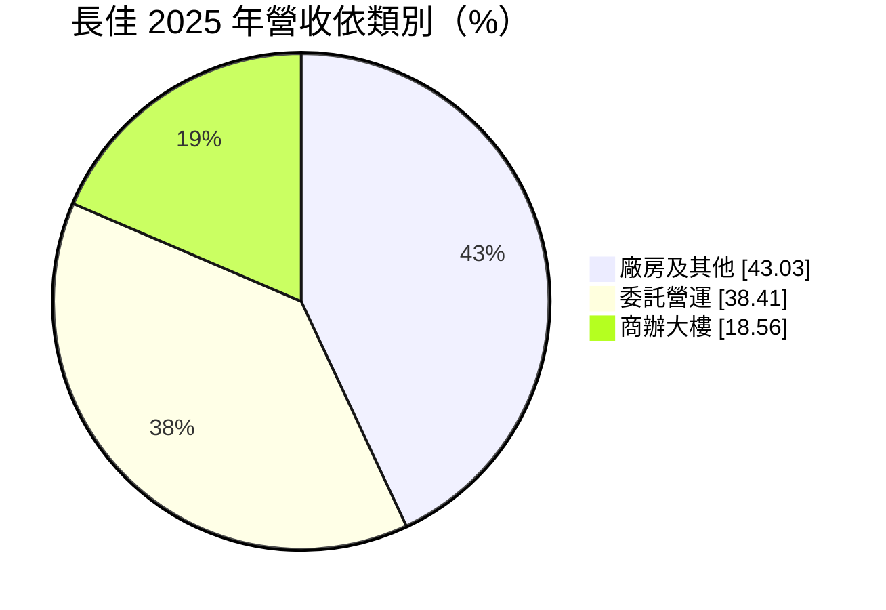
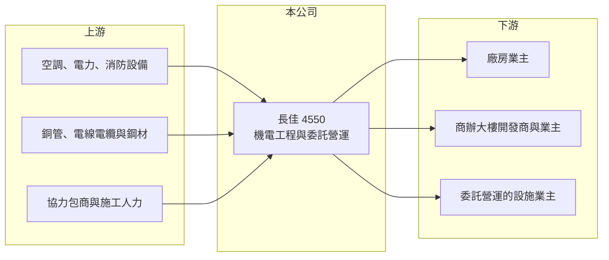

# 4550 長佳

> 上櫃｜[[產業索引-電機機械|電機機械]]｜上市（櫃）日期 2015/03/18

# 第一章：企業模式與商業藍圖

> [!info] 撰寫說明
> 精簡版，由 Claude 依公開資料整理，架構比照 [[2330台積電]]，資料截至 2026-10-08。來源：櫃買中心開放資料快照（基本資料、2026 年第二季資產負債與損益、本益比殖利率）、Goodinfo 經營績效頁、MoneyDJ 基本資料頁（2025 年營收比重與歷年股利）、科技新報公司資料頁標題（公司全名長佳機電工程股份有限公司）。工程類型與委託營運內容係依營收分類整理，尚未逐條比對原始文件。公開資料有限。#待校對

長佳機電工程（以下簡稱長佳）是一家承攬建築[[機電工程]]、並提供設施委託營運服務的公司。理解它的關鍵在於：工程承攬的營收隨接案時程起伏，而委託營運屬於按期收費的長期合約，兩者合在一起決定了公司營收的波動程度。

- **核心業務：** 長佳成立於 1993 年，2015 年在櫃買中心掛牌，總部位於台北內湖，董事長為王才翔、總經理為吳陽明。公司的本業是建築機電工程，也就是替廠房、辦公大樓等建築物規劃與施作空調、電力、給排水、消防等系統（#待校對）。機電工程通常占建築總造價的兩到三成，是建築能否正常使用的關鍵。
- **營收結構：** 依 MoneyDJ 整理的 2025 年營收比重，廠房及其他工程約占 43.0%、[[委託營運]]約占 38.4%、商辦大樓工程約占 18.6%。委託營運是業主把大樓或設施的機電系統交給專業廠商長期操作與維護，按合約期間收費，屬於[[經常性收入]]。這部分占比接近四成，是長佳營收相對其他工程公司更穩定的原因。
- **營運據點：** 公司總部在台北內湖，承攬的工程以台灣為主（推估）。工程公司的主要資產是技術人員、施工管理經驗與過去的實績，而不是大型廠房設備，因此資本支出需求較低。
- **長期方向：** 長佳的長期成長來自兩股力量：一是台灣廠房與商辦的新建與翻修需求，二是建築物進入維運階段後的委託營運需求。前者受景氣與企業投資影響大，後者隨著已完工建築累積而逐步成長。提高委託營運比重，可以讓公司營收更具可預測性，是較理想的長期發展方向。

# 第二章：護城河深度與競爭優勢

長佳的護城河來自工程實績與長期維運合約，屬於窄護城河。

- **競爭優勢：** 機電工程的業主在選擇廠商時非常重視過去實績與施工品質，因為機電系統出問題會影響整棟建築的使用。長佳累積三十多年的施工經驗，有助於取得大型業主的信任。委託營運合約一旦簽訂，通常會持續數年，業主更換維運廠商需要重新交接系統資料，這構成一定的轉換成本。
- **主要對手：** 台灣機電工程市場競爭者眾多，從大型營造集團旗下的機電公司，到專做無塵室與廠務的 [[2404漢唐]]、[[6139亞翔]]，以及許多中小型機電包商，價格競爭激烈。長佳的規模相對較小，主要在中型廠房、商辦與維運市場競爭（推估）。
- **觀察重點：** 長期最值得追蹤的是毛利率與委託營運比重。2019 年毛利率曾有 18.5%，2021 年降到 10% 以下，2022 年以後回到 14% 至 17%。工程毛利率受原物料價格與人工成本影響大，若委託營運比重持續提高，整體毛利率的波動應會縮小。

# 第三章：財務體質與盈利規模

資料日期：2026-10-08，表格是撰寫當時的快照；最新月營收、毛利率、累計 EPS 由自動排程寫在本筆記的屬性欄位（月營收、毛利率、累計EPS 等）。#待校對

長佳的財務特色是營收隨工程認列大幅起伏、毛利率屬工程業水準，但配息穩定。

| 年度 | 營收（億元） | [[毛利率]] | [[營業利益率]] | EPS（元） | [[ROE]] |
|---|---|---|---|---|---|
| 2021 | 14.2 | 9.99% | 1.70% | 1.41 | 6.47% |
| 2022 | 13.6 | 17.4% | 8.60% | 2.83 | 12.5% |
| 2023 | 19.1 | 13.8% | 7.37% | 3.26 | 13.5% |
| 2024 | 12.5 | 16.0% | 7.99% | 3.16 | 12.5% |
| 2025 | 9.19 | 15.3% | 5.74% | 1.34 | 5.25% |

（來源：Goodinfo 經營績效頁；2019 年營收 11.5 億元、EPS 2.80 元，2020 年營收 13.3 億元、EPS 2.27 元。）

- **營收規模：** 2020 至 2025 年營收由 13.3 億元降到 9.19 億元，年複合成長率約 -7.1%（推算），但期間 2023 年曾達 19.1 億元的高點。工程公司的營收依完工進度認列，大型案件集中完工的年份營收會跳升，案件青黃不接時則會下滑。2026 年上半年營收約 3.65 億元。
- **獲利：** 近五年（2021 至 2025）平均 ROE 約 10.0%（推算）。2021 年營業利益率只有 1.7%，但 EPS 仍有 1.41 元，顯示當年業外收益占比高。2026 年上半年營業利益率約 10.5%、EPS 0.88 元（推算營業利益率），本業獲利率較 2025 年改善。
- **財務特色：** 依 2026 年第二季資料，總資產約 15.9 億元、權益約 9.37 億元、負債約 6.52 億元，負債中流動負債約 4.75 億元，推估多為工程相關的應付款與預收款（#待校對）。依 MoneyDJ 資料，2019 至 2025 年度現金股利分別為 1.50、1.68、1.15、1.90、2.10、2.00、1.22 元，每年都有配息、金額穩定，配息率多在五至九成（推算）。
- **[[ROIC]] 與 [[WACC]]：** 以 2025 年營業利益約 0.53 億元（9.19 億元 × 5.74%）、稅率 20% 計算，稅後營業利益約 0.42 億元。有息負債未查得，投入資本以權益 9.37 億元到「權益加全部負債」15.9 億元為區間，ROIC 約 2.7% 至 4.5%（推算）；2024 年營業利益約 1.0 億元，同法推估約 5% 至 8.5%（推算）。WACC 以 [[CAPM]] 推估：無風險利率 1.75%、市場風險溢酬 6%、β 假設 0.8（工程服務股常見值），權益成本約 6.6%；負債多為營運性負債，WACC 約 6.0% 至 6.6%（推算）。景氣較好的年度 ROIC 大致與 WACC 相當或略高，2025 年則低於 WACC；由於工程公司實際投入的資本不多，若扣除營運性負債，真實的資本報酬可能高於上述區間。

# 第四章：總體風險與地緣政治

長佳的風險來自工程接案的不穩定、成本控管與營建景氣。

- **產業週期：** 機電工程需求跟著台灣廠房投資與商辦開發走，企業擴產或建商推案減少時，新接訂單會跟著下降。工程從得標到完工往往需要一到兩年，營收與獲利的認列會落後於景氣變化。委託營運可以提供部分緩衝，但無法完全抵銷工程營收的起伏。
- **營運風險：** 工程以固定總價得標時，若施工期間銅、鋼材、設備價格或人工成本上漲，差額通常由承包商吸收，2021 年毛利率跌破一成就是成本壓力的例子（推估）。工程延誤、驗收爭議與保固責任也可能產生額外成本。營建業普遍缺工，技術人員的招募與留任是長期挑戰。
- **其他風險：** 營建相關法規、建築節能與消防標準的變動，會影響工程設計與成本。業主財務狀況不佳時可能拖延付款，工程應收款的回收風險需要留意。利率上升會壓抑商辦與廠房的投資意願。

# 專有名詞解析

## 金融

- **[[CAPM]]**：資本資產定價模型，以無風險利率加上 β 乘以市場風險溢酬，估算股東要求的報酬率。

## 產業

- **[[機電工程]]**：建築物中空調、電力、給排水、消防等系統的設計與施工，占建築總造價的重要比例。
- **[[委託營運]]**：業主把大樓或設施的機電系統交由專業廠商長期操作與維護，依合約期間收費。
- **[[經常性收入]]**：訂閱、維護合約等按期重複收取的收入，比一次性銷售更穩定、可預測。

# 核心供應鏈

- 上游：空調、配電、消防與給排水設備供應商（例如 [[1504東元]]、[[1503士電]] 等機電設備廠，僅舉例），電線電纜與銅管等材料商，以及協力包商。
- 下游／客戶：廠房業主、商辦大樓開發商與業主、委託營運的設施業主；具體客戶公開資料未點名（#待校對）。
- 同業：[[2404漢唐]]、[[6139亞翔]] 等機電與廠務工程公司，以及其他中小型機電包商。

## 最新新聞
<!-- news:start -->
<!-- news:end -->

## 相關連結
- [公開資訊觀測站](https://mopsov.twse.com.tw/mops/web/t05st03?step=1&firstin=1&co_id=4550)
- [Goodinfo](https://goodinfo.tw/tw/StockDetail.asp?STOCK_ID=4550)
- [Yahoo 股市](https://tw.stock.yahoo.com/quote/4550)
- [鉅亨網新聞](https://www.cnyes.com/twstock/4550/news)
