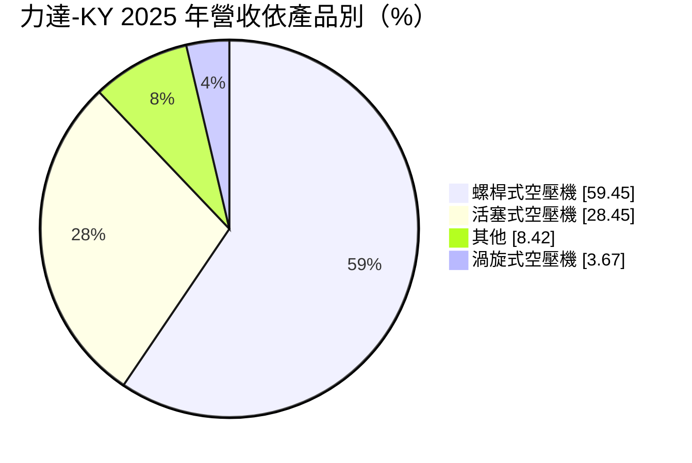
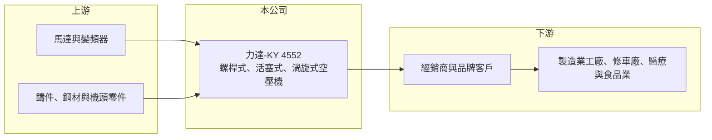

# 4552 力達-KY

> 上市｜[[產業索引-電機機械|電機機械]]｜上市（櫃）日期 2016/07/20

# 第一章：企業模式與商業藍圖

> [!info] 撰寫說明
> 精簡版，由 Claude 依公開資料整理，架構比照 [[2330台積電]]，資料截至 2026-10-08。來源：證交所開放資料快照（基本資料、2026 年第二季資產負債與損益、營益分析、2025 年度股利、本益比殖利率）、Goodinfo 經營績效頁、MoneyDJ 基本資料頁（2025 年營收比重與歷年股利）。生產基地與銷售市場係依 KY 公司結構整理，尚未逐條比對原始文件。公開資料有限。#待校對

力達控股（以下簡稱力達-KY）是以[[空氣壓縮機]]為唯一主業的製造商，產品涵蓋螺桿式、活塞式與渦旋式三大類。理解它的關鍵在於：空壓機是工廠的基本動力設備，需求穩定但競爭成熟，力達的獲利能力近年明顯下滑，而帳上淨值相對營收偏大，使 ROE 長期偏低。

- **核心業務：** 力達-KY 為開曼群島註冊的控股公司，2012 年成立，2016 年在證交所上市，董事長為吳建能、總經理為陳乙平。空氣壓縮機把空氣加壓後供工廠的氣動工具、自動化設備、噴漆與包裝機使用，被稱為工廠的「第四種公用能源」（電、水、氣之外的壓縮空氣）。依 MoneyDJ 整理的 2025 年營收比重，[[螺桿式空壓機]]約占 59.5%、活塞式約占 28.5%、渦旋式約占 3.7%、其他約 8.4%。
- **營收結構：** 螺桿式空壓機用於中大型工廠的連續供氣，是產業主流與獲利主力；活塞式空壓機結構簡單、價格較低，多用於小型工廠、修車廠與家用；渦旋式空壓機噪音低、空氣潔淨，用於醫療、實驗室與食品產業。三類產品涵蓋從小型到工業級的需求，讓公司可以服務不同規模的客戶。
- **營運據點：** 作為 KY 公司，力達的主要生產與營運基地在中國大陸（#待校對），在台灣設有辦公室負責資本市場事務。依 2026 年第二季資料，非流動資產約 43.6 億元，占總資產一半以上，代表公司持有相當規模的廠房、土地與設備。2026 年上半年其他綜合損益約 3.3 億元，主要應來自外幣換算差異，反映資產以人民幣等外幣計價（推估）。
- **長期方向：** 空壓機產業的長期趨勢是節能化，例如[[變頻空壓機]]與永磁馬達可以依用氣量調整轉速，大幅降低耗電。各國節能法規與工廠減碳需求，會推動舊機汰換為高效機種，這是空壓機廠的長期換機動能。力達能否在節能機種上建立技術與品牌優勢，是決定未來獲利能否回升的關鍵。

# 第二章：護城河深度與競爭優勢

力達-KY 的護城河有限，主要來自產品線完整與規模化生產，而非技術或品牌獨占。

- **競爭優勢：** 力達同時生產三種原理的空壓機，可以滿足客戶從小型到大型的不同需求，產品線廣度是一項優勢。多年的量產經驗讓公司在成本控制上有一定基礎，2019 至 2023 年毛利率穩定在 19% 至 22%。不過這些優勢在成熟的空壓機產業中並不罕見，難以形成高進入門檻。
- **主要對手：** 全球空壓機市場由瑞典 Atlas Copco、美國 Ingersoll Rand 等國際大廠主導，掌握高階市場與品牌溢價；中國大陸則有大量本土空壓機廠以價格競爭，台灣則有復盛等老牌業者。力達夾在國際品牌與本土低價廠之間，定價空間有限。
- **觀察重點：** 長期最值得追蹤的是營業利益率能否回到一成以上。2019 至 2023 年營業利益率在 9% 至 13% 之間，2024 年降到 5.6%，2025 年回到 9.0%，但 2026 年上半年又降到 0.69%，波動劇烈。若毛利率持續低於 18%，代表價格競爭已經壓縮到公司的基本獲利能力。

# 第三章：財務體質與盈利規模

資料日期：2026-10-08，表格是撰寫當時的快照；最新月營收、毛利率、累計 EPS 由自動排程寫在本筆記的屬性欄位（月營收、毛利率、累計EPS 等）。#待校對

力達-KY 的財務特色是營收規模三十多億元、淨值很高、負債不高，但近年營收萎縮、ROE 長期低於一成。

| 年度 | 營收（億元） | [[毛利率]] | [[營業利益率]] | EPS（元） | [[ROE]] |
|---|---|---|---|---|---|
| 2021 | 50.0 | 19.0% | 10.5% | 3.13 | 6.84% |
| 2022 | 51.4 | 22.2% | 12.8% | 3.84 | 7.95% |
| 2023 | 50.5 | 22.1% | 12.1% | 3.46 | 6.83% |
| 2024 | 36.3 | 20.1% | 5.60% | 1.19 | 2.27% |
| 2025 | 34.7 | 19.4% | 9.00% | 2.07 | 3.89% |

（來源：Goodinfo 經營績效頁；2019 年營收 54.3 億元、EPS 3.22 元，2020 年營收 43.8 億元、EPS 2.22 元。2025 年稅後淨利約 2.41 億元，取自證交所股利資料。）

- **營收規模：** 2020 至 2025 年營收由 43.8 億元降到 34.7 億元，年複合成長率約 -4.6%（推算），2024 年營收較 2023 年大減約 28%，是近年最明顯的轉折。2026 年上半年營收約 16.4 億元，仍在縮小的區間。營收下滑的具體原因（市場需求、客戶流失或產品調整）本次來源未能確認（#待校對）。
- **獲利：** 近五年（2021 至 2025）平均 ROE 約 5.6%（推算），即使在營業利益率超過一成的年份，ROE 也只有 7% 至 8%，原因是每股淨值約 55.7 元，遠高於每年 2 至 4 元的 EPS。2026 年上半年營業利益僅約 0.11 億元，加上業外損失，EPS 為 -0.07 元，獲利轉弱。
- **財務特色：** 依 2026 年第二季資料，總資產約 83.7 億元、權益約 64.6 億元、負債約 19.0 億元，負債比約 23%，期初未分配盈餘約 31 億元，帳上累積的資本相當可觀。依 MoneyDJ 資料，2019 至 2025 年度現金股利分別為 1.70、1.11、1.00、1.30、1.10、1.00、0.60 元，多數年度配息率約三至五成（推算），相對於龐大的保留盈餘，配發相當保守。
- **[[ROIC]] 與 [[WACC]]：** 以 2025 年營業利益約 3.12 億元（34.7 億元 × 9.0%）、稅率 20% 計算，稅後營業利益約 2.50 億元。有息負債未查得，投入資本以權益 64.6 億元到「權益加全部負債」83.7 億元為區間，ROIC 約 3.0% 至 3.9%（推算）；2022 年營業利益約 6.58 億元，以當時約 56 億元的權益估算，ROIC 約 7% 至 9%（推算）。WACC 以 [[CAPM]] 推估：無風險利率 1.75%、市場風險溢酬 6%、β 假設 1.0（KY 股與中國大陸營運的風險較高），權益成本約 7.8%；負債比重低，WACC 約 7.0% 至 7.5%（推算）。ROIC 長期低於 WACC，代表力達投入的龐大資本沒有賺回應有的報酬，資本配置效率是投資人需要關注的核心問題。

# 第四章：總體風險與地緣政治

力達-KY 的風險集中在中國大陸市場、產業價格競爭與 KY 公司的治理特性。

- **產業週期：** 空壓機需求跟著製造業投資與工廠開工率走，中國大陸製造業放緩、產能過剩時，新機需求下降，價格競爭加劇。2024 年起營收與獲利同步下滑，與這個背景相符（推估）。節能換機潮可以提供長期需求，但時點受政策補貼與企業資本支出影響。
- **營運風險：** 空壓機產業成熟、產品同質性高，本土同業的低價策略容易壓縮毛利率。公司資產規模大、營收下滑時折舊與固定費用攤提會明顯侵蝕獲利，2026 年上半年營業利益率只剩 0.69% 即反映這個壓力。產品若無法在節能與智慧化功能上跟上國際品牌，將難以提升售價。
- **其他風險：** 作為 KY 公司，主要資產與營運在海外，投資人取得資訊的透明度較低，且受當地法規、外匯管制與兩岸關係影響。人民幣匯率變動會直接影響以新台幣表達的淨值與損益。鋼材、銅與馬達等原料價格波動也會影響成本。

# 專有名詞解析

## 金融

- **[[CAPM]]**：資本資產定價模型，以無風險利率加上 β 乘以市場風險溢酬，估算股東要求的報酬率。

## 產業

- **[[空氣壓縮機]]**：把空氣加壓儲存、供工廠氣動設備使用的機器，壓縮空氣被視為電、水之外的重要工業能源。
- **[[螺桿式空壓機]]**：以一對相互咬合的螺旋轉子壓縮空氣，可長時間連續運轉，是中大型工廠的主流機種。
- **[[變頻空壓機]]**：以變頻器調整馬達轉速、依實際用氣量供氣的空壓機，比定速機種節省大量電力。

# 核心供應鏈

- 上游：馬達、變頻器、壓縮機頭零件、鑄件與鋼材供應商（例如 [[1504東元]] 等馬達廠，僅舉例）。
- 下游／客戶：空壓機經銷商與品牌客戶，以及製造業工廠、修車廠、醫療與食品產業的終端用戶；具體客戶公開資料未點名（#待校對）。
- 同業：Atlas Copco、Ingersoll Rand 等國際空壓機大廠，台灣的復盛，以及中國大陸本土空壓機業者。

## 最新新聞
<!-- news:start -->
<!-- news:end -->

## 相關連結
- [公開資訊觀測站](https://mopsov.twse.com.tw/mops/web/t05st03?step=1&firstin=1&co_id=4552)
- [Goodinfo](https://goodinfo.tw/tw/StockDetail.asp?STOCK_ID=4552)
- [Yahoo 股市](https://tw.stock.yahoo.com/quote/4552)
- [鉅亨網新聞](https://www.cnyes.com/twstock/4552/news)
