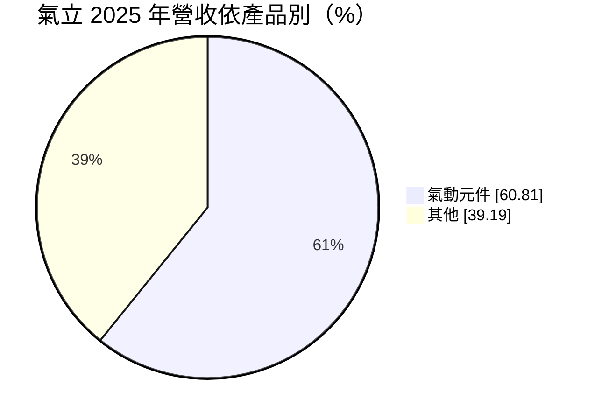
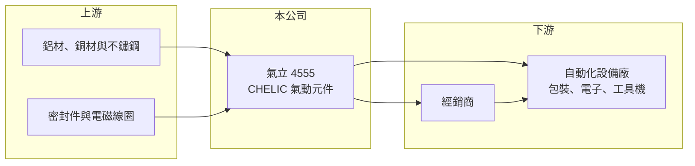

# 4555 氣立

> 上市｜[[產業索引-電機機械|電機機械]]｜上市（櫃）日期 2015/10/27

# 第一章：企業模式與商業藍圖

> [!info] 撰寫說明
> 精簡版，由 Claude 依公開資料整理，架構比照 [[2330台積電]]，資料截至 2026-10-08。來源：證交所開放資料快照（基本資料、2026 年第二季資產負債與損益、營益分析、2025 年度股利、本益比殖利率）、Goodinfo 經營績效頁、MoneyDJ 基本資料頁（2025 年營收比重與歷年股利）。「其他」產品類別的內容與海外據點本次來源未能確認。公開資料有限。#待校對

台灣氣立（以下簡稱氣立，品牌 CHELIC）是台灣老牌的[[氣動元件]]製造商，產品是工廠自動化設備中負責推、夾、移動的氣壓缸、控制氣流的電磁閥等零件。理解它的關鍵在於：氣動元件是自動化的基礎零件，市場由日本與中國大陸品牌主導，氣立在其中屬於規模較小的品牌廠，獲利對景氣與營收規模非常敏感。

- **核心業務：** 氣立成立於 1986 年，2015 年在證交所上市，總部位於新北市泰山，董事長為游平政、總經理為游博勳，屬家族經營的第二代接班企業（推估）。主要產品是氣壓缸、電磁閥、空氣調理組（過濾、調壓、給油）與接頭等氣動元件（#待校對），用在包裝機、電子組裝設備、工具機上下料、食品與紡織機械等自動化設備上。氣動元件以壓縮空氣為動力，構造簡單、速度快、成本低，是工廠自動化中使用最廣的致動方式之一。
- **營收結構：** 依 MoneyDJ 整理的 2025 年營收比重，氣動元件約占 60.8%，其他產品約占 39.2%。「其他」的具體內容本次來源未細分，可能包括電動致動器、自動化模組或子公司的其他業務（#待校對）。依 2026 年上半年財報，約 0.07 億元淨利歸屬[[非控制權益]]，表示集團內有母公司未全資持有的子公司。
- **營運據點：** 公司以台灣泰山為總部與生產基地，海外設有銷售與生產據點（#待校對）。依 2026 年第二季資料，非流動資產約 22.1 億元，接近總資產一半，代表公司擁有相當規模的廠房與設備。
- **長期方向：** 工廠自動化與缺工問題是氣動元件的長期需求來源，各國製造業回流與自動化投資會持續帶動零件需求。另一方面，電動致動器（電動缸、電動夾爪）在精密定位與節能上的優勢，正逐步取代部分氣動應用。氣立若能同時經營氣動與電動產品，就能跟上自動化技術的演進。

# 第二章：護城河深度與競爭優勢

氣立的護城河來自品牌與通路經營，但面對國際大廠與中國大陸同業夾擊，屬於窄護城河。

- **競爭優勢：** 氣動元件品項多達數千種規格，設備廠在設計時會指定品牌與型號，之後的量產與維修備品也沿用同一品牌，這構成一定的轉換成本。氣立經營自有品牌數十年，累積了經銷通路與設備廠客戶，毛利率長期維持在 26% 至 36%。不過品牌知名度與規模都遠不及國際大廠。
- **主要對手：** 全球氣動元件市場由日本 SMC 主導，德國 Festo、日本 CKD 也是重要品牌；台灣的 [[1590亞德客-KY]] 則以中國大陸市場為主，規模已遠大於氣立。中國大陸本土氣動品牌近年快速崛起，以價格搶占中低階市場。氣立的定位在中階市場，同時面對上下兩方的競爭壓力。
- **觀察重點：** 長期最值得追蹤的是營業利益率能否回到 2020 至 2022 年 10% 至 15% 的水準。2023 至 2024 年營業利益率轉為負數，2025 年回到 3.07%，2026 年上半年約 4.96%。毛利率能否穩定在三成以上，以及營收能否回到 18 億至 20 億元的規模，決定公司能否重回合理獲利。

# 第三章：財務體質與盈利規模

資料日期：2026-10-08，表格是撰寫當時的快照；最新月營收、毛利率、累計 EPS 由自動排程寫在本筆記的屬性欄位（月營收、毛利率、累計EPS 等）。#待校對

氣立的財務特色是毛利率三成上下，但營業費用占比高，營收稍有下滑就可能轉為虧損，獲利波動非常大。

| 年度 | 營收（億元） | [[毛利率]] | [[營業利益率]] | EPS（元） | [[ROE]] |
|---|---|---|---|---|---|
| 2021 | 20.3 | 35.7% | 15.1% | 3.50 | 8.99% |
| 2022 | 18.0 | 34.3% | 10.8% | 2.55 | 6.26% |
| 2023 | 13.8 | 27.1% | -1.53% | -0.51 | -1.14% |
| 2024 | 14.9 | 26.1% | -2.75% | -0.86 | -1.75% |
| 2025 | 16.0 | 30.9% | 3.07% | 0.19 | 0.98% |

（來源：Goodinfo 經營績效頁；2019 年營收 13.7 億元、EPS 0.66 元，2020 年營收 15.8 億元、EPS 2.04 元。）

- **營收規模：** 2020 至 2025 年營收由 15.8 億元到 16.0 億元，年複合成長率約 0.3%（推算），期間在 2021 年的 20.3 億元見頂後回落，2023 年只剩 13.8 億元。2026 年上半年營收約 8.98 億元，若下半年持平，全年可望略高於 2025 年（推估）。營收波動反映自動化設備投資的景氣循環。
- **獲利：** 近五年（2021 至 2025）平均 ROE 約 2.7%（推算），遠低於製造業常見水準。2023 至 2024 年營收降到 14 億元上下時，營業利益轉為虧損，顯示營業費用相對固定，[[營業槓桿]]很高。2026 年上半年 EPS 為 0.69 元，其中業外收入約 0.17 億元，對稅前淨利貢獻約四分之一。
- **財務特色：** 依 2026 年第二季資料，總資產約 46.0 億元、權益約 30.4 億元（其中非控制權益約 1.1 億元），負債約 15.6 億元，其中非流動負債約 9.3 億元，推估包含長期借款（#待校對）。依 MoneyDJ 資料，2019 至 2025 年度現金股利分別為 1.20、1.50、1.78、1.52、0.50、0.50、0.50 元；證交所資料顯示 2025 年度由盈餘配發的現金股利為 0.20 元，與 MoneyDJ 的 0.50 元差額推估來自資本公積（#待校對）。2023 至 2024 年虧損仍維持配息，代表公司重視股利的連續性。
- **[[ROIC]] 與 [[WACC]]：** 以 2025 年營業利益約 0.49 億元（16.0 億元 × 3.07%）、稅率 20% 計算，稅後營業利益約 0.39 億元。有息負債未查得，投入資本以權益 30.4 億元到「權益加全部負債」46.0 億元為區間，ROIC 約 0.9% 至 1.3%（推算）；2021 年營業利益約 3.07 億元，以當時約 27 億元的權益估算，ROIC 約 6% 至 9%（推算）；2023 至 2024 年營業虧損，ROIC 為負。WACC 以 [[CAPM]] 推估：無風險利率 1.75%、市場風險溢酬 6%、β 假設 1.0（自動化設備股常見值），權益成本約 7.8%；稅後負債成本假設 2%、負債占兩成五，WACC 約 6.3%（推算）。近五年 ROIC 幾乎都低於 WACC，代表氣立目前沒有賺回資金成本，提升營收規模與費用效率是改善資本報酬的前提。

# 第四章：總體風險與地緣政治

氣立的風險來自自動化投資週期、國際與中國大陸同業競爭，以及高營業槓桿。

- **產業週期：** 氣動元件的需求跟著設備廠的出貨走，而設備廠的訂單又來自電子、半導體、汽車、包裝等產業的資本支出。這些產業擴產放緩時，設備廠會先停止備料，氣動元件的訂單下滑往往比終端更劇烈，這就是[[長鞭效應]]。2023 年營收大減約 23% 即是一例。
- **營運風險：** 公司營業費用占營收比重高，營收稍有下滑就會侵蝕營業利益，2023 至 2024 年連續虧損證明了這個風險。國際大廠與中國大陸同業的價格競爭，限制了氣立調漲價格的空間。電動致動器取代部分氣動應用的技術變化，若公司跟進太慢，可能失去部分市場。
- **其他風險：** 鋁材與銅材是氣壓缸與閥件的主要原料，價格上漲會壓縮毛利。外銷比重與海外據點使公司暴露在匯率波動之下。各國關稅政策與供應鏈移轉，會改變設備廠的生產地點，影響氣立的接單結構。

# 專有名詞解析

## 金融

- **[[營業槓桿]]**：固定成本占比高時，營收小幅變動會讓營業利益大幅變動的現象。
- **[[長鞭效應]]**：終端需求的小幅變動，沿供應鏈往上游傳遞時被逐級放大，造成上游庫存與訂單劇烈波動。
- **[[非控制權益]]**：合併報表中屬於子公司其他股東的權益與淨利，不歸母公司股東所有。

## 產業

- **[[氣動元件]]**：以壓縮空氣驅動或控制的零件，例如氣壓缸、電磁閥與空氣調理組，是工廠自動化設備最常用的致動零件。
- **[[電動致動器]]**：以馬達驅動的直線或旋轉運動元件，例如電動缸與電動夾爪，定位精度高，可部分取代氣動元件。

# 核心供應鏈

- 上游：鋁材、銅材、不鏽鋼等金屬材料，以及密封件、電磁線圈等零件供應商。
- 下游／客戶：氣動元件經銷商，以及包裝、電子組裝、半導體、工具機與食品機械等自動化設備廠；具體客戶公開資料未點名。
- 同業：SMC、Festo、CKD 等國際氣動品牌，台灣的 [[1590亞德客-KY]]，以及中國大陸本土氣動元件業者。

## 最新新聞
<!-- news:start（自動產生，請勿手動編輯此範圍） -->
- 2026-10-06 🏛️ 重訊 12:03｜澄清115年10月06日工商時報B04版報導｜[觀測站](https://mops.twse.com.tw/mops/#/web/t05st01)

完整紀錄：[[4555氣立 新聞]]
<!-- news:end -->

## 相關連結
- [公開資訊觀測站](https://mopsov.twse.com.tw/mops/web/t05st03?step=1&firstin=1&co_id=4555)
- [Goodinfo](https://goodinfo.tw/tw/StockDetail.asp?STOCK_ID=4555)
- [Yahoo 股市](https://tw.stock.yahoo.com/quote/4555)
- [鉅亨網新聞](https://www.cnyes.com/twstock/4555/news)
