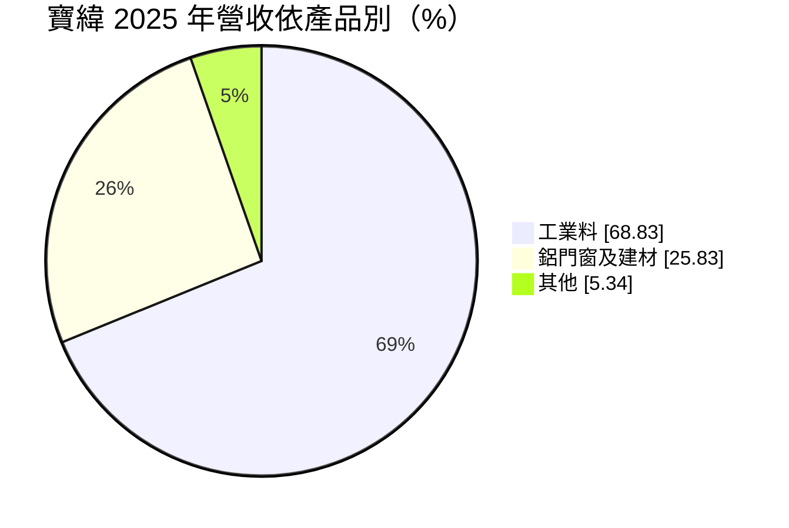
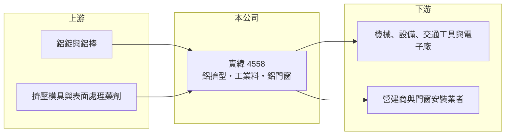

# 4558 寶緯

> 上櫃｜[[產業索引-電機機械|電機機械]]｜上市（櫃）日期 2022/03/17

# 第一章：企業模式與商業藍圖

> [!info] 撰寫說明
> 精簡版，由 Claude 依公開資料整理，架構比照 [[2330台積電]]，資料截至 2026-10-08。來源：櫃買中心開放資料快照（基本資料、2026 年第二季資產負債與損益、本益比殖利率）、MoneyDJ 年度財務比率頁與基本資料頁（2025 年營收比重與歷年股利）。Goodinfo 本次連線失敗，年度營收以 MoneyDJ 每股營業額乘以 5 億元股本推算，掛牌前年度因股本可能不同而不推算。公開資料有限。#待校對

寶緯工業（以下簡稱寶緯）是彰化北斗的[[鋁擠型]]製造商，產品分為工業用鋁材與鋁門窗建材兩大類。理解它的關鍵在於：鋁擠型是以鋁價加上加工費計價的材料加工業，毛利率薄、對鋁價與產能利用率非常敏感，而公司的負債比偏高，使財務彈性有限。

- **核心業務：** 寶緯成立於 1989 年，2022 年在櫃買中心掛牌，總部與工廠位於彰化北斗，董事長為詹勳霖。鋁擠型是把加熱的鋁棒放入擠壓機，從特定形狀的模具中擠出長條型材，再經過裁切、陽極處理或塗裝，製成各種斷面的鋁材。依 MoneyDJ 整理的 2025 年營收比重，工業料約占 68.8%、鋁門窗及建材約占 25.8%、其他約 5.3%。
- **營收結構：** 工業料是供機械、設備、交通工具、電子產品與太陽能支架等使用的鋁型材（應用細項 #待校對），客戶依設計開模訂製，屬於少量多樣的接單生產。鋁門窗及建材則用於住宅與建築，需求跟著營建景氣走。兩條產品線讓公司同時暴露在製造業與營建業兩種景氣循環中。
- **營運據點：** 公司登記在彰化北斗，位於台灣中部的金屬加工聚落。依 2026 年第二季資料，非流動資產約 14.7 億元，接近總資產一半，代表公司擁有相當規模的擠壓機、表面處理線與廠房（推估）。
- **長期方向：** 鋁材因為輕量、可回收，在電動車、太陽能、建築節能與綠建材上的應用持續增加，這是鋁擠型業的長期需求動能。另一方面，再生鋁與低碳鋁的使用比例，會成為國際客戶選擇供應商的新標準。寶緯若能提高工業料中高附加價值產品的比重，並在低碳材料上建立能力，較有機會擺脫單純的加工費競爭。

# 第二章：護城河深度與競爭優勢

寶緯的護城河很窄，主要來自在地供應能力、模具累積與客戶關係，產品本身同質性高。

- **競爭優勢：** 工業用鋁型材需要依客戶圖面開模，模具與擠壓參數一旦調好，客戶傾向長期在同一家下單，這是鋁擠型廠主要的轉換成本來源。位於中部金屬加工聚落，可以就近服務機械與設備客戶、縮短交期。公司同時經營工業料與建材，產能可以在兩個市場之間調配。
- **主要對手：** 台灣有多家中小型鋁擠型廠，加上中國大陸鋁擠型產能龐大、出口價格低廉，市場競爭激烈。具體的主要對手名單公開資料未查得。鋁擠型的報價大多以鋁錠價格加上加工費計算，廠商之間主要比的是加工費與交期。
- **觀察重點：** 長期最值得追蹤的是毛利率能否穩定在 8% 以上。2021 年毛利率曾有 16.0%，但 2023 至 2025 年在 5% 至 9% 之間，2025 年營業利益轉為小幅虧損。2026 年上半年毛利率回升到約 10.9%（推算），營業利益率約 4.9%，若能維持，代表加工費與產能利用率已經改善。

# 第三章：財務體質與盈利規模

資料日期：2026-10-08，表格是撰寫當時的快照；最新月營收、毛利率、累計 EPS 由自動排程寫在本筆記的屬性欄位（月營收、毛利率、累計EPS 等）。#待校對

寶緯的財務特色是營收規模約 15 億元、毛利率個位數、負債比偏高，獲利只有在鋁價與需求同時有利的年份才明顯。

| 年度 | 營收（億元） | [[毛利率]] | [[營業利益率]] | EPS（元） | [[ROE]] |
|---|---|---|---|---|---|
| 2021 | 未查得 | 15.99% | 11.67% | 4.55 | 29.65% |
| 2022 | 未查得 | 8.52% | 4.26% | 1.25 | 7.21% |
| 2023 | 約 15.9（推算） | 5.66% | 0.48% | 0.01 | 0.03% |
| 2024 | 約 14.5（推算） | 8.62% | 2.59% | 0.49 | 2.71% |
| 2025 | 約 15.4（推算） | 5.18% | -0.74% | -0.39 | -2.17% |

（來源：MoneyDJ 年度財務比率頁；營收以每股營業額 31.71、29.05、30.73 元乘以 5 億元股本推算。2019 至 2020 年 EPS 分別為 0.44、2.03 元。）

- **營收規模：** 2023 至 2025 年營收約在 14.5 億至 15.9 億元之間（推算），沒有明顯成長。2026 年上半年營收約 8.86 億元，若下半年維持相近水準，全年可能高於 2025 年（推估），可能與鋁價上漲帶動售價有關。鋁擠型的營收很大一部分是鋁原料的轉嫁，營收增加不一定代表加工量增加。
- **獲利：** 近五年（2021 至 2025）平均 ROE 約 7.5%（推算），但幾乎全部來自 2021 年的 29.65%；2023 至 2025 年 ROE 都在 3% 以下，2025 年為 -2.17%。2021 年的高獲利推估與當年鋁價大漲帶來的庫存利益有關（#待校對），這種獲利不具持續性。2026 年上半年 EPS 為 0.50 元，已優於 2025 年全年。
- **財務特色：** 依 2026 年第二季資料，總資產約 31.5 億元、權益約 9.01 億元、負債約 22.5 億元，負債比約 71%，其中非流動負債約 10.8 億元，在同規模製造業中屬於偏高的財務槓桿。依 MoneyDJ 資料，2019 至 2025 年度現金股利分別為 0.50、1.00、3.00、1.00、0、0.50、0 元，配息隨獲利大幅起伏，不屬於穩定配息型公司。高負債與薄利同時存在，代表景氣不佳時的財務壓力較大。
- **[[ROIC]] 與 [[WACC]]：** 2025 年營業利益約 -0.11 億元（15.4 億元 × -0.74%，推算），稅後營業利益為負，ROIC 約 -0.4% 至 -1.2%（推算，投入資本以權益 9.01 億元到「權益加全部負債」31.5 億元為區間）；2024 年營業利益約 0.38 億元，同法推估 ROIC 約 1% 至 3%（推算）。WACC 以 [[CAPM]] 推估：無風險利率 1.75%、市場風險溢酬 6%、β 假設 1.0（原物料加工股常見值），權益成本約 7.8%；稅後負債成本假設 2%、有息負債占資本約一半（推估），WACC 約 4.9%（推算）。近三年 ROIC 都低於 WACC，2025 年更是負值，代表公司目前沒有賺回資金成本；只有在 2021 年那樣的鋁價高峰，ROIC 才明顯超過資金成本。

# 第四章：總體風險與地緣政治

寶緯的風險來自鋁價波動、低毛利結構與偏高的財務槓桿。

- **產業週期：** 工業料跟著機械與製造業投資走，鋁門窗建材跟著營建景氣走，兩者同時轉弱時營收與獲利都會受壓。鋁價本身受全球供需、能源價格與中國大陸產能政策影響，波動很大。鋁價上漲時有庫存利益，下跌時則可能產生庫存損失，使獲利呈現大起大落。
- **營運風險：** 毛利率只有個位數，產能利用率、良率或加工費的小幅變動，就可能讓公司由盈轉虧，2025 年營業虧損即是例子。負債比約七成，若利率上升或銀行緊縮授信，財務費用與資金調度壓力會增加。擠壓與表面處理屬於耗能製程，電價調漲會直接侵蝕利潤。
- **其他風險：** 中國大陸鋁擠型產能過剩，低價出口會壓縮台灣廠商的報價。歐美的碳邊境調整機制與低碳材料要求，可能提高出口門檻。表面處理涉及廢水與化學品管理，環保法規趨嚴會增加合規成本。

# 專有名詞解析

## 金融

- **[[庫存利益]]**：原料價格上漲時，以較低成本取得的庫存按較高售價出售所產生的額外利潤，原料下跌時則轉為損失。
- **[[CAPM]]**：資本資產定價模型，以無風險利率加上 β 乘以市場風險溢酬，估算股東要求的報酬率。

## 產業

- **[[鋁擠型]]**：把加熱的鋁棒從特定斷面的模具中擠出成長條型材的加工方式，用於門窗、機械、電子與交通工具。
- **[[陽極處理]]**：以電解方式在鋁材表面形成氧化保護膜的表面處理，可提高耐蝕性並上色。

# 核心供應鏈

- 上游：鋁錠與鋁棒供應商（台灣多仰賴進口），以及擠壓模具、陽極處理與塗裝用化學品供應商。
- 下游／客戶：機械、設備、交通工具與電子產品製造商，以及營建商與門窗安裝業者；具體客戶公開資料未點名。
- 同業：台灣其他鋁擠型廠與鋁門窗業者，以及中國大陸鋁擠型出口廠；具體名單公開資料未查得。

## 最新新聞
<!-- news:start -->
<!-- news:end -->

## 相關連結
- [公開資訊觀測站](https://mopsov.twse.com.tw/mops/web/t05st03?step=1&firstin=1&co_id=4558)
- [Goodinfo](https://goodinfo.tw/tw/StockDetail.asp?STOCK_ID=4558)
- [Yahoo 股市](https://tw.stock.yahoo.com/quote/4558)
- [鉅亨網新聞](https://www.cnyes.com/twstock/4558/news)
