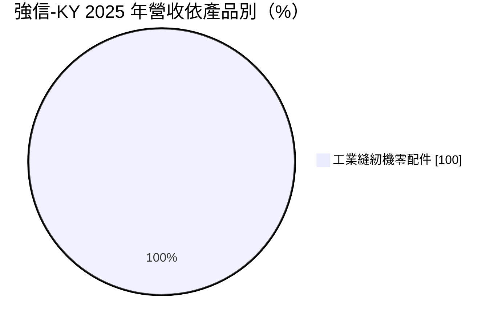
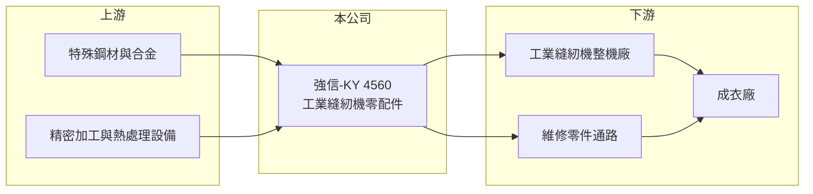

# 4560 強信-KY

> 上市｜[[產業索引-電機機械|電機機械]]｜上市（櫃）日期 2017/05/26

# 第一章：企業模式與商業藍圖

> [!info] 撰寫說明
> 精簡版，由 Claude 依公開資料整理，架構比照 [[2330台積電]]，資料截至 2026-10-08。來源：證交所開放資料快照（基本資料、2026 年第二季資產負債與損益、營益分析、2025 年度股利、本益比殖利率）、Goodinfo 經營績效頁、MoneyDJ 基本資料頁（2025 年營收比重與歷年股利）。零件品項、生產基地與客戶型態係依產業結構整理，尚未逐條比對原始文件。公開資料有限。#待校對

強信-KY 是專門生產[[工業用縫紉機]]零配件的公司，營收百分之百來自這個單一利基市場。理解它的關鍵在於：縫紉機零件體積小、單價低，但精度要求高、品項繁多，強信靠著專注與規模在這個不起眼的市場裡維持三成以上的毛利率與穩定配息。

- **核心業務：** 強信-KY 為開曼群島註冊的控股公司，2014 年成立，2017 年在證交所上市，台灣登記地址在桃園龜山，董事長綦秉信兼任總經理。公司生產工業用縫紉機的關鍵零配件，例如旋梭、送布牙、針板、壓腳等與縫線成形直接相關的精密零件（#待校對）。這些零件決定縫紉機的線跡品質與穩定性，需要精密加工與熱處理技術。
- **營收結構：** 依 MoneyDJ 整理的 2025 年營收比重，工業縫紉機零配件占 100%。零件的銷售對象包括縫紉機整機廠（新機組裝用）與維修零件通路（成衣廠更換耗損零件用），推估兩者都有（#待校對）。維修零件的需求來自全球數千萬台在用的工業縫紉機，屬於相對穩定的[[耗材]]型需求，能平衡整機廠訂單的景氣波動。
- **營運據點：** 作為 KY 公司，強信的主要生產基地推估在中國大陸（#待校對）。中國大陸是全球最大的工業縫紉機生產國，整機廠高度集中，零件廠就近設廠可以縮短交期、配合客戶開發新機種。依 2026 年第二季資料，流動資產約 18.8 億元、占總資產約七成，資產結構以現金與營運資金為主，固定資產負擔不重。
- **長期方向：** 工業縫紉機產業的長期趨勢是自動化與智慧化，例如直驅馬達、自動剪線、電腦控制花樣等功能，讓單台縫紉機的價值與零件精度要求都在提高。成衣產業從中國大陸移往東南亞、南亞與非洲，也帶動當地新機與維修零件的需求。強信能否隨著客戶移轉服務新興成衣產地，是長期成長的關鍵。

# 第二章：護城河深度與競爭優勢

強信-KY 的護城河來自利基市場的專注、精密加工能力與客戶認證，屬於窄但穩固的護城河。

- **競爭優勢：** 縫紉機零件市場規模小，大型零件廠缺乏進入誘因，專業廠商可以在利基市場中建立規模優勢。零件精度直接影響整機品質，整機廠一旦認證某家零件供應商，通常會長期合作，形成轉換成本。2019 至 2025 年毛利率維持在 31% 至 39%，對零件製造商而言相當穩定，反映一定的定價能力。
- **主要對手：** 日本的專業縫紉機零件廠在高階旋梭等關鍵零件上具有品牌與技術優勢，中國大陸則有大量中小型零件廠以價格競爭；部分整機大廠也自製部分零件。具體的主要對手名單公開資料未查得。強信的定位推估在中高階市場，以品質與價格兼顧取勝。
- **觀察重點：** 長期最值得追蹤的是營收規模能否突破 17 億至 18 億元的高原。2019、2021、2022、2025 年營收都在 16.5 億至 17.6 億元之間，2020 與 2023 年則大幅下滑到 12 億多元，顯示營收有明顯的週期性但缺乏趨勢性成長。若能擴大新興市場與自動化機種的零件份額，才有機會脫離這個區間。

# 第三章：財務體質與盈利規模

資料日期：2026-10-08，表格是撰寫當時的快照；最新月營收、毛利率、累計 EPS 由自動排程寫在本筆記的屬性欄位（月營收、毛利率、累計EPS 等）。#待校對

強信-KY 的財務特色是毛利率三成以上、負債低、配息率高，但營收與獲利隨成衣業景氣出現明顯的高低循環。

| 年度 | 營收（億元） | [[毛利率]] | [[營業利益率]] | EPS（元） | [[ROE]] |
|---|---|---|---|---|---|
| 2021 | 17.2 | 34.7% | 14.0% | 2.95 | 12.4% |
| 2022 | 17.6 | 37.7% | 17.3% | 3.70 | 14.3% |
| 2023 | 12.4 | 31.2% | 4.98% | 1.06 | 4.04% |
| 2024 | 16.1 | 32.5% | 9.69% | 2.04 | 7.71% |
| 2025 | 17.2 | 35.7% | 15.7% | 3.02 | 10.7% |

（來源：Goodinfo 經營績效頁；2019 年營收 16.5 億元、EPS 4.38 元，2020 年營收 12.6 億元、EPS 1.12 元。2025 年稅後淨利約 2.06 億元，取自證交所股利資料。）

- **營收規模：** 2020 至 2025 年營收由 12.6 億元增至 17.2 億元，年複合成長率約 6.4%（推算），但起點 2020 年正好是疫情低谷，若從 2019 年的 16.5 億元算起則幾乎持平。2026 年上半年營收約 9.59 億元，若下半年持平，全年有機會創近年新高（推估）。營收的高低起伏大致對應全球成衣業的庫存與投資循環。
- **獲利：** 近五年（2021 至 2025）平均 ROE 約 9.8%（推算）。營收高的年份營業利益率可達 14% 至 17%，營收低的 2023 年則降到約 5%，顯示[[營業槓桿]]明顯。2026 年上半年營業利益率約 14.2%、EPS 1.41 元，獲利維持在景氣較好時的水準；有效稅率約 27%（推算），高於台灣一般的 20%，與海外營運的稅負有關（推估）。
- **財務特色：** 依 2026 年第二季資料，總資產約 27.3 億元、權益約 20.4 億元、負債約 6.86 億元，其中非流動負債僅約 0.28 億元，負債比約 25%，財務結構穩健。依 MoneyDJ 資料，2019 至 2025 年度現金股利分別為 3.99、1.00、1.80、2.20、1.00、1.20、2.00 元，每年都有配息，配息率多在六至九成（推算），把大部分獲利回饋股東。
- **[[ROIC]] 與 [[WACC]]：** 以 2025 年營業利益約 2.70 億元（17.2 億元 × 15.7%）、稅率 20% 計算，稅後營業利益約 2.16 億元。有息負債未查得，投入資本以權益 20.4 億元到「權益加全部負債」27.3 億元為區間，ROIC 約 7.9% 至 10.6%（推算）；若扣除帳上大量的流動資產（推估含現金），實際營運資本的報酬會更高。WACC 以 [[CAPM]] 推估：無風險利率 1.75%、市場風險溢酬 6%、β 假設 1.0（KY 股與中國大陸營運的風險較高），權益成本約 7.8%；負債比重低，WACC 約 7.3%（推算）。景氣正常的年份 ROIC 高於 WACC，代表強信長期能創造經濟價值；但 2023 年這類低谷年份會跌到資金成本以下，價值創造呈現週期性。

# 第四章：總體風險與地緣政治

強信-KY 的風險來自成衣產業週期、單一產品集中與 KY 公司的地緣與治理特性。

- **產業週期：** 工業縫紉機的需求跟著成衣廠的產能投資走，而成衣訂單又受全球消費景氣與品牌庫存影響，2020 與 2023 年營收下滑即對應疫情衝擊與品牌去庫存。零件廠位於供應鏈上游，終端需求的小變化會被放大，屬於典型的[[長鞭效應]]。維修零件的需求可以提供部分底部支撐。
- **營運風險：** 營收百分之百來自單一產品類別，沒有其他業務可以分散風險。若主要整機廠客戶轉向自製零件或改用其他供應商，影響會非常直接。成衣產地向東南亞、南亞與非洲移轉，公司需要建立新的銷售與服務據點。
- **其他風險：** 主要營運推估在中國大陸，受當地法規、外匯管制與兩岸關係影響；人民幣匯率變動會影響以新台幣表達的損益與淨值。KY 公司的資訊透明度與公司治理需要投資人特別留意。鋼材等原料價格與當地人力成本上升，會壓縮零件的利潤空間。

# 專有名詞解析

## 金融

- **[[營業槓桿]]**：固定成本占比高時，營收小幅變動會讓營業利益大幅變動的現象。
- **[[長鞭效應]]**：終端需求的小幅變動，沿供應鏈往上游傳遞時被逐級放大，造成上游庫存與訂單劇烈波動。

## 產業

- **[[工業用縫紉機]]**：成衣廠使用的高速縫製設備，依用途分為平車、拷克車、繃縫車等，需搭配零件與維修服務。
- **[[旋梭]]**：縫紉機中負責勾住上線、與下線交織形成線跡的旋轉零件，精度直接決定縫紉品質。
- **[[耗材]]**：使用過程中會磨損、需要定期更換的零件或材料，可帶來重複性的銷售。

# 核心供應鏈

- 上游：特殊鋼材與合金供應商，以及精密加工、熱處理設備廠。
- 下游／客戶：工業縫紉機整機廠與維修零件通路，最終用戶是全球成衣廠；整機廠例如台灣的 [[1531高林股]]（是否為強信客戶未經確認，僅供產業對照），具體客戶公開資料未點名。
- 同業：日本與中國大陸的縫紉機零件專業廠；具體名單公開資料未查得。

## 最新新聞
<!-- news:start -->
<!-- news:end -->

## 相關連結
- [公開資訊觀測站](https://mopsov.twse.com.tw/mops/web/t05st03?step=1&firstin=1&co_id=4560)
- [Goodinfo](https://goodinfo.tw/tw/StockDetail.asp?STOCK_ID=4560)
- [Yahoo 股市](https://tw.stock.yahoo.com/quote/4560)
- [鉅亨網新聞](https://www.cnyes.com/twstock/4560/news)
