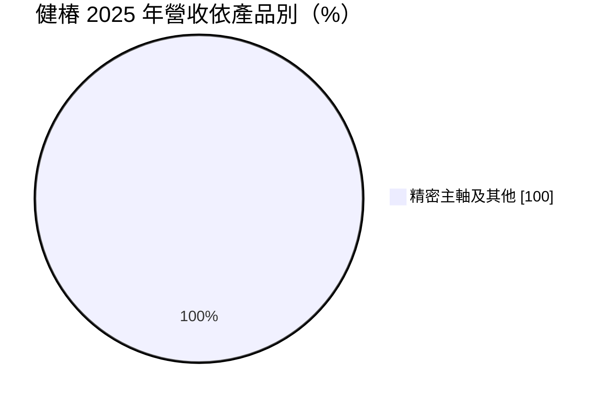
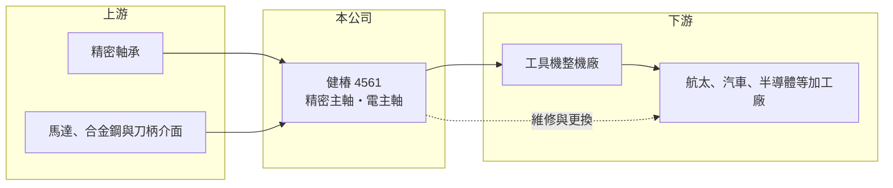

# 4561 健椿

> 上櫃｜[[產業索引-電機機械|電機機械]]｜上市（櫃）日期 2018/06/11

# 第一章：企業模式與商業藍圖

> [!info] 撰寫說明
> 精簡版，由 Claude 依公開資料整理，架構比照 [[2330台積電]]，資料截至 2026-10-08。來源：櫃買中心開放資料快照（基本資料、2026 年第二季資產負債與損益、本益比殖利率）、Goodinfo 經營績效頁、MoneyDJ 基本資料頁（2025 年營收比重與歷年股利）。主軸產品種類、客戶與海外市場係依產業結構整理，尚未逐條比對原始文件。公開資料有限。#待校對

健椿工業（以下簡稱健椿）是專門生產工具機[[主軸]]的零組件廠，營收百分之百來自精密主軸及相關產品。理解它的關鍵在於：主軸是[[工具機]]的心臟，技術門檻高、附加價值高，但健椿位於工具機產業鏈的上游，景氣波動會被放大傳遞，獲利起伏很大。

- **核心業務：** 健椿成立於 1983 年，2018 年在櫃買中心掛牌，總部與工廠位於彰化線西的彰濱工業區，董事長為法人代表世大茂投資，總經理為葉冠妗。主軸是工具機中帶動刀具或工件高速旋轉的核心部件，轉速、剛性、精度與熱變形控制，直接決定工具機的加工品質。健椿的產品推估涵蓋皮帶式、直結式與內藏馬達的[[電主軸]]，以及主軸維修服務（#待校對）。
- **營收結構：** 依 MoneyDJ 整理的 2025 年營收比重，精密主軸及其他占 100%，屬於單一產品公司。主軸的客戶是工具機整機廠，包括 CNC 車床、綜合加工中心機、磨床等製造商；主軸也是會磨耗的部件，使用多年後需要維修或更換，這部分能帶來售後的重複性收入（推估）。
- **營運據點：** 公司位於彰化，鄰近台中大里、太平、后里等台灣工具機產業聚落，可以就近與整機廠共同開發新機種。依 2026 年第二季資料，非流動資產約 12.7 億元，超過總資產一半，代表公司在精密加工設備、組裝與測試廠房上投入相當資本。
- **長期方向：** 工具機往高速、高精度、五軸與複合加工發展，對主軸的轉速與精度要求持續提高，內藏馬達的電主軸比重也在上升，這讓專業主軸廠的技術價值提高。航太、半導體設備、電動車與醫療器材的精密加工需求，是高階主軸的長期成長來源。健椿能否打進高階機種與國際整機廠，決定它能否擺脫中低階主軸的價格競爭。

# 第二章：護城河深度與競爭優勢

健椿的護城河來自精密製造技術與整機廠的共同開發關係，屬於窄護城河。

- **競爭優勢：** 主軸的精度以微米計，需要精密研磨、動平衡、軸承預壓與組裝調校的長期經驗，新進者很難在短時間內達到穩定品質。整機廠在開發新機種時，會與主軸廠共同設計主軸規格，一旦量產就不容易更換供應商，形成轉換成本。2023 至 2024 年毛利率達 28% 至 31%，反映產品具有一定的技術附加價值。
- **主要對手：** 台灣有多家專業主軸廠，例如普森、羅翌等（#待校對），部分大型工具機廠也自製主軸；高階市場則由德國、瑞士、日本的主軸品牌與工具機大廠的自製部門主導。中國大陸主軸廠近年也在中低階市場快速擴張。
- **觀察重點：** 長期最值得追蹤的是毛利率能否穩定在 25% 以上。2019 至 2022 年毛利率約 19% 至 21%，2023 至 2024 年提升到 28% 至 31%，2025 年又回落到 21.3%，2026 年上半年回升到約 25.6%（推算）。毛利率的高低反映產品組合是否往電主軸等高階產品移動，以及產能利用率的變化。

# 第三章：財務體質與盈利規模

資料日期：2026-10-08，表格是撰寫當時的快照；最新月營收、毛利率、累計 EPS 由自動排程寫在本筆記的屬性欄位（月營收、毛利率、累計EPS 等）。#待校對

健椿的財務特色是獲利隨工具機景氣大起大落，景氣好時 ROE 可達一成四，景氣差時則只有個位數。

| 年度 | 營收（億元） | [[毛利率]] | [[營業利益率]] | EPS（元） | [[ROE]] |
|---|---|---|---|---|---|
| 2021 | 13.9 | 20.8% | 13.7% | 2.49 | 14.0% |
| 2022 | 11.2 | 20.5% | 11.2% | 1.93 | 10.1% |
| 2023 | 12.0 | 28.3% | 17.2% | 2.74 | 13.3% |
| 2024 | 12.0 | 30.7% | 17.5% | 3.28 | 14.5% |
| 2025 | 9.27 | 21.3% | 4.68% | 0.66 | 2.79% |

（來源：Goodinfo 經營績效頁；2019 年營收 7.08 億元、EPS 0.44 元，2020 年營收 9.53 億元、EPS 1.46 元。）

- **營收規模：** 2020 至 2025 年營收由 9.53 億元到 9.27 億元，年複合成長率約 -0.6%（推算），期間高點是 2021 年的 13.9 億元。2025 年營收較 2024 年下滑約 23%，反映工具機景氣轉弱。2026 年上半年營收約 5.64 億元，已超過 2025 年全年的一半，景氣有回溫跡象（推估）。
- **獲利：** 近五年（2021 至 2025）平均 ROE 約 10.9%（推算），對零組件廠而言屬中上水準，但年度之間差異很大。2025 年營業利益率只剩 4.68%、EPS 0.66 元，2026 年上半年營業利益率回升到約 13.0%、EPS 1.09 元（推算營業利益率）。營收變動 20% 左右，營業利益就可能變動數倍，[[營業槓桿]]非常明顯。
- **財務特色：** 依 2026 年第二季資料，總資產約 23.5 億元、權益約 14.1 億元、負債約 9.32 億元，其中非流動負債約 4.72 億元，推估包含廠房擴建的長期借款（#待校對），負債比約 40%。依 MoneyDJ 資料，2019 至 2025 年度現金股利分別為 0.25、0.90、0.90、0.70、1.00、1.20、0.20 元，配息率多在三至六成（推算），保留較多盈餘支應資本支出。
- **[[ROIC]] 與 [[WACC]]：** 以 2025 年營業利益約 0.43 億元（9.27 億元 × 4.68%）、稅率 20% 計算，稅後營業利益約 0.35 億元。有息負債未查得，投入資本以權益 14.1 億元到「權益加全部負債」23.5 億元為區間，ROIC 約 1.5% 至 2.5%（推算）；2024 年營業利益約 2.10 億元，同法推估約 7% 至 12%（推算）。WACC 以 [[CAPM]] 推估：無風險利率 1.75%、市場風險溢酬 6%、β 假設 1.1（工具機產業景氣循環明顯），權益成本約 8.4%；稅後負債成本假設 2%、負債占三成，WACC 約 6.5%（推算）。景氣好的 2023 至 2024 年 ROIC 高於 WACC，2025 年則遠低於 WACC；健椿的價值創造高度依賴工具機景氣，長期平均大致在資金成本附近。

# 第四章：總體風險與地緣政治

健椿的風險來自工具機景氣循環、客戶集中與技術升級的壓力。

- **產業週期：** 工具機是製造業的資本財，需求跟著全球製造業投資走，景氣循環非常明顯。主軸廠位於工具機產業鏈的上游，整機廠在景氣轉弱時會先減少零件採購、消化庫存，使主軸訂單的波動比整機更大，這就是[[長鞭效應]]。2025 年營收與獲利的大幅下滑，就是這種週期的體現。
- **營運風險：** 客戶集中在台灣工具機整機廠（推估），整機廠若轉向自製主軸或改向其他供應商採購，影響會很直接。精密加工設備與廠房屬於固定成本，產能利用率下降時毛利率會明顯下滑。高階電主軸需要持續投入研發與人才，技術跟不上就只能在中低階市場進行價格競爭。
- **其他風險：** 台灣工具機以外銷為主，新台幣升值、日圓貶值會削弱台灣整機廠相對日本同業的價格競爭力，間接影響主軸訂單。美國關稅與出口管制政策，可能影響工具機出口到特定市場。軸承、馬達等關鍵零件多仰賴進口，供應與價格波動會影響生產。

# 專有名詞解析

## 金融

- **[[營業槓桿]]**：固定成本占比高時，營收小幅變動會讓營業利益大幅變動的現象。
- **[[長鞭效應]]**：終端需求的小幅變動，沿供應鏈往上游傳遞時被逐級放大，造成上游庫存與訂單劇烈波動。

## 產業

- **[[主軸]]**：工具機中帶動刀具或工件高速旋轉的核心部件，精度與剛性決定加工品質。
- **[[電主軸]]**：把馬達直接內建在主軸中的設計，省去皮帶與齒輪傳動，可達到更高轉速與精度。
- **[[工具機]]**：用來切削、加工金屬零件的機器，是製造業的母機，台灣中部有完整的工具機聚落。

# 核心供應鏈

- 上游：精密軸承（多為日本與歐洲品牌）、馬達、合金鋼材與刀柄介面零件供應商。
- 下游／客戶：CNC 車床、綜合加工中心機、磨床等工具機整機廠，例如台灣的 [[1583程泰]]、[[4510高鋒]]、[[4526東台]]、[[1530亞崴]] 等（是否為健椿客戶未經確認，僅供產業對照），以及使用工具機的加工廠。
- 同業：台灣的普森、羅翌等專業主軸廠（#待校對），以及德國、瑞士、日本的主軸品牌。

## 最新新聞
<!-- news:start -->
<!-- news:end -->

## 相關連結
- [公開資訊觀測站](https://mopsov.twse.com.tw/mops/web/t05st03?step=1&firstin=1&co_id=4561)
- [Goodinfo](https://goodinfo.tw/tw/StockDetail.asp?STOCK_ID=4561)
- [Yahoo 股市](https://tw.stock.yahoo.com/quote/4561)
- [鉅亨網新聞](https://www.cnyes.com/twstock/4561/news)
