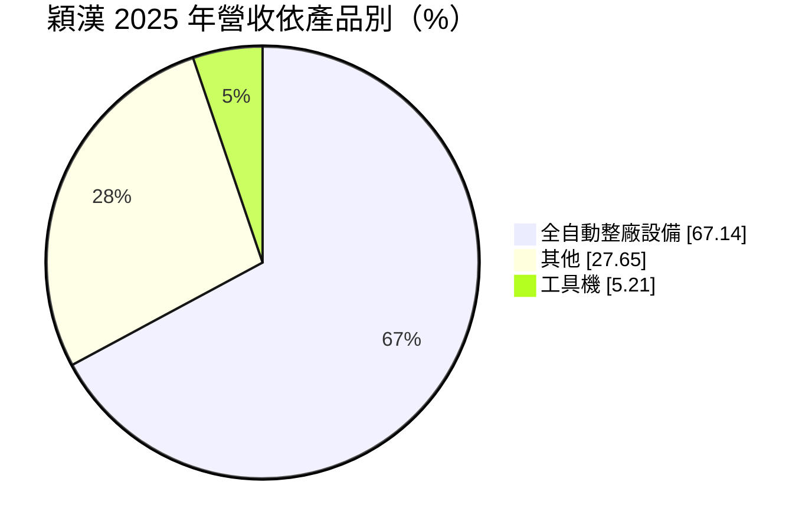
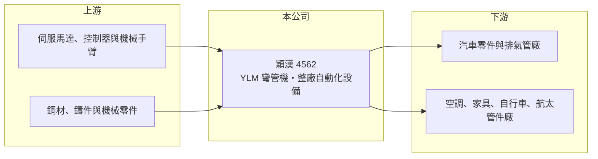

# 4562 穎漢

> 上市｜[[產業索引-電機機械|電機機械]]｜上市（櫃）日期 2017/08/21

# 第一章：企業模式與商業藍圖

> [!info] 撰寫說明
> 精簡版，由 Claude 依公開資料整理，架構比照 [[2330台積電]]，資料截至 2026-10-08。來源：證交所開放資料快照（基本資料、2026 年第二季資產負債與損益、營益分析、2025 年度股利、本益比殖利率）、Goodinfo 經營績效頁、MoneyDJ 基本資料頁（2025 年營收比重與歷年股利）。彎管機產品與應用產業係依公司品牌 YLM 的公開形象整理，尚未逐條比對原始文件。公開資料有限。#待校對

穎漢科技（以下簡稱穎漢，品牌 YLM）是台南的管材加工設備商，產品以[[彎管機]]為核心，並延伸到整條自動化管件生產線。理解它的關鍵在於：公司毛利率高達三成五以上，但營收規模只有 7 億多元，撐不起研發、業務與管理費用，已連續多年營業虧損。

- **核心業務：** 穎漢成立於 2008 年，2017 年在證交所上市，總部位於台南科技工業區，董事長為胡炳昆、總經理為胡峻嘉。主要產品是 CNC 彎管機、管端成形機與切管機，以及把這些設備串成一條線、搭配機械手臂與自動上下料的整廠自動化方案（#待校對）。管件是汽車排氣管、煞車與油管、空調冷媒管、家具、自行車與航太零件的基本構件，彎管品質直接影響產品組裝與密封性。
- **營收結構：** 依 MoneyDJ 整理的 2025 年營收比重，全自動整廠設備約占 67.1%、其他約占 27.7%、工具機約占 5.2%。整廠設備的單案金額大、客製化程度高，可以提高單一客戶的貢獻，但也讓營收認列受專案交機時程影響。「其他」推估包括零件、維修服務與單機銷售（#待校對）。
- **營運據點：** 公司以台南為研發與生產中心，產品外銷歐美、日本與中國大陸等市場（推估，#待校對）。依 2026 年第二季資料，非流動資產約 9.2 億元，總資產約 22.4 億元，負債約 13.2 億元，資產規模相對營收偏大。
- **長期方向：** 汽車電動化讓排氣管需求減少，但電池冷卻管路、熱泵空調管路與輕量化結構管件的需求增加，管材加工設備的應用正在轉移。製造業缺工也推動客戶從單機改買整線自動化設備，這是穎漢主推整廠設備的原因。公司長期的核心課題是把營收規模擴大到足以支撐費用結構，才能轉虧為盈。

# 第二章：護城河深度與競爭優勢

穎漢在技術上有一定實力，但規模不足以把技術轉化為獲利，護城河相當薄弱。

- **競爭優勢：** 彎管機需要整合機械結構、伺服控制與彎管軟體，複雜管件的回彈補償與防皺技術需要長期累積。2019 至 2025 年毛利率在 23% 至 36% 之間，近年持續提高，2026 年上半年更達約 43.3%，顯示產品本身具有技術附加價值。整廠方案能把多台設備與自動化整合在一起，對客戶而言可以減少整合風險。
- **主要對手：** 國際上有義大利 BLM、日本 Opton 等高階品牌，台灣有和和機械、舒茲通等專業彎管機廠（#待校對），中國大陸也有大量中低價位的彎管機廠商。穎漢的價格介於國際品牌與中國大陸廠商之間，在兩端都面臨競爭。
- **觀察重點：** 長期最值得追蹤的是營業費用率能否下降，讓營業利益率由負轉正。2025 年毛利率 36.4%，但營業利益率是 -15.5%，代表營業費用約占營收五成（推算）。在毛利率已經不低的情況下，關鍵在於營收規模能否顯著擴大，或費用結構能否精簡。

# 第三章：財務體質與盈利規模

資料日期：2026-10-08，表格是撰寫當時的快照；最新月營收、毛利率、累計 EPS 由自動排程寫在本筆記的屬性欄位（月營收、毛利率、累計EPS 等）。#待校對

穎漢的財務特色是毛利率逐年提高、但連續七年營業虧損，[[累積虧損]]擴大，無法配發股利。

| 年度 | 營收（億元） | [[毛利率]] | [[營業利益率]] | EPS（元） | [[ROE]] |
|---|---|---|---|---|---|
| 2021 | 8.24 | 24.8% | -11.3% | -2.01 | -13.1% |
| 2022 | 7.62 | 30.9% | -8.59% | -0.14 | -1.25% |
| 2023 | 7.42 | 33.9% | -8.44% | -0.92 | -7.84% |
| 2024 | 7.77 | 35.6% | -9.19% | -0.45 | -4.34% |
| 2025 | 7.16 | 36.4% | -15.5% | -1.28 | -11.8% |

（來源：Goodinfo 經營績效頁；2019 年營收 9.85 億元、EPS -0.95 元，2020 年營收 6.58 億元、EPS -2.23 元。）

- **營收規模：** 2020 至 2025 年營收由 6.58 億元增至 7.16 億元，年複合成長率約 1.7%（推算），但 2019 年曾有 9.85 億元，近五年營收都卡在 7 億至 8 億元之間。2026 年上半年營收約 3.26 億元，低於 2025 年全年的一半。營收規模停滯是公司無法轉虧的根本原因。
- **獲利：** 近五年（2021 至 2025）平均 ROE 約 -7.7%（推算），2019 至 2025 年每年都是營業虧損。2022 年營業虧損但 EPS 只有 -0.14 元，與當年業外收益有關（推估）。2026 年上半年營業虧損約 0.23 億元，但業外收入約 0.22 億元幾乎抵銷，EPS 為 -0.04 元；依賴業外收益彌補本業虧損，並不具持續性。
- **財務特色：** 依 2026 年第二季資料，總資產約 22.4 億元、權益約 9.18 億元、負債約 13.2 億元，負債比約 59%，其中流動負債約 10.5 億元，可能包含客戶預收款與短期借款（#待校對）。依證交所資料，2025 年底累積虧損約 4.39 億元（期初待彌補虧損約 3.26 億元加上當年淨損約 1.12 億元），2019 至 2025 年度皆未配發現金股利，依法必須先彌補虧損才能配息。
- **[[ROIC]] 與 [[WACC]]：** 2025 年營業利益約 -1.11 億元（7.16 億元 × -15.5%），虧損時不計稅盾，以權益 9.18 億元到「權益加全部負債」22.4 億元為投入資本區間，ROIC 約 -5.0% 至 -12.1%（推算），2019 年以來每年都是負值。WACC 以 [[CAPM]] 推估：無風險利率 1.75%、市場風險溢酬 6%、β 假設 1.2（連年虧損、規模小的設備股風險較高），權益成本約 9.0%；稅後負債成本假設 2.5%、負債占四成，WACC 約 6.4%（推算）。ROIC 長期為負、遠低於 WACC，代表公司持續在消耗股東資本，而不是創造價值；轉虧為盈是一切評價的前提。

# 第四章：總體風險與地緣政治

穎漢的風險集中在持續虧損、財務壓力與設備業的景氣循環。

- **產業週期：** 彎管機與整廠設備屬於資本財，客戶在汽車、空調、家具等產業景氣好時才會擴產買設備，景氣轉弱時訂單會大幅減少或延後。汽車電動化使排氣管等傳統管件需求下降，雖然有新的熱管理管路需求，但客戶結構轉換需要時間。設備業的訂單能見度通常只有數個月到一年。
- **營運風險：** 連續多年營業虧損，若無法擴大營收或精簡費用，累積虧損會持續侵蝕淨值。整廠專案客製化程度高，若專案延誤、驗收出問題或報價低估成本，損失會直接反映在當期損益。負債比接近六成且流動負債比重高，資金調度與銀行授信是需要留意的風險。
- **其他風險：** 外銷比重推估不低，匯率變動會影響報價競爭力與匯兌損益。中國大陸彎管機廠商以低價擴張，壓縮中階市場的價格空間。伺服馬達、控制器與機械手臂等關鍵零件多仰賴進口，供應鏈中斷或漲價會影響交期與成本。

# 專有名詞解析

## 金融

- **[[累積虧損]]**：公司歷年虧損累積超過盈餘後，在資產負債表保留盈餘欄出現的負數。
- **[[CAPM]]**：資本資產定價模型，以無風險利率加上 β 乘以市場風險溢酬，估算股東要求的報酬率。

## 產業

- **[[彎管機]]**：把金屬管材依設定角度與半徑彎曲成形的設備，CNC 彎管機可自動完成多個彎角，用於汽車、空調與家具管件。
- **[[整廠自動化]]**：把多台加工設備、機械手臂與上下料系統串成一條自動生產線，交給客戶的是整條產線而非單機。

# 核心供應鏈

- 上游：伺服馬達、CNC 控制器與機械手臂供應商，以及鋼材、鑄件與機械零件廠（例如 [[2049上銀]] 等傳動元件廠，僅舉例）。
- 下游／客戶：汽車零件、排氣管、空調冷媒管、家具、自行車與航太管件製造商；具體客戶公開資料未點名（#待校對）。
- 同業：義大利 BLM、日本 Opton 等國際彎管機品牌，台灣的和和機械、舒茲通等專業彎管機廠（#待校對），以及中國大陸彎管機業者。

## 最新新聞
<!-- news:start（自動產生，請勿手動編輯此範圍） -->
- 2026-10-19 📰 媒體 10:20｜自動化設備廠穎漢科技擬辦現增 籌資3.1億元｜[鉅亨網](https://news.cnyes.com/news/id/6633235)

完整紀錄：[[4562穎漢 新聞]]
<!-- news:end -->

## 相關連結
- [公開資訊觀測站](https://mopsov.twse.com.tw/mops/web/t05st03?step=1&firstin=1&co_id=4562)
- [Goodinfo](https://goodinfo.tw/tw/StockDetail.asp?STOCK_ID=4562)
- [Yahoo 股市](https://tw.stock.yahoo.com/quote/4562)
- [鉅亨網新聞](https://www.cnyes.com/twstock/4562/news)
