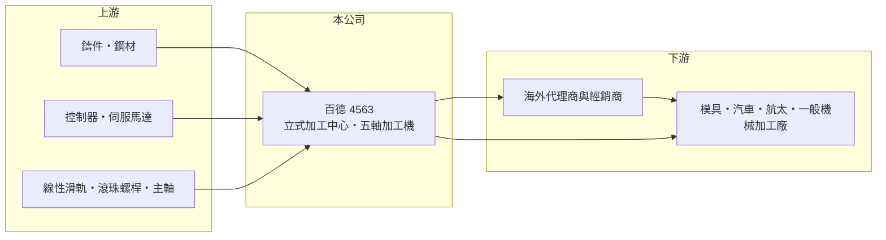

# 4563 百德

> 上櫃｜[[產業索引-電機機械|電機機械]]｜上市（櫃）日期 2018/07/12

# 第一章：企業模式與商業藍圖

> [!info] 撰寫說明
> 精簡版，由 Claude 依公開資料整理，架構比照 [[2330台積電]]，資料截至 2026-10-08。來源：證交所／櫃買中心開放資料快照（基本資料、2026 年第二季資產負債與損益、本益比殖利率）、Goodinfo 歷年經營績效表、nStock 公司簡介。產品別與地區別營收比重公開資料未查得，品牌與市場描述部分憑既有知識撰寫，已標待校對。公開資料有限。#待校對

百德機械（以下簡稱百德）是台中大甲的[[工具機]]整機廠，理解它的關鍵在於：它賣的是單價高、景氣敏感的加工中心機，而且過去六年有一半的年份在虧損，獲利能力高度取決於歐美製造業的設備投資循環。

- **核心業務：** 百德成立於 1991 年，2018 年 7 月在櫃買中心上櫃。依官方資料，公司主要經營工具機械、[[CNC]] 電腦數值控制機械及其零件的製造、加工與買賣。產品以 QUASER 品牌的立式加工中心與[[五軸加工機]]為主（待校對），這類機台用於切削模具、汽車、航太與一般機械零件，是金屬加工廠的核心生產設備。
- **營收結構：** 依產品或地區的營收比重未查得。百德以外銷為主，歐洲是重要市場（待校對），這代表營收會跟著歐洲製造業景氣、匯率與當地代理商庫存起伏。2025 年營收 28.7 億元，較 2024 年的 32.4 億元下滑約 11%。
- **營運據點：** 總部與主要工廠位於台中大甲幼獅工業區。合併報表中有非控制權益約 0.78 億元，代表旗下有非全資持有的子公司，海外銷售與服務據點的具體布局未查得（待校對）。工具機需要在地的安裝、維修與教學服務，海外據點的密度直接影響品牌在當地的接單能力。
- **長期方向：** 工具機產業的長期趨勢是往多軸、自動化與高精度發展，五軸機與搭配自動交換工作台、機械手臂的加工單元，單價與毛利都高於一般三軸機。百德 2022 至 2024 年毛利率由 25% 升到 32%，顯示產品組合往高階移動；能否把這個毛利率轉成穩定的營業利益，是公司長期能否擺脫虧損循環的關鍵。

# 第二章：護城河深度與競爭優勢

百德的護城河偏窄，主要來自品牌在特定海外市場的累積與高階機種的技術能力，但在價格與規模上面對日本、德國與台灣同業的激烈競爭。

- **競爭優勢：** 工具機買家重視精度穩定、交機速度與售後服務，一旦工廠用慣某個品牌的操作介面與保養體系，續購同品牌的機率較高，這構成一定程度的轉換成本。百德 2024 年毛利率達 31.9%，在台灣工具機整機廠中屬中上水準，代表產品並非純粹靠低價競爭。
- **主要對手：** 國內同業包括 [[1583程泰]]、[[4526東台]]、[[1530亞崴]]、[[4510高鋒]] 等工具機廠；國際上則有日本 DMG 森精機、Okuma、Mazak 與德國廠商（待校對），這些大廠在五軸與自動化產線的品牌力與規模都遠高於百德。中國工具機廠近年在中低階機種的價格競爭也持續加劇。
- **觀察重點：** 百德的毛利率在 2024 與 2025 年都維持約 31% 至 32%，但營業利益率由 10.5% 掉到 -2.0%，代表問題主要出在營收下滑時費用無法同步縮減。長期應追蹤營收能否穩定在 30 億元以上、營業費用率能否下降，以及[[累積虧損]]何時消除；這三點決定公司能否恢復配息。

# 第三章：財務體質與盈利規模

資料日期：2026-10-08，表格是撰寫當時的快照；最新月營收、毛利率、累計 EPS 由自動排程寫在本筆記的屬性欄位（月營收、毛利率、累計EPS 等）。#待校對

百德的財務特色是毛利率逐年改善，但營業利益與淨利隨營收大幅擺盪，而且業外損失與高負債比率放大了獲利的波動。

| 年度 | 營收（億元） | [[毛利率]] | [[營業利益率]] | EPS（元） | [[ROE]] |
|---|---|---|---|---|---|
| 2020 | 20.9 | 14.9% | -11.0% | -6.70 | -26.5% |
| 2021 | 20.2 | 18.9% | -5.2% | -3.36 | -15.3% |
| 2022 | 25.8 | 25.3% | 2.5% | 1.98 | 9.1% |
| 2023 | 27.7 | 28.0% | 7.6% | 2.02 | 8.2% |
| 2024 | 32.4 | 31.9% | 10.5% | 3.87 | 13.7% |
| 2025 | 28.7 | 31.5% | -2.0% | -2.67 | -9.4% |
| 2026 上半年 | 12.9 | 27.9% | 5.2% | -0.40 | 未查得 |

（來源：Goodinfo 歷年經營績效表；2026 上半年取自櫃買中心綜合損益開放資料。）

- **營收規模：** 2020 至 2025 年營收年複合成長率約 6.5%（推算），但走勢並不平順：2020 至 2021 年受疫情衝擊只有 20 億元出頭，2024 年攀上 32.4 億元高峰，2025 年又回落。工具機屬於資本財，客戶延後採購時營收可在一年內下滑一至兩成。
- **獲利：** 2021 至 2025 年平均 ROE 只有約 1.3%（推算），六年中有三年虧損。2026 年上半年本業有 0.67 億元營業利益，但業外損失 0.84 億元使稅前轉為虧損，顯示匯兌、利息或轉投資等業外項目對獲利影響很大（業外內容未查得）。
- **財務特色：** 依 2026 年第二季資料，總資產 43.9 億元、負債 29.2 億元、權益 14.7 億元，負債比率約 67%，在工具機同業中偏高；流動負債 22.2 億元，占負債的四分之三。保留盈餘為 -1.08 億元，帳上仍有累積虧損，依法須先彌補虧損才能配息，目前現金股利為 0 元。自由現金流是否長期為正未查得。
- **[[ROIC]] 與 [[WACC]]：** 2025 年營業利益約 -0.58 億元（28.7 億元 × -2.02%），稅後營業利益約 -0.46 億元；有息負債未查得，投入資本以權益 14.7 億元到權益加總負債 43.9 億元為區間，ROIC 約 -1% 至 -3%（推算），為負值。2024 年營業利益約 3.4 億元，當年 ROIC 推估約 6% 至 15%。WACC 以 CAPM 推估：無風險利率 1.75%、市場風險溢酬 6%、β 假設 1.2（工具機股景氣循環性高的常見值），權益成本約 9.0%；稅後負債成本約 2%、負債權重假設 40%，WACC 約 6.2%（推算）。長期來看，百德只有在 2024 年這種景氣高點時 ROIC 才明顯高於 WACC，多數年份未能創造經濟價值。

# 第四章：總體風險與地緣政治

百德的風險集中在工具機產業週期、高財務槓桿與海外市場的需求波動。

- **產業週期：** 工具機是典型的資本財，需求跟著汽車、航太、模具與一般製造業的設備投資走，景氣好時訂單集中湧入，景氣反轉時客戶直接延後採購。2020 年與 2025 年兩次營收下滑都伴隨大幅虧損，說明百德的[[營運槓桿]]很高。
- **營運風險：** 負債比率約 67%、累積虧損未消除，若景氣低迷時間拉長，資金壓力與利息負擔會進一步侵蝕獲利。高階五軸機的研發與海外服務據點都需要持續投入，規模較小的廠商在費用攤提上不利。
- **其他風險：** 以外銷為主，新台幣升值或歐元貶值都會壓縮毛利與產生匯兌損失；鋼材、鑄件與控制器等關鍵零件價格上漲也會影響成本。美國關稅與歐洲經濟成長放緩，可能讓海外客戶延後設備投資。

# 專有名詞解析

## 金融

- **[[營運槓桿]]**：固定成本占比高時，營收小幅變動就會讓營業利益大幅變動的現象。
- **[[累積虧損]]**：歷年虧損累積後尚未彌補的金額，依公司法須先彌補完畢才能分配盈餘。

## 產業

- **[[工具機]]**：用來切削、加工金屬零件的機器，是製造業的母機，台灣中部有完整的工具機聚落。
- **[[CNC]]**：電腦數值控制，用程式控制機台的刀具路徑進行切削、鑽孔或雕刻，是現代工具機的基礎。
- **[[五軸加工機]]**：刀具或工件可沿五個軸向同時移動的加工中心，能一次加工複雜曲面，用於航太、醫材與精密模具。

# 核心供應鏈

- 上游：鑄件與鋼材供應商、控制器與伺服馬達（日本 FANUC、德國 Siemens 等，待校對）、線性滑軌與滾珠螺桿（例如 [[2049上銀]]）。
- 下游／客戶：海外代理商與模具、汽車零件、航太及一般機械加工廠（具體客戶未查得，#待校對）。
- 同業：[[1583程泰]]、[[4526東台]]、[[1530亞崴]]、[[4510高鋒]]，以及日本、德國與中國工具機廠。

## 最新新聞
<!-- news:start -->
<!-- news:end -->

## 相關連結
- [公開資訊觀測站](https://mopsov.twse.com.tw/mops/web/t05st03?step=1&firstin=1&co_id=4563)
- [Goodinfo](https://goodinfo.tw/tw/StockDetail.asp?STOCK_ID=4563)
- [Yahoo 股市](https://tw.stock.yahoo.com/quote/4563)
- [鉅亨網新聞](https://www.cnyes.com/twstock/4563/news)
