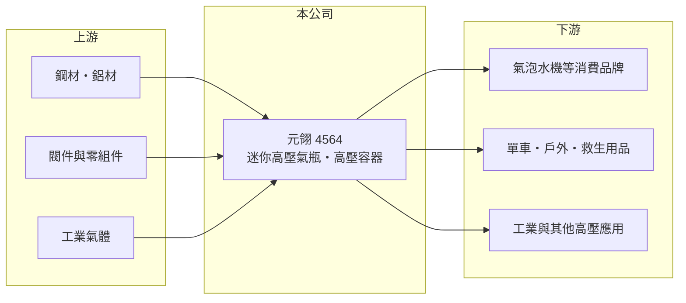

# 4564 元翎

> 上市｜[[產業索引-電機機械|電機機械]]｜上市（櫃）日期 2019/03/07

# 第一章：企業模式與商業藍圖

> [!info] 撰寫說明
> 精簡版，由 Claude 依公開資料整理，架構比照 [[2330台積電]]，資料截至 2026-10-08。來源：證交所開放資料快照（基本資料、2026 年第二季資產負債與損益、營益分析、股利、每月營收）、Goodinfo 歷年經營績效表、nStock 公司簡介。產品應用與客戶結構公開資料未查得，相關描述憑既有知識撰寫，已標待校對。公開資料有限。#待校對

元翎精密工業（以下簡稱元翎）是雲林虎尾的[[高壓氣瓶]]製造商，理解它的關鍵在於：它是一家高度集中在單一利基產品的專業代工廠，2021 年後營收腰斬、連續三年毛損，現在面對的是產能過剩與客戶結構重整的長期課題。

- **核心業務：** 元翎成立於 1988 年，2017 年登錄興櫃，2019 年 3 月在證交所上市。依官方資料，主要營業項目是各式迷你高壓充氣鋼瓶及高壓容器的研發、設計、製造與銷售。這類小鋼瓶用來封裝二氧化碳等壓縮氣體，常見用途包括氣泡水機的二氧化碳鋼瓶、自行車打氣、救生衣充氣與漆彈氣槍（待校對）。
- **營收結構：** 依產品或地區的營收比重未查得。元翎以外銷為主，過去營收高度依賴少數國際品牌客戶，其中氣泡水機相關需求占比高（待校對）。營收由 2021 年的 24.8 億元降到 2025 年的 11.0 億元，2026 年 1 至 8 月累計營收又年減約 29%，顯示主要客戶訂單大幅縮減，而非單純景氣循環。
- **營運據點：** 總部與工廠位於雲林縣虎尾鎮（雲林科技工業區周邊）。2026 年第二季非流動資產約 48.7 億元，是 2025 年營收的四倍多，代表公司過去投入大量廠房與設備，產能規模遠大於目前的營收（擴產內容未查得，待校對）。
- **長期方向：** 元翎的長期課題是把為大客戶建置的產能轉向新的應用與客戶，例如工業氣體、醫療、戶外運動或其他高壓容器市場（具體規劃未查得）。高壓氣瓶需要材料、成形、熱處理與耐壓測試的整套能力，技術本身有門檻，但能否找到足以填滿產能的新訂單，才是公司能否回到獲利的關鍵。

# 第二章：護城河深度與競爭優勢

元翎的護城河在於高壓容器製造的認證與量產能力，但客戶集中使這個優勢在客戶轉向時迅速失效。

- **競爭優勢：** 高壓氣瓶屬於安全相關產品，各國對耐壓、爆破與洩漏測試都有法規要求，新進廠商要取得認證並穩定量產需要時間，這是元翎過去能拿下國際品牌訂單的基礎。2020 至 2021 年毛利率約 26% 至 27%，代表在產能滿載時，這項製造能力能帶來合理利潤。
- **主要對手：** 迷你氣瓶的主要競爭者包括歐洲與中國的同類製造商，以及大客戶自行建置的產能（待校對）。台灣上市櫃公司中沒有直接可比的同業。當大客戶選擇自製或轉單時，專業代工廠幾乎沒有議價空間。
- **觀察重點：** 毛利率由 2021 年的 26.1% 一路降到 2025 年的 -20.3%、2026 年上半年的 -26.0%，代表營收已低到無法分攤折舊等固定成本。長期應追蹤新客戶與新應用的營收占比、[[產能利用率]]是否回升，以及公司是否處分閒置資產或調整產能，這些會決定毛損能否結束。

# 第三章：財務體質與盈利規模

資料日期：2026-10-08，表格是撰寫當時的快照；最新月營收、毛利率、累計 EPS 由自動排程寫在本筆記的屬性欄位（月營收、毛利率、累計EPS 等）。#待校對

元翎的財務特色是高固定資產、低負債，但營收萎縮後陷入毛損，資本報酬率連續多年為負。

| 年度 | 營收（億元） | [[毛利率]] | [[營業利益率]] | EPS（元） | [[ROE]] |
|---|---|---|---|---|---|
| 2020 | 20.6 | 27.2% | 19.4% | 1.65 | 6.7% |
| 2021 | 24.8 | 26.1% | 18.4% | 1.75 | 7.2% |
| 2022 | 18.9 | 12.8% | 3.1% | 0.31 | 1.3% |
| 2023 | 13.0 | -7.8% | -25.9% | -1.87 | -8.6% |
| 2024 | 11.4 | -16.9% | -30.5% | -1.74 | -8.5% |
| 2025 | 11.0 | -20.3% | -34.2% | -1.86 | -10.4% |
| 2026 上半年 | 3.87 | -26.0% | -45.7% | -0.71 | 未查得 |

（來源：Goodinfo 歷年經營績效表；2026 上半年取自證交所營益分析與綜合損益開放資料。）

- **營收規模：** 2020 至 2025 年營收年複合成長率約 -11.8%（推算）。即使在營收高峰的 2021 年，ROE 也只有約 7%，原因是股本高達 23.3 億元、權益規模大，資產周轉率偏低。
- **獲利：** 2021 至 2025 年平均 ROE 約 -3.8%（推算），2023 年起連續虧損，2025 年稅後淨損約 4.2 億元。毛損代表賣出產品的收入連生產成本都無法涵蓋，這通常是產能利用率過低、折舊等固定成本無法分攤的結果，屬於[[營運槓桿]]反向作用的典型例子。
- **財務特色：** 依 2026 年第二季資料，總資產 64.3 億元、負債 24.7 億元、權益 39.5 億元，負債比率約 38%；每股淨值 16.98 元。保留盈餘為 -1.60 億元，帳上有[[累積虧損]]，2025 年度不配發股利；近五年平均現金股利僅約 0.3 元。自由現金流是否為正未查得，但在毛損狀態下營業現金流應偏弱。
- **[[ROIC]] 與 [[WACC]]：** 2025 年營業利益約 -3.76 億元（11.0 億元 × -34.2%），稅後營業利益約 -3.0 億元；有息負債未查得，投入資本以權益 39.5 億元到權益加總負債 64.3 億元為區間，ROIC 約 -5% 至 -8%（推算），為負值。WACC 以 CAPM 推估：無風險利率 1.75%、市場風險溢酬 6%、β 假設 1.1（中小型製造業常見值），權益成本約 8.4%；稅後負債成本約 2%、負債權重假設 30%，WACC 約 6.4%（推算）。ROIC 長期低於 WACC，即使在 2021 年獲利較好時 ROIC 也只與資金成本相當，代表公司投入的大量資本目前正在毀損股東價值。

# 第四章：總體風險與地緣政治

元翎的風險集中在客戶集中、產能閒置與持續虧損對資本的侵蝕。

- **產業週期：** 迷你氣瓶的需求主要來自消費性產品，氣泡水機、單車與戶外用品的銷售會隨消費景氣與流行起伏（待校對）。更大的問題是結構性：大客戶的採購策略改變，比景氣循環對元翎的影響更深。
- **營運風險：** 營收規模遠小於產能時，固定成本持續造成毛損，若新客戶開發不如預期，虧損可能延續並進一步侵蝕淨值。公司可能需要處分資產、減資或認列減損，這些都會影響股東權益。
- **其他風險：** 鋼材與鋁材等原物料價格、外銷的匯率波動，以及各國對高壓容器的安全法規變動，都會影響成本與接單。若發生產品安全事故，品牌客戶的信任與認證也可能受損。

# 專有名詞解析

## 金融

- **[[營運槓桿]]**：固定成本占比高時，營收小幅變動就會讓營業利益大幅變動的現象。
- **[[累積虧損]]**：歷年虧損累積後尚未彌補的金額，依公司法須先彌補完畢才能分配盈餘。
- **[[產能利用率]]**：實際產量占總產能的比例，製造業的毛利率高度取決於此數字。

## 產業

- **[[高壓氣瓶]]**：用來儲存二氧化碳、氮氣等壓縮氣體的金屬容器，須通過耐壓與爆破測試，屬安全法規嚴格的產品。

# 核心供應鏈

- 上游：鋼材供應商（例如 [[2002中鋼]]，待校對）、閥件與零組件、充填用的工業氣體。
- 下游／客戶：氣泡水機品牌、單車與戶外用品、救生與工業用途（具體客戶未查得，#待校對）。
- 同業：歐洲與中國的迷你氣瓶製造商；台灣上市櫃中無直接可比公司。

## 最新新聞
<!-- news:start -->
<!-- news:end -->

## 相關連結
- [公開資訊觀測站](https://mopsov.twse.com.tw/mops/web/t05st03?step=1&firstin=1&co_id=4564)
- [Goodinfo](https://goodinfo.tw/tw/StockDetail.asp?STOCK_ID=4564)
- [Yahoo 股市](https://tw.stock.yahoo.com/quote/4564)
- [鉅亨網新聞](https://www.cnyes.com/twstock/4564/news)
