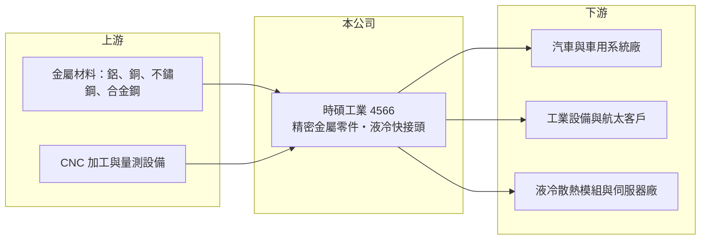

# 4566 時碩工業

> 上市｜[[產業索引-電機機械|電機機械]]｜上市（櫃）日期 2018/02/05

# 第一章：企業模式與商業藍圖

> [!info] 撰寫說明
> 精簡版，由 Claude 依公開資料整理，架構比照 [[2330台積電]] 的四章研究，資料截至 2026-10-08。來源：證交所開放資料快照（基本資料、2026 年第二季資產負債與綜合損益、營益分析、股利、2026 年 8 月營收備註）、CMoney 投資快訊、財經媒體標題、公開資訊觀測站重訊標題。公開資料有限，產品比重與多年度財務數字多數未查得。#待校對

時碩工業（股票代號 4566，英文名稱 Global Tek）是一家精密金屬零件加工廠，替汽車、工業設備與航太客戶製造高精度的金屬零組件。近年它把累積的精密加工能力延伸到 AI 伺服器的[[液冷]]散熱零件，這個轉變是理解公司長期方向的關鍵。

## 一、核心定位：多產業的精密金屬零件代工

- **核心業務：** 時碩成立於 2008 年，2018 年上市，總部位於新北市汐止，主要從事精密金屬零件的生產與加工，以 [[CNC]] 等切削製程為核心，產品應用涵蓋汽車、工業與[[航太零組件]]。這類代工的價值在於客戶的圖面精度與材料要求很高，供應商必須通過長期的品質認證，一旦成為合格供應商，訂單就會隨著車型或機種的生命週期延續多年。
- **營收結構：** 這次未查得產品別與地區別的營收比重。依證交所 2026 年 8 月營收備註，營收成長「主係多元產品布局有成，尤以散熱系統產品銷售開始發酵」，顯示散熱產品已從送樣階段進入實際出貨。#待校對
- **營運據點：** 總部在台灣，生產據點的國家與產能比重這次未查得。精密加工廠通常會在客戶所在區域設廠，以縮短交期並符合車廠與航太客戶的在地供應要求。

## 二、長期方向：從車用零件跨入 AI 液冷

- **液冷快接頭：** 財經媒體報導指出，時碩切入 AI 伺服器的水冷[[快接頭]]。快接頭要在高壓液體管路中做到快速插拔且不漏液，對加工精度、密封設計與材料一致性要求很高，正好與時碩在車用與航太零件累積的精密加工能力相通。AI 伺服器從氣冷轉向液冷，是一個可能延續多年的結構性需求。
- **多元產品布局：** 公司刻意把營收分散在汽車、工業、航太與散熱四個產業，目的在降低對單一產業景氣的依賴。分散的代價是每個產業都要投入不同的認證與設備，管理難度與資本支出都會增加。
- **籌資習慣：** 2026 年 10 月公告國內第四次無擔保[[可轉換公司債]]的代收價款與專戶行庫，代表公司已多次以可轉債籌措擴產資金。可轉債利率較低，但若轉換成股票會稀釋股本，是觀察經營層資本配置的重要指標。

# 第二章：護城河深度與競爭優勢

精密金屬零件加工是一個分散、客戶導向的產業，護城河來自認證、良率與與客戶共同開發的經驗，而非品牌。本章說明時碩的競爭位置。

## 一、護城河組成

- **品質認證與客戶黏著：** 汽車與航太零件需要通過車廠與飛機製造商的品質系統認證，認證期長、更換供應商成本高。這讓時碩既有客戶的訂單具有延續性，但也意味著新客戶的導入速度慢。
- **跨產業的精密加工經驗：** 同一套加工與量測能力可以應用在車用、航太與液冷零件，讓公司能把技術延伸到新市場。液冷快接頭就是這種技術延伸的例子。
- **整體判斷：** 時碩的護城河屬於窄護城河。代工模式下議價能力有限，毛利率大約在兩成上下，若要提升，需要靠高附加價值產品（如航太與液冷）的比重提高。

## 二、主要對手

| 對手 | 定位 | 與時碩的關係 |
|---|---|---|
| [[4551智伸科]] | 精密金屬零件與車用零組件 | 車用與工業精密零件直接競爭 |
| [[1536和大]] | 車用傳動齒輪 | 同屬車用金屬零件供應鏈 |
| [[6805富世達]]、[[3017奇鋐]]、[[3324雙鴻]] | 液冷散熱零組件與模組 | 在快接頭與液冷零件市場競爭或為客戶 |
| 歐美日液冷接頭大廠 | 專業流體接頭品牌 | 主導高階快接頭規格與認證 |

## 三、觀察重點

- **散熱產品的營收占比：** 散熱產品能否成長為主要營收來源，並帶動整體毛利率提升。
- **可轉債轉換與股本稀釋：** 多次發行可轉債後，每股盈餘的成長能否超過股本擴張的速度。

# 第三章：財務體質與盈利規模

資料日期：2026-10-08，表格是撰寫當時的快照；最新月營收、毛利率、累計 EPS 由自動排程寫在本筆記的屬性欄位（月營收、毛利率、累計EPS 等）。#待校對

財務數字顯示時碩處於低利潤率、但持續獲利並配息的狀態。新事業能否把報酬率拉上來，是長期最重要的觀察。

## 一、多年度財務

| 年度 | 營收（億元） | [[毛利率]] | [[營業利益率]] | EPS（元） | [[ROE]] |
|---|---|---|---|---|---|
| 2022 | 未查得 | 未查得 | 未查得 | 未查得 | 未查得 |
| 2023 | 未查得 | 未查得 | 未查得 | 未查得 | 未查得 |
| 2024 | 未查得 | 未查得 | 未查得 | 未查得 | 未查得 |
| 2025 | 未查得（1 至 8 月 32.98） | 未查得 | 未查得 | 約 1.35（推算） | 約 3%（推算） |
| 2026 上半年 | 28.22 | 23.21% | 4.26% | 0.99 | 約 4.3%（年化推算） |

- **營收規模：** 2026 年上半年營收 28.22 億元，1 至 8 月累計 39.73 億元，年增約 20%，8 月單月年增約 54%，主要由散熱系統產品帶動。
- **獲利：** 2025 年稅後淨利約 1.49 億元（證交所股利資料），以約 1.10 億股計算 EPS 約 1.35 元（推算）。2026 年上半年毛利率 23.21%、營業利益率 4.26%，營業費用約占營收兩成，吃掉大部分毛利，代表規模經濟尚未展現。
- **財務特色：** 2026 年第二季底股東權益約 51.5 億元、負債總計約 61.0 億元，負債高於權益，主要反映擴產與可轉債籌資。2025 年度擬配現金股利約 0.68 元、總額 7,500 萬元，約為當年淨利的五成，配息政策穩定但金額受限於獲利規模。

## 二、[[ROIC]] 與 [[WACC]]

- **ROIC（推算）：** 2026 年上半年營業利益 1.20 億元，年化約 2.41 億元，稅後約 1.92 億元。投入資本以股東權益 51.5 億元加推估有息負債約 30 億元（有息負債未查得，以非流動負債 23.2 億元加部分短期借款估計）約 81.5 億元計算，ROIC 約 2.4%（推算）。
- **WACC（推算）：** 無風險利率取 1.75%，市場風險溢酬 6%，β 取精密零件同業常見值 1.0，股權成本約 7.75%；負債成本假設 2.5%、稅後 2%，以權益 63%、負債 37% 計算，WACC 約 5.6%（推算）。
- **判讀：** ROIC 低於 WACC，代表目前投入的資本尚未創造足夠報酬。若散熱與航太等高附加價值產品提高比重、讓營業利益率回到高個位數，ROIC 才有機會超過資金成本；反之，持續以可轉債擴產而報酬率不提升，會稀釋股東價值。

# 第四章：總體風險與地緣政治

時碩的風險來自多個下游產業的週期疊加、新產品的執行，以及財務槓桿。本章挑出長期最相關的幾項。

## 一、產業週期

- **汽車產業週期：** 車用零件需求隨全球汽車銷量與車廠庫存起伏，電動車轉型也會改變零件需求，傳統燃油車相關零件長期可能萎縮。
- **AI 伺服器資本支出：** 液冷需求高度依賴雲端業者的 AI 投資，若資本支出放緩，散熱產品的成長也會隨之減速。

## 二、營運風險

- **新產品認證與良率：** 快接頭對防漏可靠度要求極高，任何品質事故都可能影響客戶信任。擴產初期的良率與折舊，也會暫時壓縮毛利率。
- **財務槓桿與股本稀釋：** 負債高於權益，加上多次發行可轉債，利率上升時財務成本增加，轉換後則稀釋每股盈餘。
- **競爭加劇：** 液冷零件吸引大量台灣與中國廠商投入，價格可能在數年內下滑。

## 三、其他風險

- **原物料：** 鋁、銅與不鏽鋼等金屬價格波動會影響成本，需要觀察能否轉嫁客戶。
- **匯率與關稅：** 客戶多在海外，美元匯率與美國關稅政策會影響報價與獲利。

# 專有名詞解析

## 金融

- **[[可轉換公司債]]**：可依約定價格轉換成公司股票的債券，公司可用較低利率籌資，但轉換後會稀釋股本。

## 產業

- **[[CNC]]**：電腦數值控制加工，以程式控制刀具切削金屬，是精密金屬零件的核心製程。
- **[[航太零組件]]**：飛機結構件、引擎零件與內裝件等，需通過嚴格品質認證才能供貨。
- **[[液冷]]**：以液體帶走晶片熱量的散熱方式，高功耗 AI 伺服器逐步從氣冷改為液冷。
- **[[快接頭]]**：液冷管路中可快速插拔且不漏液的接頭，方便伺服器維修更換，英文 Quick Disconnect。

# 核心供應鏈

- 上游：鋁、銅、不鏽鋼與合金鋼等金屬材料，以及 CNC 加工與量測設備；具體供應商未查得。
- 下游／客戶：汽車與車用系統廠、工業設備與航太客戶、液冷散熱模組與伺服器廠；具體客戶名單未查得。
- 同業：[[4551智伸科]]、[[1536和大]]、[[6805富世達]]、[[3017奇鋐]]、[[3324雙鴻]]。

## 最新新聞
<!-- news:start（自動產生，請勿手動編輯此範圍） -->
- 2026-10-14 🏛️ 重訊 15:23｜本公司受邀參加台新證券舉辦之法人說明會｜[觀測站](https://mops.twse.com.tw/mops/#/web/t05st01)
- 2026-10-08 📰 媒體 17:23｜營收速報 - 時碩工業(4566)9月營收6.67億元年增率高達44.56％｜[鉅亨網](https://news.cnyes.com/news/id/6625021)

完整紀錄：[[4566時碩工業 新聞]]
<!-- news:end -->

## 相關連結
- [公開資訊觀測站](https://mopsov.twse.com.tw/mops/web/t05st03?step=1&firstin=1&co_id=4566)
- [Goodinfo](https://goodinfo.tw/tw/StockDetail.asp?STOCK_ID=4566)
- [Yahoo 股市](https://tw.stock.yahoo.com/quote/4566)
- [鉅亨網新聞](https://www.cnyes.com/twstock/4566/news)
