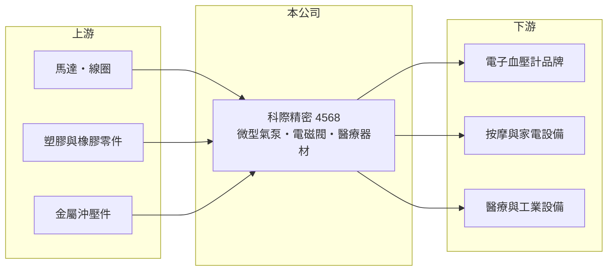

# 4568 科際精密

> 上櫃｜[[產業索引-電機機械|電機機械]]｜上市（櫃）日期 2018/10/03

# 第一章：企業模式與商業藍圖

> [!info] 撰寫說明
> 精簡版，由 Claude 依公開資料整理，架構比照 [[2330台積電]]，資料截至 2026-10-08。來源：櫃買中心開放資料快照（基本資料、2026 年第二季資產負債與損益、本益比殖利率、每月營收）、Goodinfo 歷年經營績效表、nStock 公司簡介。應用領域、客戶與生產據點公開資料未查得，相關描述憑既有知識撰寫，已標待校對。公開資料有限。#待校對

科際精密（以下簡稱科際）是生產[[微型氣泵]]與[[電磁閥]]的零組件廠，理解它的關鍵在於：它的產品體積小、單價低，卻是血壓計、按摩器材等設備裡負責「打氣與控制氣流」的關鍵元件，營收穩定但成長有限，獲利高度取決於費用控制。

- **核心業務：** 科際於 2014 年 3 月設立，2018 年 10 月在櫃買中心上櫃。依官方資料，公司及子公司主要從事氣泵、電磁閥、精密儀器及[[醫療器材]]的生產與銷售。微型氣泵與電磁閥用來產生與控制氣壓，常見於電子血壓計的壓脈帶充氣、按摩椅與氣囊、家電與醫療設備（應用分布待校對）。
- **營收結構：** 依產品、應用或地區的營收比重未查得。從營收長期維持在 10 億至 14 億元之間來看，科際的需求來源以穩定的消費性醫療與家用設備為主，而非大起大落的資本財。2025 年營收約 12.2 億元，2026 年 1 至 9 月累計年增約 6%。
- **營運據點：** 登記地址位於新北市中和區。主要生產基地應在中國大陸（待校對），在台灣以控股與營運管理為主。中國生產基地讓公司保有成本優勢，但也意味著需要面對當地工資上升與美國關稅的長期壓力。
- **長期方向：** 微型泵閥的長期成長來自高齡化帶動的居家醫療設備需求，以及往更高精度、更低噪音的產品升級，例如醫療級、穿戴式或工業用流體控制元件（具體規劃未查得）。把產品從消費級帶往醫療級，可提高單價與認證門檻，是提升毛利率的主要路徑。

# 第二章：護城河深度與競爭優勢

科際的護城河屬於窄護城河，來自小型泵閥的量產經驗與客戶的產品驗證，但規模不大、產品替代性也不低。

- **競爭優勢：** 微型氣泵必須在極小體積內兼顧壓力、流量、噪音與壽命，客戶把某款泵閥設計進血壓計或醫療設備後，更換供應商要重新做性能與安全驗證，形成一定的轉換成本。科際的毛利率長期維持在 30% 上下，代表產品並非純粹的價格競爭。
- **主要對手：** 主要競爭者是中國大陸的微型泵閥廠與日本的流體元件廠（待校對），中國廠商在價格上具有優勢。台灣上市櫃公司中，氣動元件廠 [[4555氣立]] 在流體控制技術上相近，但產品尺寸與應用市場不同。
- **觀察重點：** 毛利率在 2023 至 2025 年大致穩定在 30% 至 32%，營業利益率卻從 2020 年的 16.8% 降到 6% 至 7%，2026 年上半年更只有約 2.9%。這代表費用增加的速度快於營收，長期應追蹤費用率能否回落，以及醫療級新產品能否帶動營收突破過去的高點。

# 第三章：財務體質與盈利規模

資料日期：2026-10-08，表格是撰寫當時的快照；最新月營收、毛利率、累計 EPS 由自動排程寫在本筆記的屬性欄位（月營收、毛利率、累計EPS 等）。#待校對

科際的財務特色是營收規模穩定、負債不高、配息比例高，但營業利益率逐年下滑，使 ROE 由雙位數降到個位數。

| 年度 | 營收（億元） | [[毛利率]] | [[營業利益率]] | EPS（元） | [[ROE]] |
|---|---|---|---|---|---|
| 2020 | 11.9 | 37.2% | 16.8% | 4.93 | 13.9% |
| 2021 | 13.7 | 33.0% | 12.7% | 5.03 | 13.7% |
| 2022 | 13.0 | 30.6% | 7.8% | 4.76 | 13.1% |
| 2023 | 10.4 | 29.9% | 4.8% | 1.06 | 3.0% |
| 2024 | 11.7 | 32.2% | 7.1% | 2.81 | 8.1% |
| 2025 | 12.2 | 30.4% | 6.3% | 2.01 | 5.7% |
| 2026 上半年 | 5.98 | 27.2% | 2.9% | 0.51 | 未查得 |

（來源：Goodinfo 歷年經營績效表；2026 上半年取自櫃買中心綜合損益開放資料計算。）

- **營收規模：** 2020 至 2025 年營收年複合成長率約 0.5%（推算），幾乎持平。2022 年 EPS 4.76 元遠高於營業利益所能支撐的水準，推估有可觀的業外收益（例如匯兌利益），屬一次性成分較高的獲利（推估）。
- **獲利：** 2021 至 2025 年平均 ROE 約 8.7%（推算），前三年在 13% 以上，後兩年降到 6% 至 8%。由於毛利率變化不大，獲利下滑主要來自營業費用上升，屬於可由管理層改善的項目。
- **財務特色：** 依 2026 年第二季資料，總資產 17.2 億元、負債 6.5 億元、權益 10.6 億元，負債比率約 38%，每股淨值 33.32 元；公司持有少量庫藏股。近四季現金股利約 1.98 元，與 2025 年 EPS 2.01 元相當，[[配息率]]接近 100%，顯示公司傾向把盈餘大部分發還股東。自由現金流是否長期為正未查得。
- **[[ROIC]] 與 [[WACC]]：** 2025 年營業利益約 0.77 億元（12.2 億元 × 6.3%），稅後營業利益約 0.61 億元；有息負債未查得，投入資本以權益 10.6 億元到權益加總負債 17.2 億元為區間，ROIC 約 3.6% 至 5.7%（推算）。2020 年營業利益約 2.0 億元，當時 ROIC 推估在 15% 以上。WACC 以 CAPM 推估：無風險利率 1.75%、市場風險溢酬 6%、β 假設 1.0（零組件股常見值），權益成本約 7.8%；稅後負債成本約 2%、負債權重假設 20%，WACC 約 6.6%（推算）。近年 ROIC 低於 WACC，代表公司目前的本業報酬不足以覆蓋資金成本，營業利益率回升是重新創造價值的前提。

# 第四章：總體風險與地緣政治

科際的風險主要來自營業利益率下滑、中國生產基地的成本與政策變化，以及來自低價同業的競爭。

- **產業週期：** 血壓計、按摩器材等終端產品屬於消費性醫療與家用設備，需求相對穩定，但會受到品牌客戶庫存調整影響，2023 年營收年減約 20% 就是例子。
- **營運風險：** 營收規模約 12 億元，研發與管理費用的攤提效率有限，若無法提高營收或產品單價，營業利益率可能持續偏低。客戶集中度未查得，若少數品牌客戶轉單，影響可能很大（待校對）。
- **其他風險：** 生產基地若集中在中國大陸，將面對工資上升、環保法規與美國關稅的壓力；匯率波動會影響外銷報價與業外損益。醫療器材相關產品還須遵循各國醫材法規，認證時程與成本可能影響新產品推出速度。

# 專有名詞解析

## 應用

- **[[醫療器材]]**：用於診斷、治療或監測人體健康的器具，須取得各國主管機關許可，認證門檻高於一般消費品。

## 金融

- **[[配息率]]**：現金股利占當年度每股盈餘的比例，反映公司把獲利分給股東的程度。

## 產業

- **[[微型氣泵]]**：體積很小、用來產生氣壓或氣流的泵浦，常見於電子血壓計、按摩器材與小型醫療設備。
- **[[電磁閥]]**：以電磁力控制閥門開關、調節流體流向的元件，廣泛用於醫療、家電與自動化設備。

# 核心供應鏈

- 上游：微型馬達與線圈、塑膠射出與橡膠密封件、金屬沖壓零件供應商（待校對）。
- 下游／客戶：電子血壓計、按摩器材、家電與醫療設備品牌（具體客戶未查得，#待校對）。
- 同業：中國大陸微型泵閥廠、日本流體元件廠；國內流體控制相關廠商 [[4555氣立]]。

## 最新新聞
<!-- news:start -->
<!-- news:end -->

## 相關連結
- [公開資訊觀測站](https://mopsov.twse.com.tw/mops/web/t05st03?step=1&firstin=1&co_id=4568)
- [Goodinfo](https://goodinfo.tw/tw/StockDetail.asp?STOCK_ID=4568)
- [Yahoo 股市](https://tw.stock.yahoo.com/quote/4568)
- [鉅亨網新聞](https://www.cnyes.com/twstock/4568/news)
