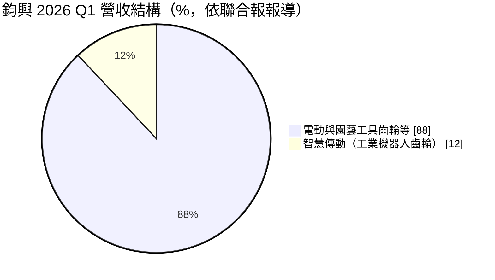
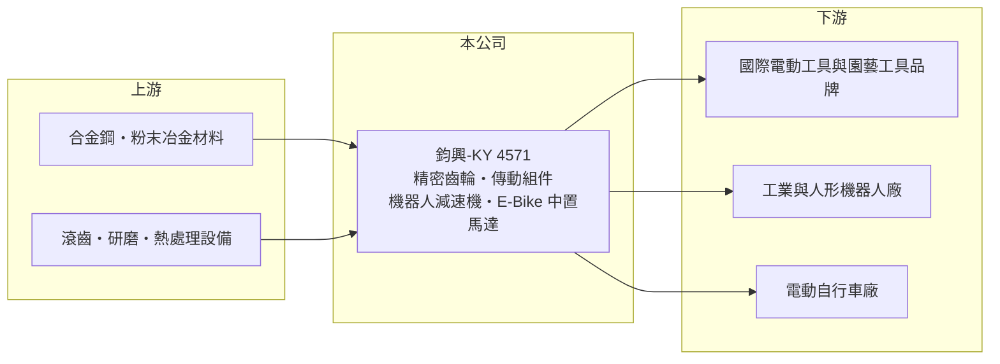

# 4571 鈞興-KY

> 上市｜[[產業索引-電機機械|電機機械]]｜上市（櫃）日期 2019/09/17

# 第一章：企業模式與商業藍圖

> [!info] 撰寫說明
> 精簡版，由 Claude 依公開資料整理，架構比照 [[2330台積電]]，資料截至 2026-10-08。來源：證交所開放資料快照（基本資料、2026 年第二季資產負債與損益、營益分析、股利、每月營收）、Goodinfo 歷年經營績效表、聯合報 2026 年股東會報導。生產據點與客戶名稱公開資料未查得，已標待校對。#待校對

鈞興機電（鈞興-KY，以下簡稱鈞興）是專做[[精密齒輪]]的傳動元件廠，理解它的關鍵在於：它以電動工具與園藝工具的齒輪起家並做到穩定獲利，現在正把同一套齒輪設計與量產能力延伸到工業[[機器人]]、人形機器人與電動自行車馬達。

- **核心業務：** 鈞興以開曼群島控股公司形式於 2014 年設立，2019 年 9 月在證交所上市。聯合報 2026 年股東會報導稱其為「精密齒輪大廠」，核心市場是電動工具與園藝工具用的齒輪與傳動組件。齒輪負責把馬達的高轉速轉換成工具所需的扭力，精度與耐磨性直接影響工具的效率與壽命。
- **營收結構：** 依報導，2026 年第一季智慧傳動產品（工業機器人用齒輪）營收占比 12%，首度超過一成，公司預期全年維持在一成以上；其餘以電動工具與園藝工具齒輪為主。同季電動工具齒輪營收與去年持平、園藝工具齒輪年減約 20%、工業機器人齒輪年增 49%。

- **營運據點：** 台灣設有營運總部（台北市大安區），生產基地主要位於中國大陸（待校對）。報導提到公司在美國對等關稅下仍創下營收與獲利新高，代表客戶以美國市場的國際工具品牌為主（待校對）。
- **長期方向：** 公司把智慧傳動列為第二條主力產品線：一方面尋求與日本機器人廠建立一階供應商的策略聯盟，另一方面開發人形機器人上肢關節用的[[漸開線少齒差減速機]]，報導指出其效率約 93%、高於原本評估的[[諧波減速機]]約 80%，預計 2026 年第三季送樣。此外，2025 年年中開發的 HX200 電動自行車中置馬達已有國內外車廠採用，預期 2027 年貢獻較明顯。

# 第二章：護城河深度與競爭優勢

鈞興的護城河來自齒輪的精密加工與大量生產能力，加上與國際工具品牌長期合作累積的設計導入，屬於窄但穩固的護城河。

- **競爭優勢：** 電動工具齒輪需要在小體積內承受高扭力與衝擊，品牌商把齒輪設計進新機種後，通常會沿用到該機種停產，更換供應商需要重新驗證壽命與噪音，形成轉換成本。鈞興 2020 至 2025 年毛利率維持在 28% 至 33%，營業利益率在 10% 至 17% 之間，即使在 2022 至 2023 年工具市場去庫存時仍保持獲利，顯示這個利基相當穩固。
- **主要對手：** 在[[減速機]]與傳動元件領域，國內有 [[4583台灣精銳]]（行星減速機）、[[2049上銀]]（諧波減速機與機器人）；國際上則有日本 Harmonic Drive、Nabtesco 等機器人減速機大廠，以及中國大陸的齒輪廠（待校對）。在工具齒輪市場，主要競爭來自中國同業與品牌商自製。
- **觀察重點：** 長期應追蹤智慧傳動營收占比能否由一成提高到兩成以上，以及日本機器人客戶與人形機器人送樣能否轉為量產訂單。工具齒輪是穩定的現金來源，但成長有限；機器人與電動自行車才是決定鈞興未來十年規模的變數。

# 第三章：財務體質與盈利規模

資料日期：2026-10-08，表格是撰寫當時的快照；最新月營收、毛利率、累計 EPS 由自動排程寫在本筆記的屬性欄位（月營收、毛利率、累計EPS 等）。#待校對

鈞興的財務特色是穩定的雙位數 ROE、低負債與約五成以上的配息率，2024 至 2025 年營收與獲利都創下新高。

| 年度 | 營收（億元） | [[毛利率]] | [[營業利益率]] | EPS（元） | [[ROE]] |
|---|---|---|---|---|---|
| 2020 | 20.7 | 32.3% | 16.8% | 6.00 | 16.5% |
| 2021 | 27.4 | 32.3% | 15.9% | 8.18 | 18.6% |
| 2022 | 24.4 | 28.4% | 10.6% | 6.66 | 13.9% |
| 2023 | 23.5 | 28.4% | 11.9% | 5.18 | 10.5% |
| 2024 | 30.6 | 30.9% | 15.8% | 9.21 | 17.2% |
| 2025 | 30.6 | 32.8% | 17.3% | 9.61 | 16.4% |
| 2026 上半年 | 15.1 | 34.4% | 17.2% | 4.16 | 未查得 |

（來源：Goodinfo 歷年經營績效表；2026 上半年取自證交所營益分析開放資料。）

- **營收規模：** 2020 至 2025 年營收年複合成長率約 8.1%（推算）。2021 年疫情帶動居家修繕與園藝需求，營收跳升到 27.4 億元，2022 至 2023 年工具品牌去庫存時回落，2024 年再創新高，走勢反映工具市場的庫存循環。
- **獲利：** 2021 至 2025 年平均 ROE 約 15.3%（推算），最低的 2023 年也有 10.5%。2025 年稅後淨利約 4.98 億元、年增 4.4%，毛利率與營業利益率同步改善，產品組合往機器人齒輪等較高附加價值的方向移動。
- **財務特色：** 依 2026 年第二季資料，總資產 43.8 億元、負債 11.1 億元、權益 32.7 億元，負債比率約 25%，流動資產占總資產約四分之三，財務結構穩健。2025 年度配發現金股利 5.3 元，以 EPS 9.61 元計，[[配息率]]約 55%，保留部分盈餘支應機器人等新產品投資。公司持有約 82 萬股庫藏股。自由現金流是否長期為正未查得。
- **[[ROIC]] 與 [[WACC]]：** 2025 年營業利益約 5.29 億元（30.6 億元 × 17.3%），稅後營業利益約 4.24 億元；有息負債未查得，負債以流動負債為主，投入資本以權益 32.7 億元到權益加總負債 43.8 億元為區間，ROIC 約 9.7% 至 13.0%（推算）。WACC 以 CAPM 推估：無風險利率 1.75%、市場風險溢酬 6%、β 假設 1.1（傳動元件股常見值），權益成本約 8.4%；稅後負債成本約 2%、負債權重假設 10%，WACC 約 7.7%（推算）。ROIC 穩定高於 WACC 約 2 至 5 個百分點，代表鈞興長期在創造經濟價值；若帳上現金扣除不計，實際營運資本的報酬率會更高。

# 第四章：總體風險與地緣政治

鈞興的風險主要來自工具市場的庫存循環、對美國市場的依賴，以及新事業能否放量的不確定性。

- **產業週期：** 電動工具與園藝工具的需求與美國房市、居家修繕與天候有關，品牌商的庫存調整會沿供應鏈放大，2022 至 2023 年營收下滑就是一例。公司在 2026 年股東會也以美國通膨與房市不確定性為由，對全年看法保守。
- **營運風險：** 人形機器人規格尚未標準化，漸開線少齒差減速機仍在送樣階段，從送樣到量產可能需要數年，期間的研發與設備投資會先發生。日本機器人客戶的認證門檻高，聯盟能否成形也有不確定性。
- **其他風險：** 生產集中在中國大陸時（待校對），美中貿易政策與關稅變化會影響客戶下單地點；鋼材價格與匯率波動會影響毛利。作為 KY 公司，資訊揭露與跨境治理也是投資人應留意的面向。

# 專有名詞解析

## 應用

- **[[機器人]]**：包含工業機器人、協作機器人與人形機器人，關節需要馬達、減速機、編碼器與驅動器等精密元件。

## 金融

- **[[配息率]]**：現金股利占當年度每股盈餘的比例，反映公司把獲利分給股東的程度。

## 產業

- **[[精密齒輪]]**：以高精度切削、熱處理與研磨製成的齒輪，負責傳遞動力與改變轉速，用於電動工具、車輛與機器人。
- **[[減速機]]**：降低馬達轉速、放大扭力的傳動元件，精密減速機是機器人關節的核心零件。
- **[[諧波減速機]]**：利用柔性齒輪變形傳動的精密減速機，體積小、減速比大，常用於機器人關節，但效率與耐用度有限。
- **[[漸開線少齒差減速機]]**：內外齒輪齒數只差少數幾齒的行星式減速機構，結構緊湊、傳動效率較高，被視為機器人關節的替代方案。

# 核心供應鏈

- 上游：合金鋼與粉末冶金材料供應商（例如 [[2002中鋼]]，待校對）、齒輪加工與熱處理設備。
- 下游／客戶：國際電動工具與園藝工具品牌（具體名稱未查得，#待校對）、日本工業機器人廠、電動自行車廠，另布局船外機與農機。
- 同業：[[4583台灣精銳]]、[[2049上銀]]、[[1536和大]]，以及日本 Harmonic Drive、Nabtesco 與中國齒輪廠。

## 最新新聞
<!-- news:start -->
<!-- news:end -->

## 相關連結
- [公開資訊觀測站](https://mopsov.twse.com.tw/mops/web/t05st03?step=1&firstin=1&co_id=4571)
- [Goodinfo](https://goodinfo.tw/tw/StockDetail.asp?STOCK_ID=4571)
- [Yahoo 股市](https://tw.stock.yahoo.com/quote/4571)
- [鉅亨網新聞](https://www.cnyes.com/twstock/4571/news)
