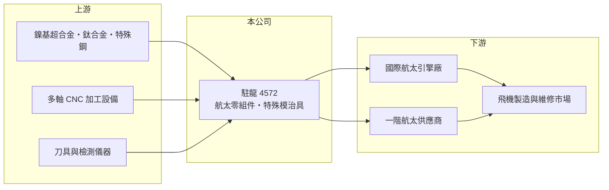

# 4572 駐龍

> 上市｜[[產業索引-電機機械|電機機械]]｜上市（櫃）日期 2019/09/10

# 第一章：企業模式與商業藍圖

> [!info] 撰寫說明
> 精簡版，由 Claude 依公開資料整理，架構比照 [[2330台積電]]，資料截至 2026-10-08。來源：證交所開放資料快照（基本資料、2026 年第二季資產負債與損益、營益分析、股利、每月營收）、Goodinfo 歷年經營績效表、nStock 公司簡介。產品細項、客戶與營收比重公開資料未查得，相關描述憑既有知識撰寫，已標待校對。公開資料有限。#待校對

駐龍精密（以下簡稱駐龍）是高雄仁武的[[航太零組件]]加工廠，理解它的關鍵在於：它的營收規模不大，但切入的是認證門檻高、交期長的民航供應鏈，2022 至 2024 年隨民航復甦把毛利率推到接近五成，2025 年則出現明顯修正。

- **核心業務：** 駐龍成立於 1990 年，2019 年 9 月在證交所上市。依官方資料，集團主要營業項目為航太零組件及特殊模治具的製造、加工與買賣。航太零組件以飛機引擎相關的精密金屬零件為主（待校對），這類零件多使用鎳基超合金、鈦合金等難加工材料，需要多軸 [[CNC]] 加工與嚴格的尺寸檢驗。
- **營收結構：** 依產品或地區的營收比重未查得。營收由 2020 年的 3.5 億元成長到 2024 年的 8.71 億元，2025 年回落到 6.71 億元，2026 年 1 至 9 月累計營收 5.74 億元、年增約 13%。營收波動主要反映國際引擎廠的訂單節奏與交機時程。
- **營運據點：** 總部與工廠位於高雄市仁武區，生產集中在台灣。航太零件的製程與檢驗須經國際客戶稽核認可，產線一旦通過認證就很少遷移，因此台灣廠是公司最主要的資產。
- **長期方向：** 全球民航機隊的擴張與新一代省油引擎的換代，是航太零件供應商長期的需求來源；引擎零件還有維修更換的售後市場，使需求延續到飛機服役的二三十年間。駐龍的長期課題是擴大可承接的料號與製程，並把特殊模治具的能力延伸到更多航太與工業應用（具體規劃未查得）。

# 第二章：護城河深度與競爭優勢

駐龍的護城河來自航太品質認證（例如 [[AS9100]]，駐龍的取得情形待校對）、零件「首件檢驗」後的長期鎖定，以及難加工材料的製程經驗，屬於窄但深的護城河。

- **競爭優勢：** 航太引擎零件一旦完成首件檢驗與客戶認證，製程就被鎖定，換供應商必須重新驗證，往往耗時一年以上，這讓既有供應商享有高轉換成本與穩定的長約訂單。駐龍 2022 至 2024 年毛利率達 45% 至 49%、營業利益率約 29% 至 36%，在台灣製造業中屬於高水準，反映這種認證壁壘帶來的定價能力。
- **主要對手：** 國內航太供應鏈包括 [[2634漢翔]]、[[2645長榮航太]] 與 [[8222寶一]] 等，但產品定位與規模不同；國際上則與歐美、日本的專業引擎零件加工廠競爭（待校對）。駐龍規模小，競爭策略是在特定料號上做到高良率與準時交貨。
- **觀察重點：** 2025 年毛利率由 49.1% 降到 34.5%、營收年減約 23%，原因未查得，可能與客戶庫存調整、產品組合或新廠折舊有關（推估）。長期應追蹤毛利率能否回到四成以上，以及營收能否穩定超過 2024 年高點，這兩項會說明 2025 年是短期修正還是結構性變化。

# 第三章：財務體質與盈利規模

資料日期：2026-10-08，表格是撰寫當時的快照；最新月營收、毛利率、累計 EPS 由自動排程寫在本筆記的屬性欄位（月營收、毛利率、累計EPS 等）。#待校對

駐龍的財務特色是高毛利、營收隨民航循環大幅成長，以及高比例的現金股利。

| 年度 | 營收（億元） | [[毛利率]] | [[營業利益率]] | EPS（元） | [[ROE]] |
|---|---|---|---|---|---|
| 2020 | 3.50 | 30.0% | 13.6% | 0.92 | 1.7% |
| 2021 | 4.04 | 34.8% | 15.0% | 1.50 | 3.0% |
| 2022 | 6.37 | 44.9% | 28.9% | 5.13 | 10.7% |
| 2023 | 8.33 | 47.8% | 34.6% | 6.21 | 13.4% |
| 2024 | 8.71 | 49.1% | 35.8% | 7.29 | 14.3% |
| 2025 | 6.71 | 34.5% | 20.6% | 3.00 | 5.8% |
| 2026 上半年 | 3.75 | 34.1% | 21.4% | 1.86 | 未查得 |

（來源：Goodinfo 歷年經營績效表；2026 上半年取自證交所營益分析開放資料。）

- **營收規模：** 2020 至 2025 年營收年複合成長率約 13.9%（推算），在電機機械類股中屬於較高的成長速度。2020 至 2021 年受疫情衝擊民航停飛，營收與獲利都在低點；2022 年起隨民航復甦快速成長，說明航太零件的需求與航空公司的機隊使用率高度相關。
- **獲利：** 2021 至 2025 年平均 ROE 約 9.5%（推算），高峰時約 14%。毛利率由三成升到接近五成時，營業利益率擴張更快，顯示固定成本占比高、[[營運槓桿]]明顯；2025 年營收下滑時，同樣的槓桿反向作用。
- **財務特色：** 依 2026 年第二季資料，總資產 31.6 億元、負債 12.6 億元、權益 19.0 億元，負債比率約 40%，保留盈餘 13.9 億元，每股淨值 47.52 元。2025 年度配發現金股利 5.0 元，高於當年 EPS 3.0 元，[[配息率]]約 167%，等於動用過去累積的保留盈餘發放；2024 年以前的配息紀錄未查得。自由現金流是否長期為正未查得。
- **[[ROIC]] 與 [[WACC]]：** 2025 年營業利益約 1.38 億元（6.71 億元 × 20.6%），稅後營業利益約 1.11 億元；有息負債未查得，投入資本以權益 19.0 億元到權益加總負債 31.6 億元為區間，ROIC 約 3.5% 至 5.8%（推算）。2024 年營業利益約 3.12 億元，當年 ROIC 推估約 8% 至 13%。WACC 以 CAPM 推估：無風險利率 1.75%、市場風險溢酬 6%、β 假設 1.2（航太零組件股波動較大的常見值），權益成本約 9.0%；稅後負債成本約 2%、負債權重假設 25%，WACC 約 7.2%（推算）。駐龍在 2023 至 2024 年 ROIC 高於 WACC，2025 年則跌破資金成本，能否重新創造價值取決於毛利率回升的幅度。

# 第四章：總體風險與地緣政治

駐龍的風險主要來自民航產業週期、客戶集中與小型供應商的規模限制。

- **產業週期：** 航太零件需求與航空客運量、新機交付與引擎維修高度相關。疫情期間全球民航停擺，駐龍 2020 年 ROE 只有 1.7%；未來若發生疫情、戰爭或經濟衰退導致航班大減，需求也會快速收縮。
- **營運風險：** 航太零件供應商通常集中在少數國際引擎廠與其一階供應商，單一客戶或單一料號的變化就可能大幅影響營收（客戶集中度未查得，待校對）。2025 年毛利率大降的原因若是產品組合或價格壓力，代表過去的高毛利不一定能持續。
- **其他風險：** 鎳基合金、鈦合金等特殊金屬價格波動會影響成本；以美元計價的外銷會受新台幣匯率影響。航太品質要求嚴格，一旦發生品質事故，可能遭到停止供貨或求償。

# 專有名詞解析

## 金融

- **[[營運槓桿]]**：固定成本占比高時，營收小幅變動就會讓營業利益大幅變動的現象。
- **[[配息率]]**：現金股利占當年度每股盈餘的比例，反映公司把獲利分給股東的程度。

## 產業

- **[[航太零組件]]**：飛機機體與引擎使用的精密零件，需通過航太品質系統與客戶首件檢驗，認證期長、轉換成本高。
- **[[AS9100]]**：航太產業的品質管理系統標準，是供應商進入國際航太供應鏈的基本門檻。
- **[[CNC]]**：電腦數值控制，用程式控制機台的刀具路徑進行切削、鑽孔或雕刻，是現代工具機的基礎。

# 核心供應鏈

- 上游：鎳基超合金、鈦合金與特殊鋼材供應商，多軸 CNC 加工設備與檢測儀器（具體供應商未查得）。
- 下游／客戶：國際航太引擎廠及其一階供應商（具體客戶未查得，#待校對）。
- 同業：[[2634漢翔]]、[[2645長榮航太]]、[[8222寶一]]，以及國際引擎零件加工廠。

## 最新新聞
<!-- news:start -->
<!-- news:end -->

## 相關連結
- [公開資訊觀測站](https://mopsov.twse.com.tw/mops/web/t05st03?step=1&firstin=1&co_id=4572)
- [Goodinfo](https://goodinfo.tw/tw/StockDetail.asp?STOCK_ID=4572)
- [Yahoo 股市](https://tw.stock.yahoo.com/quote/4572)
- [鉅亨網新聞](https://www.cnyes.com/twstock/4572/news)
