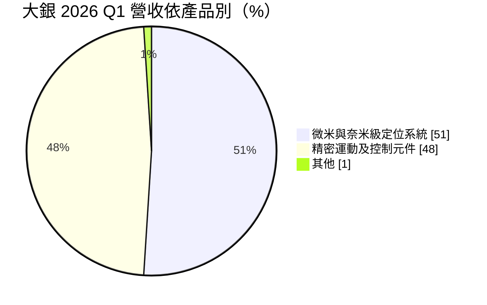
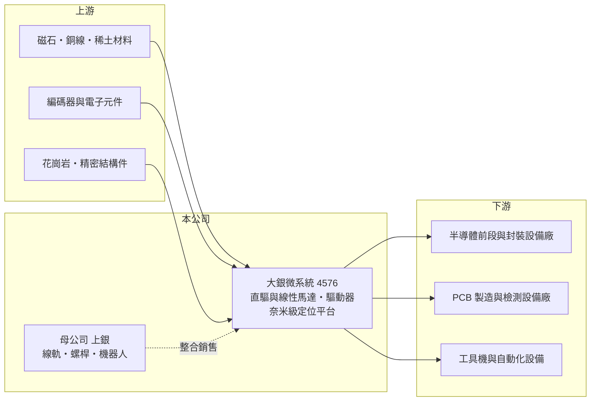

# 4576 大銀微系統

> 上市｜[[產業索引-電機機械|電機機械]]｜上市（櫃）日期 2019/09/04

# 第一章：企業模式與商業藍圖

> [!info] 撰寫說明
> 精簡版，由 Claude 依公開資料整理，架構比照 [[2330台積電]]，資料截至 2026-10-08。來源：證交所開放資料快照（基本資料、2026 年第二季資產負債與損益、營益分析、股利、每月營收）、Goodinfo 歷年經營績效表、富果 2026 年 5 月法說會摘要（AI 輔助整理，數字以公司簡報為準）。#待校對

大銀微系統（以下簡稱大銀）是 [[2049上銀]] 集團旗下的精密運動控制廠，理解它的關鍵在於：它做的是讓設備「動得準」的核心模組，從直驅馬達（[[DD馬達]]）、[[線性馬達]]、驅動器到奈米級[[定位平台]]，主要賣給半導體與 PCB 設備廠，因此營收與獲利跟著半導體設備投資循環大幅擺盪。

- **核心業務：** 大銀成立於 1997 年，2019 年 9 月在證交所上市，總部位於台中精密機械科技園區。產品分兩大類：一是精密運動及控制元件，包括直驅馬達、伺服馬達、驅動器與整合式多軸驅控器；二是微米與奈米級定位系統，也就是高精度 Stage，包括面板級封裝用平台與多維度定位平台。這些模組決定曝光、檢測、雷射加工與封裝設備的定位精度。
- **營收結構：** 依富果法說摘要，2026 年第一季營收 8.55 億元，其中定位系統 4.4 億元、占 51%，運動及控制元件 4.09 億元、占 48%，公司預期兩大產品線維持約五五比。地區別方面，亞洲（含中國大陸）占 64%、台灣占 18%。應用以半導體為主要成長動能，PCB 製造與檢測設備自 2025 年下半年起成長，[[矽光子]]檢測用高精度 Stage 於 2026 年 4 月開始出貨。

- **營運據點：** 台中總部之外，新竹鳳山新廠於 2025 年 9 月完工，貼近竹科半導體客戶；日本神戶新廠於 2024 年落成並設有無塵室，支援熊本半導體聚落；以色列子公司 Mega-Fabs 掌握編碼器等核心技術。合併報表中有非控制權益約 3.87 億元，代表部分子公司非全資持有。
- **長期方向：** 公司策略是強化驅動與控制核心技術，並與母公司上銀做機電整合：大銀的馬達與驅動器搭配上銀的線軌、螺桿、諧波減速機與晶圓搬運機器人，提供客戶整套解決方案。長期毛利率目標是穩定維持在 35% 以上，成長動能則來自 AI 帶動的先進製程與先進封裝設備、矽光子檢測與東南亞供應鏈轉移。

# 第二章：護城河深度與競爭優勢

大銀的護城河來自奈米級定位的技術門檻、半導體設備的設計導入，以及上銀集團的產品組合，屬於中等寬度的護城河。

- **競爭優勢：** 高精度 Stage 需要同時掌握馬達、編碼器、驅動控制與結構設計，能做到奈米級定位的廠商全球不多。設備廠一旦把某家平台設計進機台，後續量產與維修都沿用同一規格，換供應商要重新驗證整台設備的精度，轉換成本高。大銀與以色列子公司共同掌握編碼器技術，減少了對外部關鍵零件的依賴。
- **主要對手：** 國際上主要對手包括美國 Aerotech、德國 PI（Physik Instrumente）、日本安川電機與 THK 等（待校對），在半導體高階平台領域品牌與歷史都比大銀深厚。國內同業有 [[1597直得]]（線性滑軌與直驅馬達）、4540全球傳動 與 [[8374羅昇]]（自動化元件通路），產品部分重疊。
- **觀察重點：** 大銀的毛利率在 2023 至 2024 年約 31%，2025 年回升到 36.5%、2026 年上半年約 38%，已回到公司 35% 以上的目標。公司表示原料漲價無法完全轉嫁，因此長期應追蹤毛利率能否在景氣下行時守住 35%，以及半導體以外的應用（PCB、矽光子、機器人）占比是否提高，以降低單一產業循環的影響。

# 第三章：財務體質與盈利規模

資料日期：2026-10-08，表格是撰寫當時的快照；最新月營收、毛利率、累計 EPS 由自動排程寫在本筆記的屬性欄位（月營收、毛利率、累計EPS 等）。#待校對

大銀的財務特色是毛利率穩定在三成以上，但營業利益率隨營收規模大幅變動，典型的高[[營運槓桿]]設備零組件股。

| 年度 | 營收（億元） | [[毛利率]] | [[營業利益率]] | EPS（元） | [[ROE]] |
|---|---|---|---|---|---|
| 2020 | 24.5 | 34.2% | 7.7% | 1.14 | 4.4% |
| 2021 | 31.8 | 34.1% | 12.4% | 2.48 | 8.8% |
| 2022 | 32.3 | 34.6% | 11.7% | 2.73 | 9.9% |
| 2023 | 21.7 | 30.8% | 1.2% | 0.04 | 1.0% |
| 2024 | 22.5 | 31.0% | 2.3% | 0.51 | 2.2% |
| 2025 | 27.1 | 36.5% | 11.9% | 2.01 | 6.1% |
| 2026 上半年 | 18.8 | 38.0% | 17.3% | 1.92 | 未查得 |

（來源：Goodinfo 歷年經營績效表；2026 上半年取自證交所營益分析開放資料。）

- **營收規模：** 2020 至 2025 年營收年複合成長率約 2.0%（推算），但中間經歷 2023 年營收年減 33% 的低谷。2026 年 1 至 8 月累計營收 26.7 億元，年增約 56%，公司說明主因是客戶需求增加，上半年營收已接近 2025 年全年的七成。
- **獲利：** 2021 至 2025 年平均 ROE 約 5.6%（推算），在景氣高點也只有約 10%，原因之一是新竹與日本新廠等資本投入在前。2023 年營收縮減三成時，營業利益率由 11.7% 跌到 1.2%，2026 年上半年營收放大後又升到 17.3%，充分展現營運槓桿的雙向作用。
- **財務特色：** 依 2026 年第二季資料，總資產 75.6 億元、負債 28.8 億元、權益 46.8 億元（其中母公司業主 42.9 億元），負債比率約 38%，非流動資產 41.7 億元，反映新廠投資。2025 年度現金股利 0.8 元，以 EPS 2.01 元計，[[配息率]]約 40%，保留較多盈餘支應擴產。新竹新廠 2026 年折舊約 3,000 萬元。自由現金流是否長期為正未查得，擴廠期間應偏低。
- **[[ROIC]] 與 [[WACC]]：** 2025 年營業利益約 3.22 億元（27.1 億元 × 11.9%），稅後營業利益約 2.58 億元；有息負債未查得，投入資本以權益 46.8 億元到權益加總負債 75.6 億元為區間，ROIC 約 3.4% 至 5.5%（推算）。若以 2026 年上半年營業利益 3.26 億元年化，ROIC 可升到約 7% 至 11%（推算）。WACC 以 CAPM 推估：無風險利率 1.75%、市場風險溢酬 6%、β 假設 1.3（半導體設備零組件股波動較大的常見值），權益成本約 9.6%；稅後負債成本約 2%、負債權重假設 25%，WACC 約 7.7%（推算）。過去五年大銀的 ROIC 多半低於 WACC，只有在半導體設備擴產高峰時才可能超過，這是投資人評估其長期價值時必須面對的現實。

# 第四章：總體風險與地緣政治

大銀的風險集中在半導體設備循環、地緣政治與新產能的回收期。

- **產業週期：** 半導體與 PCB 設備投資具有明顯的循環性，客戶擴產時訂單集中湧入、交期拉長，景氣反轉時則快速縮減，2023 年就是例子。目前 AI 帶動的先進製程與封裝擴產是主要動能，一旦資本支出放緩，營收與營業利益可能同步大幅下滑，呈現[[長鞭效應]]。
- **營運風險：** 新竹與日本神戶新廠的折舊已開始提列，若需求高峰過後產能利用率下降，固定成本會壓縮獲利。驅動器供不應求時，交期與品質管理也是考驗；與上銀集團的分工與關係人交易，也需持續關注。
- **其他風險：** 亞洲（含中國大陸）占營收六成以上，美國對中國的半導體設備出口管制可能影響中國客戶需求；以色列子公司所在地的匯率與地緣局勢會影響業外收支。稀土、銅等原料價格上漲也會壓縮馬達產品的毛利。

# 專有名詞解析

## 半導體

- **[[矽光子]]**：在矽晶片上製作光學元件，以光取代電傳輸資料，可降低 AI 資料中心的傳輸耗電。

## 金融

- **[[營運槓桿]]**：固定成本占比高時，營收小幅變動就會讓營業利益大幅變動的現象。
- **[[長鞭效應]]**：終端需求的小幅變動，沿供應鏈往上游傳遞時被逐級放大，造成上游庫存與訂單劇烈波動。

## 產業

- **[[DD馬達]]**：直驅馬達，馬達直接帶動負載、不經減速機，精度高且無背隙，常用於機器人關節與旋轉平台。
- **[[線性馬達]]**：直接產生直線運動的馬達，不需螺桿轉換，速度快、精度高，用於高階定位平台。
- **[[定位平台]]**：由馬達、導軌、編碼器與控制器組成、可讓工件精準移動到指定位置的模組，又稱 Stage，用於半導體與檢測設備。

# 核心供應鏈

- 上游：磁石、銅線與稀土材料、編碼器與電子元件（部分由以色列子公司 Mega-Fabs 自製）、精密結構件。
- 下游／客戶：半導體前段與後段封裝設備廠、PCB 製造與檢測設備廠、矽光子檢測設備、工具機與自動化設備（具體客戶名稱未查得，#待校對）。
- 同業：母公司 [[2049上銀]]，國內 [[1597直得]]、4540全球傳動，國際 Aerotech、PI、安川電機等。

## 最新新聞
<!-- news:start（自動產生，請勿手動編輯此範圍） -->
- 2026-10-20 📰 媒體 21:57｜先進封裝翹曲問題有解 大銀微系統參展TPCA四大亮點一次看｜[鉅亨網](https://news.cnyes.com/news/id/6634490)
- 2026-10-06 📰 媒體 16:51｜營收速報 - 大銀微系統(4576)9月營收4.27億元年增率高達74.7％｜[鉅亨網](https://news.cnyes.com/news/id/6622754)

完整紀錄：[[4576大銀微系統 新聞]]
<!-- news:end -->

## 相關連結
- [公開資訊觀測站](https://mopsov.twse.com.tw/mops/web/t05st03?step=1&firstin=1&co_id=4576)
- [Goodinfo](https://goodinfo.tw/tw/StockDetail.asp?STOCK_ID=4576)
- [Yahoo 股市](https://tw.stock.yahoo.com/quote/4576)
- [鉅亨網新聞](https://www.cnyes.com/twstock/4576/news)
