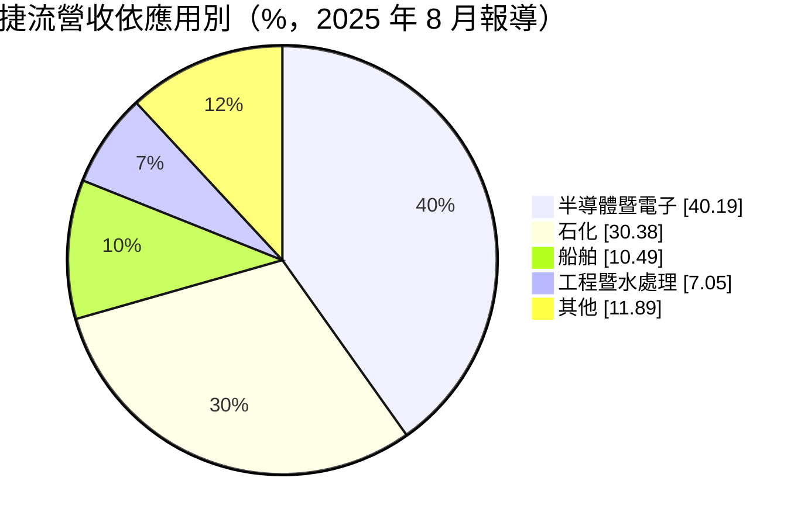
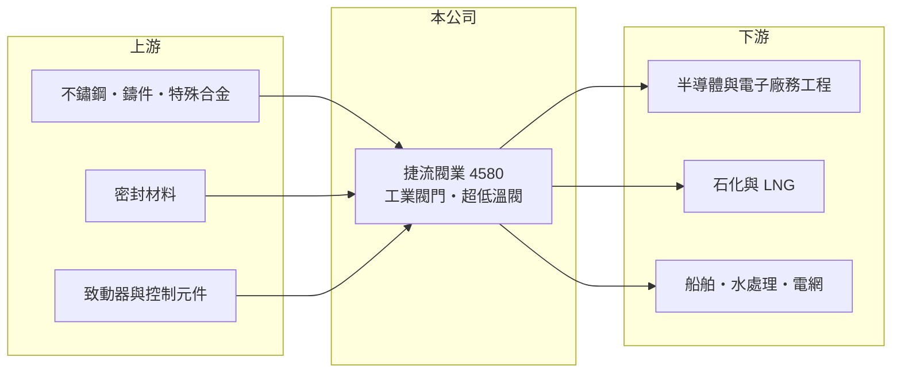

# 4580 捷流閥業

> 上櫃｜[[產業索引-電機機械|電機機械]]｜上市（櫃）日期 2020/01/06

# 第一章：企業模式與商業藍圖

> [!info] 撰寫說明
> 精簡版，由 Claude 依公開資料整理，架構比照 [[2330台積電]]，資料截至 2026-10-08。來源：櫃買中心開放資料快照（基本資料、2026 年第二季資產負債與損益、本益比殖利率、每月營收）、Goodinfo 歷年經營績效表、工商時報 2025 年 8 月報導。產品細項與生產據點公開資料有限，部分描述已標待校對。#待校對

捷流閥業（以下簡稱捷流）是新北土城的[[工業閥門]]製造商，理解它的關鍵在於：閥門是管線系統中負責開關與調節流體的元件，捷流的客戶橫跨半導體廠務、石化、船舶與水處理，訂單隨這些產業的建廠與擴廠週期起伏，但長期維持穩定且高於製造業平均的獲利。

- **核心業務：** 捷流成立於 1980 年，2020 年 1 月在櫃買中心上櫃。公司生產工業用閥門，產品以球閥、蝶閥等管線控制閥為主（產品細項待校對），用於輸送氣體、化學品、油品、超純水與一般水的管線系統。閥門看似簡單，但在高壓、高溫、超低溫或腐蝕性流體的環境下，密封性與壽命直接關係到工廠安全。
- **營收結構：** 依工商時報 2025 年 8 月報導，營收依應用別為半導體暨電子 40.19%、石化 30.38%、船舶 10.49%、工程暨水處理 7.05%，其餘約 11.9% 未說明。半導體與石化合計超過七成，代表捷流的需求主要來自這兩個產業的資本支出。

- **營運據點：** 總部與工廠位於新北市土城工業區。公司可自行進行防火、壽命與超低溫測試，並取得 ISO 9001、ABS（美國船級社）與 API（美國石油協會）等認證，這些認證是進入船舶與石化供應鏈的基本門檻。海外生產據點未查得。
- **長期方向：** 報導指出，捷流取得美國水處理閥門訂單，以及液化天然氣（[[LNG]]）與台電強韌電網相關新訂單，董事長楊大中表示將在美國市場尋找新商機。LNG 需要能承受零下一百六十度的超低溫閥門，技術門檻與單價都高於一般閥門；能源轉型與半導體在地化建廠，是捷流長期的兩條需求主線。

# 第二章：護城河深度與競爭優勢

捷流的護城河來自產業認證、廠務工程的指定採購與長期累積的測試能力，屬於窄但穩定的護城河。

- **競爭優勢：** 半導體廠務與石化工廠對閥門的洩漏率與可靠度要求極高，通常由業主或工程顧問列出合格供應商名單，新廠商要進入名單需要長時間的實績與認證。捷流能自行做防火、壽命與超低溫測試，縮短新產品認證時間；2020 至 2024 年毛利率維持在 32% 至 35%，營業利益率約 16% 至 19%，顯示產品具有一定定價能力。
- **主要對手：** 國際閥門大廠如美國 Emerson、Flowserve、日本 KITZ 等（待校對）在大型石化與 LNG 專案上具有品牌優勢；中國與印度閥門廠則在一般用途閥門上以低價競爭。捷流的定位是以台灣在地服務與交期，爭取半導體廠務與國內石化的訂單。
- **觀察重點：** 2025 年營收 22.7 億元、毛利率 30.8%、營業利益率 13.4%，都是近六年低點，ROE 也降到 8.8%。長期應追蹤 LNG、電網與美國水處理等新應用能否彌補半導體與石化建廠週期的空窗，並觀察毛利率能否回到三成以上。

# 第三章：財務體質與盈利規模

資料日期：2026-10-08，表格是撰寫當時的快照；最新月營收、毛利率、累計 EPS 由自動排程寫在本筆記的屬性欄位（月營收、毛利率、累計EPS 等）。#待校對

捷流的財務特色是營收規模穩定、ROE 長期在 15% 以上，以及高比例的現金股利，直到 2025 年才明顯下滑。

| 年度 | 營收（億元） | [[毛利率]] | [[營業利益率]] | EPS（元） | [[ROE]] |
|---|---|---|---|---|---|
| 2020 | 24.0 | 31.8% | 17.9% | 7.55 | 21.2% |
| 2021 | 24.0 | 33.6% | 18.4% | 8.04 | 19.2% |
| 2022 | 25.5 | 32.4% | 15.9% | 7.91 | 17.3% |
| 2023 | 26.1 | 32.0% | 16.4% | 7.68 | 15.0% |
| 2024 | 24.0 | 34.9% | 19.3% | 8.86 | 16.0% |
| 2025 | 22.7 | 30.8% | 13.4% | 5.03 | 8.8% |
| 2026 上半年 | 11.7 | 28.3% | 11.3% | 3.18 | 未查得 |

（來源：Goodinfo 歷年經營績效表；2026 上半年取自櫃買中心綜合損益開放資料計算。）

- **營收規模：** 2020 至 2025 年營收年複合成長率約 -1.1%（推算），營收在 22 億至 26 億元之間窄幅波動。這種穩定性來自應用分散：半導體建廠高峰與石化擴建的時間不完全重疊，可以互相彌補。
- **獲利：** 2021 至 2025 年平均 ROE 約 15.3%（推算），2020 至 2024 年 EPS 每年都在 7.5 元以上。2025 年 ROE 降到 8.8%，一方面是營收與毛利率下滑，另一方面是 2020 年上櫃後權益持續累積，ROE 也隨之逐年下降。
- **財務特色：** 依 2026 年第二季資料，總資產 40.4 億元、負債 12.9 億元、權益 27.5 億元，負債比率約 32%，每股淨值 58.70 元。近四季現金股利 4.0 元，以 2025 年 EPS 5.03 元計，[[配息率]]約 80%，符合成熟製造業高配息的特性。2026 年上半年業外收入約 0.49 億元，占稅前淨利的四分之一以上（內容未查得）。自由現金流是否長期為正未查得。
- **[[ROIC]] 與 [[WACC]]：** 2025 年營業利益約 3.04 億元（22.7 億元 × 13.4%），稅後營業利益約 2.43 億元；有息負債未查得，投入資本以權益 27.5 億元到權益加總負債 40.4 億元為區間，ROIC 約 6.0% 至 8.8%（推算）；2024 年營業利益約 4.63 億元，當年 ROIC 推估約 9% 至 13%。WACC 以 CAPM 推估：無風險利率 1.75%、市場風險溢酬 6%、β 假設 1.0（工業零組件股常見值），權益成本約 7.8%；稅後負債成本約 2%、負債權重假設 15%，WACC 約 6.9%（推算）。捷流長期 ROIC 高於 WACC，2025 年利差縮小到接近零，未來能否恢復取決於營業利益率回升。

# 第四章：總體風險與地緣政治

捷流的風險主要來自客戶產業的資本支出循環、原物料價格與國際大廠的競爭。

- **產業週期：** 半導體與石化合計占營收七成以上，兩者都有明顯的投資循環。半導體廠建廠高峰過後，廠務閥門需求會轉為較小量的維修更換；石化業若面臨產能過剩，擴建計畫可能延後。
- **營運風險：** 閥門的主要材料是不鏽鋼、鑄鐵與特殊合金，原物料價格上漲若無法轉嫁，會直接壓縮毛利率，2025 年至 2026 年上半年毛利率走低可能與此有關（推估）。大型專案訂單的認列時點也會造成季度營收波動。
- **其他風險：** 拓展美國市場會面臨關稅、認證與售後服務的挑戰；外銷比重提高後，匯率波動對獲利的影響也會增加。船舶相關訂單則與全球造船景氣連動。

# 專有名詞解析

## 應用

- **[[LNG]]**：液化天然氣，把天然氣冷卻到約零下 162 度變成液體以便運輸與儲存，相關設備需要耐超低溫。

## 金融

- **[[配息率]]**：現金股利占當年度每股盈餘的比例，反映公司把獲利分給股東的程度。

## 產業

- **[[工業閥門]]**：安裝在管線上控制流體開關、流量與壓力的元件，用於石化、半導體廠務、水處理與船舶。
- **[[廠務工程]]**：晶圓廠的無塵室、氣體化學品供應、水處理與機電系統等建置工程，隨晶圓廠擴產需求而起伏。

# 核心供應鏈

- 上游：不鏽鋼與特殊合金鑄件、密封材料、閥門致動器與控制元件供應商（具體供應商未查得）。
- 下游／客戶：半導體與電子廠的[[廠務工程]]（工程商例如 [[2404漢唐]]、[[6196帆宣]]，為產業鏈示意，非確認客戶，#待校對）、石化與 LNG 業者、船廠、水處理與電網工程。
- 同業：國際閥門大廠 Emerson、Flowserve、KITZ，以及中國與印度閥門廠（待校對）。

## 最新新聞
<!-- news:start -->
<!-- news:end -->

## 相關連結
- [公開資訊觀測站](https://mopsov.twse.com.tw/mops/web/t05st03?step=1&firstin=1&co_id=4580)
- [Goodinfo](https://goodinfo.tw/tw/StockDetail.asp?STOCK_ID=4580)
- [Yahoo 股市](https://tw.stock.yahoo.com/quote/4580)
- [鉅亨網新聞](https://www.cnyes.com/twstock/4580/news)
