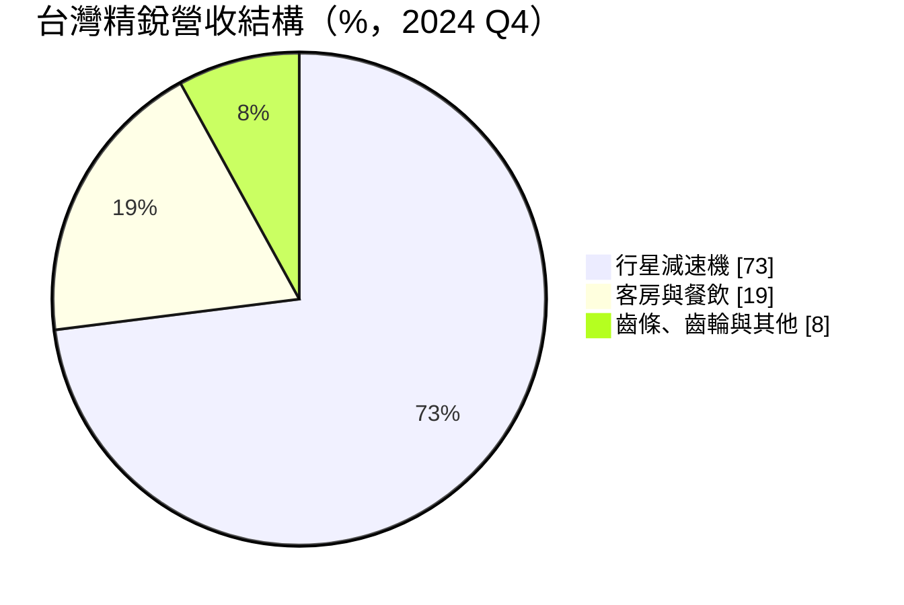
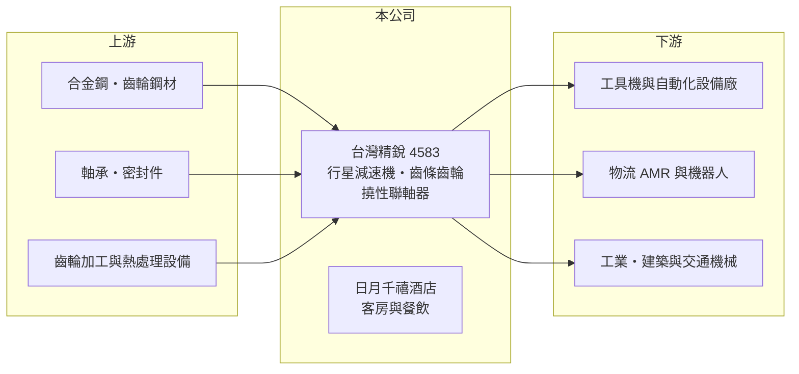

# 4583 台灣精銳

> 上市｜[[產業索引-電機機械|電機機械]]｜上市（櫃）日期 2022/05/09

# 第一章：企業模式與商業藍圖

> [!info] 撰寫說明
> 精簡版，由 Claude 依公開資料整理，架構比照 [[2330台積電]]，資料截至 2026-10-08。來源：證交所開放資料快照（基本資料、2026 年第二季資產負債與損益、營益分析、股利、每月營收）、Goodinfo 歷年經營績效表、優分析 AI 機器人專文（營收比重為 2024 年第四季資料）。#待校對

台灣精銳科技（以下簡稱精銳）是台中的精密[[行星減速機]]廠，理解它的關鍵在於：它以 APEX 品牌把行星減速機做到毛利率五成以上，是台灣傳動元件中獲利能力最突出的公司之一，同時旗下還有一家飯店，形成「高毛利製造業加觀光服務業」的特殊組合。

- **核心業務：** 精銳成立於 1999 年，2022 年 5 月在證交所上市，總部位於台中市西屯區（中部科學園區周邊）。主力產品是精密行星減速機，裝在伺服馬達與機械之間，負責降低轉速、放大扭力並維持定位精度，應用於工具機、自動化設備、工業機械、建築與礦業機械、交通運輸，以及機器人關節。另有齒條、齒排、齒輪，以及 2023 年底推出的伺服用零背隙撓性聯軸器。
- **營收結構：** 依優分析整理的 2024 年第四季資料，行星減速機占 73%、客房與餐飲占 19%、其他產品（齒條、齒輪、聯軸器等）占 8%。客房與餐飲來自 100% 持股的日月千禧酒店（位於台中，待校對），這部分營收的景氣循環與製造業不同，能在工業需求低迷時提供緩衝。

- **營運據點：** 減速機生產集中在台中，海外銷售與服務據點的布局未查得（待校對）。文中指出公司全球行星減速機市占率約 5% 至 10%，以外銷為主。
- **長期方向：** 短期動能來自 2023 年通過 [[AMZN亞馬遜]] 認證，成為其物流倉儲[[AMR]]（自主移動機器人）與七軸機器人的行星減速機供應商之一；長期則希望打入人形機器人供應鏈，尺寸僅 13 mm 的 MA 系列可裝在人形機器人關節甚至靈巧手。公司表示已掌握[[諧波減速機]]技術，但因規格尚未標準化而暫不量產，展現審慎的資本配置態度。

# 第二章：護城河深度與競爭優勢

精銳的護城河來自品牌、精密齒輪加工與齒條齒輪的完整產品線，屬於中等寬度的護城河，五成以上的毛利率是最直接的證據。

- **競爭優勢：** 行星減速機的關鍵是齒輪精度、背隙與壽命，精銳把齒輪加工與熱處理內製，能以較短交期提供高精度產品。優分析指出，精銳交期較同業短、報價較同業低，而行星減速機報價約只有諧波減速機的 30% 至 40%，在成本敏感的應用中具有吸引力。全球能同時提供行星減速機、齒排與齒輪「三合一」產品的廠商，除了德商 WITTENSTEIN 就是精銳，這讓它可以整套供應給工具機與自動化設備客戶。
- **主要對手：** 國際上主要對手是德國 WITTENSTEIN（alpha）、Neugart 與日本新寶（Nidec-Shimpo）等（後二者待校對）；國內則有 [[4571鈞興-KY]]（精密齒輪與機器人[[減速機]]）、[[2049上銀]]（諧波減速機）。中國減速機廠在中低階市場的價格競爭也持續升溫。
- **觀察重點：** 毛利率由 2020 年的 47% 升到 2023 年的 55.5%，2025 年為 52.2%，2026 年上半年 52.4%，高檔但略有下滑。長期應追蹤毛利率能否穩定在五成以上、Amazon 等新客戶後續階段的需求，以及人形機器人規格明朗後精銳能否取得量產訂單。

# 第三章：財務體質與盈利規模

資料日期：2026-10-08，表格是撰寫當時的快照；最新月營收、毛利率、累計 EPS 由自動排程寫在本筆記的屬性欄位（月營收、毛利率、累計EPS 等）。#待校對

精銳的財務特色是極高的毛利率與營業利益率、幾乎沒有負債，以及偏低的 ROE，後者來自帳上大量累積的保留盈餘。

| 年度 | 營收（億元） | [[毛利率]] | [[營業利益率]] | EPS（元） | [[ROE]] |
|---|---|---|---|---|---|
| 2020 | 28.4 | 47.0% | 30.1% | 9.60 | 9.6% |
| 2021 | 32.9 | 49.7% | 33.2% | 11.83 | 11.5% |
| 2022 | 34.3 | 50.7% | 33.7% | 14.47 | 12.8% |
| 2023 | 26.9 | 55.5% | 33.7% | 10.89 | 8.9% |
| 2024 | 29.6 | 54.5% | 33.6% | 14.15 | 11.3% |
| 2025 | 30.0 | 52.2% | 31.4% | 12.00 | 9.4% |
| 2026 上半年 | 17.6 | 52.4% | 34.4% | 6.81 | 未查得 |

（來源：Goodinfo 歷年經營績效表；2026 上半年取自證交所營益分析開放資料。）

- **營收規模：** 2020 至 2025 年營收年複合成長率約 1.1%（推算），在 27 億至 34 億元之間隨工具機與自動化景氣波動。2026 年 1 至 8 月累計營收 23.3 億元、年增約 16%，有機會突破 2022 年的高點。
- **獲利：** 2021 至 2025 年平均 ROE 約 10.8%（推算）。營業利益率在 2020 年以來始終維持在 30% 以上，即使 2023 年營收年減 22%，營業利益率也沒有下滑，顯示成本結構與定價能力都很強。2024 年 EPS 部分來自業外匯兌利益，屬一次性成分。
- **財務特色：** 依 2026 年第二季資料，總資產 111.3 億元、負債僅 12.0 億元、權益 99.3 億元，負債比率約 11%；保留盈餘高達 84.1 億元，流動資產 70.8 億元，每股淨值 123.90 元。2025 年度配發現金股利 10 元（盈餘 8 元加資本公積 2 元），以 EPS 12 元計，[[配息率]]約 83%。ROE 偏低的原因不是本業獲利差，而是權益中有大量資金未投入營運。
- **[[ROIC]] 與 [[WACC]]：** 2025 年營業利益約 9.42 億元（30.0 億元 × 31.4%），稅後營業利益約 7.54 億元；有息負債未查得、負債很低，以權益 99.3 億元到權益加總負債 111.3 億元為投入資本，ROIC 約 6.8% 至 7.6%（推算）。由於流動資產高達 70.8 億元（現金部位未查得），若扣除多餘現金只計營運所需資本，實際營運資本報酬率應在 20% 以上（推估）。WACC 以 CAPM 推估：無風險利率 1.75%、市場風險溢酬 6%、β 假設 1.1（傳動元件股常見值），權益成本約 8.4%；幾乎無負債，WACC 約 8.0%（推算）。帳面 ROIC 略低於 WACC，但這是過度保留現金造成的，本業本身創造的報酬遠高於資金成本；資本配置的效率，例如提高配息或投入新產品，是長期影響股東報酬的關鍵。

# 第四章：總體風險與地緣政治

精銳的風險主要來自工具機與自動化景氣、人形機器人題材的不確定性，以及飯店業務的獨立風險。

- **產業週期：** 行星減速機需求跟著工具機、自動化設備與半導體設備的投資循環走，2023 年營收年減 22% 就是例子。Amazon 等物流自動化專案訂單規模大但階段性明顯，一個階段結束後若下一階段延後，營收會出現落差。
- **營運風險：** 人形機器人規格尚未標準化，大額訂單與量產時程仍有不確定性；中國減速機廠的價格競爭可能壓縮中低階產品的毛利。飯店業務占營收近兩成，受觀光景氣、人力成本與設備更新影響，經營邏輯與製造業截然不同。
- **其他風險：** 以外銷為主，新台幣匯率會影響毛利與業外匯兌損益；鋼材等原物料價格上漲會影響成本。帳上大量現金若長期未有效運用，也會持續拉低 ROE。

# 專有名詞解析

## 應用

- **[[AMR]]**：自主移動機器人，能自行規劃路徑在倉庫或工廠內搬運物品，不需要地面軌道或磁條導引。

## 金融

- **[[配息率]]**：現金股利占當年度每股盈餘的比例，反映公司把獲利分給股東的程度。

## 產業

- **[[行星減速機]]**：由中心太陽齒輪、周圍行星齒輪與外環齒輪組成的減速機，扭力大、精度高，常與伺服馬達搭配。
- **[[減速機]]**：降低馬達轉速、放大扭力的傳動元件，精密減速機是機器人關節的核心零件。
- **[[諧波減速機]]**：利用柔性齒輪變形傳動的精密減速機，體積小、減速比大，常用於機器人關節，但效率與耐用度有限。

# 核心供應鏈

- 上游：合金鋼與齒輪鋼材（例如 [[2002中鋼]]，待校對）、軸承與密封件、齒輪加工與熱處理設備。
- 下游／客戶：伺服馬達與自動化設備廠、工具機廠、[[AMZN亞馬遜]] 物流自動化專案、工業與建築機械。
- 同業：德國 WITTENSTEIN、Neugart，日本新寶；國內 [[4571鈞興-KY]]、[[2049上銀]]。

## 最新新聞
<!-- news:start -->
<!-- news:end -->

## 相關連結
- [公開資訊觀測站](https://mopsov.twse.com.tw/mops/web/t05st03?step=1&firstin=1&co_id=4583)
- [Goodinfo](https://goodinfo.tw/tw/StockDetail.asp?STOCK_ID=4583)
- [Yahoo 股市](https://tw.stock.yahoo.com/quote/4583)
- [鉅亨網新聞](https://www.cnyes.com/twstock/4583/news)
