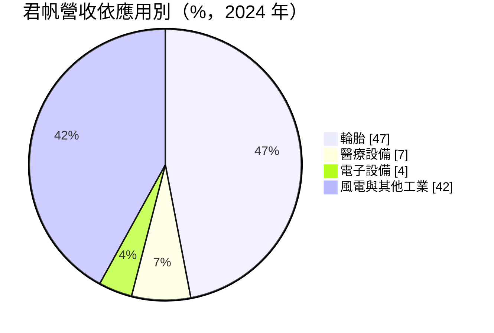
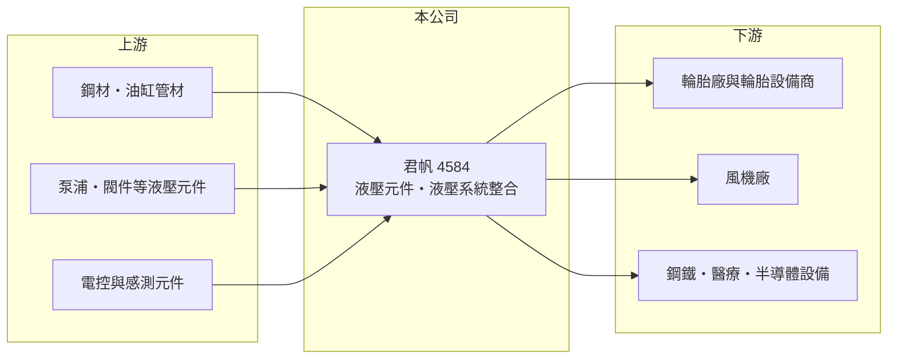

# 4584 君帆

> 上櫃｜[[產業索引-電機機械|電機機械]]｜上市（櫃）日期 2022/10/05

# 第一章：企業模式與商業藍圖

> [!info] 撰寫說明
> 精簡版，由 Claude 依公開資料整理，架構比照 [[2330台積電]]，資料截至 2026-10-08。來源：櫃買中心開放資料快照（基本資料、2026 年第二季資產負債與損益、本益比殖利率、每月營收）、Goodinfo 歷年經營績效表、Yahoo 股市轉載 2025 年 4 月新聞（應用別比重為 2024 年資料）。#待校對

君帆工業（以下簡稱君帆）是台南永康的[[液壓系統]]整合廠，理解它的關鍵在於：它不是賣單一標準零件，而是依客戶設備需求設計整套油壓動力與控制系統，輪胎製造設備是最大應用，再延伸到[[風力發電]]、半導體設備與醫療設備。

- **核心業務：** 君帆成立於 1983 年，2022 年 10 月在櫃買中心上櫃。新聞稱其為「液壓元件及系統整合大廠」，業務包括液壓元件與依客戶需求設計的液壓系統。液壓系統以油壓推動油缸與馬達，能在小空間內產生極大的力量，廣泛用於[[輪胎硫化機]]、鋼鐵製程設備、風機與各類工業機械。
- **營收結構：** 依 2024 年資料，輪胎相關應用占營收 47%（年增 50%）、醫療設備占 7%（年增 70%）、電子設備占 4%（年增 1.47 倍），其餘約 42% 為風電、鋼鐵與一般工業等其他應用（細項未查得）。輪胎占近半，代表君帆的營收與全球輪胎廠的設備投資高度相關。

- **營運據點：** 總部與工廠位於台南市永康區，另在中國大陸設有供貨據點。泰國新廠已獲泰國投資促進委員會（BOI）核准，原規劃 2026 年完成設廠，目標是就近服務在泰國設廠的輪胎廠、汽車廠，以及一家義大利鋼鐵製程設備商在泰國的生產需求。
- **長期方向：** 君帆自 2021 年起與風機大廠西門子歌美颯（Siemens Gamesa）合作，風電業務在 2024 年大幅成長；同時看好半導體製程設備與醫療設備應用，預計 2025 年新增三款醫療量產產品。公司也在研發人形機器人與機器狗足部、大出力關節用的油壓產品，但仍在開發階段、尚無出貨實績。

# 第二章：護城河深度與競爭優勢

君帆的護城河來自客製化系統設計能力與客戶設備的長期配合，屬於窄護城河。

- **競爭優勢：** 液壓系統要配合客戶設備的空間、出力、速度與安全規範量身設計，供應商一旦被設計進某款輪胎硫化機或風機，後續同型設備與維修零件通常會沿用，形成轉換成本。能取得西門子歌美颯這類國際風機大廠的認證，也代表君帆的品質與交期達到國際標準。毛利率長期維持在 31% 至 35%，反映客製化系統的附加價值。
- **主要對手：** 國際液壓大廠如德國 Bosch Rexroth、美國 Parker Hannifin、日本油研工業等（待校對）在元件與系統上都具有規模與品牌優勢；國內則有氣壓與液壓元件廠 [[4555氣立]] 等。君帆的策略是在特定設備（輪胎、風機、醫療）上做深客製化，而非與大廠比拚標準品。
- **觀察重點：** 2026 年 1 至 8 月累計營收年減約 18%，上半年營業利益率僅約 3.9%，說明在營收縮減時費用負擔明顯加重。長期應追蹤泰國廠能否如期投產並帶來東南亞輪胎與汽車客戶，以及醫療、半導體等高附加價值應用的占比能否持續提高。

# 第三章：財務體質與盈利規模

資料日期：2026-10-08，表格是撰寫當時的快照；最新月營收、毛利率、累計 EPS 由自動排程寫在本筆記的屬性欄位（月營收、毛利率、累計EPS 等）。#待校對

君帆的財務特色是毛利率穩定、ROE 約一成上下，配息率約六成，但營收規模小，費用與匯率對獲利影響明顯。

| 年度 | 營收（億元） | [[毛利率]] | [[營業利益率]] | EPS（元） | [[ROE]] |
|---|---|---|---|---|---|
| 2020 | 8.98 | 32.8% | 13.2% | 4.29 | 17.7% |
| 2021 | 11.4 | 34.2% | 16.6% | 5.07 | 19.1% |
| 2022 | 10.5 | 35.3% | 10.5% | 3.61 | 11.4% |
| 2023 | 10.1 | 32.2% | 12.5% | 3.28 | 10.0% |
| 2024 | 13.3 | 31.7% | 11.9% | 3.60 | 11.1% |
| 2025 | 13.1 | 33.3% | 12.0% | 3.43 | 9.9% |
| 2026 上半年 | 5.39 | 29.7% | 3.9% | 1.04 | 未查得 |

（來源：Goodinfo 歷年經營績效表，2021 年數字擷取時格式有歧義，待校對；2026 上半年取自櫃買中心綜合損益開放資料計算。）

- **營收規模：** 2020 至 2025 年營收年複合成長率約 7.8%（推算）。2024 年營收 13.31 億元創新高，主要由輪胎與風電帶動；2022 年上櫃前後股本擴大（推估與上櫃承銷增資有關，待校對），EPS 與 ROE 因此低於 2020 至 2021 年。
- **獲利：** 2021 至 2025 年平均 ROE 約 12.3%（推算）。2026 年上半年稅前淨利 0.24 億元，但因所得稅為利益 0.07 億元，稅後淨利 0.31 億元、EPS 1.04 元，本業獲利其實偏弱，屬一次性稅務因素墊高。
- **財務特色：** 依 2026 年第二季資料，總資產 20.3 億元、負債 9.8 億元、權益 10.5 億元，負債比率約 48%；非流動資產 10.3 億元，占總資產一半，反映廠房設備與泰國新廠的投資。2024 年度擬配息 2.2 元、配息率逾六成，近四季現金股利 2.0 元，以 2025 年 EPS 3.43 元計，[[配息率]]約 58%。自由現金流是否長期為正未查得，泰國建廠期間應偏低。
- **[[ROIC]] 與 [[WACC]]：** 2025 年營業利益約 1.57 億元（13.1 億元 × 12.0%），稅後營業利益約 1.26 億元；有息負債未查得，投入資本以權益 10.5 億元到權益加總負債 20.3 億元為區間，ROIC 約 6.2% 至 12.0%（推算）。WACC 以 CAPM 推估：無風險利率 1.75%、市場風險溢酬 6%、β 假設 1.0（工業零組件股常見值），權益成本約 7.8%；稅後負債成本約 2%、負債權重假設 30%，WACC 約 6.0%（推算）。2025 年 ROIC 高於或接近 WACC，屬於小幅創造價值；但 2026 年上半年營業利益率大降，若延續，ROIC 將跌破資金成本。

# 第四章：總體風險與地緣政治

君帆的風險主要來自輪胎產業的設備投資循環、客戶集中與海外建廠的執行。

- **產業週期：** 輪胎相關應用占近半營收，輪胎廠擴產或汰換設備的時點決定君帆的訂單高低；風電則受各國再生能源政策與風機廠訂單影響，近年國際風機廠經營波動大，需求可能延遲。
- **營運風險：** 營收規模約 13 億元，單一大客戶或大專案的變化就會影響全年表現（客戶集中度未查得，待校對）。泰國新廠若延後投產或初期產能利用率低，折舊與人事費用會壓低獲利；跨國管理與當地人才也是考驗。
- **其他風險：** 鋼材、液壓元件與電子零件價格上漲會壓縮毛利；外銷與海外據點使匯率對損益影響加大。人形機器人等新應用仍在研發，商業化時程不確定。

# 專有名詞解析

## 應用

- **[[風力發電]]**：利用風機葉片帶動發電機產生電力的再生能源，風機的變槳、煞車與偏航系統常使用液壓元件。
- **[[輪胎硫化機]]**：把未成型的生胎放入模具加熱加壓、使橡膠定型的設備，是輪胎廠的核心機台。

## 金融

- **[[配息率]]**：現金股利占當年度每股盈餘的比例，反映公司把獲利分給股東的程度。

## 產業

- **[[液壓系統]]**：以加壓的油推動油缸或馬達產生動力的系統，可在小空間輸出極大力量，用於重型機械與工業設備。

# 核心供應鏈

- 上游：鋼材與油缸管材、泵浦與閥件等液壓元件、電控與感測元件供應商（具體供應商未查得）。
- 下游／客戶：輪胎廠與輪胎硫化機設備商、西門子歌美颯等風力發電風機廠、義大利鋼鐵製程設備商、醫療與半導體設備廠。
- 同業：Bosch Rexroth、Parker Hannifin、油研工業（待校對），國內 [[4555氣立]]。

## 最新新聞
<!-- news:start -->
<!-- news:end -->

## 相關連結
- [公開資訊觀測站](https://mopsov.twse.com.tw/mops/web/t05st03?step=1&firstin=1&co_id=4584)
- [Goodinfo](https://goodinfo.tw/tw/StockDetail.asp?STOCK_ID=4584)
- [Yahoo 股市](https://tw.stock.yahoo.com/quote/4584)
- [鉅亨網新聞](https://www.cnyes.com/twstock/4584/news)
