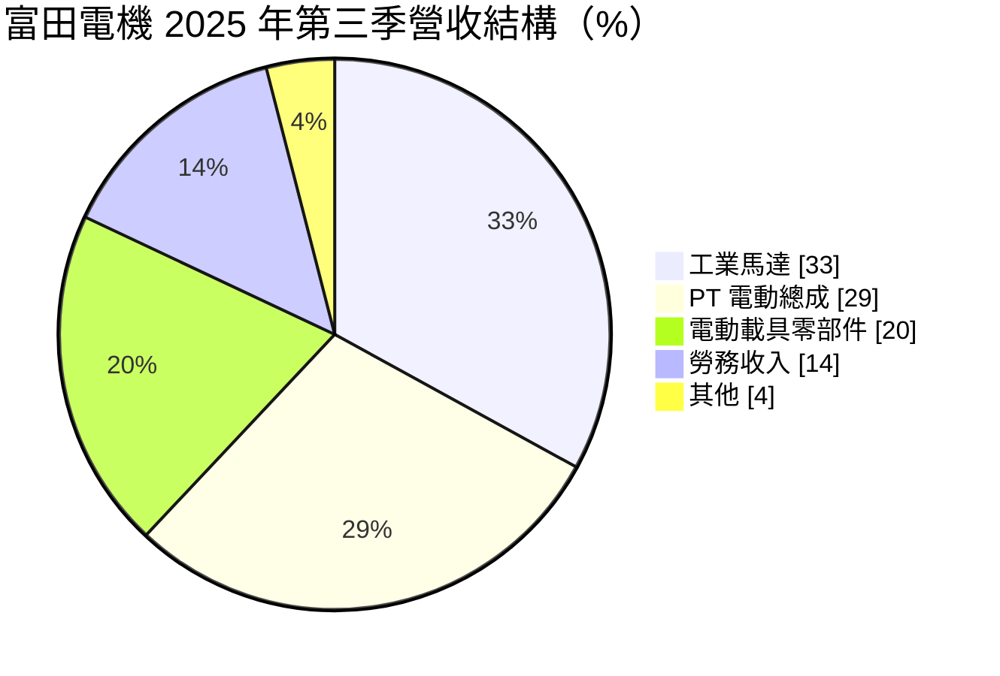
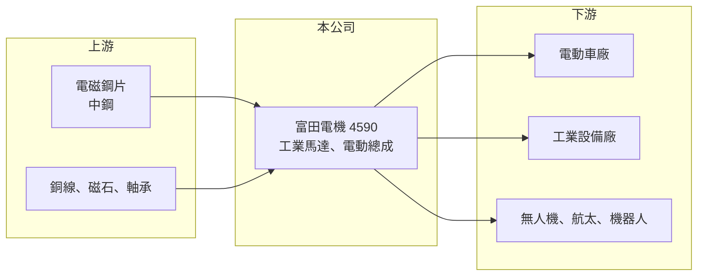

# 4590 富田-創

> 創新板｜[[產業索引-電機機械|電機機械]]｜上市（櫃）日期 2026/01/29

# 第一章：企業模式與商業藍圖

> [!info] 撰寫說明
> 精簡版，由 Claude 依公開資料整理，架構比照 [[2330台積電]] 的四章研究，資料截至 2026-10-08。來源：Goodinfo 年度經營績效頁、優分析 2025 年底掛牌前報導、證交所開放資料（基本資料、2026 年第二季資產負債與綜合損益、營益分析、股利、每月營收）。創新板／新掛牌，公開資料有限；地區別營收、主要客戶名稱與業外收益來源未查得。#待校對

富田電機是台灣少數同時做工業馬達與電動車動力系統的馬達廠，2026 年才掛牌。本章說明它的產品、營收結構與成長引擎。

## 一、核心定位：少量多樣的高階客製化馬達

富田電機成立於 1988 年，總部與主要工廠位於苗栗銅鑼，2026 年 1 月在證交所[[創新板]]掛牌，實收資本額約 5.5 億元，董事長張金鋒（證交所開放資料）。產品包括三相感應馬達、變頻馬達、伺服馬達與液冷伺服馬達，以及電動車的完整動力系統（優分析）。

* **少量多樣的客製化能力：** 公司以模組化設計搭配客製化開發，承接一般大廠不願做的小批量、高規格訂單。這讓它能進入電動車、航太與機器人等高階市場，但也代表單一產品量不大，規模經濟有限。
* **從工業馬達延伸到[[電動總成]]：** 電動車的核心是馬達、減速機與控制器組成的動力總成，富田把傳統馬達經驗延伸到這個領域，能提供整套方案而不只是單一馬達。

## 二、營收結構

工業馬達與電動車相關產品（電動總成加零部件）合計約八成，勞務收入約 14%，可能來自替客戶進行開發設計的委託案（推估）。公司過去曾是國際電動車廠的馬達供應商（待校對），電動車業務的興衰對營收影響很大。

## 三、生產據點

苗栗銅鑼廠品質要求最高，主要生產車用與高規格產品；台中豐州廠生產傳統馬達；台中豐工廠具備高階產品產能，目前用於高階傳統馬達（優分析）。2025 年公司投資約 2,500 萬元建置[[無人機]]馬達專用自動化產線，預計 2026 年年中量產。

## 四、長期藍圖：電動載具、航太與無人機

董事長在 2025 年提出三大成長引擎：電動載具、航太科技與無人機。公司已開發 15 種無人機馬達，取得一家台灣與兩家北美廠商訂單並開始量產；同時向歐洲客戶送樣 AI 機器人關節馬達，並規劃無稀土馬達。2025 年也與 [[2002中鋼]] 成立聯合實驗室，共同開發電動載具、無人機與機器人用馬達（優分析）。這些新市場若能放量，有機會讓公司擺脫單一電動車客戶的波動。

# 第二章：護城河深度與競爭優勢

馬達是成熟產業，本章分析富田電機在高階客製化市場的優勢與限制。

## 一、護城河的核心組成要素

* **電動車動力系統經驗：** 電動車馬達對效率、散熱與可靠度的要求遠高於一般工業馬達，富田累積多年車用開發與量產經驗，是進入無人機與機器人等新市場的基礎。
* **客製化與快速開發：** 少量多樣的模式讓公司能服務新創車廠、航太與國防客戶，這些客戶重視開發彈性，價格敏感度較低。
* **技術合作：** 與中鋼合作開發馬達用電磁鋼片與設計，有助於取得材料與技術上的優勢（推估）。

## 二、主要競爭對手

| 對手 | 定位 | 對富田的威脅 |
|---|---|---|
| [[1504東元]] | 台灣最大工業馬達廠 | 工業馬達規模與通路遠大於富田 |
| [[1503士電]] | 重電與馬達 | 在工業與電動車馬達競爭 |
| [[2308台達電]] | 電源與電動車動力系統 | 電動車動力總成的強力對手 |
| 日本電產（Nidec） | 全球馬達龍頭 | 電動車與精密馬達規模領先 |

## 三、守得住與守不住

* **守得住：** 高規格、少量的車用與航太馬達，以及需要快速客製化的無人機與機器人客戶。
* **守不住：** 本業獲利。2023 至 2025 年營業利益率只在 -8% 至 4% 之間（Goodinfo），本業幾乎不賺錢，EPS 主要靠業外收益支撐。
* **觀察重點：** 無人機與機器人馬達能否在 2026 至 2027 年貢獻明顯營收，讓營業利益率回到正數。

# 第三章：財務體質與盈利規模

資料日期：2026-10-08，表格是撰寫當時的快照；最新月營收、毛利率、累計 EPS 由自動排程寫在本筆記的屬性欄位（月營收、毛利率、累計EPS 等）。#待校對

本章用多年度數據檢視富田電機「本業微利、業外撐獲利」的財務特性。

## 一、多年度三率與 ROE

| 年度 | 營收（新台幣） | [[毛利率]] | [[營業利益率]] | EPS（元） | [[ROE]] |
|---|---|---|---|---|---|
| 2021 | 17.0 億 | 21.6% | 3.34% | 1.92 | 3.39% |
| 2022 | 19.7 億 | 20.5% | 1.24% | 0.58 | 0.95% |
| 2023 | 28.6 億 | 6.84% | -8.14% | -3.75 | -5.86% |
| 2024 | 22.0 億 | 21.8% | 3.59% | 2.75 | 4.33% |
| 2025 | 13.0 億 | 29.2% | 0.17% | 2.72 | 4.19% |
| 2026 上半年 | 5.69 億 | 31.85% | -4.61% | 2.07 | 未查得 |

註：2021 至 2025 年取自 Goodinfo；2026 上半年取自證交所營益分析與綜合損益。

* **營收大幅波動：** 2023 年營收衝上 28.6 億元但毛利率只有 6.8%，之後營收一路降到 2025 年的 13.0 億元，2021 至 2025 年營收年複合成長率約 -6.5%（推算）。2026 年 1 至 8 月累計營收約 7.9 億元，年減約 4%（證交所每月營收）。
* **毛利率回升、營收下滑：** 2025 年毛利率回到 29%，可能是低毛利訂單減少、產品組合改善（推估）。
* **業外收益是獲利主力：** 2026 年上半年營業虧損約 0.26 億元，但業外收益約 1.52 億元，稅前淨利約 1.26 億元（證交所綜合損益）。業外收益的具體來源未查得，投資人評估時應把本業與業外分開看。
* **ROE 偏低：** 每股淨值高達 65 元，權益規模大，使 ROE 長期只有 0% 至 4%。

## 二、股利與財務結構

2025 年度配發現金股利 2.30 元，以 EPS 2.72 元計算配發率約 85%（證交所股利資料，推算）。2026 年第二季底總資產約 62.8 億元、總負債約 27.1 億元（其中非流動負債約 11.5 億元）、權益約 35.7 億元（證交所資產負債）。有息負債金額未查得。

## 三、[[ROIC]] 與 [[WACC]]

**ROIC 推算：** 2025 年營業利益約 13.0 億 × 0.17% ≈ 0.02 億元，稅後幾乎為零。假設總負債 27.1 億元的一半約 13.5 億元為有息負債，加上權益 35.7 億元，投入資本約 49.3 億元，ROIC 約 0%（推算）。若把業外收益也算進報酬，報酬率約 3% 至 4%（推估）。

**WACC 推算：** 台灣 10 年期公債 1.75%、市場風險溢酬 6%、β 取電機同業常見值 0.9，權益成本約 7.2%；負債成本 3%、稅率 20%，權益占比約 73%，WACC 約 5.8%（推算）。

**結論：** 以本業計算的 ROIC 明顯低於 WACC，即使加上業外收益也還在資金成本之下，代表龐大的資產目前沒有被有效運用。新事業能否放量、讓本業恢復獲利，是公司能否長期創造價值的關鍵。

# 第四章：總體風險與地緣政治

本章整理富田電機長期面對的客戶、產業與政策風險。

## 一、產業週期

* **電動車市場波動：** 電動車相關產品占營收約一半，電動車客戶的銷量、車型更替與價格戰都會直接反映在營收。2023 年後營收大幅下滑就是例子。
* **工業景氣：** 工業馬達需求隨製造業資本支出循環，景氣低迷時企業延後設備更新。

## 二、營運風險

* **客戶集中：** 少量多樣的高階訂單往往集中在少數客戶，客戶轉單或專案結束就會讓營收出現斷層。
* **新事業執行：** 無人機、航太與機器人馬達仍在起步，需要認證與量產驗證，時程可能延後。
* **獲利依賴業外：** 本業微利時，業外收益的波動會放大 EPS 的不穩定。

## 三、其他風險

* **原物料：** 銅、電磁鋼片與稀土價格波動會影響成本；無稀土馬達是公司降低稀土依賴的方向。
* **匯率與關稅：** 2025 年曾因匯率波動產生匯損，美國關稅政策也影響北美訂單（優分析）。

# 專有名詞解析

## 金融

- **[[創新板]]**：證交所 2021 年設立的板塊，讓尚未獲利但具技術或創新能力的公司掛牌，初期限合格投資人交易。
- **[[ROIC]]**：投入資本報酬率，衡量企業用股東與債權人投入的資本，每年能產生多少稅後營業利益。
- **[[WACC]]**：加權平均資金成本，股東要求報酬與負債利息依資本結構加權後的平均值，是判斷是否創造價值的門檻。

## 產業

- **[[電動總成]]**：電動車的動力核心，由馬達、減速機與馬達控制器組成，負責把電池電力轉為車輪的驅動力。
- **[[無人機]]**：無人駕駛的飛行器，馬達需要高功率密度與輕量化，近年在國防與商用需求快速成長。

# 核心供應鏈

- 上游：電磁鋼片（[[2002中鋼]]）、銅線、磁石（含稀土）、軸承與電子控制零件。
- 下游／客戶：電動車廠、工業設備廠，以及台灣與北美的無人機廠商、歐洲機器人客戶（客戶名稱未查得）。
- 同業：[[1504東元]]、[[1503士電]]、[[2308台達電]]、[[1536和大]]、日本電產。

## 最新新聞
<!-- news:start -->
<!-- news:end -->

## 相關連結
- [公開資訊觀測站](https://mopsov.twse.com.tw/mops/web/t05st03?step=1&firstin=1&co_id=4590)
- [Goodinfo](https://goodinfo.tw/tw/StockDetail.asp?STOCK_ID=4590)
- [Yahoo 股市](https://tw.stock.yahoo.com/quote/4590)
- [鉅亨網新聞](https://www.cnyes.com/twstock/4590/news)
