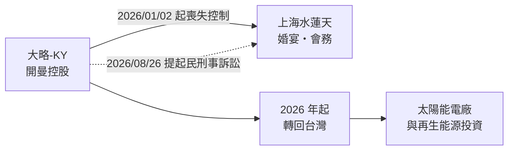
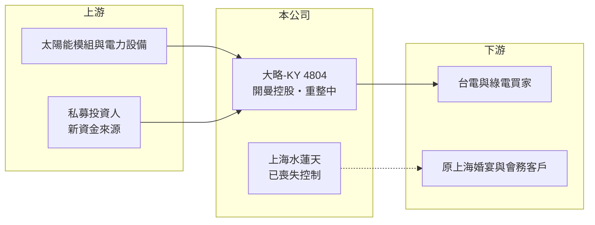

# 4804 大略-KY

> 上櫃｜[[產業索引-觀光餐旅|觀光餐旅]]｜上市（櫃）日期 2015/12/04

# 第一章：企業模式與商業藍圖

> [!info] 撰寫說明
> 本文由 Claude 依公開資料整理，架構比照 [[2330台積電]] 的四章研究，資料截至 2026-10-08。財務數字來源：櫃買中心開放資料（基本資料、2026 年第二季資產負債表與綜合損益表）、Goodinfo 年度經營績效頁、nStock 公司簡介；公開資料有限，公司正處於子公司失控、停止交易與重整階段，產業描述為整理性內容，尚未逐條比對原始文件。#待校對

在評估單一個股的長期投資價值時，首要步驟是拆解企業的底層獲利邏輯。大略-KY（股票代號：4804，以下簡稱大略）是一家原本在上海經營婚宴與會務服務的開曼控股公司，2026 年起失去對主要營運子公司的控制，本章說明它原本的商業模式，以及目前的處境。

## 一、核心定位：開曼控股、上海營運的婚宴業者

大略於 2011 年 8 月在英屬開曼群島設立，2012 年 3 月完成組織重組，成為集團的控股公司，2015 年 12 月在櫃買中心上櫃。依 nStock 整理，集團的主要業務是飯店經營、婚宴及婚慶策劃與會務服務，營運主體是中國大陸子公司「上海水蓮天企業發展有限公司」。這種「境外控股、中國營運、台灣掛牌」的結構，是 [[KY股]] 常見的架構，投資人實際持有的是開曼公司股權，對中國營運資產的控制力取決於子公司經營層的配合。

## 二、失去子公司控制：營收幾乎歸零

依 nStock 整理的公告，大略自 2026 年 1 月 2 日起喪失對上海水蓮天的控制，原本規劃的清算計畫不再執行，公司於 2026 年 8 月 26 日提起民事與刑事訴訟。失去營運子公司後，合併營收幾乎歸零：2026 年上半年營收僅約 67 萬元，營業費用卻有 4,425 萬元。公司股票自 2026 年 4 月 14 日起停止在櫃買中心交易（依 nStock 整理，原因待校對）。

## 三、長期方向：減資、私募與再生能源

2026 年 6 月 25 日股東會通過兩項重整措施：一是[[減資彌補虧損]] 4.70 億元，減資比率約 65.27%；二是[[私募]]普通股不超過 6,600 萬股，引進新資金（兩案尚待主管機關申報）。公司表示將把營運重心轉回台灣，發展[[再生能源]]業務，包括取得營運中的太陽能發電站與投資再生能源發電公司。這實際上是以上市櫃公司的外殼重新開始一個全新事業，未來價值幾乎完全取決於新事業的資產品質與私募投資人的背景。

# 第二章：護城河深度與競爭優勢

「護城河」指企業抵禦競爭、維持超額利潤的保護機制。大略目前沒有可運作的本業，本章說明原本的競爭位置與新事業面對的競爭。

## 一、原本的競爭位置

上海的婚宴與會務市場規模大，但業者眾多、高度分散，場地租金與裝修投入高。大略的營收從 2020 至 2021 年的每年 3 億多元，一路下滑到 2025 年的 1.28 億元，2025 年毛利率更轉為負值（-4.14%），顯示原本的婚宴事業在中國結婚人數下降與競爭下已失去獲利能力。失去控制之後，這段事業對股東而言已無法再產生價值。

## 二、新事業的主要競爭對手

| 對手 | 定位 | 對大略新事業的威脅 |
|---|---|---|
| [[6806森崴能源]] | 再生能源開發與售電 | 案場規模與融資能力遠大於大略 |
| [[6869雲豹能源]] | 太陽能電廠與綠電交易 | 已有大量運轉中案場 |
| [[6873泓德能源]] | 太陽能電廠開發與維運 | 在案場取得與工程上具經驗優勢 |

## 三、守得住／守不住／觀察重點

目前沒有可以守住的競爭優勢。大略剩下的是上櫃公司的身分與約 1 億元的資產。長期觀察重點是：減資與私募是否完成、私募對象是誰、取得的太陽能電廠規模與售電合約條件，以及對上海子公司的訴訟能否追回資產。

# 第三章：財務體質與盈利規模

資料日期：2026-10-08，表格是撰寫當時的快照；最新月營收、毛利率、累計 EPS 由自動排程寫在本筆記的屬性欄位（月營收、毛利率、累計EPS 等）。#待校對

財務報表是檢驗護城河是否真實存在的最終標準。大略的數字記錄了一個事業從獲利到瓦解的過程。

## 一、多年度經營績效

| 年度 | 營收（新台幣） | [[毛利率]] | [[營業利益率]] | EPS（元） | [[ROE]] |
|---|---|---|---|---|---|
| 2020 | 3.30 億 | 25.0% | -3.47% | 0.21（正負號存疑） | -6.04% |
| 2021 | 3.40 億 | 42.1% | 1.58% | -0.13 | -4.08% |
| 2022 | 2.73 億 | 37.6% | -69.7% | -5.03 | -63% |
| 2023 | 2.38 億 | 38.8% | -29.3% | -3.41 | -84.4% |
| 2024 | 1.19 億 | 23.3% | -37.5% | -1.47 | -102% |
| 2025 | 1.28 億 | -4.14% | -45.4% | -1.54 | -157% |
| 2026 上半年 | 0.007 億 | 未查得（營收過小無意義） | 未查得 | -0.78 | 未查得 |

資料來源：2020 至 2025 年為 Goodinfo，2026 上半年為櫃買中心開放資料。Goodinfo 2020 年的 EPS 為正，但淨利率與 ROE 為負，正負號互相矛盾，需以年報核對。

2022 年起大略連年大幅虧損，ROE 從 -63% 惡化到 -157%，代表股東權益每年被吃掉一半以上甚至更多。2021 至 2025 年平均 ROE 約 -82%（推算），營收年複合成長率約 -21%（2021 年 3.40 億元到 2025 年 1.28 億元，推算）。近五年沒有配發現金股利。

## 二、財務結構

2026 年第二季底，大略總資產僅 1.05 億元，其中非流動資產 0.97 億元、流動資產只有 0.09 億元；負債 0.52 億元，流動負債 0.35 億元已遠超過流動資產。權益總計 0.54 億元，每股淨值 0.74 元。依 nStock 整理，2026 年 6 月 30 日待彌補虧損約 6.51 億元，達實收資本額的 90%。

## 三、[[ROIC]] 與 [[WACC]]：價值創造利差

**ROIC 推算：** 2025 年營業虧損約 0.58 億元（1.28 億 × -45.4%），虧損年度不計稅盾。2026 年第二季底權益總計約 0.54 億元，負債 0.52 億元中假設一半為有息負債約 0.26 億元（推估），投入資本約 0.79 億元，ROIC 約 -73%（推算）。由於分子是 2025 年、分母是失控後的 2026 年資產，這個數字只能說明「本業已嚴重失血」，不宜精確解讀。

**WACC 推算：** 台灣 10 年期公債取 1.75%、市場風險溢酬 6%、β 取高風險小型股 1.2，股東權益成本約 9%；負債成本假設 4%，虧損無法抵稅以稅前計；權益約 67%、負債約 33%，WACC 約 7.3%（推算）。實際上停止交易、面臨重整的公司，投資人要求的報酬遠高於 CAPM 推算值。

**結論：** ROIC 遠低於 WACC，原有事業已完全喪失價值創造能力。未來能否創造價值，取決於減資私募後新注入的再生能源資產，屆時需要以新的資產負債表重新評估。

# 第四章：總體風險與地緣政治

任何企業都無法脫離宏觀環境獨立存在。本章分析大略長期必須面對的風險。

## 一、公司治理與資產追回風險

失去對營運子公司的控制，是 KY 股最嚴重的治理風險之一。訴訟能否追回在中國的資產或賠償，受兩岸司法程序與執行效率影響，結果高度不確定。投資人應把這段資產視為可能無法回收。

## 二、交易與股權風險

股票已停止交易，流動性幾乎為零。減資會使持股數大幅減少，私募則可能讓新投資人取得經營權，原股東持股比例被大幅稀釋。若重整無法完成，公司可能面臨終止上櫃。

## 三、新事業執行風險

再生能源屬於資本密集產業，需要大量融資與案場開發經驗。大略在這個領域沒有既有實績，新事業能否取得合理報酬的電廠，以及電價政策與併網條件的變化，都是不確定因素。

# 專有名詞解析

## 金融

- **[[減資彌補虧損]]**：公司以減少股本的方式沖銷累積虧損，股東持股數減少但持股比例不變，常見於長期虧損的公司。
- **[[私募]]**：公司向特定投資人發行新股籌資，通常有轉讓限制，常被用來引進策略股東。
- **[[KY股]]**：在海外註冊、來台上市櫃的公司，代號名稱後加註 KY。
- **[[ROIC]]**：投入資本報酬率，稅後營業利益除以股東權益加有息負債，衡量本業運用資本的效率。
- **[[WACC]]**：加權平均資金成本，股東與債權人要求報酬率的加權平均，是 ROIC 要超越的門檻。

## 產業

- **[[再生能源]]**：太陽能、風力等可自然補充的能源，發電業者通常透過長期購電合約或躉購費率出售電力。

# 核心供應鏈

## 1. 上游：新事業的設備與資金
- 太陽能模組與電力設備供應商；股東會通過的私募對象（尚未公告）

## 2. 中游：大略與子公司
- 開曼控股公司；上海水蓮天企業發展（2026 年 1 月起喪失控制，訴訟中）

## 3. 下游與同業
- 新事業客戶：台電與綠電買家
- 再生能源同業：[[6806森崴能源]]、[[6869雲豹能源]]、[[6873泓德能源]]

## 最新新聞
<!-- news:start -->
<!-- news:end -->

## 相關連結
- [公開資訊觀測站](https://mopsov.twse.com.tw/mops/web/t05st03?step=1&firstin=1&co_id=4804)
- [Goodinfo](https://goodinfo.tw/tw/StockDetail.asp?STOCK_ID=4804)
- [Yahoo 股市](https://tw.stock.yahoo.com/quote/4804)
- [鉅亨網新聞](https://www.cnyes.com/twstock/4804/news)
