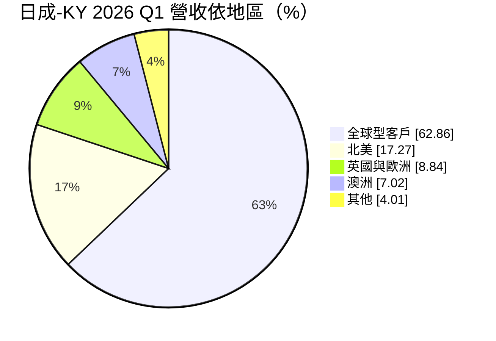
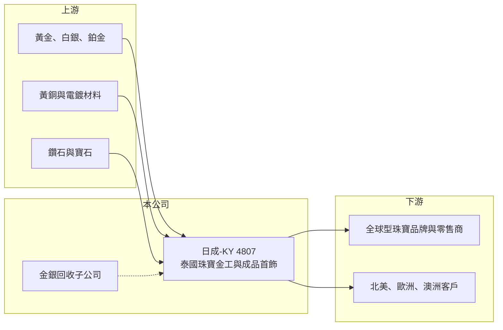

# 4807 日成-KY

> 上市｜[[產業索引-貿易百貨業|貿易百貨業]]｜上市（櫃）日期 2017/06/26

# 第一章：企業模式與商業藍圖

> [!info] 撰寫說明
> 精簡版，由 Claude 依公開資料整理，架構比照 [[2330台積電]] 的四章研究，資料截至 2026-10-08。財務數字來源：MoneyDJ 年度財務比率頁、富果研究 2026 年 5 月法說會整理、證交所開放資料（基本資料、2026 年第二季資產負債與綜合損益、營益分析、股利、每月營收）。歷年營收金額未查得。#待校對

日成-KY（股票代號：4807）是在台上市、生產基地位於泰國的珠寶首飾製造商。它屬於珠寶產業鏈的中游，替全球珠寶品牌與零售商代工，獲利高度受訂單量、貴金屬價格與產品組合影響。

## 一、核心定位：泰國的珠寶金工代工廠

- **公司基本面：** 日成-KY 註冊於開曼群島，2014 年成立、2017 年在台上市，實收資本額約 4.9 億元，董事長為泰籍的帕查拉蓬．拍奔順通。作為 [[KY股]]，營運與生產都在泰國。
- **產品與材質：** 公司從事珠寶金工、電鍍與飾品製造，材質包括黃銅、925 純銀、K 金與鉑金。近年策略是減少低毛利的線材與半成品，轉向 K 金、銀與鉑金的成品首飾，以提高附加價值。
- **回收事業：** 子公司從事金銀回收，並取得 RJC（責任珠寶業委員會）認證，符合國際品牌對供應鏈來源透明度的要求。

## 二、客戶與市場結構

2026 年第一季營收依地區分布如下（富果研究法說會整理）：

- **客戶策略：** 公司未公開客戶名稱，表示會在每個地區挑選頂尖客戶合作，避免客戶之間正面競爭。全球型客戶占六成以上，代表營收集中於少數大型國際珠寶品牌或零售商（推估）。
- **為什麼重要：** 代工廠的營收取決於品牌客戶的下單，客戶集中帶來穩定的大訂單，但也讓公司對單一客戶的依賴度高。

## 三、產能與人力

珠寶首飾製造仍高度依賴手工，人力就是產能。公司員工由約 2,800 人增加到 2026 年 5 月底的 3,100 人以上，目標第三季超過 3,200 人，以因應下半年旺季。泰國擁有成熟的珠寶加工產業與技術工人，是日成選擇在當地生產的主要原因。

## 四、長期方向

公司的長期重點包括精實流程、科技與數據應用、人才培育、財務風險管理與 ESG。工廠第二期太陽能已完成，約供應 35% 的再生能源。公司也引述市場預期，2030 年[[培育鑽石]]可能占全球鑽石首飾銷售的一半，成品首飾的產品組合會跟著這個趨勢調整。

# 第二章：護城河深度與競爭優勢

日成的護城河來自泰國的工匠產能、品牌客戶的認證關係與回收事業，屬於窄護城河。

## 一、護城河的組成

- **技術工人與產能：** 精緻首飾需要熟練工匠，培訓需要時間。累積三千多名員工的產能與製程經驗，新進者短期內難以複製。
- **客戶認證與轉換成本：** 國際珠寶品牌選擇代工廠時，重視品質、交期與供應鏈責任認證，一旦合作穩定，通常不會輕易更換。
- **RJC 認證與回收能力：** 責任採購與貴金屬回收符合國際品牌的 ESG 要求，是爭取高端客戶的條件。

## 二、主要競爭對手

| 對手 | 定位 | 對日成的威脅 |
|---|---|---|
| 中國深圳水貝等珠寶加工聚落 | 大型代工產能 | 規模大、成本低，價格競爭力強 |
| 印度珠寶製造商 | 鑽石與黃金首飾 | 在鑽石切磨與黃金首飾具有產業優勢 |
| 泰國當地其他珠寶代工廠 | 同地區競爭 | 爭奪相同的技術工人與客戶 |

## 三、守得住與守不住

- **守得住：** 已建立長期關係的全球型品牌客戶，以及需要高工藝與責任認證的成品首飾。
- **守不住：** 低毛利的線材與半成品，這也是公司主動縮減這類產品的原因。
- **觀察重點：** 成品首飾占比能否持續提高、毛利率能否維持在 20% 以上，以及客戶集中度的變化。

# 第三章：財務體質與盈利規模

資料日期：2026-10-08，表格是撰寫當時的快照；最新月營收、毛利率、累計 EPS 由自動排程寫在本筆記的屬性欄位（月營收、毛利率、累計EPS 等）。#待校對

日成的財務數字波動很大，獲利高度受訂單量與產品組合影響，屬於景氣循環型的代工廠。

## 一、多年度財務表

| 年度 | 營收（新台幣） | [[毛利率]] | [[營業利益率]] | EPS（元） | [[ROE]] |
|---|---|---|---|---|---|
| 2019 | 未查得（年減 38.21%） | 12.50% | -5.75% | -3.83 | -9.76% |
| 2020 | 未查得（年減 2.42%） | 22.75% | 6.51% | 2.31 | 9.16% |
| 2021 | 未查得（年增 18.28%） | 23.36% | 8.68% | 3.32 | 13.12% |
| 2022 | 未查得（年減 20.95%） | 19.50% | 3.21% | 0.85 | 4.24% |
| 2023 | 未查得（年減 30.42%） | 3.75% | -19.42% | -4.12 | -17.24% |
| 2024 | 未查得（年增 54.90%） | 13.06% | -3.91% | -1.56 | -6.79% |
| 2025 | 未查得（年增 19.60%） | 14.53% | 1.30% | -0.24 | -0.17% |
| 2026 上半年 | 12.6 億 | 22.25% | 9.50% | 2.00 | 未查得 |

註：2019 至 2025 年比率取自 MoneyDJ；2026 上半年取自證交所開放資料。2025 年 1 至 8 月營收約 13.3 億元，2026 年同期約 18.5 億元、年增約 39%（證交所每月營收）。

- **營運槓桿明顯：** 營收衰退的 2023 年毛利率跌到 3.75%、營業利益率 -19.42%；營收回升的 2026 年上半年，毛利率回到 22.25%、營業利益率 9.5%。人力與廠房是固定成本，訂單量決定獲利。
- **2026 年的改善：** 第一季毛利率 27.72%，部分來自一次性的存貨出清；公司預期第二季毛利率略低於第一季，下半年為傳統旺季。
- **貴金屬價格：** 金銀價格上漲會推高營收金額，但若無法完全轉嫁，也會壓縮毛利率（推估）。

## 二、ROE 與資本結構

2021 至 2025 年平均 ROE 約 -1.4%（推算），反映 2023 至 2024 年的虧損。2026 年第二季底總資產約 17.3 億元、負債約 6.5 億元，負債比約 38%（證交所開放資料），每股淨值約 19.96 元。帳上仍有待彌補虧損，2025 年度未配發股利；章程規定股利以不低於當年度稅後盈餘的 50% 為原則，若 2026 年獲利延續並彌補虧損後，配息能力可能恢復（推估）。

## 三、[[ROIC]] 與 [[WACC]]

**ROIC 推算：** 以 2026 年上半年營業利益約 1.20 億元年化為 2.4 億元，稅後約 1.92 億元。投入資本以權益約 10.75 億元，加上假設約 3 億元的有息負債（推估），合計約 13.75 億元，年化 ROIC 約 14%（推算）。若以 2025 年營業利益率 1.3% 計算，ROIC 只有約 1% 至 2%（推算）。

**WACC 推算：** 公債殖利率 1.75%、市場風險溢酬 6%、β 取小型代工 KY 股常見值 1.0，再加計約 1% 的規模風險溢酬，股東權益成本約 8.75%；負債成本假設 4%（泰國借款利率較高），稅後 3.2%；權益約占 78%、負債約占 22%，WACC 約 7.5%（推算）。

**結論：** 日成的 ROIC 在旺年可明顯高於資金成本，在淡年則轉為負值，長期平均大致與資金成本相當。能否成為持續創造價值的公司，取決於成品首飾的轉型能否讓毛利率穩定在 20% 以上。

# 第四章：總體風險與地緣政治

日成的風險以客戶集中、貴金屬價格與泰國營運環境為主。

## 一、產業週期

- **珠寶消費景氣：** 珠寶屬於非必需消費，歐美景氣轉弱時，品牌客戶會減少下單並調整庫存，2023 年營收年減約三成就是例子。
- **[[長鞭效應]]：** 品牌客戶的庫存調整會放大到代工廠，終端需求小幅變化，代工訂單可能大幅波動。

## 二、營運風險

- **客戶集中：** 全球型客戶占營收六成以上，若主要客戶轉單或減單，營收會明顯下滑。
- **人力依賴：** 製程依賴技術工人，泰國薪資上漲或缺工會增加成本，旺季前的招募速度也會影響出貨。
- **貴金屬價格波動：** 金、銀、鉑價格變動會影響存貨評價與報價，若避險不足，可能產生損失。

## 三、其他風險

- **匯率：** 營收以美元計價、成本以泰銖為主，泰銖升值會壓縮毛利，換算成新台幣時也受台幣匯率影響。
- **關稅：** 美國對泰國產品的關稅政策變動，會影響北美客戶的下單意願（推估）。
- **培育鑽石的衝擊：** 培育鑽石價格快速下滑，改變鑽石首飾的定價結構，對產品組合與單價有不確定影響。
- **KY 公司治理：** 營運在海外，台灣投資人的查核能力有限。

# 專有名詞解析

## 金融

- **[[KY股]]**：在開曼群島等地註冊、在台灣上市櫃的外國公司股票，主要營運多在海外。
- **[[長鞭效應]]**：終端需求的小幅變動，沿供應鏈往上游傳遞時被逐級放大，造成上游訂單劇烈波動。
- **[[ROIC]]**：投入資本報酬率，稅後營業利益除以股東權益與有息負債的合計，衡量本業對所有資金提供者的報酬。
- **[[WACC]]**：加權平均資金成本，依股東權益與負債的比重加權計算的資金成本，ROIC 高於它才代表創造價值。

## 產業

- **[[培育鑽石]]**：以高溫高壓或化學氣相沉積法在實驗室製造的鑽石，成分與天然鑽石相同，價格較低。

# 核心供應鏈

## 1. 上游：貴金屬與材料
- 黃金、白銀、鉑金、黃銅與電鍍材料，鑽石與寶石
- 貴金屬相關同業：[[1785光洋科]]（台灣貴金屬回收與材料）

## 2. 本公司
- 日成-KY：泰國生產基地、金銀回收子公司

## 3. 下游與同業
- 全球型珠寶品牌與零售商（客戶名稱未揭露）
- 同業：中國深圳珠寶加工業者、印度珠寶製造商

## 最新新聞
<!-- news:start（自動產生，請勿手動編輯此範圍） -->
- 2026-10-08 🏛️ 重訊 17:33｜公告本公司內部稽核主管異動｜[觀測站](https://mops.twse.com.tw/mops/#/web/t05st01)

完整紀錄：[[4807日成-KY 新聞]]
<!-- news:end -->

## 相關連結
- [公開資訊觀測站](https://mopsov.twse.com.tw/mops/web/t05st03?step=1&firstin=1&co_id=4807)
- [Goodinfo](https://goodinfo.tw/tw/StockDetail.asp?STOCK_ID=4807)
- [Yahoo 股市](https://tw.stock.yahoo.com/quote/4807)
- [鉅亨網新聞](https://www.cnyes.com/twstock/4807/news)
