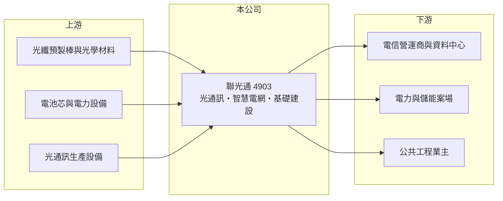

# 4903 聯光通

> 上櫃｜[[產業索引-通信網路業|通信網路業]]｜上市（櫃）日期 2001/05/14

# 第一章：企業模式與商業藍圖

> [!info] 撰寫說明
> 精簡版，由 Claude 依公開資料整理，架構比照 [[2330台積電]] 的四章研究，資料截至 2026-10-08。來源：櫃買中心開放資料（基本資料、綜合損益、資產負債、每月營收、本益比殖利率）、Goodinfo 年度經營績效、科技新報 2026 年 7 月報導。公開資料有限，本次未取得產品別營收比重，早期業務與集團入主時間依記憶整理，需逐條比對原始文件。#待校對

本章說明聯光通（股票代號：4903）的商業模式：一家老牌光纖通訊廠，在台鋼集團入主後轉向光通訊、智慧電網與基礎建設三條業務線的轉型公司。

- **核心業務：** 聯光通成立於 1986 年，2001 年在櫃買中心掛牌，實收資本額約 10.5 億元，董事長為林郁昌。公司早年以光纖、光纜等光纖通訊產品為本業（待校對），屬於電信與有線電視網路的上游材料供應商。依科技新報 2026 年 7 月報導，公司目前隸屬台鋼集團，事業分為光通訊、智慧電網與基礎建設三大塊。
- **營收結構：** 本次未取得產品別營收比重。從營收在 2025 年由 8.22 億元跳升到 13.5 億元、毛利率卻只有約一成來看，新增營收可能主要來自智慧電網（含[[儲能]]）與基礎建設工程這類毛利較低的專案型業務（推估）。
- **營運據點：** 總部與生產據點細節本次未查得（待校對）。客戶推估以電信營運商、電力相關單位與工程業主為主。
- **長期方向：** 董事長在 2026 年 7 月表示，下半年同步擴大三大事業，預計第三季採購光通訊設備、力拚年底前投產，目標讓台灣重回全球光電供應鏈。這代表公司想從工程與電網專案，回到技術門檻較高的光通訊製造，但設備投資與量產能力仍待驗證。

# 第二章：護城河深度與競爭優勢

本章評估聯光通的護城河。公司過去多年本業虧損，轉型剛起步，目前看不出明確的護城河。

- **競爭優勢：** 聯光通的主要資源是集團背景與數十年光纖通訊經驗。台鋼集團旗下有能源、工程等事業（待校對），可以為智慧電網與基礎建設業務帶來接案機會，這是 2025 年營收快速成長的可能原因（推估）。但光纖與儲能都是資本密集、價格競爭激烈的產業，單靠集團資源不足以構成長期優勢。
- **主要對手：** 光纖光纜領域的對手包括 [[1605華新]]、[[1609大亞]] 等線纜廠與國際光纖大廠；光通訊元件領域則有 [[3363上詮]]、[[3163波若威]]、[[6442光聖]]；儲能與電網工程方面有 [[1519華城]]、[[1513中興電]]、[[1503士電]] 等重電廠（對手名單為產業常識整理，待校對）。
- **觀察重點：** 第一，光通訊新產線能否在 2026 年底如期投產並取得客戶認證。第二，營業利益率能否維持在正值，擺脫過去年年虧損的狀態。第三，集團內部交易比重與其定價是否透明。

# 第三章：財務體質與盈利規模

資料日期：2026-10-08。數字取自 Goodinfo 年度經營績效與櫃買中心開放資料，表格是撰寫當時的快照；最新月營收、毛利率、累計 EPS 由自動排程寫在本筆記的屬性欄位（月營收、毛利率、累計EPS 等）。#待校對

聯光通的財務數字顯示本業長期虧損，直到 2025 年才轉為營業獲利，獲利基礎仍然很薄。

| 年度 | 營收（新台幣） | [[毛利率]] | [[營業利益率]] | EPS（元） | [[ROE]] |
|---|---|---|---|---|---|
| 2019 | 8.52 億 | 19.1% | -3.06% | -0.42 | -3.22% |
| 2020 | 10.2 億 | 12.0% | -16.3% | -1.82 | -24.5% |
| 2021 | 8.13 億 | 14.8% | -4.19% | -0.35 | -7.51% |
| 2022 | 8.19 億 | 10.6% | -7.64% | -0.80 | -14.7% |
| 2023 | 6.88 億 | 8.5% | -10.2% | 0.28 | 2.77% |
| 2024 | 8.22 億 | 6.67% | -9.9% | 0.07 | 0.35% |
| 2025 | 13.5 億 | 12.4% | 4.49% | 1.02 | 9.77% |
| 2026 上半年 | 8.17 億 | 9.73% | 3.38% | 0.26 | 未查得 |

註：2019 至 2025 年取自 Goodinfo 合併報表；2026 上半年取自櫃買中心開放資料，毛利率與營業利益率由營業毛利、營業利益除以營收計算。2023 至 2024 年營業虧損但 EPS 為正，代表獲利來自業外收益。

- **營收規模：** 2020 至 2025 年營收年複合成長率約 5.8%（推算），但成長幾乎全部發生在 2025 年。2026 上半年營收 8.17 億元、年增約 38.8%；1 至 8 月累計 9.75 億元，年增約 10.5%，下半年動能較上半年放緩。
- **獲利：** 2019 至 2024 年營業利益率全部為負，毛利率從 19% 一路降到 6.7%，代表原有的光纖本業缺乏定價能力。2025 年營業利益率轉正為 4.49%，但 2026 上半年毛利率又降到 9.7%，獲利結構仍不穩定。2021 至 2025 年平均 ROE 約 -1.9%（推算）。
- **財務特色：** 2026 年第二季底資產總計 19.2 億元、負債 7.52 億元（多為流動負債 6.67 億元），股東權益 11.7 億元，每股淨值 11.09 元，保留盈餘僅約 1.16 億元。櫃買中心資料顯示最近一年度每股現金股利約 0.3 元。年底前的光通訊設備投資可能需要額外資金，需留意是否辦理增資。
- **[[ROIC]] 與 [[WACC]]：** 以 2025 年營業利益約 0.61 億元（13.5 億元 × 4.49%）扣 20% 稅後約 0.49 億元，投入資本以股東權益 11.7 億元加非流動負債 0.85 億元（代替有息負債）約 12.5 億元計算，ROIC 約 3.9%（推算）；2026 上半年年化約 3.5%（推算）。WACC 以 CAPM 推估：無風險利率 1.75%、市場風險溢酬 6%、β 取 1.2（推估，轉型題材中小型股波動較大），權益成本約 8.95%，負債比重低，WACC 約 8.5%（推算）。ROIC 明顯低於 WACC，過去多年更是負值，代表公司尚未建立能創造價值的商業模式，轉型成效需要用未來幾年的資本報酬來檢驗。

# 第四章：總體風險與地緣政治

本章整理聯光通面對的長期風險，主要來自轉型執行與專案型業務的波動。

- **產業週期：** 光纖光纜需求跟隨電信營運商與資料中心的佈線投資，儲能與電網工程則受政府能源政策與標案時程影響，兩者都不是穩定成長的市場。專案認列時間集中，單月營收可能大起大落。
- **營運風險：** 光通訊新產線從採購設備、試產到客戶認證通常需要一年以上，良率與成本若不如預期，折舊會先侵蝕獲利。工程與儲能專案毛利低，成本估算失準就可能虧損。
- **其他風險：** 經營權屬於集團，資本配置與關係人交易需要持續觀察。台灣儲能市場受電價與電網調度規則影響，政策變動會改變專案報酬。原物料（銅、光纖預製棒、電池芯）價格波動會影響毛利。

# 專有名詞解析

## 應用

- **[[光纖]]**：以玻璃纖維傳輸光訊號的線材，頻寬大、損耗低，是電信骨幹與資料中心連線的主要媒介。

## 金融

- **[[ROIC]]**：投入資本報酬率，稅後營業利益除以股東權益加有息負債，衡量本業運用資本的效率。
- **[[WACC]]**：加權平均資金成本，股東與債權人要求報酬率的加權平均，是 ROIC 要超越的門檻。

## 產業

- **[[儲能]]**：以電池等設備儲存電力，在用電尖峰或電網需要時釋放，可參與電力交易市場賺取收入。
- **[[智慧電網]]**：在輸配電網路中加入感測、通訊與自動控制，讓電力供需可即時調度，常與儲能、再生能源併網搭配。

# 核心供應鏈

- 上游：光纖預製棒與光學材料、電池芯與電力設備、光通訊生產設備供應商（實際供應商未公開）。
- 下游／客戶：電信營運商與資料中心、電力與儲能案場、公共工程業主；客戶名稱本次未查得，集團內交易比重未查得。
- 同業：[[1605華新]]、[[1609大亞]]、[[3363上詮]]、[[3163波若威]]、[[6442光聖]]、[[1519華城]]。

## 最新新聞
<!-- news:start（自動產生，請勿手動編輯此範圍） -->
- 2026-10-06 📰 媒體 16:51｜營收速報 - 聯光通(4903)9月營收2.81億元年增率高達93.83％｜[鉅亨網](https://news.cnyes.com/news/id/6622755)

完整紀錄：[[4903聯光通 新聞]]
<!-- news:end -->

## 相關連結
- [公開資訊觀測站](https://mopsov.twse.com.tw/mops/web/t05st03?step=1&firstin=1&co_id=4903)
- [Goodinfo](https://goodinfo.tw/tw/StockDetail.asp?STOCK_ID=4903)
- [Yahoo 股市](https://tw.stock.yahoo.com/quote/4903)
- [鉅亨網新聞](https://www.cnyes.com/twstock/4903/news)
