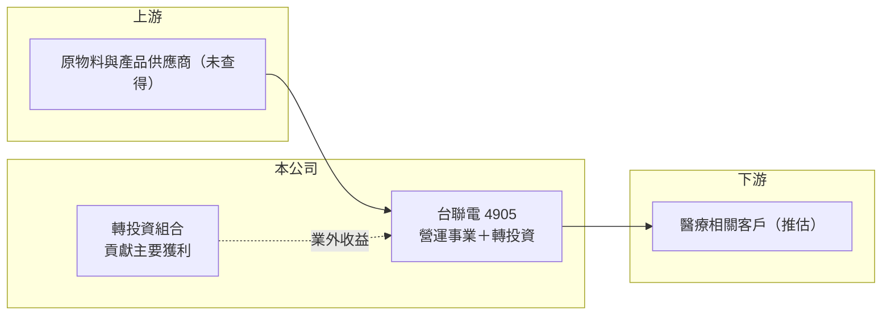

# 4905 台聯電

> 上櫃｜[[產業索引-通信網路業|通信網路業]]｜上市（櫃）日期 2001/12/07

# 第一章：企業模式與商業藍圖

> [!info] 撰寫說明
> 精簡版，由 Claude 依公開資料整理，架構比照 [[2330台積電]] 的四章研究，資料截至 2026-10-08。來源：櫃買中心開放資料（基本資料、綜合損益、資產負債、每月營收、本益比殖利率）、Goodinfo 年度經營績效。公開資料有限，本次未取得產品別、子公司與轉投資明細，業務描述多為依財報結構推估，需逐條比對原始文件與年報。#待校對

本章說明台聯電（股票代號：4905）的商業模式。從財報結構看，台聯電是一家本業營收很小、獲利主要來自[[業外收益]]（轉投資收益）的公司，近年營收規模因新事業或新併入子公司而明顯放大（推估）。

- **核心業務：** 台聯電成立於 1990 年，2001 年在櫃買中心掛牌，實收資本額約 2.93 億元，董事長由法人華盛國際投資股份有限公司擔任。公司早年在通訊網路產業掛牌（待校對），但櫃買中心目前的每月營收資料已將其產業別列為生技醫療業，代表主要營業項目已經轉變。具體產品與子公司本次未查得。
- **營收結構：** 營收在 2019 至 2023 年只有約 0.6 億至 1.2 億元，2024 年跳升到 5.93 億元、2025 年 7.27 億元，最可能的原因是併入新的營運子公司（推估）。由於資產負債表上有[[非控制權益]]約 2.2 億元，代表合併報表中有非全資持有的子公司。
- **營運據點：** 本次未查得（待校對）。
- **長期方向：** 公司每股淨值超過百元，資產以投資為主（推估），長期價值取決於轉投資組合的品質與經營層的資本配置。新事業能否讓本業轉為穩定獲利，是判斷台聯電能否從投資控股型公司變成營運型公司的關鍵。

# 第二章：護城河深度與競爭優勢

本章評估台聯電的護城河。由於本業長期虧損或微利，目前看不出營運面的護城河，價值主要來自資產面。

- **競爭優勢：** 台聯電的優勢在於資產負債表：股本小、每股淨值高、保留盈餘約 28.8 億元，代表過去累積了大量投資收益。這讓公司有能力投資新事業或併購，而不必向股東募資。但資產面的優勢不等於營運能力，投資收益也可能隨市場起伏。
- **主要對手：** 因主要產品未查得，無法列出具體競爭對手（待校對）。
- **觀察重點：** 第一，業外收益的來源是穩定的股利、利息，還是一次性的處分利益。第二，2024 年後新增的營運事業能否在營業利益層面轉正。第三，股利政策是否與投資收益相稱。

# 第三章：財務體質與盈利規模

資料日期：2026-10-08。數字取自 Goodinfo 年度經營績效與櫃買中心開放資料，表格是撰寫當時的快照；最新月營收、毛利率、累計 EPS 由自動排程寫在本筆記的屬性欄位（月營收、毛利率、累計EPS 等）。#待校對

台聯電的財務數字顯示本業長期虧損，但 EPS 多數年度為正，差額來自業外收益。

| 年度 | 營收（新台幣） | [[毛利率]] | [[營業利益率]] | EPS（元） | [[ROE]] |
|---|---|---|---|---|---|
| 2019 | 0.64 億 | 35.6% | -84.5% | 1.44 | 1.77% |
| 2020 | 0.64 億 | 28.9% | -61.2% | 0.93 | 1.12% |
| 2021 | 0.59 億 | 34.4% | -44.5% | 1.49 | 1.69% |
| 2022 | 0.83 億 | 31.1% | -19.3% | -1.49 | -1.6% |
| 2023 | 1.15 億 | 33.2% | -34.6% | 5.61 | 6.03% |
| 2024 | 5.93 億 | 23.4% | 0.49% | 2.91 | 3.4% |
| 2025 | 7.27 億 | 25.8% | 1.01% | 2.76 | 3.1% |
| 2026 上半年 | 4.46 億 | 27.3% | -1.02% | 8.07 | 未查得 |

註：2019 至 2025 年取自 Goodinfo 合併報表；2026 上半年取自櫃買中心開放資料，毛利率與營業利益率由營業毛利、營業利益除以營收計算。

- **營收規模：** 2024 年營收跳升後，2026 年 1 至 8 月累計營收 6.42 億元，較去年同期 4.66 億元增加約 37.7%，新事業仍在成長。由於基期改變，2020 至 2025 年營收年複合成長率沒有參考意義。
- **獲利：** 2026 上半年營業損失 0.05 億元，但業外收入 2.74 億元，稅後歸屬母公司淨利 2.36 億元、EPS 8.07 元，獲利幾乎全部來自業外。2021 至 2025 年平均 ROE 約 2.5%（推算），以每股淨值百元以上的資本規模而言，資本效率偏低。
- **財務特色：** 2026 年第二季底資產總計 49.3 億元、負債 15.9 億元（流動負債 12.0 億元、非流動負債 3.82 億元），歸屬母公司權益 31.2 億元，每股淨值 106.56 元。櫃買中心資料顯示最近一年度每股現金股利 1.5 元，相對 2025 年 EPS 2.76 元，配息率約 54%（推算）。
- **[[ROIC]] 與 [[WACC]]：** 本業營業利益接近零，2026 上半年年化營業損失約 0.09 億元，投入資本以歸屬母公司權益 31.2 億元加非流動負債 3.82 億元（代替有息負債）約 35.0 億元計算，ROIC 約 -0.3%（推算）；2025 年營業利益約 0.07 億元，ROIC 約 0.2%（推算）。WACC 以 CAPM 推估：無風險利率 1.75%、市場風險溢酬 6%、β 取 0.9（推估，資產型公司波動較低），權益成本約 7.15%，負債比重低，WACC 約 6.8%（推算）。以本業衡量，ROIC 遠低於 WACC；公司的價值創造幾乎完全依賴轉投資報酬，這類公司更適合用資產價值與投資收益穩定度來評估。

# 第四章：總體風險與地緣政治

本章整理台聯電面對的長期風險，主要來自資訊透明度與獲利來源的穩定性。

- **產業週期：** 主要事業屬於生技醫療業（依櫃買中心產業別），但具體產品未查得，產業週期特性無法判斷（待校對）。
- **營運風險：** 獲利高度依賴業外收益，若收益來自處分投資或評價利益，年度間會大幅波動，2022 年 EPS 為 -1.49 元、2023 年 5.61 元即是例子。新事業尚在虧損邊緣，若持續擴張而未轉盈，會侵蝕投資收益。
- **其他風險：** 股本小、法人股東持股集中（推估），股票流動性低。轉投資若包含上市櫃股票，股市下跌會同時影響淨值與獲利。

# 專有名詞解析

## 金融

- **[[業外收益]]**：非本業產生的收入，例如股利、利息、處分投資利益與匯兌利益，穩定性通常低於本業利潤。
- **[[非控制權益]]**：合併子公司中不屬於母公司股東的那部分權益，代表子公司還有其他股東。
- **[[ROIC]]**：投入資本報酬率，稅後營業利益除以股東權益加有息負債，衡量本業運用資本的效率。
- **[[WACC]]**：加權平均資金成本，股東與債權人要求報酬率的加權平均，是 ROIC 要超越的門檻。

# 核心供應鏈

- 上游：本次未查得。
- 下游／客戶：依產業別推估為醫療相關客戶，實際客戶未查得。
- 同業：因主要產品未查得，暫不列出。

## 最新新聞
<!-- news:start（自動產生，請勿手動編輯此範圍） -->
- 2026-10-22 🏛️ 重訊 18:05｜代重要子公司價值投資(股)公司公告決議辦理現金增資發行新股｜[觀測站](https://mops.twse.com.tw/mops/#/web/t05st01)

完整紀錄：[[4905台聯電 新聞]]
<!-- news:end -->

## 相關連結
- [公開資訊觀測站](https://mopsov.twse.com.tw/mops/web/t05st03?step=1&firstin=1&co_id=4905)
- [Goodinfo](https://goodinfo.tw/tw/StockDetail.asp?STOCK_ID=4905)
- [Yahoo 股市](https://tw.stock.yahoo.com/quote/4905)
- [鉅亨網新聞](https://www.cnyes.com/twstock/4905/news)
