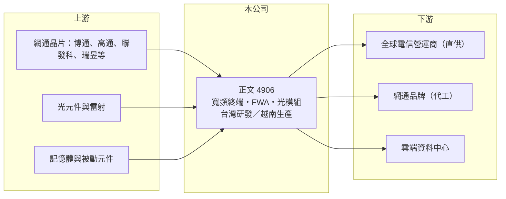

# 4906 正文

> 上市｜[[產業索引-通信網路業|通信網路業]]｜上市（櫃）日期 2003/06/30

# 第一章：企業模式與商業藍圖

> [!info] 撰寫說明
> 精簡版，由 Claude 依公開資料整理，架構比照 [[2330台積電]] 的四章研究，資料截至 2026-10-08。來源：證交所開放資料（基本資料、綜合損益、資產負債、營益分析、股利、每月營收）、Goodinfo 年度經營績效、Yahoo 股市公司基本資料、優分析 2025 年 12 月文章。本次未取得產品別營收比重；Goodinfo 的 2025 年營收與優分析描述的年減幅度不一致，需比對原始財報。#待校對

本章說明正文科技（股票代號：4906，英文 GEMTEK，以下簡稱正文）的商業模式：一家從無線網路代工起家、正在從「替品牌代工」轉向「直接供貨給電信營運商」的網通廠。

- **核心業務：** 正文成立於 1988 年，2003 年在證交所上市，總部與工廠位於新竹湖口工業區，實收資本額約 45.2 億元，董事長陳鴻文、總經理李榮昌。產品包括路由器、無線網卡、IP 機上盒、LTE 與 5G 通訊系統，應用於家庭寬頻、企業網路與智慧城市；近年推出 800G 光模組與 5G 毫米波 [[FWA]] 設備，瞄準 AI 與雲端基礎建設。
- **營收結構：** 本次未取得產品別比重。依優分析整理，正文自 2022 年起推動直供電信營運商，直供出貨比重 2023 年約 20%、2024 年約 40%，2025 年預期接近 50%。這個轉變的意義是：正文從品牌商背後的 [[ODM]]，變成直接面對營運商的設備供應商，毛利較高，但要自己承擔標案、認證與售後服務。
- **營運據點：** 台灣新竹湖口為總部與研發據點，量產產能正由中國移往越南，報導指出 2025 年底生產基地轉移已接近尾聲。產能轉移是為了回應美國關稅與營運商排除中國生產設備的要求。
- **長期方向：** 正文的長期策略是同時往兩個方向發展：一是把寬頻終端直接賣給全球電信營運商，二是切入資料中心用的 800G [[光收發模組]]。兩條路都比傳統代工有更高的附加價值，但也都需要時間建立客戶信任。

# 第二章：護城河深度與競爭優勢

本章評估正文的護城河。網通代工的同質化程度高，正文目前處於轉型期，護城河窄且仍在重建。

- **競爭優勢：** 正文累積了數十年的無線射頻與網通系統設計經驗，產品線涵蓋 Wi-Fi、LTE、5G 與機上盒，能為營運商提供較完整的家庭寬頻方案。越南產能讓它符合歐美營運商的非中國供應鏈要求。轉型後 2025 年第三季毛利率提升到 16.35%，顯示直供模式確實帶來較高毛利。
- **主要對手：** 寬頻終端與 FWA 的對手包括 [[3596智易]]、[[5388中磊]]、[[3704合勤控]]、[[6285啟碁]]、[[2419仲琦]]、[[3062建漢]]；光收發模組則需面對 [[3450聯鈞]]、[[4979華星光]] 與中國大廠（對手名單為產業常識整理，待校對）。
- **觀察重點：** 第一，直供營運商的新訂單能否補上流失的代工訂單，讓營收止跌。第二，越南產能的良率與成本是否穩定。第三，800G 光模組能否取得雲端客戶認證並量產。報導指出法人把 2026 年視為檢驗轉型成敗的關鍵年。

# 第三章：財務體質與盈利規模

資料日期：2026-10-08。數字取自 Goodinfo 年度經營績效與證交所開放資料，表格是撰寫當時的快照；最新月營收、毛利率、累計 EPS 由自動排程寫在本筆記的屬性欄位（月營收、毛利率、累計EPS 等）。#待校對

正文的財務數字呈現典型網通代工廠的低毛利，轉型期間營收下滑、本業轉為虧損。

| 年度 | 營收（新台幣） | [[毛利率]] | [[營業利益率]] | EPS（元） | [[ROE]] |
|---|---|---|---|---|---|
| 2019 | 181 億 | 9.82% | 0.29% | 0.57 | 2.42% |
| 2020 | 199 億 | 11.4% | 2.35% | 3.86 | 15.6% |
| 2021 | 229 億 | 8.99% | 1.55% | 1.89 | 6.4% |
| 2022 | 279 億 | 10.3% | 2.61% | 1.70 | 5.9% |
| 2023 | 261 億 | 10.6% | 1.77% | 1.55 | 4.11% |
| 2024 | 256 億 | 11.9% | 2.27% | 1.56 | 4.83% |
| 2025 | 165 億（待校對） | 13.8% | 0.36% | -0.25 | -0.85% |
| 2026 上半年 | 67.3 億 | 11.32% | -4.77% | -0.42 | 未查得 |

註：2019 至 2025 年取自 Goodinfo 合併報表；2026 上半年取自證交所營益分析與綜合損益開放資料。優分析指出 2025 年前 11 個月營收年減約 7.8%，與 Goodinfo 2025 年營收較 2024 年減少約 35% 不一致，需比對原始財報。

- **營收規模：** 依 Goodinfo 數字，2020 至 2025 年營收年複合成長率約 -3.7%（推算）。2026 年 1 至 8 月累計營收 99.2 億元，較去年同期 115.8 億元減少約 14.4%，代工訂單流失的影響仍在延續。
- **獲利：** 毛利率長期在 9% 至 14%，營業利益率只有 0% 至 3%，是網通代工廠的典型結構。2021 至 2025 年平均 ROE 約 4.1%（推算），低於多數投資人要求的報酬。2026 上半年營業損失 3.21 億元，歸屬母公司淨損 1.82 億元，轉型成本與營收下滑同時壓縮獲利。
- **財務特色：** 2026 年第二季底資產總計 192.6 億元、負債 76.3 億元（流動負債 72.5 億元、非流動負債 3.84 億元），歸屬母公司權益 112.6 億元，每股淨值 24.92 元，財務結構保守。2025 年度在虧損下仍每股配發現金股利 0.5 元，以保留盈餘支應。
- **[[ROIC]] 與 [[WACC]]：** 以 2024 年營業利益約 5.81 億元（256 億元 × 2.27%）扣 20% 稅後約 4.65 億元，投入資本以歸屬母公司權益 112.6 億元加非流動負債 3.84 億元（代替有息負債，流動負債中的短期借款未查得）約 116.4 億元計算，ROIC 約 4.0%（推算）；2026 上半年年化營業損失約 6.42 億元，ROIC 約 -5.5%（推算）。WACC 以 CAPM 推估：無風險利率 1.75%、市場風險溢酬 6%、β 取 1.0（推估，網通設備股常見值），權益成本約 7.75%，負債比重低，WACC 約 7.6%（推算）。正文過去即使在正常年度 ROIC 也低於 WACC，轉型期更轉為負值，代表傳統代工模式長期沒有創造價值，直供與光模組策略能否把 ROIC 拉到 WACC 之上，是長期評估的核心。

# 第四章：總體風險與地緣政治

本章整理正文面對的長期風險，主要來自轉型執行與網通產業的低毛利結構。

- **產業週期：** 寬頻終端需求跟隨電信營運商的資本支出與換機週期，2022 年缺料期間備貨、2023 年後庫存調整，呈現[[長鞭效應]]。光收發模組需求則取決於雲端業者的 AI 資料中心投資，景氣轉向時訂單變化很快。
- **營運風險：** 代工訂單流失速度快於直供訂單成長，造成營收缺口；直供模式需要自行承擔標案、庫存與售後服務成本，營運費用較高。越南新產能在爬坡期間良率與效率可能不如原有工廠。
- **其他風險：** 美國關稅、各國網通設備資安規範與營運商的供應鏈要求持續變動。產品以美元計價，新台幣升值會壓縮毛利。晶片與記憶體缺貨或漲價時，低毛利結構難以吸收。

# 專有名詞解析

## 應用

- **[[FWA]]**：固定無線接取，用 4G／5G 行動網路取代實體線路提供家用或企業寬頻，常用於光纖難以佈建的地區。
- **[[光收發模組]]**：把電訊號轉成光訊號發射、並把接收的光訊號轉回電訊號的模組，資料中心交換器與伺服器之間的光纖連線都需要它。

## 金融

- **[[長鞭效應]]**：終端需求的小幅變動，沿供應鏈往上游傳遞時被逐級放大，造成上游庫存與訂單劇烈波動。
- **[[ROIC]]**：投入資本報酬率，稅後營業利益除以股東權益加有息負債，衡量本業運用資本的效率。
- **[[WACC]]**：加權平均資金成本，股東與債權人要求報酬率的加權平均，是 ROIC 要超越的門檻。

## 產業

- **[[ODM]]**：原廠委託設計製造，代工廠可提出設計方案並負責生產，與客戶綁定較深，議價能力較高。

# 核心供應鏈

- 上游：網通晶片 [[AVGO博通]]、[[QCOM高通]]、[[2454聯發科]]、[[2379瑞昱]] 等（實際採購比重未公開，待校對），光元件、記憶體與被動元件。
- 下游／客戶：全球電信營運商、網通品牌客戶與雲端資料中心；報導未點名具體客戶。
- 同業：[[3596智易]]、[[5388中磊]]、[[3704合勤控]]、[[6285啟碁]]、[[2419仲琦]]、[[3062建漢]]、[[3047訊舟]]。

## 最新新聞
<!-- news:start（自動產生，請勿手動編輯此範圍） -->
- 2026-10-16 🏛️ 重訊 16:25｜(補充公告)代子公司G-Technology Investment Co., Ltd.公告 初期投資 Starman Gemtek LLC 股權案｜[觀測站](https://mops.twse.com.tw/mops/#/web/t05st01)
- 2026-10-15 🏛️ 重訊 16:13｜代子公司G-Technology Investment Co., Ltd.公告 初期投資 Starman Gemtek LLC 股權案｜[觀測站](https://mops.twse.com.tw/mops/#/web/t05st01)
- 2026-10-15 🏛️ 重訊 16:13｜代子公司Gemtek Vietnam Co., Ltd.公告自地委建興建廠房之相關訊息｜[觀測站](https://mops.twse.com.tw/mops/#/web/t05st01)
- 2026-10-08 🏛️ 重訊 14:05｜公告本公司115年9月合併營業收入淨額應為1,643,417仟元｜[觀測站](https://mops.twse.com.tw/mops/#/web/t05st01)

完整紀錄：[[4906正文 新聞]]
<!-- news:end -->

## 相關連結
- [公開資訊觀測站](https://mopsov.twse.com.tw/mops/web/t05st03?step=1&firstin=1&co_id=4906)
- [Goodinfo](https://goodinfo.tw/tw/StockDetail.asp?STOCK_ID=4906)
- [Yahoo 股市](https://tw.stock.yahoo.com/quote/4906)
- [鉅亨網新聞](https://www.cnyes.com/twstock/4906/news)
