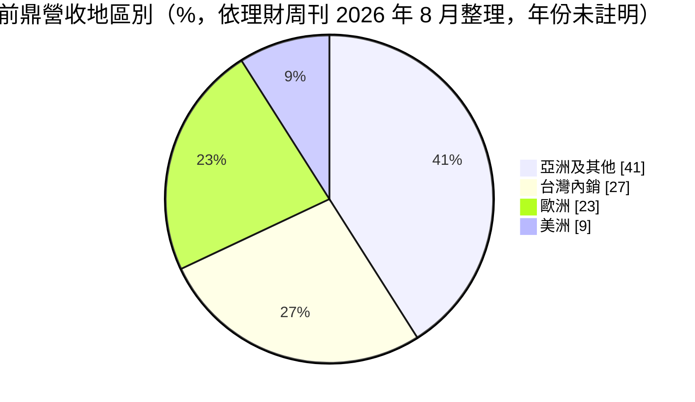
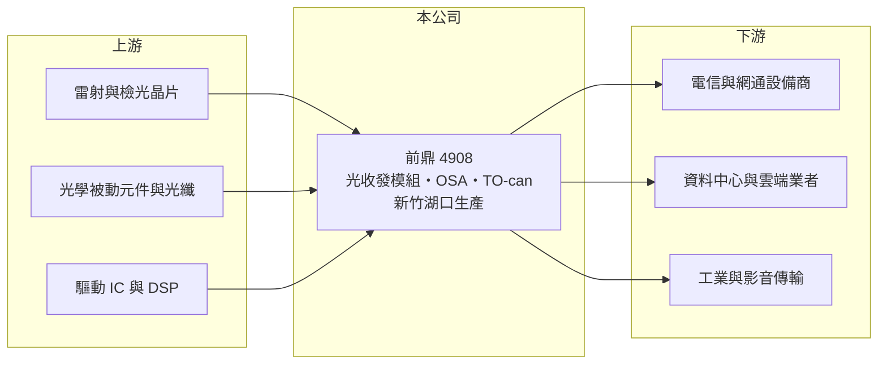

# 4908 前鼎

> 上櫃｜[[產業索引-通信網路業|通信網路業]]｜上市（櫃）日期 2002/02/27

# 第一章：企業模式與商業藍圖

> [!info] 撰寫說明
> 精簡版，由 Claude 依公開資料整理，架構比照 [[2330台積電]] 的四章研究，資料截至 2026-10-08。來源：櫃買中心開放資料（基本資料、綜合損益、資產負債、每月營收、本益比殖利率）、Goodinfo 年度經營績效、理財周刊 2026 年 8 月文章。地區別比重的年份文章未註明，客戶名單未公開。#待校對

本章說明前鼎光電（股票代號：4908，以下簡稱前鼎）的商業模式：一家全部產能留在台灣、以中低速與利基型[[光收發模組]]為主、正往高速與雷射光源延伸的小型光通訊廠。

- **核心業務：** 前鼎成立於 1998 年，2002 年在櫃買中心掛牌，實收資本額約 7.82 億元，董事長葉政彥。主營光纖通訊主動元件模組的設計、研發與製造，產品包括光收發模組、光纖次模組（OSA）、TO-can 封裝，以及 DVI 與 HDMI 光纖延長線。
- **營收結構：** 依理財周刊 2026 年 8 月整理，光收發模組約占 94%，其他約 6%。地區別方面，內銷約 27%、外銷約 73%，外銷中亞洲及其他地區 41%、歐洲 23%、美洲 9%（年份未註明）。客戶分散在多個區域，沒有過度依賴美國雲端業者。

- **營運據點：** 主要生產基地位於新竹縣湖口鄉，沒有在中國設廠。光收發模組年產能約 182 萬個，光纖次模組封裝年產能約 2.25 萬個。全台生產在美中貿易摩擦下是接單優勢，但也代表人工成本較高。
- **長期方向：** 前鼎已建立[[矽光子]]技術平台，400G 產品送樣並少量出貨，800G 產品部分進入量產；連續波雷射（[[CW雷射]]）的 Chip on Carrier 產線預計 2026 年第三季底完工，目標切入光模組所需的核心光源。公司也同步開發 [[CPO]] 架構所需的外部雷射光源模組（ELSFP）封裝。這是從模組組裝往上游光源延伸的重要一步。

# 第二章：護城河深度與競爭優勢

本章評估前鼎的護城河。前鼎的毛利率在光通訊模組廠中偏高，顯示利基產品有定價能力，但規模小，屬於窄護城河。

- **競爭優勢：** 前鼎長期專注於電信、工業與影音傳輸等利基型光模組，這類產品規格多、單一訂單量小，大型模組廠不一定願意投入，客戶導入後轉換成本也高。這是前鼎毛利率能長期維持在 37% 至 47% 的原因，遠高於以資料中心大量出貨為主的模組廠。全台灣生產與無中國產能，也符合部分歐美客戶的供應鏈要求。
- **主要對手：** 光收發模組的對手包括 [[3450聯鈞]]、[[3234光環]]、[[4979華星光]]、[[4977眾達-KY]]，以及中國的中際旭創、新易盛等大廠（對手名單為產業常識整理，待校對）。
- **觀察重點：** 第一，400G／800G 高速產品能否從送樣走到穩定量產，並維持毛利率。第二，CW 雷射產線完工後的良率與客戶認證。第三，營收成長是否能突破過去十年 7 億至 9 億元的規模區間。

# 第三章：財務體質與盈利規模

資料日期：2026-10-08。數字取自 Goodinfo 年度經營績效與櫃買中心開放資料，表格是撰寫當時的快照；最新月營收、毛利率、累計 EPS 由自動排程寫在本筆記的屬性欄位（月營收、毛利率、累計EPS 等）。#待校對

前鼎的財務數字顯示營收規模長期停留在 8 億元上下，但毛利率與營業利益率都很穩定，財務結構幾乎無負債。

| 年度 | 營收（新台幣） | [[毛利率]] | [[營業利益率]] | EPS（元） | [[ROE]] |
|---|---|---|---|---|---|
| 2019 | 8.18 億 | 36.9% | 19.4% | 1.66 | 8.92% |
| 2020 | 7.41 億 | 41.2% | 21.5% | 1.55 | 8.05% |
| 2021 | 7.79 億 | 41.1% | 22.8% | 1.86 | 9.35% |
| 2022 | 8.85 億 | 44.8% | 26.0% | 3.34 | 15.9% |
| 2023 | 9.41 億 | 42.6% | 22.0% | 2.63 | 12.2% |
| 2024 | 9.36 億 | 44.4% | 21.7% | 2.82 | 13.1% |
| 2025 | 8.15 億 | 47.3% | 21.5% | 1.98 | 9.01% |
| 2026 上半年 | 5.21 億 | 46.3% | 24.1% | 1.42 | 未查得 |

註：2019 至 2025 年取自 Goodinfo 合併報表；2026 上半年取自櫃買中心開放資料，毛利率與營業利益率由營業毛利、營業利益除以營收計算。

- **營收規模：** 2020 至 2025 年營收年複合成長率約 1.9%（推算），長期在 7 億至 9.5 億元之間。2026 年 1 至 8 月累計營收 7.17 億元，較去年同期增加約 28.3%，可能突破過去高點。
- **獲利：** 毛利率從 2019 年的 36.9% 提升到 2025 年的 47.3%，營業利益率穩定在 19% 至 26%，代表產品組合持續往高附加價值移動。2021 至 2025 年平均 ROE 約 11.9%（推算）；ROE 不算特別高，原因是帳上保留大量現金、權益基數大。
- **財務特色：** 2026 年第二季底資產總計 21.1 億元、負債只有 3.48 億元（非流動負債僅約 0.02 億元），股東權益約 17.6 億元，每股淨值 22.56 元，幾乎沒有有息負債。櫃買中心資料顯示最近一年度每股現金股利 1 元，相對 2025 年 EPS 1.98 元，配息率約 50%（推算）。
- **[[ROIC]] 與 [[WACC]]：** 以 2026 上半年營業利益 1.26 億元年化約 2.51 億元、扣 20% 稅後約 2.01 億元，投入資本以股東權益約 17.6 億元加非流動負債 0.02 億元約 17.7 億元計算，ROIC 約 11.4%（推算）；2025 年營業利益約 1.75 億元，ROIC 約 7.9%（推算）。若扣除帳上現金只計營運資本，ROIC 會更高。WACC 以 CAPM 推估：無風險利率 1.75%、市場風險溢酬 6%、β 取 1.2（推估，光通訊族群波動大），權益成本約 8.95%，因幾乎無負債，WACC 約 9%（推算）。ROIC 在好年度高於 WACC、在 2025 年略低，代表前鼎的營運本身具備價值創造能力，但大量閒置資金拉低了整體資本報酬。

# 第四章：總體風險與地緣政治

本章整理前鼎面對的長期風險，主要來自規模小與光通訊技術世代更替快。

- **產業週期：** 光通訊需求跟隨電信營運商與資料中心的投資週期。2025 年營收由 9.36 億元降到 8.15 億元，顯示利基市場同樣受客戶庫存調整影響，出現[[長鞭效應]]。AI 資料中心需求旺盛時訂單成長快，但退潮時也可能急速下滑。
- **營運風險：** 400G、800G 與 CW 雷射都是新產品，量產初期良率不佳會壓低毛利率。公司規模小，研發與設備投資的能量不如大型模組廠，在高速產品可能只能扮演第二供應商的角色。
- **其他風險：** 光通訊技術從可插拔模組走向 CPO，若產業架構改變速度快於前鼎的技術布局，傳統模組需求可能萎縮。雷射晶片等關鍵材料多仰賴外購（推估），供應吃緊時可能影響出貨。產品以美元計價，匯率波動影響獲利。

# 專有名詞解析

## 半導體

- **[[CW雷射]]**：連續波雷射，持續輸出穩定光源的雷射二極體，矽光子模組與 CPO 架構需要它作為外部光源。
- **[[矽光子]]**：在矽晶片上製作光學元件，以光取代電傳輸資料，可降低 AI 資料中心的傳輸耗電。
- **[[CPO]]**：共同封裝光學，把光學收發元件與交換晶片封裝在一起，縮短電訊號距離以降低功耗。

## 應用

- **[[光收發模組]]**：把電訊號轉成光訊號發射、並把接收的光訊號轉回電訊號的模組，資料中心交換器與伺服器之間的光纖連線都需要它。

## 金融

- **[[ROIC]]**：投入資本報酬率，稅後營業利益除以股東權益加有息負債，衡量本業運用資本的效率。
- **[[WACC]]**：加權平均資金成本，股東與債權人要求報酬率的加權平均，是 ROIC 要超越的門檻。

# 核心供應鏈

- 上游：雷射與檢光晶片（如 [[3081聯亞]] 等磊晶與晶片廠，實際供應關係未公開，待校對）、光學被動元件與光纖、驅動 IC 與 DSP（[[MRVL邁威爾]]、[[AVGO博通]] 屬於此類供應商）。
- 下游／客戶：電信與網通設備商、資料中心業者與工業、影音傳輸應用；客戶名單未公開。
- 同業：[[3450聯鈞]]、[[3234光環]]、[[4979華星光]]、[[4977眾達-KY]]、[[3363上詮]]。

## 最新新聞
<!-- news:start -->
<!-- news:end -->

## 相關連結
- [公開資訊觀測站](https://mopsov.twse.com.tw/mops/web/t05st03?step=1&firstin=1&co_id=4908)
- [Goodinfo](https://goodinfo.tw/tw/StockDetail.asp?STOCK_ID=4908)
- [Yahoo 股市](https://tw.stock.yahoo.com/quote/4908)
- [鉅亨網新聞](https://www.cnyes.com/twstock/4908/news)
