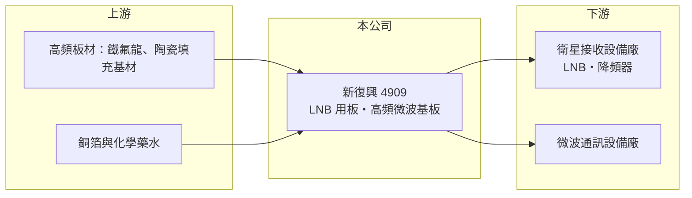

# 4909 新復興

> 上櫃｜[[產業索引-通信網路業|通信網路業]]｜上市（櫃）日期 2002/11/28

# 第一章：企業模式與商業藍圖

> [!info] 撰寫說明
> 精簡版，由 Claude 依公開資料整理，架構比照 [[2330台積電]] 的四章研究，資料截至 2026-10-08。來源：櫃買中心開放資料（基本資料、綜合損益、資產負債、每月營收、本益比殖利率）、Goodinfo 年度經營績效、CMoney 2024 年 9 月投資快訊。公開資料有限，本次未取得產品別比重、客戶名單與 2024 年營收暴增的確切原因，需逐條比對原始文件與年報。#待校對

本章說明新復興微波通訊（股票代號：4909，以下簡稱新復興）的商業模式：一家以衛星接收器用電路板起家的高頻微波基板廠，本業規模已大幅縮小，近年獲利主要來自一次性的資產處分。

- **核心業務：** 新復興成立於 1984 年，2002 年在櫃買中心掛牌，實收資本額約 9.34 億元，董事長張永輝。主要產品是 [[LNB]] 用電路板與高頻微波通訊基板，報導稱其為全球 LNB 用板的領導廠商。LNB 是衛星天線上的降頻器，需要使用低損耗的高頻板材，這類電路板的製程與一般 PCB 不同。
- **營收結構：** 本次未取得產品別比重。2019 至 2023 年營收在 5 億至 8 億元之間，2024 年跳升到 27.8 億元，2025 年又降到 2.97 億元。依 2024 年 9 月報導，子公司資產處分利益估計超過 2.8 億元，2024 年營收暴增可能與子公司處分資產有關，屬一次性成分（推估，確切原因待校對）。
- **營運據點：** 生產據點本次未查得（待校對）。主要客戶推估為衛星電視接收設備與微波通訊設備廠。
- **長期方向：** 傳統衛星電視（直播衛星）需求長期萎縮，LNB 板的市場隨之縮小，這是新復興營收長期下滑的根本原因。[[低軌衛星]]地面設備與 5G 毫米波等新高頻應用理論上需要類似的板材技術，但公司是否已取得這類訂單，本次未查得。

# 第二章：護城河深度與競爭優勢

本章評估新復興的護城河。高頻板材製程有技術門檻，但主要市場萎縮，本業連年虧損，護城河已經很薄。

- **競爭優勢：** 高頻微波基板使用鐵氟龍或陶瓷填充等特殊材料，鑽孔、壓合與線路精度要求高，過去新復興在 LNB 板市場建立了規模與客戶關係。這類利基產品的客戶數少，供應商一旦被認證就能長期供貨。
- **主要對手：** 高頻與射頻板的對手包括 [[2383台光電]]、[[6274台燿]] 等材料廠的下游客戶，以及 [[2367燿華]]、[[2316楠梓電]]、[[8213志超]] 等 PCB 廠；衛星與射頻元件方面相關的台廠有 [[3491昇達科]]、[[2314台揚]]（對手名單為產業常識整理，待校對）。
- **觀察重點：** 第一，本業毛利率能否轉回正值，2025 年與 2026 上半年毛利率皆為負。第二，公司是否有計畫運用高達 25 億元的股東權益投入新業務或發放給股東。第三，低軌衛星與高頻通訊新應用能否帶來實際訂單。

# 第三章：財務體質與盈利規模

資料日期：2026-10-08。數字取自 Goodinfo 年度經營績效與櫃買中心開放資料，表格是撰寫當時的快照；最新月營收、毛利率、累計 EPS 由自動排程寫在本筆記的屬性欄位（月營收、毛利率、累計EPS 等）。#待校對

新復興的財務數字顯示本業持續萎縮且多數年度虧損，2024 年的高獲利屬於特殊情況。

| 年度 | 營收（新台幣） | [[毛利率]] | [[營業利益率]] | EPS（元） | [[ROE]] |
|---|---|---|---|---|---|
| 2019 | 7.80 億 | 8.57% | -4.71% | 0.03 | 0.12% |
| 2020 | 6.81 億 | 8.66% | -5.66% | 0.16 | 0.59% |
| 2021 | 6.73 億 | -2.48% | -17.3% | -1.26 | -4.81% |
| 2022 | 4.95 億 | -13.0% | -31.7% | -0.59 | -2.32% |
| 2023 | 6.21 億 | 21.4% | 9.10% | 0.42 | 1.65% |
| 2024 | 27.8 億 | 37.4% | 29.3% | 10.14 | 33.7% |
| 2025 | 2.97 億 | -10.1% | -33.3% | -1.25 | -4.04% |
| 2026 上半年 | 1.03 億 | -25.0% | -54.8% | -0.09 | 未查得 |

註：2019 至 2025 年取自 Goodinfo 合併報表；2026 上半年取自櫃買中心開放資料，毛利率與營業利益率由營業毛利、營業利益除以營收計算。2024 年數字含一次性因素（推估）。

- **營收規模：** 扣除 2024 年後，營收從 2019 年的 7.8 億元一路降到 2025 年的 2.97 億元。2026 年 1 至 8 月累計營收 1.36 億元，較去年同期 2.20 億元減少約 38%，本業仍在萎縮。
- **獲利：** 七年中有四年營業虧損，2025 年與 2026 上半年毛利率為負，代表營收已不足以支撐工廠的固定成本。2026 上半年營業損失 0.57 億元，靠業外收入 0.54 億元幾乎打平。2021 至 2025 年平均 ROE 約 4.8%（推算），但若排除 2024 年則為負值。
- **財務特色：** 2026 年第二季底資產總計 26.8 億元、負債僅 1.44 億元，股東權益 25.4 億元，每股淨值 27.17 元，保留盈餘約 10.9 億元。資產遠大於本業所需，推估主要是 2024 年處分資產後留下的現金與投資。最近一年度未配發現金股利。
- **[[ROIC]] 與 [[WACC]]：** 以 2026 上半年營業損失 0.57 億元年化約 -1.13 億元（虧損不計稅盾），投入資本以股東權益 25.4 億元加非流動負債 0.32 億元約 25.7 億元計算，ROIC 約 -4.4%（推算）；2025 年營業損失約 0.99 億元，ROIC 約 -3.9%（推算）。WACC 以 CAPM 推估：無風險利率 1.75%、市場風險溢酬 6%、β 取 1.0（推估），權益成本約 7.75%，幾乎無負債，WACC 約 7.7%（推算）。ROIC 長期為負、遠低於 WACC，代表本業正在消耗價值；股東的價值主要來自帳上資產，而非營運。

# 第四章：總體風險與地緣政治

本章整理新復興面對的長期風險，核心是主要市場的結構性萎縮。

- **產業週期：** 衛星電視受串流影音取代，LNB 需求呈長期下滑，這不是一般的景氣循環，而是結構性衰退。若沒有新應用接手，營收很難回到過去水準。
- **營運風險：** 營收規模太小，工廠固定成本無法攤提，毛利率為負的狀態若持續，會逐年侵蝕淨值。一次性處分利益不能重複，2024 年的獲利不應作為未來獲利能力的參考。
- **其他風險：** 帳上資金如何運用存在不確定性，若投入不熟悉的新事業，可能產生新的虧損。高頻板材原料（如鐵氟龍基材）價格與供應受少數國外廠商影響。

# 專有名詞解析

## 應用

- **[[LNB]]**：低雜訊降頻器，裝在衛星天線焦點上，把衛星送來的高頻訊號放大並降頻，再送進接收機。
- **[[低軌衛星]]**：運行在約 500 至 2,000 公里高度的通訊衛星群，延遲較低，需大量地面接收設備，代表業者為 Starlink。

## 金融

- **[[ROIC]]**：投入資本報酬率，稅後營業利益除以股東權益加有息負債，衡量本業運用資本的效率。
- **[[WACC]]**：加權平均資金成本，股東與債權人要求報酬率的加權平均，是 ROIC 要超越的門檻。

## 產業

- **[[高頻基板]]**：使用低介電損耗材料製作的電路板，用於微波、毫米波與衛星通訊，製程難度高於一般 PCB。

# 核心供應鏈

- 上游：高頻板材（多為國外材料廠，實際供應商未公開，待校對）、銅箔 [[8358金居]] 等與化學藥水。
- 下游／客戶：衛星接收設備與 LNB 製造商、微波通訊設備廠；客戶名稱本次未查得。
- 同業：[[2367燿華]]、[[2316楠梓電]]、[[8213志超]]、[[3491昇達科]]、[[2314台揚]]。

## 最新新聞
<!-- news:start -->
<!-- news:end -->

## 相關連結
- [公開資訊觀測站](https://mopsov.twse.com.tw/mops/web/t05st03?step=1&firstin=1&co_id=4909)
- [Goodinfo](https://goodinfo.tw/tw/StockDetail.asp?STOCK_ID=4909)
- [Yahoo 股市](https://tw.stock.yahoo.com/quote/4909)
- [鉅亨網新聞](https://www.cnyes.com/twstock/4909/news)
