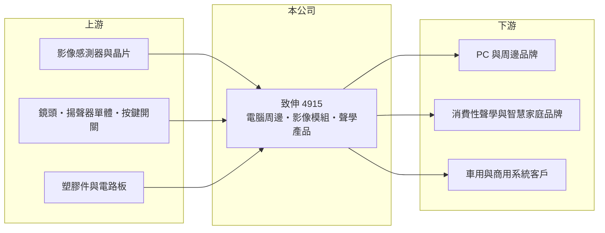

# 4915 致伸

> 上市｜[[產業索引-電子零組件業|電子零組件業]]｜上市（櫃）日期 2012/10/05

# 第一章：企業模式與商業藍圖

> [!info] 撰寫說明
> 精簡版，由 Claude 依公開資料整理，架構比照 [[2330台積電]]，資料截至 2026-10-08。來源：證交所開放資料（基本資料、2026 年第二季資產負債與綜合損益、股利）、Goodinfo 經營績效頁、優分析 2026 年 1 月營收報導。產品別營收比重、生產據點與客戶名單未查得，相關描述憑記憶整理。#待校對

致伸是台灣電腦周邊與影音模組的大型 [[ODM]] 廠，它的長期課題是如何從成熟、低毛利的鍵盤滑鼠代工，轉成整合聲音、影像與感測的系統方案供應商。

- **核心業務：** 致伸替國際品牌設計與製造電腦周邊（鍵盤、滑鼠、觸控板等輸入裝置）、[[影像模組]]（筆電與視訊會議鏡頭、監控與車用攝影模組）以及聲學產品（[[揚聲器]]、智慧音箱與耳機等）。這三大產品線長期構成主要營收，致伸在全球 PC 周邊代工中屬於規模最大的廠商之一（產品比重與排名待校對）。
- **商業模式：** 公司自稱採「ODM＋」模式，也就是不只代工，還提供聲學、光學與介面設計的系統解決方案。這種模式的好處是能參與客戶早期設計、提高轉換成本，缺點是需要長期投入研發，而 ODM 的毛利率天花板仍受品牌客戶壓價限制。致伸毛利率從 2020 年的 11.9% 逐年升到 2025 年的 17.3%，反映產品組合往高附加價值移動。
- **營運據點：** 總部在台北內湖，製造基地分布在中國與東南亞（具體廠區與產能配置未查得，待校對）。對大型 ODM 而言，多地產能是應對美國關稅與客戶要求 [[中國加一]] 的必要條件。
- **長期方向：** 致伸以「AI 感測融合（AI Sensor Fusion）」為核心策略，整合聲音、影像與介面技術，應用場域包括 [[車用電子]]、智慧監控、會議系統、機器人與智慧工作場域，並在 2026 年持續推動 Edge AI 與 AIoT 應用。這個方向的意義在於把公司從「賣單一周邊」轉為「賣感測模組」，打開汽車與商用等較高門檻市場。

# 第二章：護城河深度與競爭優勢

致伸的護城河來自規模、跨領域的系統設計能力與長年的品牌客戶關係，屬於中等寬度、但需要持續投入才能維持的類型。

- **競爭優勢：** 鍵盤、滑鼠等產品技術門檻不高，但品牌客戶需要供應商同時具備大規模製造、全球交貨與快速開發的能力，能滿足的廠商並不多。致伸同時擁有聲學、光學與介面三種能力，能為客戶提供整合方案，這比單一產品代工更難被替換。
- **主要對手：** 電腦周邊方面主要對手為 [[2385群光]]、[[2301光寶科]] 等台廠與中國代工廠；影像模組會遇到群光、[[3019亞光]] 及中國的相機模組廠；聲學產品則面對中國歌爾、立訊等大型聲學代工廠，這些中國對手在規模與成本上具優勢。
- **觀察重點：** 第一是毛利率能否持續維持在 17% 以上，代表高毛利專案占比是否持續提升。第二是車用與商用影像、聲學模組的營收占比，這決定公司能否降低對 PC 週期的依賴。第三是 2026 年營收年增約一成的動能，是來自 PC 換機的短期拉貨，還是新事業的結構性成長。

# 第三章：財務體質與盈利規模

資料日期：2026-10-08，表格是撰寫當時的快照；最新月營收、毛利率、累計 EPS 由自動排程寫在本筆記的屬性欄位（月營收、毛利率、累計EPS 等）。#待校對

致伸的財務特徵是營收規模大、利潤率薄但持續改善，以及穩定的高配息。

| 年度 | 營收（億元） | [[毛利率]] | [[營業利益率]] | EPS（元） | [[ROE]] |
|---|---|---|---|---|---|
| 2020 | 682 | 11.9% | 3.37% | 4.30 | 13.0% |
| 2021 | 716 | 13.1% | 3.93% | 5.13 | 15.0% |
| 2022 | 792 | 13.9% | 4.22% | 6.10 | 16.5% |
| 2023 | 605 | 15.8% | 4.53% | 5.50 | 14.1% |
| 2024 | 582 | 17.0% | 4.69% | 5.61 | 14.0% |
| 2025 | 602 | 17.3% | 4.72% | 5.71 | 13.0% |
| 2026 上半年 | 331 | 15.4% | 4.0% | 2.55 | 半年，不年化 |

（2020 至 2025 年取自 Goodinfo；2026 上半年依證交所第二季綜合損益計算。）

- **營收規模：** 2020 至 2025 年營收由 682 億元降到 602 億元，年複合成長率約 -2.5%，主要因為 2022 年疫情宅經濟高峰過後，PC 周邊需求回落。2026 年上半年營收 331 億元，較前一年同期成長，回到成長軌道。
- **獲利：** 營收下滑期間，毛利率反而由 11.9% 提升到 17.3%，營業利益率由 3.4% 升到 4.7%，EPS 維持在 5 至 6 元，代表公司主動淘汰低毛利產品、提高高毛利專案比重。2026 年上半年毛利率 15.4% 較低，需觀察是產品組合還是短期因素。
- **股利與資本效率：** 近五年（2021 至 2025）平均 ROE 約 14.5%，相當穩定。2025 年度配發現金股利約 4.57 元，配息率約 80%（推算），屬於高配息政策。2026 年第二季底總資產 546.5 億元、負債 342.4 億元、權益 204.1 億元，負債多為流動負債，主要是 ODM 業常見的應付帳款。
- **[[ROIC]] 與 [[WACC]]：** 有息負債未查得，以股東權益近似投入資本（ODM 廠大量使用應付帳款這類無息資金，ROIC 實際可能更高）。2025 年稅後營業利益約 602 億 × 4.72% × (1 − 20%) ≈ 22.7 億元，除以權益 204.1 億元，ROIC 約 11%（推算）。WACC 以 CAPM 推估：無風險利率 1.75%、市場風險溢酬 6%、β 取 EMS 與 ODM 常見值 0.9，股權成本約 7.2%；負債成本假設 2.5%，WACC 約 6% 至 7%（推算）。ROIC 穩定高出 WACC 約 4 至 5 個百分點，代表致伸在薄利的代工業中仍能長期創造價值，關鍵在於高周轉與低資本密集。

# 第四章：總體風險與地緣政治

致伸的風險主要來自 PC 與消費性電子的需求週期、品牌客戶的議價壓力，以及地緣政治對製造布局的影響。

- **產業週期：** 鍵盤、滑鼠、筆電鏡頭等產品的需求跟著 PC 出貨走，2023 年營收年減約 24% 就是疫情後需求回落與庫存調整的結果。消費性聲學產品同樣有明顯的季節性與產品週期，營收可能隨單一大客戶的新品成敗大幅波動。
- **營運風險：** ODM 的毛利率受品牌客戶壓價影響，少數大客戶占營收比重高時，一旦客戶改變供應商策略或自行生產，衝擊會很大。新事業（車用、機器人、會議系統）的開發週期長、認證嚴格，前期研發投入可能多年後才回收。
- **地緣政治與關稅：** 美國對中國製產品的關稅與 [[對等關稅]] 政策，迫使品牌要求代工廠移出中國，搬遷產線會增加資本支出與營運成本，並可能在轉移期間影響良率與交期。
- **其他風險：** 營收以美元計價，新台幣升值會壓縮毛利；記憶體、晶片與原物料價格波動也會影響成本與客戶的出貨節奏。

# 專有名詞解析

## 應用

- **[[車用電子]]**：汽車上使用的電子系統與零組件，例如駕駛輔助、車載攝影與影音系統。

## 產業

- **[[ODM]]**：原廠委託設計製造，代工廠負責設計與生產，再以客戶品牌出貨。
- **[[影像模組]]**：把鏡頭、影像感測器與電路板組合成可直接裝進產品的攝影模組。
- **[[揚聲器]]**：把電訊號轉成聲音的元件，俗稱喇叭，廣泛用於筆電、音箱與汽車。
- **[[中國加一]]**：在中國之外再建立至少一個生產基地，以分散地緣政治與關稅風險的供應鏈策略。
- **[[對等關稅]]**：美國依各國對美貿易條件設定相對應稅率的關稅政策。

# 核心供應鏈

- 上游：影像感測器與控制晶片、鏡頭、揚聲器單體、按鍵開關與機構件、電路板供應商（未查得具名廠商）。
- 下游／客戶：PC 與周邊品牌、消費性聲學與智慧家庭品牌、車用與會議系統客戶（具名客戶未查得）。
- 同業：[[2385群光]]、[[2301光寶科]]、[[3019亞光]]、歌爾、立訊。

## 最新新聞
<!-- news:start -->
<!-- news:end -->

## 相關連結
- [公開資訊觀測站](https://mopsov.twse.com.tw/mops/web/t05st03?step=1&firstin=1&co_id=4915)
- [Goodinfo](https://goodinfo.tw/tw/StockDetail.asp?STOCK_ID=4915)
- [Yahoo 股市](https://tw.stock.yahoo.com/quote/4915)
- [鉅亨網新聞](https://www.cnyes.com/twstock/4915/news)
