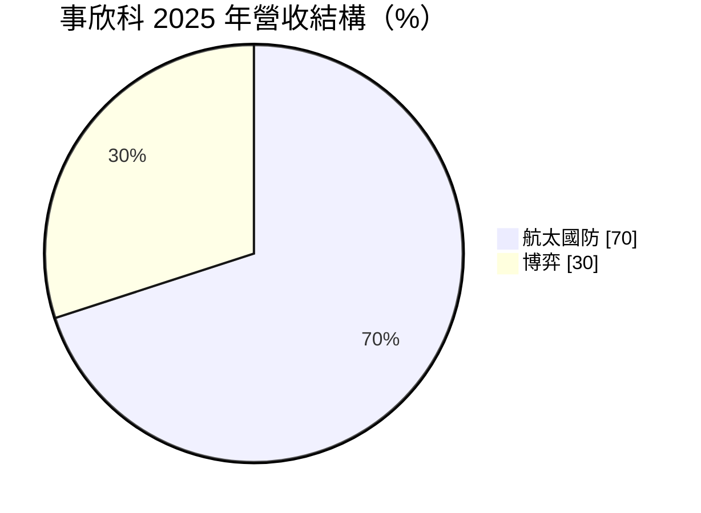
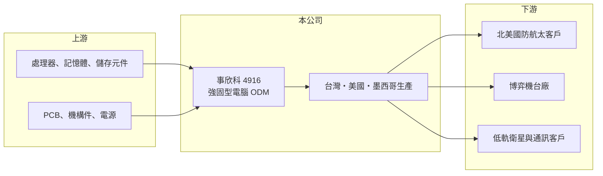

# 4916 事欣科

> 上市｜[[產業索引-電腦及週邊設備業|電腦及週邊設備業]]｜上市（櫃）日期 2013/11/21

# 第一章：企業模式與商業藍圖

> [!info] 撰寫說明
> 精簡版，由 Claude 依公開資料整理，架構比照 [[2330台積電]]，資料截至 2026-10-08。來源：證交所開放資料（基本資料、2026 年上半年財報、每月營收、股利）、Goodinfo 經營績效頁、優分析 2025 年 4 月事欣科報導，以及財經媒體標題。2026 年上半年業外收益的來源未查得。#待校對

本章說明事欣科（4916）的商業模式：以北美客戶為主、專做航太國防與博弈設備的[[工業電腦]] [[ODM]] 廠。

- **核心業務：** 事欣科成立於 2001 年，2013 年上市，總部在桃園中壢。公司替客戶設計並製造工業電腦與嵌入式系統，應用在航太、國防、博弈機台等對可靠度要求很高的場域。與一般消費性電子代工不同，這類產品批量小、規格嚴格、生命週期長，客戶更重視長期供貨與認證。
- **營收結構：** 依 2025 年報導，航太國防約占營收 70%、博弈約 30%，北美出貨比重超過九成。2026 年月營收公告提到國防、航太與通訊客戶需求強勁，[[低軌衛星]]產品持續拉貨，顯示衛星通訊正成為新的成長來源。
- **營運據點：** 生產基地分布在台灣、美國（內華達州與加州）與墨西哥。墨西哥廠位於美墨貿易協定的免稅區，2025 年第一季擴產投入營運，讓公司能就近供應北美客戶，並降低關稅變動的影響。
- **長期方向：** 公司以國防航太為核心，墨西哥廠取得 [[ITAR]] 認證後可以直接參與美國國防專案，並推進資安與醫療認證、爭取無人機訂單。營收在 2019 至 2021 年大幅縮減後（推估與退出低毛利代工業務有關，待校對），這幾年的轉型方向是用高門檻認證換取較高且穩定的毛利。

# 第二章：護城河深度與競爭優勢

本章分析事欣科的護城河：國防航太的認證門檻與北美在地生產，是它與一般工業電腦廠最大的不同。

- **競爭優勢：** 國防與航太產品需要 ITAR 等出口管制合規、品質系統認證與長時間驗證，客戶一旦採用某家供應商，通常會在整個產品生命週期（常達十年以上）持續下單。美國與墨西哥的在地產能符合美國政府與國防客戶對供應鏈來源的要求，這是只在台灣或中國生產的同業不易複製的優勢。
- **主要對手：** 台灣強固型與工業電腦同業包括 [[6922宸曜]]、[[3594磐儀]]、[[3416融程電]]、[[3088艾訊]]、[[6166凌華]] 等；博弈電腦則與 [[8050廣積]] 等業者競爭。美國本土的國防電子廠在大型專案上也是對手。
- **觀察重點：** 長期要看國防航太比重能否持續提高、低軌衛星與無人機產品能否從開發轉為量產訂單，以及毛利率能否穩定在 20% 左右。博弈業務受賭場資本支出影響，需留意其景氣循環。

# 第三章：財務體質與盈利規模

資料日期：2026-10-08，表格是撰寫當時的快照；最新月營收、毛利率、累計 EPS 由自動排程寫在本筆記的屬性欄位（月營收、毛利率、累計EPS 等）。#待校對

本章用多年度數字檢視事欣科轉型後的獲利改善。

| 年度 | 營收（億元） | [[毛利率]] | [[營業利益率]] | EPS（元） | [[ROE]] |
|---|---|---|---|---|---|
| 2020 | 33.8 | 19.5% | -3.3% | -1.78 | -7.16% |
| 2021 | 21.0 | 15.1% | -1.49% | 1.29 | 8.78% |
| 2022 | 27.8 | 16.5% | 3.2% | 1.21 | 7.41% |
| 2023 | 34.1 | 14.0% | 4.6% | 0.87 | 4.62% |
| 2024 | 35.7 | 14.1% | 2.92% | 0.02 | 0.07% |
| 2025 | 36.1 | 20.0% | 8.1% | 1.77 | 7.33% |

- **營收規模：** 2019 年營收約 77.9 億元，2021 年降到 21 億元，之後逐年回升，2021 至 2025 年年複合成長率約 14.5%。2026 年前 8 月累計營收 35.1 億元、年增約 62%，已接近 2025 年全年，成長主要來自國防、航太與低軌衛星。
- **獲利：** 2025 年毛利率從 14% 跳升到 20%，營業利益率 8.1%，是近年最好的一年，反映產品組合轉向高毛利的國防航太。2026 年上半年毛利率 20.5%、營業利益率 9.1%，但 EPS 5.45 元中有大部分來自 5.7 億元的業外收入（來源未查得），本業 EPS 約 1.4 元（推算），評估時應以營業利益為準。
- **財務特色：** 近 5 年（2021 至 2025）平均 ROE 約 5.6%，偏低。2025 年度配發現金股利 0.5 元，約為當年盈餘的三成。2026 年第二季權益 36.1 億元，負債 17.5 億元，負債比約 33%，財務結構穩健。
- **[[ROIC]] 與 [[WACC]]：** 2025 年營業利益約 2.9 億元，稅後約 2.3 億元；以權益 36.1 億元加非流動負債 4.3 億元（代替有息負債）估算投入資本約 40.4 億元，ROIC 約 5.8%（推算）。若以 2026 年上半年營業利益 2.2 億元年化，ROIC 約 8.8%（推算）。WACC 以 [[CAPM]] 推估：無風險利率 1.75%、市場風險溢酬 6%、β 假設 1.1（工業電腦股常見值），股東權益成本約 8.35%；稅後負債成本 2%、負債占資本 10%，WACC 約 7.7%（推算）。過去多年 ROIC 低於 WACC，2026 年起本業若維持目前水準，才首次站上 WACC，轉型是否真正創造價值仍需幾年驗證。

# 第四章：總體風險與地緣政治

本章整理事欣科長期要面對的風險。

- **產業週期：** 國防預算通常較穩定，但個別專案有招標與交貨時程，營收可能隨專案起伏。博弈業務跟著賭場與娛樂消費的資本支出循環，景氣差時需求下降明顯。
- **營運風險：** 客戶集中在北美少數國防航太與博弈業者，單一客戶的計畫變動影響很大。低軌衛星、無人機等新產品仍在早期，量產時程與競爭格局不確定。
- **其他風險：** 美國關稅、美墨貿易協定的變化會影響墨西哥廠的成本優勢；國防產品受出口管制法規約束，合規成本高。營收以美元計價，匯率波動會影響毛利；業外收益占比偏高時，盈餘品質需要留意。

# 專有名詞解析

## 應用

- **[[工業電腦]]**：用於工廠、交通、國防等嚴苛環境的電腦，強調耐用、長期供貨與客製化。
- **[[低軌衛星]]**：在約 500 至 2,000 公里高度運行的通訊衛星，延遲低，需要大量地面終端與衛星零組件。

## 金融

- **[[CAPM]]**：資本資產定價模型，以無風險利率加上 β 乘以市場風險溢酬，推估股東要求的報酬率。

## 產業

- **[[ODM]]**：原廠委託設計製造，代工廠負責產品設計與生產，客戶以自有品牌銷售。
- **[[ITAR]]**：美國國際武器貿易條例，規範國防相關產品與技術的出口，取得資格才能承接美國國防專案。

# 核心供應鏈

- 上游：處理器與晶片（例如 [[INTC英特爾]]、[[AMD超微]] 平台，供貨關係待校對）、記憶體與儲存元件、PCB、機構件與電源供應器。
- 下游／客戶：北美國防與航太系統商、博弈機台製造商、低軌衛星與通訊設備客戶（客戶名稱未公開）。
- 同業：[[6922宸曜]]、[[3594磐儀]]、[[3416融程電]]、[[3088艾訊]]、[[6166凌華]]、[[8050廣積]]。

## 最新新聞
<!-- news:start（自動產生，請勿手動編輯此範圍） -->
- 2026-10-12 📰 媒體 08:51｜營收速報 - 事欣科(4916)9月營收5.97億元年增率高達70.31％｜[鉅亨網](https://news.cnyes.com/news/id/6627796)

完整紀錄：[[4916事欣科 新聞]]
<!-- news:end -->

## 相關連結
- [公開資訊觀測站](https://mopsov.twse.com.tw/mops/web/t05st03?step=1&firstin=1&co_id=4916)
- [Goodinfo](https://goodinfo.tw/tw/StockDetail.asp?STOCK_ID=4916)
- [Yahoo 股市](https://tw.stock.yahoo.com/quote/4916)
- [鉅亨網新聞](https://www.cnyes.com/twstock/4916/news)
