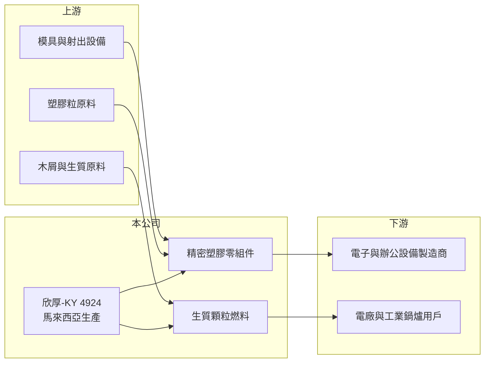

# 4924 欣厚-KY

> 上櫃｜[[產業索引-電腦及週邊設備業|電腦及週邊設備業]]｜上市（櫃）日期 2011/10/18

# 第一章：企業模式與商業藍圖

> [!info] 撰寫說明
> 精簡版，由 Claude 依公開資料整理，架構比照 [[2330台積電]]，資料截至 2026-10-08。來源：櫃買中心開放資料（基本資料、2026 年上半年財報、每月營收）、Goodinfo 經營績效頁、nStock 公司簡介。公開資料有限，產品應用與客戶結構未查得，部分描述為推估。#待校對

本章說明欣厚科技（4924，以下簡稱欣厚-KY）的商業模式：一家在海外註冊、以馬來西亞子公司營運的小型製造業者，同時經營精密塑膠零組件與[[生質燃料]]兩條業務。

- **核心業務：** 欣厚-KY 於 2009 年在開曼群島註冊成立，2011 年在櫃買中心掛牌，屬於 [[KY股]]。依公司簡介，業務為精密塑膠零組件與生質顆粒燃料的製造，主要營運子公司是欣厚企業（馬）有限公司。塑膠零組件以[[射出成型]]為核心，替電子或辦公設備客戶生產外殼與內構件（應用領域為推估）。
- **營收結構：** 公開資料沒有揭露兩項業務的營收比重。櫃買中心把公司的產業別歸在綠能環保（產業代碼 35），可能反映生質燃料業務的重要性提升，但本筆記庫目前仍歸類在電腦及週邊設備業。全年營收規模只有約 7 億元，屬於很小型的上櫃公司。
- **營運據點：** 生產集中在馬來西亞，台灣端設有台北的聯絡地址，董事長為劉鳳君。馬來西亞具備較低的人力成本與豐富的木材、棕櫚等生質原料，這是同時經營塑膠加工與生質燃料的地理基礎（推估）。
- **長期方向：** 生質顆粒燃料可供電廠與工業鍋爐替代燃煤，受各國減碳政策帶動，是公司較有成長潛力的業務；塑膠零組件則屬成熟的代工市場。長期要看公司能否把資源轉向需求較穩定的生質燃料，並提升整體毛利。

# 第二章：護城河深度與競爭優勢

本章分析欣厚-KY 的競爭位置：規模小、產品同質性高，護城河有限。

- **競爭優勢：** 在馬來西亞當地生產，可以就近服務當地電子製造聚落，並享有東南亞的成本與關稅優勢。生質燃料業務若能掌握穩定的原料來源與長期採購合約，原料取得本身就是一種進入門檻。
- **主要對手：** 塑膠射出代工的同業眾多，包括東南亞與中國的大量中小型模具射出廠，台股同業可參考 [[5356協益]]、[[1338廣華-KY]] 等；生質燃料則面對馬來西亞、越南與印尼的木質顆粒廠，以及其他減碳燃料。
- **觀察重點：** 長期觀察毛利率能否維持在 25% 以上、營業利益率能否轉為穩定的正數，以及生質燃料業務是否取得長期合約。公司近五年都沒有配發股利，代表獲利尚不足以回饋股東。

# 第三章：財務體質與盈利規模

資料日期：2026-10-08，表格是撰寫當時的快照；最新月營收、毛利率、累計 EPS 由自動排程寫在本筆記的屬性欄位（月營收、毛利率、累計EPS 等）。#待校對

本章用多年度數字檢視欣厚-KY 的獲利能力，整體呈現毛利尚可、但營業費用吃掉大部分利潤的結構。

| 年度 | 營收（億元） | [[毛利率]] | [[營業利益率]] | EPS（元） | [[ROE]] |
|---|---|---|---|---|---|
| 2020 | 5.89 | 27.0% | 5.45% | 0.94 | 11.8% |
| 2021 | 5.45 | 27.5% | 4.57% | 0.98 | 10.9% |
| 2022 | 6.83 | 24.6% | 3.50% | 0.88 | 8.81% |
| 2023 | 5.00 | 19.4% | -9.53% | -1.15 | -11.7% |
| 2024 | 6.93 | 21.1% | -0.69% | 0.05 | 0.49% |
| 2025 | 7.21 | 22.9% | 0.17% | 0.38 | 3.91% |

- **營收規模：** 2020 至 2025 年營收年複合成長率約 4.1%，規模在 5 億至 7 億元之間波動，2023 年曾跌到 5 億元並出現虧損。2026 年上半年營收 3.9 億元，前 8 月累計年增約 5%。
- **獲利：** 毛利率在 19% 至 28% 之間，但營業費用率約 20% 以上，使營業利益率長期在正負 5% 之間徘徊。2026 年上半年毛利率 26.2%、營業利益率僅 0.6%，EPS 0.23 元，其中業外收入貢獻大於本業。
- **財務特色：** 近 5 年（2021 至 2025）平均 ROE 約 2.5%。2026 年第二季總資產 7.5 億元、權益 4.0 億元，非流動資產占總資產約三分之二，屬於設備密集的製造業；每股淨值約 10.7 元，接近面額，代表多年累積的盈餘有限。近五年沒有配息。
- **[[ROIC]] 與 [[WACC]]：** 2025 年營業利益僅約 0.01 億元，ROIC 接近 0%；以權益 4.0 億元加非流動負債 1.25 億元粗估投入資本約 5.2 億元，2020 至 2022 年營業利益約 0.2 億至 0.3 億元時，ROIC 約 4% 至 5%（推算）。WACC 以 [[CAPM]] 推估：無風險利率 1.75%、市場風險溢酬 6%、β 假設 1.0（小型製造股常見值），股東權益成本約 7.75%；稅後負債成本 2.4%、負債占資本 25%，WACC 約 6.4%（推算）。ROIC 長期低於 WACC，代表目前的經營規模尚未替股東創造經濟價值。

# 第四章：總體風險與地緣政治

本章整理欣厚-KY 長期要面對的風險。

- **產業週期：** 塑膠零組件跟著下游電子與辦公設備需求起伏，景氣差時客戶砍單會直接衝擊產能利用率。生質燃料需求受電廠採購與減碳政策影響，價格也跟著煤價與運費波動。
- **營運風險：** 營收規模小，營業費用難以攤提，只要營收下滑一成就可能轉為虧損。塑膠原料價格與馬來西亞的工資、電價上漲，都會壓縮毛利。
- **其他風險：** KY 公司的主要資產與營運在海外，投資人取得資訊較不容易，並承擔馬幣與新台幣的匯率風險。生質燃料的永續認證與各國補貼政策若改變，需求可能大幅波動。

# 專有名詞解析

## 金融

- **[[KY股]]**：在海外註冊、回台灣上市櫃的公司，代號後加註 KY，主要營運多在海外。
- **[[CAPM]]**：資本資產定價模型，以無風險利率加上 β 乘以市場風險溢酬，推估股東要求的報酬率。

## 產業

- **[[生質燃料]]**：以木屑、農業廢棄物等生物質製成的燃料，例如木質顆粒，可替代燃煤用於發電與鍋爐。
- **[[射出成型]]**：把加熱熔融的塑膠注入模具、冷卻後成型的製程，是塑膠零組件的主要生產方式。

# 核心供應鏈

- 上游：塑膠粒原料供應商、木屑與生質原料來源、模具與射出成型設備（個別供應商未查得）。
- 下游／客戶：電子與辦公設備製造商、電廠與工業鍋爐用戶（客戶名稱未查得）。
- 同業：[[5356協益]]、[[1338廣華-KY]]，以及東南亞的塑膠射出廠與木質顆粒廠。

## 最新新聞
<!-- news:start -->
<!-- news:end -->

## 相關連結
- [公開資訊觀測站](https://mopsov.twse.com.tw/mops/web/t05st03?step=1&firstin=1&co_id=4924)
- [Goodinfo](https://goodinfo.tw/tw/StockDetail.asp?STOCK_ID=4924)
- [Yahoo 股市](https://tw.stock.yahoo.com/quote/4924)
- [鉅亨網新聞](https://www.cnyes.com/twstock/4924/news)
