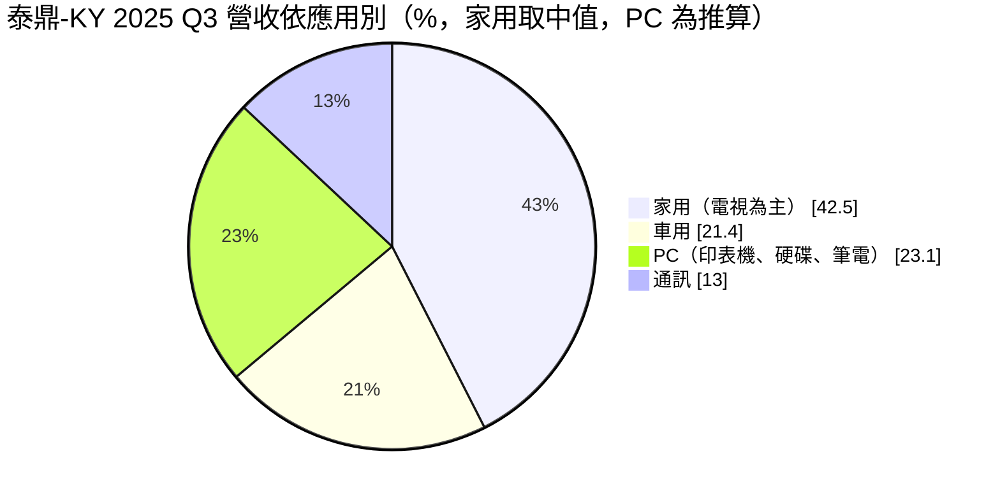
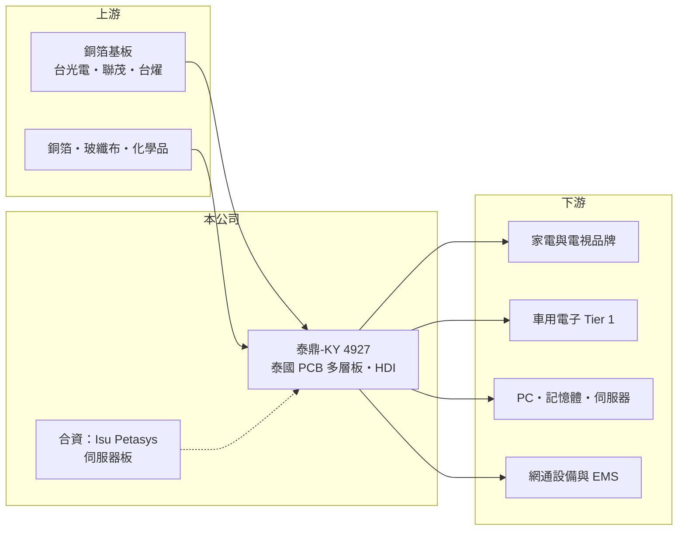

# 4927 泰鼎-KY

> 上市｜[[產業索引-電子零組件業|電子零組件業]]｜上市（櫃）日期 2015/09/08

# 第一章：企業模式與商業藍圖

> [!info] 撰寫說明
> 精簡版，由 Claude 依公開資料整理，架構比照 [[2330台積電]]，資料截至 2026-10-08。來源：證交所開放資料（基本資料、2026 年第二季資產負債與綜合損益、股利）、Goodinfo 經營績效頁、富果研究 2025 年 12 月 26 日法說會摘要。營收比重為 2025 年第三季資料，家用比重取區間中值。#待校對

泰鼎-KY 是以泰國為生產基地的 [[PCB]] 廠，過去靠家電與車用板賺錢，近三年深陷虧損，正試著轉往筆電、記憶體與伺服器等高階板。

- **核心業務：** 泰鼎在泰國龍仔厝府經營多座 PCB 廠：一廠生產 2 至 8 層板，主要供非消費性產品；二廠生產 4 至 12 層板，負責車用與筆電；三廠是最新廠區，可做 8 至 20 層板與 [[HDI]]，新產品原則上在此生產；旭豐（AS）工廠則提供單面板。2025 年前三季營收以 4 至 8 層板占比最高，產品仍以中階多層板為主。
- **營收結構：** 依 2025 年第三季法說會資料，家用（主要是電視）約占 40% 至 45%，車用約 21.4%，自 2023 年起維持兩成以上；PC（印表機、硬碟、筆電）是第三大類，通訊（Wi-Fi、路由器、智慧音箱）約 13%。家用電子比重高，是泰鼎毛利率受價格競爭壓抑的主要原因。

- **營運據點：** 生產集中在泰國，客戶遍及日本、韓國、歐美與 EMS 代工夥伴。泰國是近年 PCB 業者分散中國產能的首選地點，泰鼎是少數早已在當地深耕的台資板廠，這原本是它的區位優勢。
- **長期方向：** 公司把「Computing」（筆電、記憶體、伺服器）與車用列為兩大重點。2025 年泰鼎與韓國伺服器網通板廠 Isu Petasys 成立合資公司，對方取得東南亞產能、泰鼎取得高階伺服器板技術；記憶體方面與既有大客戶合作 DDR 相關產品；筆電板則因美系品牌移出中國而送樣多家新客戶。轉型能否成功，決定泰鼎能否擺脫消費性電子的低價競爭。

# 第二章：護城河深度與競爭優勢

泰鼎的護城河原本來自泰國的先行者優勢與日系、車用客戶關係，但隨著大批台廠與中國廠湧入泰國，這項優勢正在縮小。

- **競爭優勢：** 車用 PCB 需要通過 IATF 16949 等車規認證，客戶一旦導入很少換廠，泰鼎車用比重維持兩成以上，代表它在這個領域有穩定的客戶基礎。在泰國經營多年的人力、供應鏈與政府關係，也是新進者短期內難以複製的。
- **主要對手：** 2023 年以來 [[2368金像電]]、[[3044健鼎]]、[[2313華通]]、[[3037欣興]]、[[6213聯茂]] 等台灣 PCB 與材料廠及多家中國廠陸續赴泰國設廠（廠商名單待校對），泰國 PCB 產能快速增加，人力與原料競爭加劇。在高階伺服器板方面，金像電等台廠的技術與客戶基礎遠勝泰鼎。
- **觀察重點：** 第一是毛利率何時轉正並回到兩位數，2025 年與 2026 年上半年毛利率皆為負值。第二是與 Isu Petasys 合資的伺服器板何時量產、能否取得實際訂單。第三是三廠 HDI 與 8 至 20 層板的 [[稼動率]]，這決定固定成本能否被有效攤提。

# 第三章：財務體質與盈利規模

資料日期：2026-10-08，表格是撰寫當時的快照；最新月營收、毛利率、累計 EPS 由自動排程寫在本筆記的屬性欄位（月營收、毛利率、累計EPS 等）。#待校對

泰鼎的財務在 2023 年後急轉直下，連續三年大幅虧損，資本結構明顯惡化。

| 年度 | 營收（億元） | [[毛利率]] | [[營業利益率]] | EPS（元） | [[ROE]] |
|---|---|---|---|---|---|
| 2020 | 118 | 21.2% | 10.1% | 6.31 | 15.9% |
| 2021 | 148 | 21.1% | 9.98% | 7.25 | 18.3% |
| 2022 | 149 | 19.0% | 6.78% | 4.60 | 11.4% |
| 2023 | 126 | 8.14% | -4.79% | -4.20 | -10.7% |
| 2024 | 125 | 2.44% | -11.8% | -9.21 | -26.2% |
| 2025 | 116 | -1.28% | -14.1% | -8.65 | -31.9% |
| 2026 上半年 | 57.0 | -9.1% | -22.8% | -5.46 | 半年，不年化 |

（2020 至 2025 年取自 Goodinfo；2026 上半年依證交所第二季綜合損益計算。）

- **營收規模：** 2020 至 2025 年營收由 118 億元降至 116 億元，年複合成長率約 -0.3%，但期間 2021、2022 年曾達 148 至 149 億元高峰。2023 年以後營收下滑約兩成，顯示消費性電子需求回落與泰國同業競爭的雙重壓力。
- **獲利：** 毛利率由 2020 至 2022 年的 19% 至 21%，一路跌到 2025 年的 -1.3%，2026 年上半年更降到 -9.1%。法說會說明 2025 年第三季毛利轉負的原因包括：高單價產品因關稅提前出貨、稼動率未達經濟規模、新品開發費用增加與原物料上漲；營收以美元計價、功能性貨幣為泰銖，泰銖升值也侵蝕營收。
- **財務結構：** 2026 年第二季底總資產 190.6 億元、負債 148.4 億元，負債比約 78%；權益 42.2 億元，保留盈餘為 -21.7 億元的 [[累積虧損]]，每股淨值 15.87 元。2025 年度未發放現金股利。近五年（2021 至 2025）平均 ROE 約 -7.8%。
- **[[ROIC]] 與 [[WACC]]：** 2025 年營業損失約 116 億 × -14.1% ≈ -16.4 億元，ROIC 為明顯負值（推算）；有息負債未查得，即使以權益加上全部非流動負債（42.2 億＋35.4 億）作為投入資本的保守估計，ROIC 仍約 -20% 以下。WACC 以 CAPM 推估：無風險利率 1.75%、市場風險溢酬 6%，因虧損與高負債，β 假設 1.3，股權成本約 9.6%；負債成本假設 3.5%、稅後 2.8%，負債約占七成，WACC 約 5% 至 6%（推算，高負債讓數字偏低，實際風險更高）。ROIC 遠低於 WACC，代表過去三年持續毀損股東價值；2020 至 2021 年 ROIC 曾明顯高於 WACC，說明這門生意在稼動率充足時可以賺錢，問題在於能否回到那個狀態。

# 第四章：總體風險與地緣政治

泰鼎的風險集中在虧損持續、資本結構惡化，以及泰國 PCB 產能過剩的競爭格局。

- **產業週期：** PCB 是高固定成本產業，[[稼動率]] 下滑時折舊與人力無法調降，毛利率會迅速轉負。家電、電視等消費性產品比重高，使泰鼎更容易受到終端需求下滑與價格戰影響。
- **競爭與轉型風險：** 大批台灣與中國板廠在泰國設廠，未來幾年當地產能可能過剩，人才與原料成本上升。伺服器與筆電新產品需要長時間認證，管理層也表示新產品推出初期存在不確定性，若轉型進度落後，虧損可能延續。
- **財務風險：** 連續虧損使權益下降、負債比升高，若持續虧損，可能需要再透過 [[現金增資]] 或資產處分補強資本，並面臨銀行融資條件收緊的壓力。
- **其他風險：** 泰銖兌美元匯率波動直接影響營收與成本；美國關稅政策改變客戶出貨節奏；銅箔、玻纖布與 [[銅箔基板]] 等原物料上漲也會壓縮毛利。泰國的政治與勞動法規變化同樣是長期變數。

# 專有名詞解析

## 金融

- **[[累積虧損]]**：公司歷年虧損累積超過盈餘後，在資產負債表保留盈餘欄出現的負數。
- **[[現金增資]]**：公司發行新股向股東或投資人募集現金，以補充營運資金或改善財務結構。

## 產業

- **[[PCB]]**：印刷電路板，用銅箔線路連接電子零件的基板，是幾乎所有電子產品的骨架。
- **[[HDI]]**：高密度互連板，以雷射鑽孔與增層製程做出更細的線路，用於手機、筆電與高階伺服器。
- **[[稼動率]]**：實際生產量占可生產產能的比例，高固定成本產業的獲利高度取決於此。
- **[[銅箔基板]]**：由銅箔、玻纖布與樹脂壓合而成的板材，是 PCB 的主要原料。

# 核心供應鏈

- 上游：銅箔基板 [[2383台光電]]、[[6213聯茂]]、[[6274台燿]]，以及銅箔、玻纖布與製程化學品供應商（泰鼎實際採購對象未查得）。
- 下游／客戶：日韓與歐美的家電、車用電子、PC 與記憶體、網通設備客戶與 EMS 夥伴（具名客戶未查得）；伺服器板合作夥伴為 Isu Petasys。
- 同業：[[2368金像電]]、[[3044健鼎]]、[[2313華通]]、[[3037欣興]]、5469瀚宇博、3715定穎投控。

## 最新新聞
<!-- news:start（自動產生，請勿手動編輯此範圍） -->
- 2026-10-06 📰 媒體 18:50｜營收速報 - 泰鼎-KY(4927)9月營收15.36億元年增率高達72.83％｜[鉅亨網](https://news.cnyes.com/news/id/6622883)

完整紀錄：[[4927泰鼎-KY 新聞]]
<!-- news:end -->

## 相關連結
- [公開資訊觀測站](https://mopsov.twse.com.tw/mops/web/t05st03?step=1&firstin=1&co_id=4927)
- [Goodinfo](https://goodinfo.tw/tw/StockDetail.asp?STOCK_ID=4927)
- [Yahoo 股市](https://tw.stock.yahoo.com/quote/4927)
- [鉅亨網新聞](https://www.cnyes.com/twstock/4927/news)
