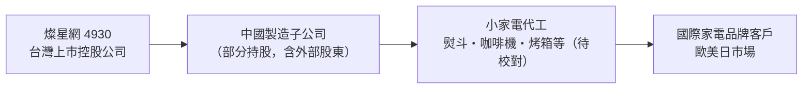
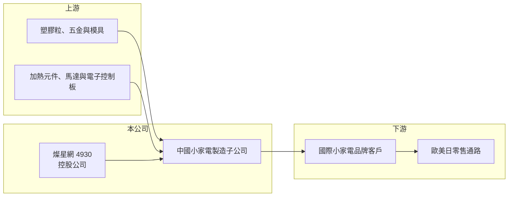

# 4930 燦星網

> 上市｜[[產業索引-電器電纜|電器電纜]]｜上市（櫃）日期 2010/06/21

# 第一章：企業模式與商業藍圖

> [!info] 撰寫說明
> 本文由 Claude 依公開資料整理，架構比照 [[2330台積電]] 的四章研究，資料截至 2026-10-08。財務數字來源：Goodinfo 年度經營績效頁與基本資料頁、證交所開放資料（基本資料、資產負債、綜合損益、營益分析、股利、每月營收）。公開資料有限：產品別營收比重、主要客戶與集團持股結構未查得，集團沿革部分憑記憶整理，均需校對；產業描述為整理性內容，尚未逐條比對原始文件。#待校對

在評估單一個股的長期投資價值時，首要步驟是拆解企業的底層獲利邏輯。本章說明燦星網通（股票代號：4930，以下簡稱燦星網）作為燦坤集團旗下的控股公司，如何透過中國子公司經營[[小家電]]的製造與銷售。

## 一、核心定位：燦坤集團的海外製造控股公司

燦星網成立於 2009 年 11 月，2010 年 6 月即在證交所上市，實收資本額 8 億元，董事長為林技典，與 [[2430燦坤]] 的董事長相同。成立不到一年就上市，反映它是由既有集團事業分割而來的控股公司：燦坤集團把在中國的小家電製造事業放到燦星網旗下，台灣的 3C 零售則留在燦坤（憑記憶，待校對）。#待校對

燦星網的主要業務登記為「小家電之製造及銷售」。依記憶整理，集團的製造核心是位於福建廈門的燦坤實業，該公司在深圳證交所發行 B 股，長年替國際家電品牌代工熨斗、咖啡機、烤箱與燒烤爐等小家電（憑記憶，待校對）。2026 年第二季燦星網的權益總計 63.0 億元中，有 31.3 億元屬於[[非控制權益]]，代表燦星網只持有部分重要子公司的股權，其餘由其他股東持有，這與上述控股結構相符。#待校對

* **[[OEM]]與[[ODM]]代工：** 代工廠的獲利來自生產效率與規模，產品掛客戶的品牌銷售，因此毛利率通常不高，但不需要負擔品牌行銷費用。
* **控股公司的特性：** 燦星網本身的價值來自子公司的獲利與持股比例，母公司股東實際分到的只有歸屬母公司的那一部分。2026 年上半年稅後淨損 1.74 億元中，歸屬母公司的部分為 0.96 億元。

## 二、長期方向

燦星網的規模在 2021 年後明顯縮小，營收從 2021 年的 105 億元降到 2025 年的 59.7 億元。小家電代工業在中國面臨工資上升、價格競爭與歐美客戶要求「中國以外」產能的壓力，代工廠普遍需要在東南亞建立第二生產基地。燦星網是否有海外產能規劃，公開資料未查得。長期觀察重點是代工業務能否穩住規模，以及控股架構下母公司股東能分到多少價值。

# 第二章：護城河深度與競爭優勢

在長期價值投資中，「護城河」指企業抵禦競爭、維持超額利潤的保護機制。本章分析燦星網在小家電代工市場的位置。

## 一、護城河的組成

燦星網的護城河很窄，主要來自：

* **長期代工經驗與客戶關係：** 小家電代工需要整合模具、塑膠射出、加熱元件與安規認證，與國際品牌長期合作的代工廠，在品質與交期上累積了客戶信任（推估）。品牌客戶更換代工廠需要重新驗證，有一定的轉換成本。
* **集團資源：** 與燦坤同屬一個集團，在台灣有自家零售通路，但兩者業務性質不同，綜效有限（推估）。

## 二、競爭對手格局

| 對手 | 定位 | 對燦星網的影響 |
|---|---|---|
| 新寶股份等中國小家電代工大廠 | 規模更大、品項更廣 | 以規模與成本搶走國際品牌訂單 |
| 美的等家電集團的代工部門 | 垂直整合、零組件自製 | 成本優勢明顯 |
| 東南亞新興代工廠 | 承接「中國以外」產能需求 | 分走對關稅敏感的訂單 |
| [[1626艾美特-KY]] | 台資小家電品牌兼製造 | 在中國製造與小家電品類上可比較 |

## 三、守得住與守不住的地方

* **守得住：** 既有品牌客戶的長期品項，以及需要較高品質與安規要求的產品。
* **守不住：** 價格與規模。代工業的毛利率由客戶議價決定，2026 年上半年毛利率降到 8.16%，營業利益轉為虧損，代表價格壓力已侵蝕到本業。
* **觀察重點：** 毛利率能否回到 15% 左右的歷史水準、營收規模能否止跌，以及是否有東南亞產能布局。

# 第三章：財務體質與盈利規模

資料日期：2026-10-08。數字取自 Goodinfo 年度經營績效頁與證交所開放資料，表格是撰寫當時的快照；最新月營收、毛利率、累計 EPS 由自動排程寫在本筆記的屬性欄位（月營收、毛利率、累計EPS 等）。#待校對

財務報表是檢驗護城河是否真實存在的最終標準。本章用多年度三率、ROE 與資本報酬，檢視燦星網的獲利品質。

## 一、多年度獲利

| 年度 | 營收（新台幣） | [[毛利率]] | [[營業利益率]] | EPS（元） | [[ROE]] |
|---|---|---|---|---|---|
| 2019 | 93.7 億 | 16.8% | 4.08% | 0.46 | 5.56% |
| 2020 | 94.7 億 | 18.5% | 8.66% | 2.23 | 10.5% |
| 2021 | 105 億 | 15.2% | 6.70% | 3.19 | 12.3% |
| 2022 | 74.0 億 | 17.5% | 6.39% | 3.20 | 8.47% |
| 2023 | 69.0 億 | 18.6% | 6.29% | 3.61 | 9.77% |
| 2024 | 79.4 億 | 15.9% | 4.40% | 2.67 | 6.75% |
| 2025 | 59.7 億 | 14.5% | 0.36% | 0.60 | 1.91% |
| 2026 上半年 | 27.3 億 | 8.16% | -7.77% | -1.20 | 未查得 |

註：EPS 以歸屬母公司淨利計算，2025 年歸屬母公司稅後淨利約 0.48 億元。2026 年 1 至 8 月累計營收 39.0 億元，年減約 2.2%。

* **2020 至 2023 年的穩定期：** 營業利益率維持在 6% 至 9%，EPS 2 至 3.6 元，是代工業務的正常獲利水準。
* **2024 年後明顯轉弱：** 營業利益率從 6% 降到 2025 年的 0.36%，2026 年上半年更轉為負 7.77%，顯示營收減少後，固定成本無法分攤。
* **營收年複合成長率：** 2020 至 2025 年約負 8.8%（推算）。

## 二、長期指標

* **平均 ROE：** 2021 至 2025 年平均約 7.8%（推算），而且逐年下滑。
* **股利：** 2025 年度配發現金股利 0.6 元，與當年 EPS 相同，[[配發率]]約 100%。Goodinfo 統計的歷年平均現金股利約 1.24 元。
* **資產結構：** 2026 年第二季總資產 112.2 億元，負債 49.2 億元（其中非流動負債 27.5 億元），權益 63.0 億元，歸屬母公司權益 31.8 億元，每股淨值 39.70 元。

## 三、[[ROIC]] 與 [[WACC]]：價值創造利差

**ROIC 推算：** 2025 年營業利益約 0.21 億元（59.7 億元 × 0.36%），稅後約 0.17 億元，以權益 63.0 億元計算 ROIC 約 0.3%，計入全部負債則約 0.15%（推算）。2026 年上半年營業虧損 2.12 億元，ROIC 已轉為負值。

**WACC 推算：** 權益成本以 [[CAPM]] 估算，台灣 10 年期公債 1.75%、市場風險溢酬 6%、β 取 0.9（家電製造業常見值，非來源數字），約 7.15%；負債成本假設 3%（含人民幣借款的推估），稅後 2.4%。假設權益占資本 60%，WACC 約 5.3%（推算）。

**結論：** 2020 至 2023 年燦星網的 ROIC 約在 WACC 附近，2024 年後明顯低於 WACC，目前本業正在消耗資本。控股結構也讓母公司股東實際能分到的價值打折。

# 第四章：總體風險與地緣政治

任何企業都無法脫離宏觀環境獨立存在。本章分析燦星網必須面對的需求、競爭與外部風險。

## 一、產業週期

* **歐美消費需求：** 小家電代工訂單取決於國際品牌的銷售與庫存，歐美消費轉弱時，品牌客戶會先砍代工訂單。
* **原物料與運費：** 塑膠、銅、鋼材與海運費用的波動會影響毛利，代工廠通常只能部分轉嫁。

## 二、營運風險

* **規模縮小與固定成本：** 營收持續下滑，工廠與人員的固定成本難以分攤，是目前虧損的主要原因。
* **客戶集中：** 代工業通常依賴少數大型品牌客戶，單一客戶轉單影響很大（客戶名單未查得）。
* **經營團隊：** 證交所基本資料顯示總經理欄為「NA」、發言人「暫缺」，經營團隊的完整度需要留意。

## 三、其他風險

* **地緣政治與關稅：** 生產集中在中國，美國對中國商品加徵關稅會削弱出口競爭力，品牌客戶也可能把訂單移往東南亞。
* **匯率：** 營運以人民幣為主、出口以美元計價，兩種貨幣的變動都會影響獲利。
* **控股折價：** 子公司有大量外部股東，母公司股東無法完全掌握子公司的現金，市場通常會給控股公司較低的評價。

# 專有名詞解析

## 金融

- **[[非控制權益]]**：子公司權益中不屬於母公司的部分，代表子公司其他股東的持分。
- **[[控股公司]]**：主要資產為子公司股權的公司，本身營運有限，價值取決於子公司的獲利與持股比例。

## 產業

- **[[小家電]]**：電風扇、電暖器、吹風機、廚房電器等體積小、單價低的家電，產品週期短、品牌與通路競爭激烈。
- **[[OEM]]**：原廠委託製造，代工廠依客戶的設計生產，產品掛客戶的品牌銷售。
- **[[ODM]]**：原廠委託設計製造，代工廠負責設計與生產，產品掛客戶的品牌銷售。

# 核心供應鏈

## 1. 上游：零組件與原料
- 塑膠粒、五金件、模具、加熱元件與馬達（供應商名稱未查得）

## 2. 本公司與集團
- 同集團 3C 零售通路：[[2430燦坤]]
- 小家電同業：[[1626艾美特-KY]]，中國的新寶股份、美的

## 3. 下游：客戶
- 國際小家電品牌（客戶名單未查得）

## 最新新聞
<!-- news:start -->
<!-- news:end -->

## 相關連結
- [公開資訊觀測站](https://mopsov.twse.com.tw/mops/web/t05st03?step=1&firstin=1&co_id=4930)
- [Goodinfo](https://goodinfo.tw/tw/StockDetail.asp?STOCK_ID=4930)
- [Yahoo 股市](https://tw.stock.yahoo.com/quote/4930)
- [鉅亨網新聞](https://www.cnyes.com/twstock/4930/news)
