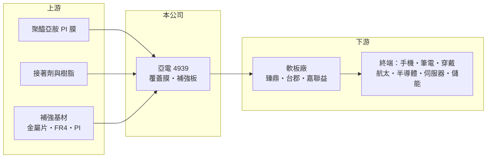

# 4939 亞電

> 上櫃｜[[產業索引-電子零組件業|電子零組件業]]｜上市（櫃）日期 2011/09/19

# 第一章：企業模式與商業藍圖

> [!info] 撰寫說明
> 精簡版，由 Claude 依公開資料整理，架構比照 [[2330台積電]]，資料截至 2026-10-08。來源：櫃買中心開放資料（基本資料、2026 年第二季資產負債與綜合損益、股利）、Goodinfo 經營績效頁、聯合新聞網 2026 年 1 月報導。公開資料有限，產品比重、生產據點與客戶未查得。#待校對

亞洲電材（亞電）是 [[軟板]] 的材料供應商，主力是保護與支撐軟板線路的覆蓋膜與補強板；它的長期課題是從消費性電子的材料，走向航太、半導體與伺服器等高階應用。

- **核心業務：** 依 2026 年報導，亞電的產品結構以 [[覆蓋膜]] 與補強板為主力。覆蓋膜貼在軟板線路表面，負責絕緣與保護；補強板則貼在軟板需要插接或承重的位置，增加局部硬度。這兩項都是軟板製造不可缺少的材料，需求量跟著手機、筆電、穿戴裝置等軟板用量起伏（是否也生產軟性 [[銅箔基板]] 待校對）。
- **商業模式：** 材料業的特性是產品需通過軟板廠與終端品牌的雙重認證，一旦導入，同一機種的生命週期內很少更換，但每一代新機都要重新競爭。毛利率高低取決於配方技術與產品規格，高階材料毛利遠高於通用規格。
- **營運據點：** 公司設於台灣，2011 年上櫃，實收資本額約 9.8 億元；主要生產基地的地點與產能未查得（推估與兩岸軟板聚落相鄰，待校對）。2026 年報導提到公司採取控管出貨、提前處理風險的策略，以降低單一市場與客戶回款的不確定性。
- **長期方向：** 2026 年公司表示營運重心轉向高階應用，持續投入航太與半導體相關軟板材料的開發與升級，並擴大伺服器、儲能等應用。這個方向若成功，可以讓亞電擺脫消費性電子材料的價格競爭，提高產品單價與毛利率。

# 第二章：護城河深度與競爭優勢

亞電的護城河主要是材料配方與客戶認證，但面對日本與中國的大型材料廠，規模劣勢明顯。

- **競爭優勢：** 軟板材料必須在耐熱、尺寸穩定、接著力與電氣特性上符合嚴格規格，配方與製程經驗需要長時間累積。通過大型軟板廠認證後，材料供應商會跟著客戶的量產機種長期出貨，形成一定的黏著度。
- **主要對手：** 台灣軟板材料同業包括 [[8039台虹]]、3354律勝、[[3645達邁]] 等，國際上則有日本與韓國的材料大廠，以及快速擴產的中國材料廠。台虹在軟性銅箔基板與覆蓋膜的規模遠大於亞電，亞電屬於利基型的小規模供應商。
- **觀察重點：** 第一是高階應用材料能否放量，反映在毛利率能否穩定高於 25%（2026 年上半年約 27%）。第二是航太、半導體與伺服器相關營收的比重。第三是營業利益率能否回到 2020 至 2021 年 12% 至 13% 的水準。

# 第三章：財務體質與盈利規模

資料日期：2026-10-08，表格是撰寫當時的快照；最新月營收、毛利率、累計 EPS 由自動排程寫在本筆記的屬性欄位（月營收、毛利率、累計EPS 等）。#待校對

亞電的財務走勢是 2022 年後獲利明顯下滑、2025 年轉為小幅虧損，2026 年上半年才重新轉盈。

| 年度 | 營收（億元） | [[毛利率]] | [[營業利益率]] | EPS（元） | [[ROE]] |
|---|---|---|---|---|---|
| 2020 | 17.4 | 26.9% | 12.0% | 1.61 | 10.6% |
| 2021 | 19.6 | 27.8% | 13.4% | 1.76 | 10.9% |
| 2022 | 16.5 | 21.9% | 6.87% | 0.35 | 2.18% |
| 2023 | 15.5 | 21.9% | 5.27% | 0.37 | 2.37% |
| 2024 | 15.4 | 21.1% | 2.28% | 0.19 | 1.24% |
| 2025 | 14.2 | 21.7% | -1.01% | -0.43 | -2.92% |
| 2026 上半年 | 7.49 | 27.3% | 7.0% | 0.53 | 半年，不年化 |

（2020 至 2025 年取自 Goodinfo；2026 上半年依櫃買中心第二季綜合損益計算。）

- **營收規模：** 2020 至 2025 年營收由 17.4 億元降到 14.2 億元，年複合成長率約 -4.0%，2021 年 19.6 億元是近年高峰，此後連續四年下滑，反映消費性電子軟板需求疲弱與材料價格競爭。
- **獲利：** 毛利率由 27% 至 28% 降到 21% 至 22%，營業利益率由 13% 一路降到 2025 年的 -1%，EPS 由 1.76 元降到 -0.43 元。2026 年上半年毛利率回到 27.3%、營益率 7.0%，EPS 0.53 元，顯示高階產品與產能調度帶來改善，但仍需觀察能否延續。
- **股利與財務：** 近五年（2021 至 2025）平均 ROE 約 2.8%。最近一次現金股利為每股 0.25 元（所屬年度未區分）。2026 年第二季底總資產 30.3 億元、負債 15.1 億元、權益 15.2 億元，負債比約 50%，每股淨值 15.45 元，無非控制權益。
- **[[ROIC]] 與 [[WACC]]：** 有息負債未查得，以股東權益近似投入資本。2025 年營業利益為負，ROIC 約 -0.7%（推算）；以 2026 上半年營業利益 0.53 億元年化，稅後約 0.84 億元，除以權益 15.2 億元，ROIC 約 5.5%（推算）。WACC 以 CAPM 推估：無風險利率 1.75%、市場風險溢酬 6%、β 取電子材料常見值 1.1，股權成本約 8.4%；負債成本假設 2.5%、負債約占三成至四成，WACC 約 6.5% 至 7%（推算）。2022 年以來 ROIC 持續低於 WACC，代表近年並未創造價值；2026 年的改善若能把 ROIC 推回 8% 以上，才算回到 2020 至 2021 年的價值創造水準。

# 第四章：總體風險與地緣政治

亞電的風險在於消費性電子需求、材料價格競爭，以及小規模公司轉型高階材料的執行力。

- **產業週期：** 軟板材料需求跟著手機、筆電與穿戴裝置的出貨與設計變化，當品牌減少軟板用量或庫存調整時，材料廠會先受衝擊。2022 至 2025 年營收連續下滑，就是消費性電子低迷的反映。
- **競爭風險：** 中國材料廠持續擴產並以價格搶單，日本與台灣大廠則在高階規格占優勢，亞電夾在中間，若高階轉型不順，可能長期停留在低毛利的通用規格市場。
- **營運風險：** 航太與半導體材料的認證週期長、客戶少，前期研發投入大，貢獻營收的速度可能慢於預期。報導提到公司控管出貨以降低客戶回款風險，顯示應收帳款品質是需要留意的面向。
- **其他風險：** 聚醯亞胺（PI）膜、接著劑與銅箔等原料價格波動會影響成本；匯率變化與兩岸政策也會影響客戶布局與接單。

# 專有名詞解析

## 金融

- **[[ROIC]]**：投入資本報酬率，衡量公司運用股東與債權人資金創造營業利潤的效率。
- **[[WACC]]**：加權平均資金成本，是股權與債權資金成本依資本結構加權後的平均值。

## 產業

- **[[軟板]]**：可彎曲的印刷電路板，用於手機、筆電、穿戴裝置等需要折彎或空間受限的位置。
- **[[覆蓋膜]]**：貼在軟板線路表面的絕緣保護膜，多以聚醯亞胺與接著劑製成。
- **[[銅箔基板]]**：由銅箔、玻纖布與樹脂壓合而成的板材，是 PCB 的主要原料。

# 核心供應鏈

- 上游：聚醯亞胺膜、接著劑、補強用金屬片與基材供應商，PI 膜廠如 [[3645達邁]]（亞電實際採購對象未查得）。
- 下游／客戶：軟板廠 [[4958臻鼎-KY]]、[[6269台郡]]、[[6153嘉聯益]] 等（是否為亞電客戶未查得，列為產業下游參考），終端為手機、筆電、穿戴、航太、半導體、伺服器與儲能。
- 同業：[[8039台虹]]、3354律勝、[[3645達邁]]。

## 最新新聞
<!-- news:start -->
<!-- news:end -->

## 相關連結
- [公開資訊觀測站](https://mopsov.twse.com.tw/mops/web/t05st03?step=1&firstin=1&co_id=4939)
- [Goodinfo](https://goodinfo.tw/tw/StockDetail.asp?STOCK_ID=4939)
- [Yahoo 股市](https://tw.stock.yahoo.com/quote/4939)
- [鉅亨網新聞](https://www.cnyes.com/twstock/4939/news)
