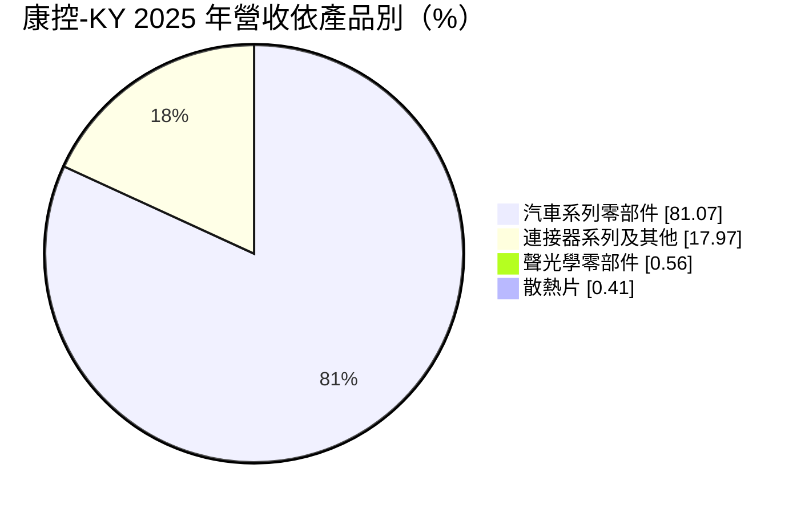
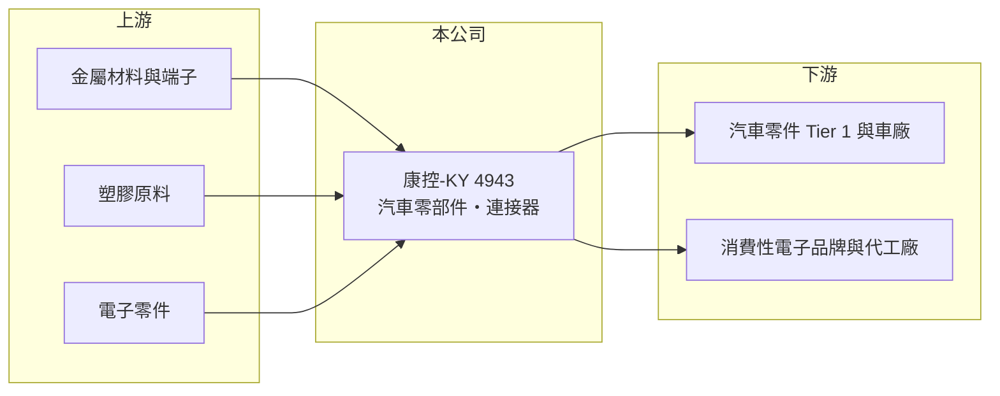

# 4943 康控-KY

> 上市｜[[產業索引-電子零組件業|電子零組件業]]｜上市（櫃）日期 2016/11/11

# 第一章：企業模式與商業藍圖

> [!info] 撰寫說明
> 精簡版，由 Claude 依公開資料整理，架構比照 [[2330台積電]]，資料截至 2026-10-08。來源：證交所開放資料（基本資料、2026 年第二季資產負債與綜合損益、股利）、Goodinfo 經營績效頁、富邦 eBroker（MoneyDJ 資料）基本資料頁 2025 年營收比重、科技新報月營收報導。公開資料有限，具體產品、客戶與生產據點未查得，歷史沿革憑記憶整理。#待校對

康控-KY 是一家正在劇烈轉型、財務極度吃緊的公司：營收已由消費性電子零件轉為以汽車零部件為主，但本業連年虧損，股東權益幾乎耗盡。

- **核心業務：** 依 2025 年營收比重，康控的產品以汽車系列零部件為主，占 81.07%；連接器系列及其他占 17.97%；聲光學零部件與散熱片合計不到 1%。這與公司早年以筆電、手機等消費性電子的[[連接器]]與聲學零件為主的結構差異很大（早期產品結構憑記憶，待校對），代表它已把重心移往 [[車用電子]] 與汽車零件市場。
- **營收結構：**

- **營運據點：** 康控為開曼註冊的控股公司（KY 股），2016 年在台上市，營運主體與生產基地主要位於中國大陸（具體廠區與汽車零部件的產品類型未查得，待校對）。KY 公司的資訊揭露多以集團合併報表呈現，外部投資人能取得的營運細節相對有限。
- **長期方向：** 汽車零件的訂單通常隨車型專案取得，生命週期 4 至 7 年，比消費性電子更穩定。康控 2026 年前八個月營收年增約 47%，顯示新業務在擴大，但同時期仍是負毛利，代表轉型初期的成本、良率或定價問題尚未解決。公司長期能否存續，取決於汽車零件業務能否在資本耗盡前轉為正毛利。

# 第二章：護城河深度與競爭優勢

康控目前很難說有明確的護城河；汽車零件業務若能站穩，車規認證帶來的客戶黏著度會是未來可能的優勢。

- **競爭優勢：** 汽車零部件需要通過 IATF 16949 品質系統與車廠的零件認證（PPAP），一旦進入某個車型的供應名單，通常會供貨到車型停產。康控把八成營收移到汽車零件，表示它已取得部分車型專案，這是消費性電子業務所沒有的穩定性。
- **主要對手：** 汽車零部件市場競爭者眾多，中國本土零組件廠在成本與在地服務上具優勢；台灣車用零件與線束廠如 [[6279胡連]]、[[3023信邦]]、[[1536和大]] 等，則在品質與海外客戶上更成熟。連接器業務則面對大量中國同業，價格競爭激烈。
- **觀察重點：** 第一是毛利率何時由負轉正，2025 年與 2026 年上半年毛利率都在 -3% 至 -6%。第二是營收成長能否帶來規模經濟，讓固定成本被攤提。第三是公司如何補強幾乎耗盡的股東權益，包括增資、引進策略投資人或處分資產。

# 第三章：財務體質與盈利規模

資料日期：2026-10-08，表格是撰寫當時的快照；最新月營收、毛利率、累計 EPS 由自動排程寫在本筆記的屬性欄位（月營收、毛利率、累計EPS 等）。#待校對

康控的財務在 2021 年後大幅惡化，營收縮水六成以上，五年連續虧損，權益已接近零。

| 年度 | 營收（億元） | [[毛利率]] | [[營業利益率]] | EPS（元） | [[ROE]] |
|---|---|---|---|---|---|
| 2020 | 43.0 | 24.9% | -0.9% | -0.93 | -3.52% |
| 2021 | 32.7 | -2.46% | -115% | -24.11 | -119% |
| 2022 | 17.8 | -34.9% | -77.9% | -8.23 | -183% |
| 2023 | 16.8 | -1.69% | -24.6% | -2.84 | -188% |
| 2024 | 15.2 | -3.70% | -28.6% | -1.24 | -53.4% |
| 2025 | 16.9 | -3.01% | -25.8% | -1.88 | -78.2% |
| 2026 上半年 | 11.1 | -5.8% | -24.1% | -1.34 | 半年，不年化 |

（2020 至 2025 年取自 Goodinfo；2026 上半年依證交所第二季綜合損益計算。2021 年的大額虧損可能包含資產減損等一次性項目，未查得明細。）

- **營收規模：** 2020 至 2025 年營收由 43.0 億元降到 16.9 億元，年複合成長率約 -17%。2026 年上半年營收 11.1 億元，已接近 2024 年全年的七成，新業務帶來營收回升。
- **獲利：** 2021 年起毛利率持續為負，營業利益率長期在 -25% 左右，代表即使不計管銷費用，產品售價也不足以支應生產成本。ROE 數字因權益極低而失去比較意義（-50% 至 -190%）。
- **財務結構：** 2026 年第二季底總資產 31.8 億元、負債 30.8 億元，負債比約 97%；權益總計僅 1.05 億元，其中歸屬母公司權益 0.42 億元，保留盈餘為 -12.4 億元的 [[累積虧損]]，每股淨值 0.33 元。流動負債 26.6 億元遠高於流動資產 15.2 億元，短期償債壓力大。2025 年度未發放股利。
- **[[ROIC]] 與 [[WACC]]：** 2025 年營業損失約 16.9 億 × -25.8% ≈ -4.4 億元，ROIC 為大幅負值（推算）；有息負債未查得，但以權益加非流動負債（1.05 億＋4.1 億）作為投入資本的下限估計，ROIC 遠低於 -50%（推算）。WACC 以 CAPM 推估：無風險利率 1.75%、市場風險溢酬 6%，β 假設 1.5（虧損且高槓桿），股權成本約 10.8%；負債成本假設 4%，在權益幾近為零的情況下，WACC 主要由負債成本決定，約 4% 至 5%（推算，實際財務風險遠高於此數字所示）。ROIC 長期遠低於 WACC，代表過去五年持續大幅毀損價值，公司目前的首要課題是存續而非價值創造。

# 第四章：總體風險與地緣政治

康控最大的風險是財務存續風險，其次才是汽車零件轉型能否成功。

- **財務存續風險：** 權益只剩約 1 億元、每股淨值 0.33 元，若再虧損，權益可能轉為負值。依台灣證券市場規定，每股淨值過低或轉負的公司可能被調整信用交易資格或變更為 [[全額交割股]]（實際適用條件待校對）。流動負債遠大於流動資產，若銀行抽緊銀根，可能出現資金缺口。
- **產業週期：** 汽車零件需求跟著車市景氣與車型專案起伏，中國車市價格戰激烈，車廠持續要求供應商降價，這可能是康控毛利率難以轉正的原因之一（推估）。
- **營運風險：** 營收高度集中在汽車零部件，若主要車型銷售不如預期或專案結束，營收會快速下滑。負毛利代表生產效率、良率或報價有結構性問題，需要時間調整。
- **其他風險：** KY 公司的資訊透明度與公司治理需特別留意；人民幣匯率、中國地方政策與美中關係，也會影響營運與資金調度。

# 專有名詞解析

## 應用

- **[[車用電子]]**：汽車上使用的電子系統與零組件，例如駕駛輔助、車載攝影與影音系統。

## 金融

- **[[累積虧損]]**：公司歷年虧損累積超過盈餘後，在資產負債表保留盈餘欄出現的負數。
- **[[全額交割股]]**：因財務或其他問題被主管機關限制，買賣時須先付款或交券才能成交的股票。
- **[[ROIC]]**：投入資本報酬率，衡量公司運用股東與債權人資金創造營業利潤的效率。
- **[[WACC]]**：加權平均資金成本，是股權與債權資金成本依資本結構加權後的平均值。

## 產業

- **[[連接器]]**：讓電子零件或設備之間可插拔連接、傳輸電力與訊號的元件。

# 核心供應鏈

- 上游：金屬材料、端子、塑膠原料與電子零件供應商（未查得具名廠商）。
- 下游／客戶：汽車零件 Tier 1 與車廠、消費性電子品牌與代工廠（具名客戶未查得）。
- 同業：[[6279胡連]]、[[3023信邦]]、[[1536和大]]，以及中國本土汽車零部件與連接器廠。

## 最新新聞
<!-- news:start -->
<!-- news:end -->

## 相關連結
- [公開資訊觀測站](https://mopsov.twse.com.tw/mops/web/t05st03?step=1&firstin=1&co_id=4943)
- [Goodinfo](https://goodinfo.tw/tw/StockDetail.asp?STOCK_ID=4943)
- [Yahoo 股市](https://tw.stock.yahoo.com/quote/4943)
- [鉅亨網新聞](https://www.cnyes.com/twstock/4943/news)
