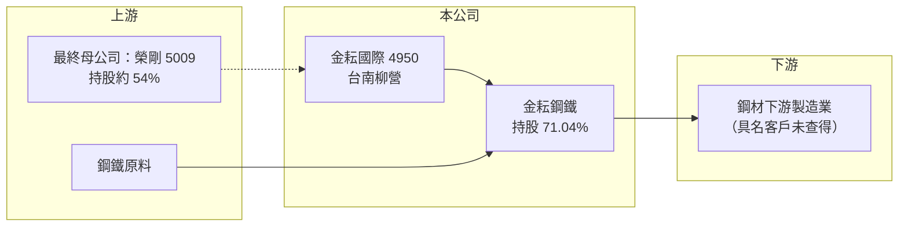

# 4950 金耘國際

> 上櫃｜[[產業索引-鋼鐵工業|鋼鐵工業]]｜上市（櫃）日期 2012/04/27

# 第一章：企業模式與商業藍圖

> [!info] 撰寫說明
> 精簡版，由 Claude 依公開資料整理，架構比照 [[2330台積電]]，資料截至 2026-10-08。來源：MoneyDJ 理財網財務比率年表（2020 至 2025 年）與季表；nStock 公司沿革（前身、更名、轉型與股權變動）；櫃買中心開放資料快照（基本資料、2026 年上半年資產負債與損益、2026 年 8 月營收說明、本益比淨值比）。子公司金耘鋼鐵的產品與產能未查得，公開資料有限。#待校對

金耘國際的前身是觸控面板廠牧東光電，成立於 2008 年 10 月，2012 年 4 月在櫃買中心掛牌。經過多年虧損與業務轉換，2024 年 9 月起 [[5009榮剛]] 成為最終母公司（持股約 54%），2025 年 2 月完成更名為金耘國際，目前透過子公司金耘鋼鐵經營鋼鐵事業，總部位於台南柳營。理解這家公司，重點在於它已經是一家「換了骨架」的新公司，過去的財務紀錄參考價值有限。

- **核心業務：** 公司登記的營業項目包括不銹鋼製品與觸控面板，但觸控面板相關營運已在 2023 年 6 月暫停（nStock 整理公司財報附註）。2024 年 10 月至 2025 年 7 月陸續取得金耘鋼鐵股權，截至 2026 年 6 月底持股 71.04%，金耘鋼鐵成為主要營運來源；金耘鋼鐵的具體產品與產能未查得。
- **營收結構：** 產品別營收比重未查得。2025 年全年營收約 10.2 億元（nStock），2026 年 1 至 8 月營收 8.9 億元、年增約 29%，櫃買中心營收說明寫的是「市場需求回溫」。
- **營運據點：** 總部位於台南市柳營區（櫃買基本資料）。原本的不銹鋼製品子公司四合，2017 年由上海遷到江蘇南通，2023 年再遷到河南南陽；2025 年 2 月公司出售 Honest Mount Investments 與四合創新全部股權，中國不銹鋼製品業務不再納入合併報表（nStock）。
- **長期方向：** 公司的定位已變成榮剛集團在鋼鐵材料上的延伸平台。長期價值取決於金耘鋼鐵的產品能否與榮剛的特殊鋼形成互補，以及母公司是否會持續注入資源或業務，這些安排目前公開資訊有限。

# 第二章：護城河深度與競爭優勢

金耘國際目前沒有明確的獨立護城河，競爭力主要來自榮剛集團的技術、客戶與財務支持。

- **競爭優勢：** 作為榮剛子公司，金耘可以共享母公司的冶金技術、採購規模與客戶網路，這是一般小型鋼鐵加工廠沒有的資源。2026 年上半年毛利率回升到約 19%、營業利益率約 10%（櫃買資料推算），顯示新事業已開始有獲利能力。
- **主要對手：** 因金耘鋼鐵的產品未查得，具體對手無法確認。若以鋼鐵材料加工來看，國內同業包括特殊鋼與棒線材業者，例如 [[2015豐興]]、[[2017官田鋼]] 等（對手判斷為推估）。
- **觀察重點：** 過去五年有四年虧損，2023 年 ROE 低到 -97.7%（MoneyDJ），轉型前的財務紀錄很差。長期要看金耘鋼鐵的營收與獲利能否穩定數年，以及公司是否與母公司之間存在大量關係人交易，這會影響獲利的獨立性與小股東權益。

# 第三章：財務體質與盈利規模

資料日期：2026-10-08，表格是撰寫當時的快照；最新月營收、毛利率、累計 EPS 由自動排程寫在本筆記的屬性欄位（月營收、毛利率、累計EPS 等）。#待校對

金耘國際的歷史財務分成兩段：2024 年以前是觸控面板與不銹鋼製品的長期虧損，2025 年起併入金耘鋼鐵後轉為小幅獲利，比較時要留意營運主體已經改變。

| 年度 | 營收（億元） | [[毛利率]] | [[營業利益率]] | EPS（元） | [[ROE]] |
|---|---|---|---|---|---|
| 2021 | 未查得 | 21.64% | 3.17% | 0.49 | 6.73% |
| 2022 | 未查得 | -5.68% | -94.09% | -1.38 | -20.13% |
| 2023 | 未查得 | -83.24% | -256.75% | -4.05 | -97.74% |
| 2024 | 未查得 | 9.80% | -14.66% | -0.89 | -10.38% |
| 2025 | 約 10.2 | 16.13% | 3.88% | -0.36 | 0.72% |

股本歷經私募等變動，早年營收無法用每股營業額可靠推算，故寫未查得。

- **長期指標：** 2021 至 2025 年平均 ROE 約 -24%（推算），每股淨值由 2020 年的 6.9 元降到 2023 年的 2.15 元，2025 年回升到 9.01 元（MoneyDJ），反映私募增資與新事業併入。近年沒有配發股利（櫃買資料），長期營收成長率因營運主體改變不具比較意義。
- **[[ROIC]] 與 [[WACC]]：** 2025 年營業利益約 0.39 億元（營收約 10.2 億元 × 3.88%），稅後約 0.32 億元。投入資本以 2026 年第二季權益總計 7.6 億元，加上有息負債推估約 2.8 億元（負債總計 5.7 億元的一半，官方快照未拆分）計算，2025 年 ROIC 約 3%（推算）；2026 年上半年營業利益 0.64 億元，年化 ROIC 約 10%（推算）。WACC 約 6.2%（推算：無風險利率 1.75%、市場風險溢酬 6%、β 取鋼鐵同業常見值 0.9，股東權益成本 7.15%；稅前負債成本 2.5%、稅率 20%，以市值約 12 億元與有息負債約 2.8 億元計算權重約 81：19）。2025 年 ROIC 低於 WACC，2026 年上半年首度明顯高於門檻，但新事業只有一年多的紀錄，還不能視為長期創造價值。權益總計含非控制權益（金耘鋼鐵另有 29% 外部股東），歸屬母公司的報酬會再打折。
- **財務特色：** 2026 年第二季總資產 13.3 億元、負債 5.7 億元，負債比率約 43%，每股淨值 9.60 元，仍略低於面額。2026 年上半年營收 6.4 億元、EPS 0.64 元（櫃買資料）。

# 第四章：總體風險與地緣政治

金耘國際的風險在於轉型初期的不確定性、對母公司的依賴，以及鋼鐵本業的景氣循環。

- **產業週期：** 金耘鋼鐵的營收受鋼材價格與下游需求影響，2026 年營收成長主要來自市場需求回溫（櫃買資料），景氣反轉時營收與毛利率可能同步下滑。鋼價下跌期間，存貨可能需要提列[[存貨跌價損失]]。
- **營運風險：** 新事業規模小、歷史短，獲利能否持續尚待驗證。公司與榮剛集團之間的業務往來若比重高，[[關係人交易]]的定價會直接影響獲利，小股東需要留意資訊揭露是否充分。
- **其他風險：** 公司過去曾有私募繳款未完成、與獨立董事的訴訟等治理事件（2023 年 10 月公告，nStock），反映舊經營時期的治理問題；新經營團隊上任後的治理改善程度是長期觀察重點。股本與子公司結構變動頻繁，也增加財報比較的難度。

# 專有名詞解析

## 金融

- **[[關係人交易]]**：公司與母公司、子公司或董監事等有控制或重大影響關係的對象之間的交易，定價是否公允會影響小股東權益。
- **[[存貨跌價損失]]**：存貨的市價低於帳面成本時，依會計規定須認列的損失，會直接壓低毛利率。
- **[[ROIC]]**：投入資本報酬率，稅後營業利益除以股東權益加有息負債，衡量本業運用資本的效率。
- **[[WACC]]**：加權平均資金成本，股東與債權人要求報酬率的加權平均，是 ROIC 要超越的門檻。

# 核心供應鏈

- 上游：鋼鐵原料（具名供應商未查得）；最終母公司 [[5009榮剛]] 提供集團資源。
- 下游／客戶：鋼材下游製造業（具名客戶未查得）。
- 同業：國內鋼鐵材料加工業者（具體對手未查得）。

## 最新新聞
<!-- news:start -->
<!-- news:end -->

## 相關連結
- [公開資訊觀測站](https://mopsov.twse.com.tw/mops/web/t05st03?step=1&firstin=1&co_id=4950)
- [Goodinfo](https://goodinfo.tw/tw/StockDetail.asp?STOCK_ID=4950)
- [Yahoo 股市](https://tw.stock.yahoo.com/quote/4950)
- [鉅亨網新聞](https://www.cnyes.com/twstock/4950/news)
