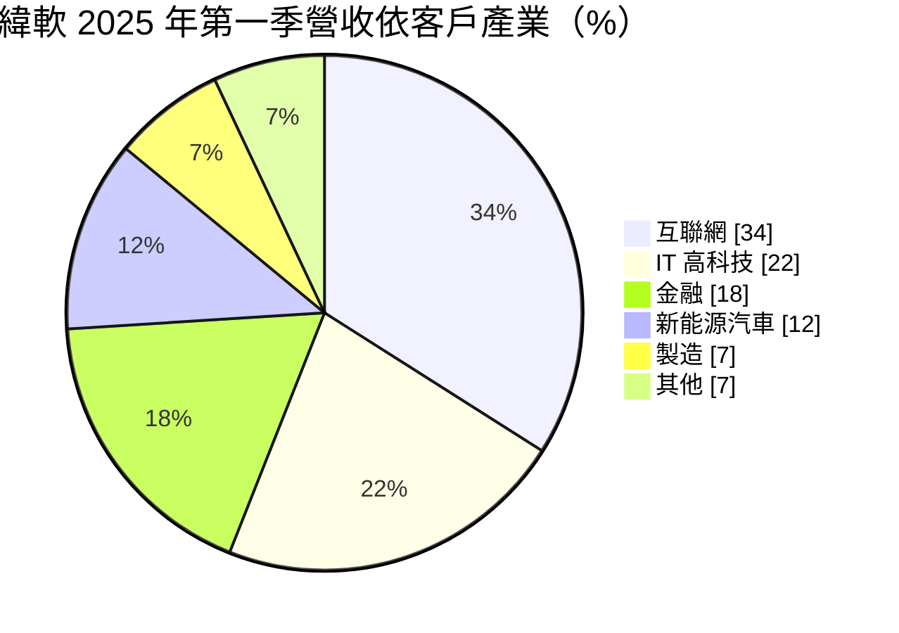
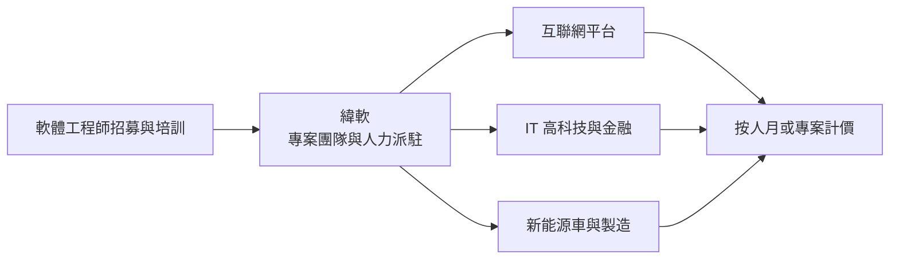
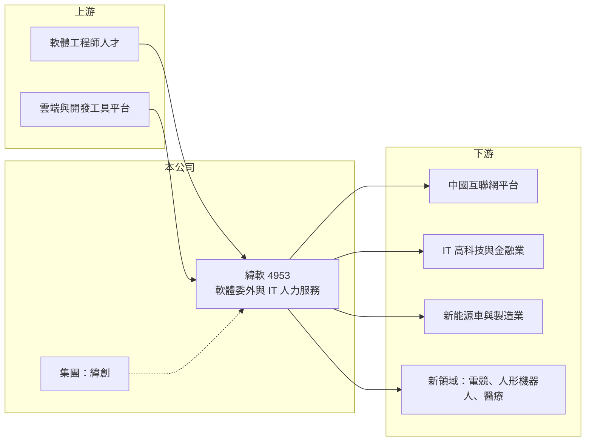

# 4953 緯軟

> 上櫃｜[[產業索引-資訊服務業|資訊服務業]]｜上市（櫃）日期 2014/01/08

# 第一章：企業模式與商業藍圖

> [!info] 撰寫說明
> 精簡版，由 Claude 依公開資料整理，架構比照 [[2330台積電]] 的四章研究，資料截至 2026-10-08。來源：自由時報財經 2025 年 5 月法說會報導（客戶產業別、地區別、新領域）、Goodinfo 年度經營績效頁、櫃買中心開放資料（基本資料、2026 年第二季資產負債與綜合損益、每月營收、本益比殖利率）。櫃買中心 2026 年 10 月開放資料的公司簡稱已為「緯致」，更名時間與原因未查得；與緯創集團的關係、服務型態依記憶整理。#待校對

緯軟是緯創集團旗下的 IT 服務公司，以中國網路業者為主要客戶，本章說明它以軟體工程人力為核心的委外服務模式，以及這種模式的規模邏輯與限制。

## 一、核心定位：大型客戶的軟體委外夥伴

- **核心業務：** 緯軟定位為 IT 服務商（自由時報財經），主要替大型網路平台、科技公司、金融機構與車廠提供軟體開發、測試、維運與 IT 人力支援，也就是[[IT委外]]服務（服務型態依記憶整理，待校對）。客戶把非核心或需要大量人力的軟體工作交給緯軟，以彈性調整人力、降低固定成本。
- **公司背景：** 緯軟成立於 1992 年、2014 年上櫃，董事長兼總經理為蕭清志，實收資本額約 7.43 億元（櫃買中心開放資料）。公司源自緯創資通的軟體部門，屬於 [[3231緯創]] 集團（依記憶整理，待校對）。櫃買中心 2026 年 10 月的資料中，公司簡稱已改為「緯致」（櫃買中心開放資料），代表公司名稱已有調整，詳細時間待校對。
- **客戶產業分布：** 2025 年第一季營收依客戶產業如下（自由時報財經）：

- **地區分布：** 中國市場約占七成，日本約 7%，美國比重更小（自由時報財經）。也就是說，緯軟本質上是一家以中國軟體人力市場為主的公司，營收與中國網路與科技產業的景氣高度相關。

## 二、資本轉化邏輯：人力規模就是營收規模

IT 委外服務多以「人月」或專案計價，營收規模大致等於工程師人數乘以每人的計費單價。好處是不需要大量資本設備，成長時只要招募與培訓更多工程師；壞處是毛利率受人力成本與客戶議價擠壓，緯軟的[[毛利率]]由 2020 年的 25.8% 降到 2025 年的 16.6%（Goodinfo）。員工人數與[[人均產值]]公開資料未查得，但這兩個指標是判斷這類公司效率的核心。

## 三、長期方向

公司把互聯網、新能源車等既有業務視為第一成長曲線，把電競、[[人形機器人]]與醫療健康視為第二成長曲線，並積極切入 AI 商機；新領域的需求量體與客戶數較少，但毛利率較好（自由時報財經）。2025 年時人形機器人客戶有 3 家、電競客戶 20 家以下（自由時報財經），仍在早期階段。

# 第二章：護城河深度與競爭優勢

本章分析緯軟的競爭優勢，以及軟體委外產業的限制。

## 一、競爭優勢

- **大客戶的長期合作：** 大型網路平台與金融機構選擇委外夥伴時，重視交付品質、資安管理與能否快速調度大量人力。緯軟長期服務大型客戶，已進入其供應商名單，新進者需要時間累積實績。
- **集團背景：** 緯創集團的製造業與跨國營運經驗，讓緯軟在服務製造業、電動車與硬體相關軟體時有領域知識優勢（推估）。
- **限制：** 軟體委外的差異化有限，客戶可以同時找多家供應商比價，議價力偏向客戶端；毛利率長期下滑就是議價力不足的反映。

## 二、主要對手

| 對手 | 定位 | 與緯軟的比較 |
|---|---|---|
| 中國大型 IT 外包商（中軟國際、軟通動力等） | 中國軟體委外龍頭 | 規模遠大於緯軟，在中國網路客戶上直接競爭 |
| 印度 IT 服務商（Infosys、TCS 等） | 全球 IT 外包 | 在跨國企業與日本市場競爭 |
| [[6214精誠]] | 台灣資訊服務集團 | 在台灣與金融客戶部分重疊 |
| 客戶內部研發團隊 | 自建人力 | 客戶縮減委外、改為內部開發時直接替代 |

## 三、觀察重點

- **中國網路產業景氣：** 互聯網客戶占三成以上，中國平台業者的人力預算是營收最大的變數。
- **新領域的毛利貢獻：** 人形機器人、電競與醫療等新領域毛利較好，若比重能提高，可扭轉毛利率下滑趨勢。
- **AI 對委外需求的影響：** AI 程式輔助工具提高開發效率，可能減少客戶對基礎人力的需求，也可能創造新的 AI 導入專案，這是長期的雙面變數。

# 第三章：財務體質與盈利規模

資料日期：2026-10-08，表格是撰寫當時的快照；最新月營收、毛利率、累計 EPS 由自動排程寫在本筆記的屬性欄位（月營收、毛利率、累計EPS 等）。#待校對

本章用多年度數據檢視緯軟在規模擴張與毛利率下滑之間的取捨，以及資本報酬。

## 一、多年度三率與 ROE

| 年度 | 營收（新台幣） | [[毛利率]] | [[營業利益率]] | EPS（元） | [[ROE]] |
|---|---|---|---|---|---|
| 2020 | 51.0 億 | 25.8% | 9.5% | 7.06 | 21.0% |
| 2021 | 61.8 億 | 23.3% | 7.44% | 6.91 | 19.0% |
| 2022 | 79.5 億 | 21.1% | 7.08% | 8.33 | 21.1% |
| 2023 | 88.4 億 | 20.0% | 6.86% | 8.49 | 18.6% |
| 2024 | 103 億 | 17.1% | 4.52% | 6.25 | 12.4% |
| 2025 | 116 億 | 16.6% | 6.1% | 8.45 | 15.5% |
| 2026 上半年 | 70.2 億 | 14.61% | 6.01% | 4.88 | 未查得 |

註：2020 至 2025 年取自 Goodinfo；2026 上半年依櫃買中心綜合損益推算。

- **營收成長：** 2020 至 2025 年營收年複合成長率約 17.9%（推算），2026 年 1 至 8 月累計營收約 95.4 億元、年增約 30.7%（櫃買中心每月營收）。
- **毛利率下滑：** 營收翻倍的同時，毛利率下降約 9 個百分點，2024 年營業利益率一度降到 4.52%，顯示規模成長是以價格讓步換來的。
- **ROE：** 2021 至 2025 年平均 ROE 約 17.3%（推算），但趨勢由 20% 左右降到 12% 至 16%。

## 二、股利與財務結構

最近一次現金股利約 5.14 元（櫃買中心本益比殖利率資料），以 2025 年 EPS 8.45 元計算配發率約 61%（推算）。2026 年第二季底權益約 40.9 億元、總負債約 26.7 億元，其中流動負債約 25.2 億元、非流動負債約 1.5 億元；流動資產約 58.4 億元（櫃買中心資產負債）。流動負債推估以應付薪資與應付帳款為主（推估），應收帳款的回收速度是這類公司的重要財務指標。

## 三、[[ROIC]] 與 [[WACC]]

**ROIC 推算：** 2025 年營業利益約 116 億元 × 6.1% ≈ 7.08 億元，扣除 20% 稅後約 5.66 億元（實際稅率依中國子公司稅制而定）。投入資本以權益 40.9 億元加上非流動負債 1.5 億元計算，約 42.4 億元，ROIC 約 13.3%（推算）。

**WACC 推算：** 公債殖利率 1.75%、市場風險溢酬 6%、β 取 IT 服務股常見值 0.8，權益成本約 6.55%；有息負債很少，WACC 約 6.5%（推算）。考量營收集中在中國，若另加國家風險溢酬，WACC 可能提高到 7% 至 8%（推估）。

**結論：** ROIC 約 13%，高於約 6.5% 至 8% 的 WACC，代表緯軟仍在創造價值，但利差已較 2020 至 2022 年縮小。新領域的高毛利業務能否放大，決定利差能否回升。

# 第四章：總體風險與地緣政治

本章整理緯軟長期面對的地緣政治、產業與營運風險。

## 一、地緣政治風險

- **中國市場集中：** 約七成營收來自中國，兩岸關係、美中科技競爭與中國對外資企業的政策變化，都可能影響客戶關係與營運。
- **資料與資安法規：** 中國的資料安全與個資法規趨嚴，軟體委外需要符合更高的合規要求。

## 二、產業週期與結構風險

- **網路產業景氣：** 中國平台業者在監管與成長放緩時會縮減人力預算，委外需求首當其衝。
- **價格壓力：** 軟體委外競爭者眾多，客戶議價力強，毛利率長期承壓。
- **AI 替代：** AI 程式生成工具普及後，基礎開發與測試的人力需求可能減少，公司需要轉向更高附加價值的服務。

## 三、營運風險

- **人力成本與流動率：** 工程師薪資上漲與高流動率，會推升招募與培訓成本。
- **匯率：** 營收以人民幣為主，人民幣對新台幣的匯率波動會影響換算後的營收與獲利。

# 專有名詞解析

## 應用

- **[[IT委外]]**：企業把軟體開發、測試或系統維運交給外部廠商執行，以彈性調整人力、降低固定成本。
- **[[人形機器人]]**：外型與動作模仿人類的機器人，需要大量感測、控制與 AI 軟體開發。

## 金融

- **[[人均產值]]**：營收除以員工人數，用來衡量人力密集型服務業的經營效率。
- **[[ROIC]]**：投入資本報酬率，衡量企業用股東與債權人投入的資本，每年能產生多少稅後營業利益。
- **[[WACC]]**：加權平均資金成本，股東要求報酬與負債利息依資本結構加權後的平均值，是判斷是否創造價值的門檻。

# 核心供應鏈

- 上游：軟體工程師人才市場；雲端與開發工具平台，例如 [[MSFT微軟]]、[[AMZN亞馬遜]]（產業代表，非指名合作對象）。
- 下游／客戶：中國互聯網平台、IT 高科技、金融、新能源車與製造業客戶；集團關係企業 [[3231緯創]]、[[6669緯穎]]（待校對）。
- 同業：中軟國際、軟通動力、印度 IT 服務商，以及 [[6214精誠]]。

## 最新新聞
<!-- news:start -->
<!-- news:end -->

## 相關連結
- [公開資訊觀測站](https://mopsov.twse.com.tw/mops/web/t05st03?step=1&firstin=1&co_id=4953)
- [Goodinfo](https://goodinfo.tw/tw/StockDetail.asp?STOCK_ID=4953)
- [Yahoo 股市](https://tw.stock.yahoo.com/quote/4953)
- [鉅亨網新聞](https://www.cnyes.com/twstock/4953/news)
