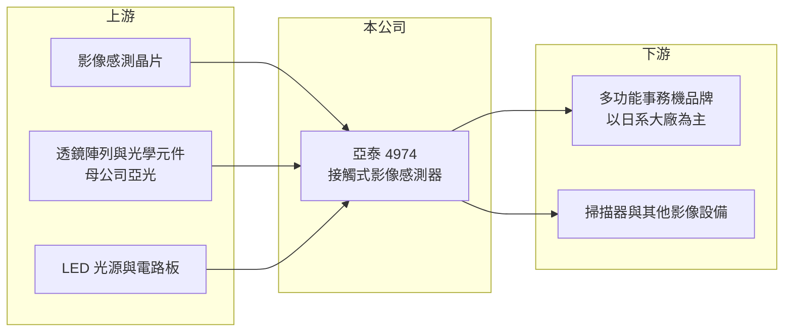

# 4974 亞泰

> 上櫃｜[[產業索引-電子零組件業|電子零組件業]]｜上市（櫃）日期 2011/11/29

# 第一章：企業模式與商業藍圖

> [!info] 撰寫說明
> 精簡版，由 Claude 依公開資料整理，架構比照 [[2330台積電]]，資料截至 2026-10-08。來源：櫃買中心開放資料（基本資料、2026 年第二季資產負債與綜合損益、股利）、Goodinfo 經營績效頁、nStock 公司頁。公開資料有限，營收比重、客戶與生產據點未查得，客戶與產地描述憑記憶整理。#待校對

亞泰影像是一家專注於單一利基產品的公司：它幾乎只做事務機裡用來「看」文件的接觸式影像感測器，因此它的命運和全球辦公事務機市場緊緊綁在一起。

- **核心業務：** 依 nStock 公司資料，亞泰的業務是製造與銷售 [[接觸式影像感測器]]（Contact Image Sensor），應用以 [[多功能事務機]] 為主。這是一條細長的感測模組，把光源、透鏡陣列與感光元件整合在一起，貼近紙面逐行讀取影像，是影印、掃描、傳真功能的核心零件。
- **母公司與定位：** 亞泰由光學元件廠 [[3019亞光]] 持股約 26%（2025 年與 2026 年 6 月底皆同），可借重亞光在光學鏡片與精密製造上的能力。亞泰本身則專注在感測模組的設計與量產，屬於「小而專精」的零組件供應商。
- **客戶與營運據點：** 多功能事務機市場由少數日系品牌主導，亞泰的客戶推估以日系事務機大廠為主（具名客戶待校對）。生產據點未查得，推估與亞光集團在中國的製造基地相關（待校對）。亞泰 2004 年設立、2011 年上櫃，實收資本額約 7.25 億元。
- **長期方向：** 辦公文件數位化讓全球事務機出貨長期緩步下滑，亞泰的長期挑戰是在萎縮的市場中維持份額，並把影像感測技術延伸到其他應用（例如工業檢測、金融票據或醫療掃描，屬推估方向，公司實際布局未查得）。在新應用出現之前，它更像一家高配息、低成長的現金型公司。

# 第二章：護城河深度與競爭優勢

亞泰的護城河來自高度專業化的產品、長期的日系客戶認證，以及市場本身規模不大、不吸引新進者。

- **競爭優勢：** 接觸式影像感測器需要同時處理光學、感測與機構的整合，事務機品牌一旦採用某家模組，會在整個機種平台沿用多年，換供應商需要重新驗證影像品質。市場規模有限，大型電子廠缺乏進入誘因，讓專業廠得以維持穩定的份額與約 16% 至 18% 的毛利率。
- **主要對手：** 同類產品的供應商包括台灣的 8249菱光，以及日本的事務機零件與光學元件廠（部分事務機品牌也可能自製，待校對）。亞泰與菱光是台灣在這個利基市場的兩家主要廠商。
- **觀察重點：** 第一是事務機市場的長期出貨趨勢，以及亞泰在主要客戶中的份額。第二是營業利益率能否維持在 11% 以上，這反映它在成熟市場中的成本控制。第三是公司如何運用大量現金，是持續高配息，還是投入新應用或併購。

# 第三章：財務體質與盈利規模

資料日期：2026-10-08，表格是撰寫當時的快照；最新月營收、毛利率、累計 EPS 由自動排程寫在本筆記的屬性欄位（月營收、毛利率、累計EPS 等）。#待校對

亞泰的財務特色是營收持平、利潤率穩定、資產負債表以現金為主，並長期維持高配息。

| 年度 | 營收（億元） | [[毛利率]] | [[營業利益率]] | EPS（元） | [[ROE]] |
|---|---|---|---|---|---|
| 2020 | 39.9 | 17.7% | 13.3% | 5.16 | 15.2% |
| 2021 | 41.9 | 16.9% | 12.2% | 5.87 | 16.4% |
| 2022 | 42.9 | 17.8% | 12.6% | 7.98 | 20.2% |
| 2023 | 35.4 | 16.3% | 11.1% | 5.64 | 13.5% |
| 2024 | 43.9 | 16.1% | 11.2% | 7.29 | 16.5% |
| 2025 | 37.1 | 15.8% | 11.1% | 5.16 | 11.2% |
| 2026 上半年 | 20.1 | 14.0% | 9.6% | 2.49 | 半年，不年化 |

（2020 至 2025 年取自 Goodinfo；2026 上半年依櫃買中心第二季綜合損益計算。）

- **營收規模：** 2020 至 2025 年營收在 35 億至 44 億元之間波動，2020 至 2025 年複合成長率約 -1.4%，符合成熟市場的特徵。年度間的起伏主要來自客戶的拉貨與庫存節奏，而非結構性成長或衰退。
- **獲利：** 毛利率長期維持在 16% 至 18%，營業利益率在 11% 至 13%，代表管銷費用極為精簡、營運效率高。EPS 在 5 至 8 元之間，2026 年上半年毛利率 14.0%、營益率 9.6%，略低於過去水準，需留意是否為匯率或價格壓力。
- **股利與資本效率：** 近五年（2021 至 2025）平均 ROE 約 15.6%。最近一次現金股利約 3.9 元，相對 2025 年 EPS 5.16 元，配息率約 76%（推算），長期以高配息回饋股東。2026 年第二季底總資產 48.0 億元中，流動資產就占 46.3 億元，非流動資產僅 1.6 億元，負債 15.2 億元、權益 32.8 億元，財務結構非常保守，幾乎不需資本支出。
- **[[ROIC]] 與 [[WACC]]：** 有息負債未查得，以股東權益近似投入資本。2025 年稅後營業利益約 37.1 億 × 11.1% × (1 − 20%) ≈ 3.3 億元，除以權益 32.8 億元，ROIC 約 10%（推算）。但亞泰的資產大多是現金、應收帳款與存貨，實際營運所需的固定資產極少，若扣除帳上現金（金額未查得），營運資產的報酬率會遠高於 10%。WACC 以 [[CAPM]] 推估：無風險利率 1.75%、市場風險溢酬 6%、β 取 0.9（低負債、營運穩定），股權成本約 7.2%；幾乎無長期負債，WACC 約 7%（推算）。ROIC 長期高於 WACC，代表本業持續創造價值，只是成長空間有限，因此把多數盈餘以股利發還股東是合理的資本配置。

# 第四章：總體風險與地緣政治

亞泰的風險集中在單一產品、單一終端市場與少數客戶的結構性依賴。

- **產業週期與長期萎縮：** 多功能事務機的出貨受企業辦公支出與數位化趨勢影響，長期呈緩步下滑。疫情期間遠距辦公加速無紙化，這種結構性變化不會因景氣循環而逆轉，亞泰的營收天花板因此受限。
- **客戶集中：** 事務機品牌數量少，前幾大客戶可能占營收很高比重（未查得具體數字），任何一家客戶改變採購策略、轉向自製或更換供應商，都會對營收造成明顯衝擊。
- **營運風險：** 產品單一，若技術規格出現變化（例如改用不同的影像擷取方式），既有產品可能被取代。母公司亞光持股約 26%，集團間的交易與資源分配也需要持續關注。
- **其他風險：** 營收以美元或日圓計價的比重可能不低（待校對），新台幣與日圓匯率變化會影響毛利率。生產若集中於中國，也面臨地緣政治與關稅風險。

# 專有名詞解析

## 金融

- **[[ROIC]]**：投入資本報酬率，衡量公司運用股東與債權人資金創造營業利潤的效率。
- **[[WACC]]**：加權平均資金成本，是股權與債權資金成本依資本結構加權後的平均值。
- **[[CAPM]]**：資本資產定價模型，用無風險利率加上 β 乘以市場風險溢酬來估算股東要求的報酬率。

## 產業

- **[[接觸式影像感測器]]**：整合光源、透鏡陣列與感光元件的細長模組，貼近紙面逐行掃描影像，用於事務機與掃描器。
- **[[多功能事務機]]**：結合影印、列印、掃描與傳真等功能的辦公設備。

# 核心供應鏈

- 上游：影像感測晶片、透鏡陣列與光學元件（母公司 [[3019亞光]]）、LED 光源與電路板供應商（其餘具名廠商未查得）。
- 下游／客戶：多功能事務機品牌（推估以日系大廠為主，具名客戶未查得），以及掃描器等影像設備廠。
- 同業：8249菱光、日本事務機零件廠。

## 最新新聞
<!-- news:start -->
<!-- news:end -->

## 相關連結
- [公開資訊觀測站](https://mopsov.twse.com.tw/mops/web/t05st03?step=1&firstin=1&co_id=4974)
- [Goodinfo](https://goodinfo.tw/tw/StockDetail.asp?STOCK_ID=4974)
- [Yahoo 股市](https://tw.stock.yahoo.com/quote/4974)
- [鉅亨網新聞](https://www.cnyes.com/twstock/4974/news)
